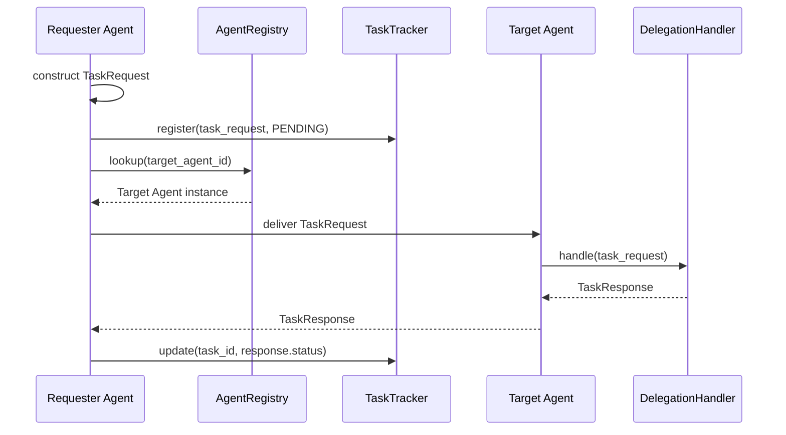
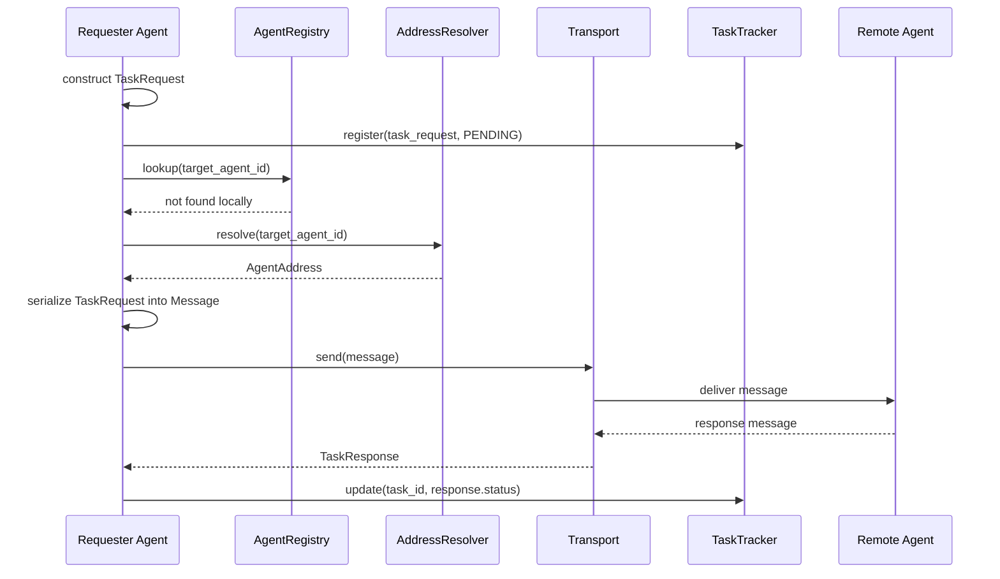
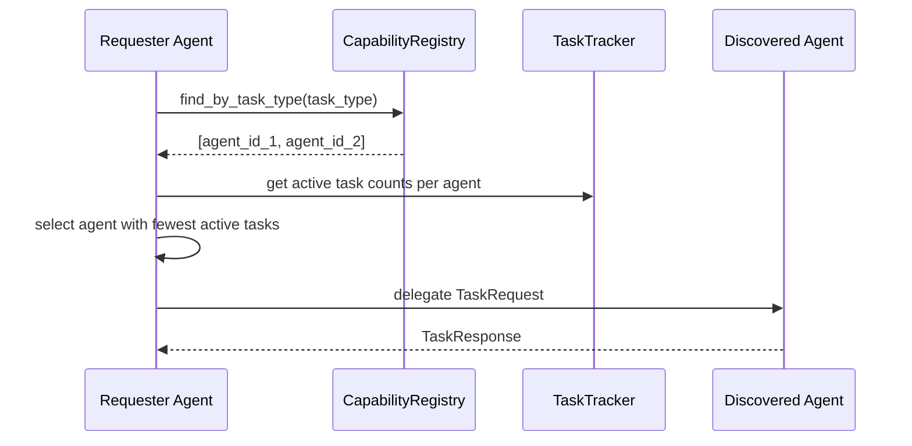
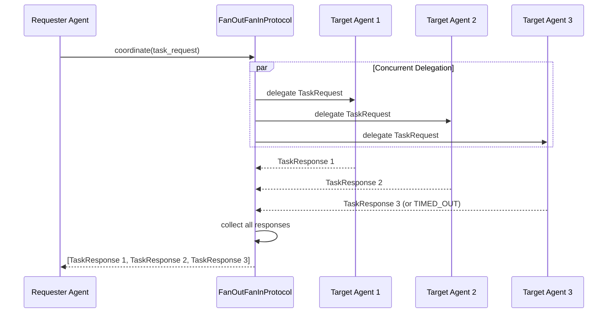

# Design Document — Agent Coordination

## Overview

The Agent Coordination feature extends the `automojo-agent-kit` SDK with higher-level multi-agent coordination primitives that build on top of the Core Agent Framework and Communication & Messaging systems. It defines:

1. **Task Request/Response Protocol** — `TaskRequest` and `TaskResponse` immutable data objects for structured task delegation with JSON round-trip serialization
2. **Task Status Enumeration** — `TaskStatus` enum defining the lifecycle states of delegated tasks (PENDING, ACCEPTED, RUNNING, COMPLETED, FAILED, TIMED_OUT, CANCELLED)
3. **Agent Capability System** — `AgentCapability` and `CapabilityAdvertisement` immutable objects for declaring and publishing agent capabilities
4. **Capability Registry** — `CapabilityRegistry` for thread-safe registration, deregistration, and lookup of agent capabilities by name, task type, or agent identifier
5. **Task Delegation API** — Extensions to the `Agent` base class with `delegate_task`, `delegate_task_by_capability`, and delegation handler registration methods
6. **Task Tracker** — `TaskTracker` for monitoring delegated task lifecycle, enforcing deadlines, and supporting cancellation
7. **Coordination Protocols** — `CoordinationProtocol` abstract base class with concrete implementations: `DirectDelegationProtocol`, `CapabilityRoutingProtocol`, `FanOutFanInProtocol`
8. **Task Queue** — `TaskQueue` for priority-ordered buffering of task requests when target agents are busy
9. **Coordination Configuration** — `CoordinationConfiguration` for declarative coordination settings with JSON/YAML serialization
10. **Delegation Handler** — `DelegationHandler` callback interface for processing incoming task requests
11. **Exception Hierarchy** — `TaskDelegationError`, `TaskTimeoutError`, `CapabilityNotFoundError`, `TaskQueueFullError` for precise error classification
12. **Structured Logging** — Logger hierarchy rooted at `automojo.agentkit.coordination`

All classes live under `source/packages/automojo/agentkit/` with filenames in all-lowercase (no underscores), following the project naming conventions. The coordination module is organized as a sub-package under `agentkit/coordination/`.

The system integrates with:

- Core Agent Framework — `Agent` base class, `AgentConfiguration`, `AgentIdentity`, `AgentRegistry`, `SemanticError`, `ConfigurationError`
- Communication & Messaging — `Message`, `Transport`, `AgentAddress`, `AddressResolver`, `MessagePattern` for remote agent communication
- Workflow & Orchestration — `WorkflowStep` (coordination can be used within workflow steps)
- Error Handling & Resilience — `RetryPolicy` for retry configuration on failed delegations
- `automojo-extension` — `ExtensionPoint` for plugin discovery of coordination protocols and delegation handlers
- `automojo-credentials` — `CredentialReference` for credential management during cross-agent delegation
- `automojo-this-app` — `AppContext` for settings, environment variables, and file path resolution

The design prioritizes debuggability over performance and readability over conciseness, per the project coding standards.

## Architecture

```mermaid
graph TD
    subgraph "automojo.agentkit.coordination"
        TaskRequest[TaskRequest]
        TaskResponse[TaskResponse]
        TaskStatus[TaskStatus enum]
        AgentCapability[AgentCapability]
        CapabilityAdvertisement[CapabilityAdvertisement]
        CapabilityRegistry[CapabilityRegistry]
        TaskTracker[TaskTracker]
        TaskQueue[TaskQueue]
        CoordinationConfiguration[CoordinationConfiguration]
        CoordinationErrors[TaskDelegationError / TaskTimeoutError / CapabilityNotFoundError / TaskQueueFullError]
    end

    subgraph "automojo.agentkit.coordination.protocols"
        CoordinationProtocol[CoordinationProtocol ABC]
        DirectDelegation[DirectDelegationProtocol]
        CapabilityRouting[CapabilityRoutingProtocol]
        FanOutFanIn[FanOutFanInProtocol]
    end

    subgraph "automojo.agentkit.coordination.handlers"
        DelegationHandler[DelegationHandler]
    end

    subgraph "Core Agent Framework"
        Agent[Agent base class]
        AgentIdentity[AgentIdentity]
        AgentRegistry[AgentRegistry singleton]
        AgentConfiguration[AgentConfiguration]
        Errors[SemanticError / ConfigurationError]
    end

    subgraph "Communication & Messaging"
        Message[Message]
        Transport[Transport]
        AgentAddress[AgentAddress]
        AddressResolver[AddressResolver]
    end

    subgraph "External Packages"
        Extension[automojo-extension]
        Credentials[automojo-credentials]
        ThisApp[automojo-this-app]
    end

    Agent --> TaskTracker
    Agent --> CapabilityRegistry
    Agent --> DelegationHandler
    Agent --> CoordinationConfiguration

    TaskTracker --> TaskRequest
    TaskTracker --> TaskStatus
    TaskTracker --> TaskResponse

    TaskQueue --> TaskRequest

    CoordinationProtocol --> TaskRequest
    CoordinationProtocol --> TaskResponse
    CoordinationProtocol --> CoordinationConfiguration

    DirectDelegation --> CoordinationProtocol
    CapabilityRouting --> CoordinationProtocol
    FanOutFanIn --> CoordinationProtocol

    DirectDelegation --> AddressResolver
    DirectDelegation --> Transport
    CapabilityRouting --> CapabilityRegistry
    CapabilityRouting --> TaskTracker
    FanOutFanIn --> Transport

    CapabilityRegistry --> CapabilityAdvertisement
    CapabilityRegistry --> AgentCapability
    CapabilityAdvertisement --> AgentCapability

    TaskResponse --> TaskStatus

    Agent --> AgentRegistry
    AddressResolver --> AgentAddress
    CoordinationConfiguration --> ThisApp
    Agent --> Extension
```



### Task Delegation Flow (Local Agent)



### Task Delegation Flow (Remote Agent)



### Capability-Based Routing Flow



### Fan-Out/Fan-In Flow



### Design Decisions

1. **Coordination module as a sub-package** — The coordination feature has enough classes to warrant a sub-package under `agentkit/coordination/` with further sub-packages for protocols and handlers. This keeps the file count per directory manageable while maintaining the all-lowercase no-underscore filename convention.

2. **Immutable data transfer objects** — `TaskRequest`, `TaskResponse`, `AgentCapability`, and `CapabilityAdvertisement` use read-only properties backed by private attributes set in `__init__`. This prevents accidental mutation and makes the objects safe to pass across agent boundaries and threads.

3. **TaskStatus as an enum with terminal state detection** — The `is_terminal` property on `TaskStatus` centralizes the definition of which states are final (COMPLETED, FAILED, TIMED_OUT, CANCELLED), avoiding scattered conditionals throughout the codebase.

4. **CapabilityRegistry as a per-agent instance (not singleton)** — Unlike `AgentRegistry` which is a singleton, each agent owns its own `CapabilityRegistry`. This avoids global state coupling and supports isolated testing. Agents share capability information through `CapabilityAdvertisement` messages.

5. **Local-first delegation with transport fallback** — The `delegate_task` method first checks the local `AgentRegistry` for the target agent. If found locally, the `TaskRequest` is delivered directly to the `DelegationHandler` without serialization or transport overhead. Only when the target is not local does the system serialize the `TaskRequest` into a `Message` and send it through the `Transport`. This optimizes the common case of co-located agents.

6. **Coordination protocols as strategy pattern** — `CoordinationProtocol` is an abstract base class with concrete implementations (`DirectDelegationProtocol`, `CapabilityRoutingProtocol`, `FanOutFanInProtocol`). New coordination strategies can be added via `automojo-extension` without modifying existing code.

7. **TaskTracker with thread-safe status management** — The `TaskTracker` uses `threading.Lock` to protect all status updates and queries. This ensures correctness when multiple threads delegate tasks concurrently.

8. **TaskQueue using heapq for priority ordering** — The `TaskQueue` uses Python's `heapq` module for efficient O(log n) enqueue and dequeue operations, with higher priority values dispatched first (negated for min-heap).

9. **DelegationHandler as a callable protocol** — Rather than requiring inheritance, `DelegationHandler` is defined as a callable that accepts a `TaskRequest` and returns a `TaskResponse`. This allows plain functions, lambdas, and class instances with `__call__` to serve as handlers.

10. **Serialization follows naming conventions** — `as_dict` for dictionary conversion, `to_json`/`to_yaml` for encoding, `from_dict`/`from_json`/`from_yaml` as class methods for deserialization, per the project naming conventions.

11. **Capability-based routing selects least-loaded agent** — When multiple agents support a task type, the `CapabilityRoutingProtocol` selects the agent with the fewest active tasks as reported by the `TaskTracker`. This provides simple load balancing without requiring a dedicated load balancer component.

12. **Fan-out/fan-in with optional aggregation** — The `FanOutFanInProtocol` returns a list of `TaskResponse` objects by default, but accepts an optional aggregator callable in the metadata to combine results into a single `TaskResponse`. This supports both raw collection and custom aggregation use cases.

13. **Structured logging under `automojo.agentkit.coordination`** — All coordination components log to the `automojo.agentkit.coordination` logger hierarchy, consistent with the logging patterns established in other SDK features.

## Components and Interfaces

### File Layout

| File | Class(es) | Purpose |
|---|---|---|
| `coordination/__init__.py` | — | Package init, exports public API |
| `coordination/taskstatus.py` | `TaskStatus` | Enum of task lifecycle states |
| `coordination/taskrequest.py` | `TaskRequest` | Immutable task request data object |
| `coordination/taskresponse.py` | `TaskResponse` | Immutable task response data object |
| `coordination/agentcapability.py` | `AgentCapability` | Immutable capability declaration |
| `coordination/capabilityadvertisement.py` | `CapabilityAdvertisement` | Immutable capability advertisement |
| `coordination/capabilityregistry.py` | `CapabilityRegistry` | Thread-safe capability registration and lookup |
| `coordination/tasktracker.py` | `TaskTracker` | Task lifecycle monitoring and timeout enforcement |
| `coordination/taskqueue.py` | `TaskQueue` | Priority-ordered task buffering |
| `coordination/coordinationconfiguration.py` | `CoordinationConfiguration` | Declarative coordination settings |
| `coordination/errors.py` | `TaskDelegationError`, `TaskTimeoutError`, `CapabilityNotFoundError`, `TaskQueueFullError` | Coordination exception hierarchy |
| `coordination/handlers/__init__.py` | — | Handlers sub-package init |
| `coordination/handlers/delegationhandler.py` | `DelegationHandler` | Callable interface for task handling |
| `coordination/protocols/__init__.py` | — | Protocols sub-package init |
| `coordination/protocols/coordinationprotocol.py` | `CoordinationProtocol` | Abstract coordination protocol base class |
| `coordination/protocols/directdelegationprotocol.py` | `DirectDelegationProtocol` | Direct agent-to-agent delegation |
| `coordination/protocols/capabilityroutingprotocol.py` | `CapabilityRoutingProtocol` | Capability-based agent discovery and routing |
| `coordination/protocols/fanoutfaninprotocol.py` | `FanOutFanInProtocol` | Concurrent multi-agent delegation |

### TaskStatus (Requirement 3)

```python
import enum

class TaskStatus(enum.Enum):
    """
        Enumeration of lifecycle states for a delegated task.
    """

    PENDING = "pending"
    ACCEPTED = "accepted"
    RUNNING = "running"
    COMPLETED = "completed"
    FAILED = "failed"
    TIMED_OUT = "timed_out"
    CANCELLED = "cancelled"

    TERMINAL_STATUSES = frozenset({"completed", "failed", "timed_out", "cancelled"})

    @property
    def is_terminal(self) -> bool:
        """
            Returns True when the status represents a terminal state
            (COMPLETED, FAILED, TIMED_OUT, CANCELLED).

            :returns: Boolean indicating terminal state.
        """
        rtnval = self.value in self.TERMINAL_STATUSES
        return rtnval

    @classmethod
    def from_string(cls, value: str) -> "TaskStatus":
        """
            Returns the TaskStatus member matching the given case-insensitive string.

            :param value: A string representing the task status.

            :returns: The matching TaskStatus member.
            :raises: SemanticError
        """
        normalized = value.strip().lower()
        for member in cls:
            if member.value == normalized:
                rtnval = member
                return rtnval

        valid_values = [m.value for m in cls]
        err_msg_lines = [
            "Invalid task status value '{}'.".format(value),
            "Valid task statuses: {}".format(valid_values)
        ]
        err_msg = os.linesep.join(err_msg_lines)
        raise SemanticError(err_msg)

    def __str__(self) -> str:
        rtnval = self.value
        return rtnval
```

### TaskRequest (Requirements 1, 18, 19)

```python
import json
import uuid
from datetime import datetime

class TaskRequest:
    """
        Immutable object representing a unit of work to be delegated from
        one agent to another. Contains a unique identifier, task type,
        parameters, priority, optional deadline, requester agent identifier,
        and optional metadata.
    """

    def __init__(self, task_type: str, parameters: dict,
                 requester_agent_id: str, priority: int = 0,
                 deadline: datetime = None, metadata: dict = None,
                 identifier: str = None):
        self._identifier = identifier if identifier is not None else str(uuid.uuid4())
        self._task_type = task_type
        self._parameters = dict(parameters) if parameters is not None else {}
        self._priority = priority
        self._deadline = deadline
        self._requester_agent_id = requester_agent_id
        self._metadata = dict(metadata) if metadata is not None else {}
        return

    @property
    def identifier(self) -> str:
        """
            Returns the unique identifier for this task request.

            :returns: String identifier.
        """
        rtnval = self._identifier
        return rtnval

    @property
    def task_type(self) -> str:
        """
            Returns the task type string.

            :returns: Task type string.
        """
        rtnval = self._task_type
        return rtnval

    @property
    def parameters(self) -> dict:
        """
            Returns a copy of the parameters dictionary.

            :returns: Dictionary of task parameters.
        """
        rtnval = dict(self._parameters)
        return rtnval

    @property
    def priority(self) -> int:
        """
            Returns the task priority integer.

            :returns: Priority integer.
        """
        rtnval = self._priority
        return rtnval

    @property
    def deadline(self) -> datetime:
        """
            Returns the optional deadline timestamp, or None.

            :returns: Deadline datetime or None.
        """
        rtnval = self._deadline
        return rtnval

    @property
    def requester_agent_id(self) -> str:
        """
            Returns the requester agent identifier string.

            :returns: Requester agent identifier.
        """
        rtnval = self._requester_agent_id
        return rtnval

    @property
    def metadata(self) -> dict:
        """
            Returns a copy of the metadata dictionary.

            :returns: Dictionary of metadata.
        """
        rtnval = dict(self._metadata)
        return rtnval

    def as_dict(self) -> dict:
        """
            Returns a dictionary representation of the task request fields.

            :returns: Dictionary of task request fields.
        """
        rtnval = {
            "identifier": self._identifier,
            "task_type": self._task_type,
            "parameters": dict(self._parameters),
            "priority": self._priority,
            "deadline": self._deadline.isoformat() if self._deadline is not None else None,
            "requester_agent_id": self._requester_agent_id,
            "metadata": dict(self._metadata)
        }
        return rtnval

    def to_json(self) -> str:
        """
            Returns a JSON string representation of the task request fields.

            :returns: JSON string.
        """
        rtnval = json.dumps(self.as_dict())
        return rtnval

    @classmethod
    def from_dict(cls, data: dict) -> "TaskRequest":
        """
            Constructs a TaskRequest from a dictionary.

            :param data: Dictionary containing task request fields.

            :returns: A TaskRequest instance.
        """
        deadline = None
        if data.get("deadline") is not None:
            deadline = datetime.fromisoformat(data["deadline"])

        rtnval = cls(
            task_type=data["task_type"],
            parameters=data.get("parameters", {}),
            requester_agent_id=data["requester_agent_id"],
            priority=data.get("priority", 0),
            deadline=deadline,
            metadata=data.get("metadata", {}),
            identifier=data.get("identifier")
        )
        return rtnval

    @classmethod
    def from_json(cls, json_str: str) -> "TaskRequest":
        """
            Deserializes a JSON string into a TaskRequest instance.

            :param json_str: JSON string.

            :returns: A TaskRequest instance.
        """
        data = json.loads(json_str)
        rtnval = cls.from_dict(data)
        return rtnval

    def __repr__(self) -> str:
        rtnval = "TaskRequest(identifier={}, task_type={}, priority={})".format(
            self._identifier, self._task_type, self._priority
        )
        return rtnval

    def __str__(self) -> str:
        rtnval = "TaskRequest: type={}, priority={}, requester={}".format(
            self._task_type, self._priority, self._requester_agent_id
        )
        return rtnval
```

### TaskResponse (Requirements 2, 18, 19)

```python
import json
from datetime import datetime, timezone

class TaskResponse:
    """
        Immutable object representing the outcome of a delegated task.
        Contains the task request identifier, task status, optional result,
        optional error information, responder agent identifier, and
        completion timestamp.
    """

    def __init__(self, task_request_id: str, status: TaskStatus,
                 responder_agent_id: str, result: dict = None,
                 error_info: dict = None, completion_timestamp: datetime = None):
        self._task_request_id = task_request_id
        self._status = status
        self._result = dict(result) if result is not None else None
        self._error_info = dict(error_info) if error_info is not None else None
        self._responder_agent_id = responder_agent_id
        self._completion_timestamp = completion_timestamp if completion_timestamp is not None else datetime.now(timezone.utc)
        return

    @property
    def task_request_id(self) -> str:
        """
            Returns the task request identifier string.

            :returns: Task request identifier.
        """
        rtnval = self._task_request_id
        return rtnval

    @property
    def status(self) -> TaskStatus:
        """
            Returns the task status value.

            :returns: TaskStatus enum member.
        """
        rtnval = self._status
        return rtnval

    @property
    def result(self) -> dict:
        """
            Returns a copy of the result dictionary, or None.

            :returns: Result dictionary or None.
        """
        rtnval = dict(self._result) if self._result is not None else None
        return rtnval

    @property
    def error_info(self) -> dict:
        """
            Returns a copy of the error information dictionary, or None.

            :returns: Error information dictionary or None.
        """
        rtnval = dict(self._error_info) if self._error_info is not None else None
        return rtnval

    @property
    def responder_agent_id(self) -> str:
        """
            Returns the responder agent identifier string.

            :returns: Responder agent identifier.
        """
        rtnval = self._responder_agent_id
        return rtnval

    @property
    def completion_timestamp(self) -> datetime:
        """
            Returns the completion timestamp.

            :returns: Completion datetime.
        """
        rtnval = self._completion_timestamp
        return rtnval

    @property
    def is_success(self) -> bool:
        """
            Returns True when the task status is COMPLETED.

            :returns: Boolean indicating success.
        """
        rtnval = self._status == TaskStatus.COMPLETED
        return rtnval

    def as_dict(self) -> dict:
        """
            Returns a dictionary representation of the task response fields.

            :returns: Dictionary of task response fields.
        """
        rtnval = {
            "task_request_id": self._task_request_id,
            "status": self._status.value,
            "result": dict(self._result) if self._result is not None else None,
            "error_info": dict(self._error_info) if self._error_info is not None else None,
            "responder_agent_id": self._responder_agent_id,
            "completion_timestamp": self._completion_timestamp.isoformat()
        }
        return rtnval

    def to_json(self) -> str:
        """
            Returns a JSON string representation of the task response fields.

            :returns: JSON string.
        """
        rtnval = json.dumps(self.as_dict())
        return rtnval

    @classmethod
    def from_dict(cls, data: dict) -> "TaskResponse":
        """
            Constructs a TaskResponse from a dictionary.

            :param data: Dictionary containing task response fields.

            :returns: A TaskResponse instance.
        """
        status = TaskStatus.from_string(data["status"])
        completion_timestamp = datetime.fromisoformat(data["completion_timestamp"])
        rtnval = cls(
            task_request_id=data["task_request_id"],
            status=status,
            responder_agent_id=data["responder_agent_id"],
            result=data.get("result"),
            error_info=data.get("error_info"),
            completion_timestamp=completion_timestamp
        )
        return rtnval

    @classmethod
    def from_json(cls, json_str: str) -> "TaskResponse":
        """
            Deserializes a JSON string into a TaskResponse instance.

            :param json_str: JSON string.

            :returns: A TaskResponse instance.
        """
        data = json.loads(json_str)
        rtnval = cls.from_dict(data)
        return rtnval

    def __repr__(self) -> str:
        rtnval = "TaskResponse(task_request_id={}, status={})".format(
            self._task_request_id, self._status.value
        )
        return rtnval

    def __str__(self) -> str:
        rtnval = "TaskResponse: request_id={}, status={}, responder={}".format(
            self._task_request_id, self._status.value, self._responder_agent_id
        )
        return rtnval
```

### AgentCapability (Requirements 4, 18, 19)

```python
import json

class AgentCapability:
    """
        Immutable object representing a capability that an agent can perform.
        Contains a capability name, description, set of supported task types,
        input schema, output schema, and optional metadata.
    """

    def __init__(self, capability_name: str, description: str,
                 supported_task_types: set, input_schema: dict = None,
                 output_schema: dict = None, metadata: dict = None):
        self._capability_name = capability_name
        self._description = description
        self._supported_task_types = frozenset(supported_task_types) if supported_task_types is not None else frozenset()
        self._input_schema = dict(input_schema) if input_schema is not None else {}
        self._output_schema = dict(output_schema) if output_schema is not None else {}
        self._metadata = dict(metadata) if metadata is not None else {}
        return

    @property
    def capability_name(self) -> str:
        """
            Returns the capability name string.

            :returns: Capability name.
        """
        rtnval = self._capability_name
        return rtnval

    @property
    def description(self) -> str:
        """
            Returns the capability description string.

            :returns: Description string.
        """
        rtnval = self._description
        return rtnval

    @property
    def supported_task_types(self) -> frozenset:
        """
            Returns the frozenset of supported task type strings.

            :returns: Frozenset of task type strings.
        """
        rtnval = self._supported_task_types
        return rtnval

    @property
    def input_schema(self) -> dict:
        """
            Returns a copy of the input schema dictionary.

            :returns: Input schema dictionary.
        """
        rtnval = dict(self._input_schema)
        return rtnval

    @property
    def output_schema(self) -> dict:
        """
            Returns a copy of the output schema dictionary.

            :returns: Output schema dictionary.
        """
        rtnval = dict(self._output_schema)
        return rtnval

    @property
    def metadata(self) -> dict:
        """
            Returns a copy of the metadata dictionary.

            :returns: Metadata dictionary.
        """
        rtnval = dict(self._metadata)
        return rtnval

    def supports_task_type(self, task_type: str) -> bool:
        """
            Returns True when the given task type is in the set of
            supported task types.

            :param task_type: Task type string to check.

            :returns: Boolean indicating support.
        """
        rtnval = task_type in self._supported_task_types
        return rtnval

    def as_dict(self) -> dict:
        """
            Returns a dictionary representation of the capability fields.

            :returns: Dictionary of capability fields.
        """
        rtnval = {
            "capability_name": self._capability_name,
            "description": self._description,
            "supported_task_types": sorted(list(self._supported_task_types)),
            "input_schema": dict(self._input_schema),
            "output_schema": dict(self._output_schema),
            "metadata": dict(self._metadata)
        }
        return rtnval

    def to_json(self) -> str:
        """
            Returns a JSON string representation of the capability fields.

            :returns: JSON string.
        """
        rtnval = json.dumps(self.as_dict())
        return rtnval

    @classmethod
    def from_dict(cls, data: dict) -> "AgentCapability":
        """
            Constructs an AgentCapability from a dictionary.

            :param data: Dictionary containing capability fields.

            :returns: An AgentCapability instance.
        """
        rtnval = cls(
            capability_name=data["capability_name"],
            description=data.get("description", ""),
            supported_task_types=set(data.get("supported_task_types", [])),
            input_schema=data.get("input_schema", {}),
            output_schema=data.get("output_schema", {}),
            metadata=data.get("metadata", {})
        )
        return rtnval

    @classmethod
    def from_json(cls, json_str: str) -> "AgentCapability":
        """
            Deserializes a JSON string into an AgentCapability instance.

            :param json_str: JSON string.

            :returns: An AgentCapability instance.
        """
        data = json.loads(json_str)
        rtnval = cls.from_dict(data)
        return rtnval

    def __repr__(self) -> str:
        rtnval = "AgentCapability(capability_name={}, task_types={})".format(
            self._capability_name, len(self._supported_task_types)
        )
        return rtnval

    def __str__(self) -> str:
        types_list = sorted(list(self._supported_task_types))
        rtnval = "AgentCapability: name={}, description={}, task_types={}".format(
            self._capability_name, self._description, types_list
        )
        return rtnval
```

### CapabilityAdvertisement (Requirements 5, 18, 19)

```python
import json
from datetime import datetime, timezone

class CapabilityAdvertisement:
    """
        Immutable object representing an agent's published set of capabilities.
        Contains the agent identifier, a list of AgentCapability objects,
        and a timestamp.
    """

    def __init__(self, agent_id: str, capabilities: list,
                 timestamp: datetime = None):
        self._agent_id = agent_id
        self._capabilities = list(capabilities) if capabilities is not None else []
        self._timestamp = timestamp if timestamp is not None else datetime.now(timezone.utc)
        return

    @property
    def agent_id(self) -> str:
        """
            Returns the agent identifier string.

            :returns: Agent identifier.
        """
        rtnval = self._agent_id
        return rtnval

    @property
    def capabilities(self) -> list:
        """
            Returns a copy of the capabilities list.

            :returns: List of AgentCapability objects.
        """
        rtnval = list(self._capabilities)
        return rtnval

    @property
    def timestamp(self) -> datetime:
        """
            Returns the advertisement timestamp.

            :returns: Timestamp datetime.
        """
        rtnval = self._timestamp
        return rtnval

    def as_dict(self) -> dict:
        """
            Returns a dictionary representation of the advertisement fields.

            :returns: Dictionary of advertisement fields.
        """
        rtnval = {
            "agent_id": self._agent_id,
            "capabilities": [cap.as_dict() for cap in self._capabilities],
            "timestamp": self._timestamp.isoformat()
        }
        return rtnval

    def to_json(self) -> str:
        """
            Returns a JSON string representation of the advertisement fields.

            :returns: JSON string.
        """
        rtnval = json.dumps(self.as_dict())
        return rtnval

    @classmethod
    def from_dict(cls, data: dict) -> "CapabilityAdvertisement":
        """
            Constructs a CapabilityAdvertisement from a dictionary.

            :param data: Dictionary containing advertisement fields.

            :returns: A CapabilityAdvertisement instance.
        """
        capabilities = [AgentCapability.from_dict(cap) for cap in data.get("capabilities", [])]
        timestamp = datetime.fromisoformat(data["timestamp"])
        rtnval = cls(
            agent_id=data["agent_id"],
            capabilities=capabilities,
            timestamp=timestamp
        )
        return rtnval

    @classmethod
    def from_json(cls, json_str: str) -> "CapabilityAdvertisement":
        """
            Deserializes a JSON string into a CapabilityAdvertisement instance.

            :param json_str: JSON string.

            :returns: A CapabilityAdvertisement instance.
        """
        data = json.loads(json_str)
        rtnval = cls.from_dict(data)
        return rtnval

    def __repr__(self) -> str:
        rtnval = "CapabilityAdvertisement(agent_id={}, capabilities={})".format(
            self._agent_id, len(self._capabilities)
        )
        return rtnval

    def __str__(self) -> str:
        cap_names = [cap.capability_name for cap in self._capabilities]
        rtnval = "CapabilityAdvertisement: agent={}, capabilities={}".format(
            self._agent_id, cap_names
        )
        return rtnval
```

### CapabilityRegistry (Requirements 6, 19, 21)

```python
import logging
import threading

logger = logging.getLogger("automojo.agentkit.coordination")

class CapabilityRegistry:
    """
        Thread-safe registry that tracks AgentCapability advertisements
        from agents. Provides lookup by capability name, task type, and
        agent identifier. Uses threading.Lock for concurrent access
        protection.
    """

    def __init__(self):
        self._advertisements: dict = {}
        self._lock = threading.Lock()
        return

    def register(self, advertisement: CapabilityAdvertisement) -> None:
        """
            Registers a CapabilityAdvertisement, replacing any previous
            registration for the same agent identifier.

            :param advertisement: The CapabilityAdvertisement to register.
        """
        with self._lock:
            self._advertisements[advertisement.agent_id] = advertisement
        logger.info(
            "Capability registered: agent=%s, capabilities=%s",
            advertisement.agent_id,
            [cap.capability_name for cap in advertisement.capabilities]
        )
        return

    def deregister(self, agent_id: str) -> None:
        """
            Removes the capability registration for the given agent identifier.

            :param agent_id: Agent identifier string.
        """
        with self._lock:
            if agent_id in self._advertisements:
                del self._advertisements[agent_id]
        logger.info("Capability deregistered: agent=%s", agent_id)
        return

    def find_by_capability_name(self, capability_name: str) -> list:
        """
            Returns a list of agent identifier strings that have registered
            the specified capability name.

            :param capability_name: Capability name to search for.

            :returns: List of agent identifier strings.
        """
        with self._lock:
            result = []
            for agent_id, advert in self._advertisements.items():
                for cap in advert.capabilities:
                    if cap.capability_name == capability_name:
                        result.append(agent_id)
                        break
            rtnval = result
            return rtnval

    def find_by_task_type(self, task_type: str) -> list:
        """
            Returns a list of agent identifier strings that have registered
            a capability supporting the specified task type.

            :param task_type: Task type string to search for.

            :returns: List of agent identifier strings.
        """
        with self._lock:
            result = []
            for agent_id, advert in self._advertisements.items():
                for cap in advert.capabilities:
                    if cap.supports_task_type(task_type):
                        result.append(agent_id)
                        break
            rtnval = result
            return rtnval

    def get_advertisement(self, agent_id: str) -> CapabilityAdvertisement:
        """
            Returns the CapabilityAdvertisement for the given agent identifier,
            or None when not found.

            :param agent_id: Agent identifier string.

            :returns: CapabilityAdvertisement or None.
        """
        with self._lock:
            rtnval = self._advertisements.get(agent_id)
            return rtnval

    def list_all(self) -> list:
        """
            Returns a list of all registered CapabilityAdvertisement objects.

            :returns: List of CapabilityAdvertisement objects.
        """
        with self._lock:
            rtnval = list(self._advertisements.values())
            return rtnval

    @property
    def agent_count(self) -> int:
        """
            Returns the count of registered agents.

            :returns: Integer count.
        """
        with self._lock:
            rtnval = len(self._advertisements)
            return rtnval

    def has_capability(self, capability_name: str) -> bool:
        """
            Returns True when any agent has registered the specified
            capability name.

            :param capability_name: Capability name to check.

            :returns: Boolean indicating presence.
        """
        result = self.find_by_capability_name(capability_name)
        rtnval = len(result) > 0
        return rtnval

    def has_task_type(self, task_type: str) -> bool:
        """
            Returns True when any agent has registered a capability
            supporting the specified task type.

            :param task_type: Task type string to check.

            :returns: Boolean indicating presence.
        """
        result = self.find_by_task_type(task_type)
        rtnval = len(result) > 0
        return rtnval

    def __repr__(self) -> str:
        rtnval = "CapabilityRegistry(agent_count={})".format(self.agent_count)
        return rtnval

    def __str__(self) -> str:
        with self._lock:
            entries = []
            for agent_id, advert in self._advertisements.items():
                cap_names = [cap.capability_name for cap in advert.capabilities]
                entries.append("{}={}".format(agent_id, cap_names))
        rtnval = "CapabilityRegistry: [{}]".format(", ".join(entries))
        return rtnval
```

### TaskTracker (Requirements 8, 19, 21)

```python
import logging
import threading
from datetime import datetime, timezone

logger = logging.getLogger("automojo.agentkit.coordination")

class TaskTracker:
    """
        Monitors all delegated tasks for an agent, maintaining a registry
        of active TaskRequest objects and their current TaskStatus values.
        Supports status queries, cancellation, and timeout enforcement.
        Thread-safe via threading.Lock.
    """

    def __init__(self):
        self._tasks: dict = {}
        self._statuses: dict = {}
        self._responses: dict = {}
        self._lock = threading.Lock()
        return

    def register(self, task_request: TaskRequest) -> None:
        """
            Registers a TaskRequest with an initial status of PENDING.

            :param task_request: The TaskRequest to track.
        """
        with self._lock:
            self._tasks[task_request.identifier] = task_request
            self._statuses[task_request.identifier] = TaskStatus.PENDING
        logger.info(
            "Task registered: id=%s, type=%s, requester=%s",
            task_request.identifier, task_request.task_type,
            task_request.requester_agent_id
        )
        return

    def update_status(self, task_request_id: str, response: TaskResponse) -> None:
        """
            Updates the TaskStatus for a tracked task based on the
            received TaskResponse.

            :param task_request_id: The task request identifier.
            :param response: The TaskResponse containing the new status.
        """
        with self._lock:
            self._statuses[task_request_id] = response.status
            self._responses[task_request_id] = response
        logger.info(
            "Task status updated: id=%s, status=%s, responder=%s",
            task_request_id, response.status.value, response.responder_agent_id
        )
        return

    def get_status(self, task_request_id: str) -> TaskStatus:
        """
            Returns the current TaskStatus for the given task request
            identifier, or None when not tracked.

            :param task_request_id: The task request identifier.

            :returns: TaskStatus or None.
        """
        with self._lock:
            rtnval = self._statuses.get(task_request_id)
            return rtnval

    def get_task(self, task_request_id: str) -> TaskRequest:
        """
            Returns the TaskRequest for the given identifier, or None
            when not tracked.

            :param task_request_id: The task request identifier.

            :returns: TaskRequest or None.
        """
        with self._lock:
            rtnval = self._tasks.get(task_request_id)
            return rtnval

    def get_active_tasks(self) -> list:
        """
            Returns a list of TaskRequest objects with non-terminal
            TaskStatus values.

            :returns: List of active TaskRequest objects.
        """
        with self._lock:
            result = []
            for task_id, status in self._statuses.items():
                if not status.is_terminal:
                    result.append(self._tasks[task_id])
            rtnval = result
            return rtnval

    def get_completed_tasks(self) -> list:
        """
            Returns a list of TaskRequest objects with terminal
            TaskStatus values.

            :returns: List of completed TaskRequest objects.
        """
        with self._lock:
            result = []
            for task_id, status in self._statuses.items():
                if status.is_terminal:
                    result.append(self._tasks[task_id])
            rtnval = result
            return rtnval

    def cancel_task(self, task_request_id: str) -> None:
        """
            Cancels a tracked task by updating its status to CANCELLED.

            :param task_request_id: The task request identifier.

            :raises: SemanticError
        """
        with self._lock:
            if task_request_id not in self._tasks:
                err_msg_lines = [
                    "Cannot cancel unknown task request.",
                    "Task request identifier: '{}'".format(task_request_id)
                ]
                err_msg = os.linesep.join(err_msg_lines)
                raise SemanticError(err_msg)
            self._statuses[task_request_id] = TaskStatus.CANCELLED
        logger.info("Task cancelled: id=%s", task_request_id)
        return

    def check_timeouts(self) -> list:
        """
            Checks all tracked tasks for deadline expiration. Updates
            the status to TIMED_OUT for any task whose deadline has
            passed without a terminal response. Returns a list of
            timed-out task request identifiers.

            :returns: List of timed-out task request identifier strings.
            :raises: TaskTimeoutError
        """
        now = datetime.now(timezone.utc)
        timed_out_ids = []
        with self._lock:
            for task_id, task in self._tasks.items():
                status = self._statuses[task_id]
                if not status.is_terminal and task.deadline is not None:
                    if now >= task.deadline:
                        self._statuses[task_id] = TaskStatus.TIMED_OUT
                        timed_out_ids.append(task_id)
                        logger.warning(
                            "Task timed out: id=%s, type=%s, deadline=%s",
                            task_id, task.task_type, task.deadline.isoformat()
                        )

        for task_id in timed_out_ids:
            task = self._tasks[task_id]
            err_msg_lines = [
                "Task exceeded configured deadline.",
                "Task request identifier: '{}'".format(task_id),
                "Task type: '{}'".format(task.task_type),
                "Deadline: '{}'".format(task.deadline.isoformat())
            ]
            err_msg = os.linesep.join(err_msg_lines)
            raise TaskTimeoutError(
                err_msg,
                task_request_id=task_id,
                timeout_duration=None
            )

        rtnval = timed_out_ids
        return rtnval

    @property
    def active_count(self) -> int:
        """
            Returns the count of active (non-terminal) tasks.

            :returns: Integer count.
        """
        with self._lock:
            count = 0
            for status in self._statuses.values():
                if not status.is_terminal:
                    count += 1
            rtnval = count
            return rtnval

    @property
    def total_count(self) -> int:
        """
            Returns the count of total tracked tasks.

            :returns: Integer count.
        """
        with self._lock:
            rtnval = len(self._tasks)
            return rtnval

    def __repr__(self) -> str:
        rtnval = "TaskTracker(active={}, total={})".format(
            self.active_count, self.total_count
        )
        return rtnval

    def __str__(self) -> str:
        with self._lock:
            active = 0
            completed = 0
            failed = 0
            for status in self._statuses.values():
                if not status.is_terminal:
                    active += 1
                elif status == TaskStatus.COMPLETED:
                    completed += 1
                elif status == TaskStatus.FAILED:
                    failed += 1
        rtnval = "TaskTracker: active={}, completed={}, failed={}".format(
            active, completed, failed
        )
        return rtnval
```

### TaskQueue (Requirements 13, 19, 21)

```python
import heapq
import logging
import threading

logger = logging.getLogger("automojo.agentkit.coordination")

class TaskQueue:
    """
        Priority-ordered queue that buffers TaskRequest objects when target
        agents are busy. Higher priority values are dispatched first.
        Thread-safe via threading.Lock.
    """

    def __init__(self, max_capacity: int = 100):
        self._max_capacity = max_capacity
        self._heap: list = []
        self._counter = 0
        self._lock = threading.Lock()
        return

    def enqueue(self, task_request: TaskRequest) -> None:
        """
            Adds a TaskRequest to the queue in priority order.

            :param task_request: The TaskRequest to enqueue.

            :raises: TaskQueueFullError
        """
        with self._lock:
            if len(self._heap) >= self._max_capacity:
                err_msg_lines = [
                    "Task queue has reached maximum capacity.",
                    "Current size: {}".format(len(self._heap)),
                    "Maximum capacity: {}".format(self._max_capacity)
                ]
                err_msg = os.linesep.join(err_msg_lines)
                raise TaskQueueFullError(err_msg)

            # Negate priority for max-heap behavior with heapq (min-heap)
            entry = (-task_request.priority, self._counter, task_request)
            heapq.heappush(self._heap, entry)
            self._counter += 1

        logger.debug(
            "Task enqueued: id=%s, type=%s, priority=%s, queue_size=%s",
            task_request.identifier, task_request.task_type,
            task_request.priority, self.size
        )
        return

    def dequeue(self) -> TaskRequest:
        """
            Removes and returns the highest-priority TaskRequest from the
            queue, or None when the queue is empty.

            :returns: TaskRequest or None.
        """
        with self._lock:
            if len(self._heap) == 0:
                rtnval = None
                return rtnval
            neg_priority, counter, task_request = heapq.heappop(self._heap)
            rtnval = task_request
            return rtnval

    def peek(self) -> TaskRequest:
        """
            Returns the highest-priority TaskRequest without removing it
            from the queue, or None when the queue is empty.

            :returns: TaskRequest or None.
        """
        with self._lock:
            if len(self._heap) == 0:
                rtnval = None
                return rtnval
            neg_priority, counter, task_request = self._heap[0]
            rtnval = task_request
            return rtnval

    def remove(self, task_request_id: str) -> bool:
        """
            Removes the TaskRequest with the given identifier from the queue.

            :param task_request_id: The task request identifier to remove.

            :returns: True when found and removed, False otherwise.
        """
        with self._lock:
            for i, entry in enumerate(self._heap):
                neg_priority, counter, task_request = entry
                if task_request.identifier == task_request_id:
                    self._heap.pop(i)
                    heapq.heapify(self._heap)
                    rtnval = True
                    return rtnval
            rtnval = False
            return rtnval

    @property
    def size(self) -> int:
        """
            Returns the current queue size.

            :returns: Integer size.
        """
        with self._lock:
            rtnval = len(self._heap)
            return rtnval

    @property
    def max_capacity(self) -> int:
        """
            Returns the maximum capacity.

            :returns: Integer capacity.
        """
        rtnval = self._max_capacity
        return rtnval

    @property
    def is_empty(self) -> bool:
        """
            Returns True when the queue is empty.

            :returns: Boolean indicating empty state.
        """
        with self._lock:
            rtnval = len(self._heap) == 0
            return rtnval

    def __repr__(self) -> str:
        rtnval = "TaskQueue(size={}, max_capacity={})".format(
            self.size, self._max_capacity
        )
        return rtnval

    def __str__(self) -> str:
        top_type = None
        with self._lock:
            if len(self._heap) > 0:
                neg_priority, counter, task_request = self._heap[0]
                top_type = task_request.task_type
        rtnval = "TaskQueue: size={}, capacity={}, top_type={}".format(
            self.size, self._max_capacity, top_type
        )
        return rtnval
```

### CoordinationConfiguration (Requirements 14, 18, 19)

```python
import json
import yaml

class CoordinationConfiguration:
    """
        Configuration object defining default coordination settings including
        task timeout, task priority, maximum concurrent delegations, task
        queue capacity, and retry policy.
    """

    DEFAULT_TIMEOUT = 60.0
    DEFAULT_PRIORITY = 0
    DEFAULT_MAX_CONCURRENT = 10
    DEFAULT_QUEUE_CAPACITY = 100

    def __init__(self, default_timeout: float = 60.0,
                 default_priority: int = 0,
                 max_concurrent_delegations: int = 10,
                 task_queue_capacity: int = 100,
                 retry_policy: dict = None):
        self._validate_timeout(default_timeout)
        self._validate_max_concurrent(max_concurrent_delegations)
        self._validate_queue_capacity(task_queue_capacity)

        self._default_timeout = default_timeout
        self._default_priority = default_priority
        self._max_concurrent_delegations = max_concurrent_delegations
        self._task_queue_capacity = task_queue_capacity
        self._retry_policy = dict(retry_policy) if retry_policy is not None else None
        return

    def _validate_timeout(self, value: float) -> None:
        """
            Validates that the timeout is greater than zero.

            :param value: Timeout value to validate.

            :raises: ConfigurationError
        """
        if value <= 0:
            err_msg_lines = [
                "Invalid default task timeout value.",
                "Timeout must be greater than zero, got: {}".format(value)
            ]
            err_msg = os.linesep.join(err_msg_lines)
            raise ConfigurationError(err_msg)
        return

    def _validate_max_concurrent(self, value: int) -> None:
        """
            Validates that max concurrent delegations is at least one.

            :param value: Max concurrent value to validate.

            :raises: ConfigurationError
        """
        if value < 1:
            err_msg_lines = [
                "Invalid maximum concurrent delegations value.",
                "Must be at least 1, got: {}".format(value)
            ]
            err_msg = os.linesep.join(err_msg_lines)
            raise ConfigurationError(err_msg)
        return

    def _validate_queue_capacity(self, value: int) -> None:
        """
            Validates that task queue capacity is at least one.

            :param value: Queue capacity value to validate.

            :raises: ConfigurationError
        """
        if value < 1:
            err_msg_lines = [
                "Invalid task queue capacity value.",
                "Must be at least 1, got: {}".format(value)
            ]
            err_msg = os.linesep.join(err_msg_lines)
            raise ConfigurationError(err_msg)
        return

    @property
    def default_timeout(self) -> float:
        """
            Returns the default task timeout in seconds.

            :returns: Timeout float.
        """
        rtnval = self._default_timeout
        return rtnval

    @property
    def default_priority(self) -> int:
        """
            Returns the default task priority.

            :returns: Priority integer.
        """
        rtnval = self._default_priority
        return rtnval

    @property
    def max_concurrent_delegations(self) -> int:
        """
            Returns the maximum concurrent delegations.

            :returns: Integer count.
        """
        rtnval = self._max_concurrent_delegations
        return rtnval

    @property
    def task_queue_capacity(self) -> int:
        """
            Returns the task queue capacity.

            :returns: Integer capacity.
        """
        rtnval = self._task_queue_capacity
        return rtnval

    @property
    def retry_policy(self) -> dict:
        """
            Returns a copy of the retry policy dictionary, or None.

            :returns: Retry policy dictionary or None.
        """
        rtnval = dict(self._retry_policy) if self._retry_policy is not None else None
        return rtnval

    def as_dict(self) -> dict:
        """
            Returns a dictionary representation of the configuration fields.

            :returns: Dictionary of configuration fields.
        """
        rtnval = {
            "default_timeout": self._default_timeout,
            "default_priority": self._default_priority,
            "max_concurrent_delegations": self._max_concurrent_delegations,
            "task_queue_capacity": self._task_queue_capacity,
            "retry_policy": dict(self._retry_policy) if self._retry_policy is not None else None
        }
        return rtnval

    def to_json(self) -> str:
        """
            Returns a JSON string representation of the configuration fields.

            :returns: JSON string.
        """
        rtnval = json.dumps(self.as_dict())
        return rtnval

    def to_yaml(self) -> str:
        """
            Returns a YAML string representation of the configuration fields.

            :returns: YAML string.
        """
        rtnval = yaml.dump(self.as_dict(), default_flow_style=False)
        return rtnval

    @classmethod
    def from_dict(cls, data: dict) -> "CoordinationConfiguration":
        """
            Constructs a CoordinationConfiguration from a dictionary.

            :param data: Dictionary containing configuration fields.

            :returns: A CoordinationConfiguration instance.
            :raises: ConfigurationError
        """
        rtnval = cls(
            default_timeout=data.get("default_timeout", cls.DEFAULT_TIMEOUT),
            default_priority=data.get("default_priority", cls.DEFAULT_PRIORITY),
            max_concurrent_delegations=data.get("max_concurrent_delegations", cls.DEFAULT_MAX_CONCURRENT),
            task_queue_capacity=data.get("task_queue_capacity", cls.DEFAULT_QUEUE_CAPACITY),
            retry_policy=data.get("retry_policy")
        )
        return rtnval

    @classmethod
    def from_json(cls, json_str: str) -> "CoordinationConfiguration":
        """
            Deserializes a JSON string into a CoordinationConfiguration instance.

            :param json_str: JSON string.

            :returns: A CoordinationConfiguration instance.
            :raises: ConfigurationError
        """
        data = json.loads(json_str)
        rtnval = cls.from_dict(data)
        return rtnval

    @classmethod
    def from_yaml(cls, yaml_str: str) -> "CoordinationConfiguration":
        """
            Deserializes a YAML string into a CoordinationConfiguration instance.

            :param yaml_str: YAML string.

            :returns: A CoordinationConfiguration instance.
            :raises: ConfigurationError
        """
        data = yaml.safe_load(yaml_str)
        rtnval = cls.from_dict(data)
        return rtnval

    @classmethod
    def from_json_file(cls, file_path: str, app_context=None) -> "CoordinationConfiguration":
        """
            Loads configuration from a JSON file, resolving the path relative
            to the AppContext directory.

            :param file_path: Path to the JSON configuration file.
            :param app_context: Optional AppContext for path resolution.

            :returns: A CoordinationConfiguration instance.
            :raises: ConfigurationError
        """
        resolved_path = file_path
        if app_context is not None:
            resolved_path = os.path.join(app_context.directory, file_path)
        with open(resolved_path, "r") as f:
            content = f.read()
        rtnval = cls.from_json(content)
        return rtnval

    @classmethod
    def from_yaml_file(cls, file_path: str, app_context=None) -> "CoordinationConfiguration":
        """
            Loads configuration from a YAML file, resolving the path relative
            to the AppContext directory.

            :param file_path: Path to the YAML configuration file.
            :param app_context: Optional AppContext for path resolution.

            :returns: A CoordinationConfiguration instance.
            :raises: ConfigurationError
        """
        resolved_path = file_path
        if app_context is not None:
            resolved_path = os.path.join(app_context.directory, file_path)
        with open(resolved_path, "r") as f:
            content = f.read()
        rtnval = cls.from_yaml(content)
        return rtnval

    def __repr__(self) -> str:
        rtnval = "CoordinationConfiguration(timeout={}, max_concurrent={})".format(
            self._default_timeout, self._max_concurrent_delegations
        )
        return rtnval

    def __str__(self) -> str:
        rtnval = "CoordinationConfiguration: timeout={}, priority={}, max_concurrent={}, queue_capacity={}".format(
            self._default_timeout, self._default_priority,
            self._max_concurrent_delegations, self._task_queue_capacity
        )
        return rtnval
```

### DelegationHandler (Requirement 15)

```python
from typing import Callable

# DelegationHandler is defined as a callable type alias
DelegationHandler = Callable[["TaskRequest"], "TaskResponse"]
```

The `DelegationHandler` is a callable that accepts a `TaskRequest` and returns a `TaskResponse`. It can be implemented as:
- A plain function
- A lambda expression
- A class instance with a `__call__` method

The `Agent` base class stores a single `DelegationHandler` reference. When an incoming `TaskRequest` is received, the agent invokes the handler. If the handler raises an exception, the agent catches it and returns a `TaskResponse` with `TaskStatus.FAILED` and an error information dictionary containing the exception type and message.

### CoordinationProtocol (Requirement 9, 19)

```python
import abc

class CoordinationProtocol(abc.ABC):
    """
        Abstract base class defining the protocol for agents to negotiate
        task assignments, report progress, and handle failures. Concrete
        implementations provide specific coordination strategies.
    """

    def __init__(self, protocol_name: str):
        if protocol_name is None or len(protocol_name.strip()) == 0:
            err_msg = "CoordinationProtocol requires a non-empty protocol name."
            raise SemanticError(err_msg)
        self._protocol_name = protocol_name
        return

    @property
    def protocol_name(self) -> str:
        """
            Returns the protocol name string.

            :returns: Protocol name.
        """
        rtnval = self._protocol_name
        return rtnval

    @abc.abstractmethod
    def coordinate(self, task_request: TaskRequest,
                   configuration: CoordinationConfiguration) -> object:
        """
            Executes the coordination strategy for the given task request.
            Returns a TaskResponse or a list of TaskResponse objects
            depending on the protocol implementation.

            :param task_request: The TaskRequest to coordinate.
            :param configuration: The CoordinationConfiguration.

            :returns: TaskResponse or list of TaskResponse objects.
        """
        ...

    def __repr__(self) -> str:
        rtnval = "{}(protocol_name={})".format(
            self.__class__.__name__, self._protocol_name
        )
        return rtnval

    def __str__(self) -> str:
        rtnval = "{}: protocol={}".format(
            self.__class__.__name__, self._protocol_name
        )
        return rtnval
```

### DirectDelegationProtocol (Requirement 10)

```python
import logging

logger = logging.getLogger("automojo.agentkit.coordination")

class DirectDelegationProtocol(CoordinationProtocol):
    """
        Coordination protocol that delegates a task directly to a specified
        target agent by identifier. Uses the AddressResolver to resolve
        the target agent's address and the Transport to deliver the task.
    """

    def __init__(self, address_resolver, transport, agent_registry=None):
        super().__init__(protocol_name="direct")
        self._address_resolver = address_resolver
        self._transport = transport
        self._agent_registry = agent_registry
        return

    def coordinate(self, task_request: TaskRequest,
                   configuration: CoordinationConfiguration) -> TaskResponse:
        """
            Delegates the task directly to the target agent specified in
            the task request metadata under the key "target_agent_id".

            :param task_request: The TaskRequest to delegate.
            :param configuration: The CoordinationConfiguration.

            :returns: A TaskResponse from the target agent.
            :raises: TaskDelegationError
        """
        target_agent_id = task_request.metadata.get("target_agent_id")
        if target_agent_id is None:
            err_msg_lines = [
                "DirectDelegationProtocol requires 'target_agent_id' in task request metadata.",
                "Task request identifier: '{}'".format(task_request.identifier)
            ]
            err_msg = os.linesep.join(err_msg_lines)
            raise TaskDelegationError(
                err_msg,
                target_agent_id=None,
                task_request_id=task_request.identifier
            )

        logger.info(
            "Direct delegation: task_id=%s, target=%s, type=%s",
            task_request.identifier, target_agent_id, task_request.task_type
        )

        # Check local registry first
        if self._agent_registry is not None:
            local_agent = self._agent_registry.lookup(target_agent_id)
            if local_agent is not None:
                rtnval = self._delegate_local(task_request, local_agent)
                return rtnval

        # Fall back to remote delegation via transport
        try:
            address = self._address_resolver.resolve(target_agent_id)
            rtnval = self._delegate_remote(task_request, address, configuration)
            return rtnval
        except Exception as ex:
            err_msg_lines = [
                "Failed to delegate task to target agent.",
                "Target agent identifier: '{}'".format(target_agent_id),
                "Error: {}".format(str(ex))
            ]
            err_msg = os.linesep.join(err_msg_lines)
            raise TaskDelegationError(
                err_msg,
                target_agent_id=target_agent_id,
                task_request_id=task_request.identifier,
                cause=ex
            )

    def _delegate_local(self, task_request: TaskRequest, target_agent) -> TaskResponse:
        """
            Delivers the TaskRequest directly to the local agent's
            DelegationHandler.

            :param task_request: The TaskRequest to deliver.
            :param target_agent: The local Agent instance.

            :returns: A TaskResponse.
        """
        ...

    def _delegate_remote(self, task_request: TaskRequest, address,
                         configuration: CoordinationConfiguration) -> TaskResponse:
        """
            Serializes the TaskRequest into a Message and sends it
            through the Transport to the target agent's address.

            :param task_request: The TaskRequest to send.
            :param address: The AgentAddress of the target.
            :param configuration: The CoordinationConfiguration.

            :returns: A TaskResponse.
        """
        ...
```

### CapabilityRoutingProtocol (Requirement 11)

```python
import logging

logger = logging.getLogger("automojo.agentkit.coordination")

class CapabilityRoutingProtocol(CoordinationProtocol):
    """
        Coordination protocol that discovers an agent capable of handling
        a task type through the CapabilityRegistry and delegates the task
        to the discovered agent. Selects the agent with the fewest active
        tasks for load balancing.
    """

    def __init__(self, capability_registry: CapabilityRegistry,
                 task_tracker: TaskTracker,
                 address_resolver, transport, agent_registry=None):
        super().__init__(protocol_name="capability_routing")
        self._capability_registry = capability_registry
        self._task_tracker = task_tracker
        self._address_resolver = address_resolver
        self._transport = transport
        self._agent_registry = agent_registry
        return

    def coordinate(self, task_request: TaskRequest,
                   configuration: CoordinationConfiguration) -> TaskResponse:
        """
            Discovers an agent supporting the task type and delegates
            the task. Selects the least-loaded agent when multiple
            candidates exist.

            :param task_request: The TaskRequest to coordinate.
            :param configuration: The CoordinationConfiguration.

            :returns: A TaskResponse from the selected agent.
            :raises: CapabilityNotFoundError, TaskDelegationError
        """
        task_type = task_request.task_type
        agent_ids = self._capability_registry.find_by_task_type(task_type)

        if len(agent_ids) == 0:
            err_msg_lines = [
                "No agent found with capability supporting task type.",
                "Task type: '{}'".format(task_type)
            ]
            err_msg = os.linesep.join(err_msg_lines)
            raise CapabilityNotFoundError(err_msg, task_type=task_type)

        # Select agent with fewest active tasks
        sorted_agents = self._sort_by_load(agent_ids)

        logger.info(
            "Capability routing: task_id=%s, type=%s, candidates=%s, selected=%s",
            task_request.identifier, task_type, agent_ids, sorted_agents[0]
        )

        # Try agents in order of load until one succeeds
        last_error = None
        for agent_id in sorted_agents:
            try:
                metadata = dict(task_request.metadata)
                metadata["target_agent_id"] = agent_id
                routed_request = TaskRequest(
                    task_type=task_request.task_type,
                    parameters=task_request.parameters,
                    requester_agent_id=task_request.requester_agent_id,
                    priority=task_request.priority,
                    deadline=task_request.deadline,
                    metadata=metadata,
                    identifier=task_request.identifier
                )
                direct = DirectDelegationProtocol(
                    address_resolver=self._address_resolver,
                    transport=self._transport,
                    agent_registry=self._agent_registry
                )
                rtnval = direct.coordinate(routed_request, configuration)
                return rtnval
            except TaskDelegationError as ex:
                last_error = ex
                logger.warning(
                    "Capability routing fallback: agent=%s failed, trying next. Error: %s",
                    agent_id, str(ex)
                )
                continue

        err_msg_lines = [
            "All capable agents failed to accept the task.",
            "Task type: '{}'".format(task_type),
            "Attempted agents: {}".format(sorted_agents)
        ]
        err_msg = os.linesep.join(err_msg_lines)
        raise TaskDelegationError(
            err_msg,
            task_request_id=task_request.identifier,
            cause=last_error
        )

    def _sort_by_load(self, agent_ids: list) -> list:
        """
            Sorts agent identifiers by their active task count (ascending).

            :param agent_ids: List of agent identifier strings.

            :returns: Sorted list of agent identifier strings.
        """
        ...
```

### FanOutFanInProtocol (Requirement 12)

```python
import concurrent.futures
import logging
from datetime import datetime, timezone

logger = logging.getLogger("automojo.agentkit.coordination")

class FanOutFanInProtocol(CoordinationProtocol):
    """
        Coordination protocol that delegates the same task to multiple
        agents concurrently and collects all results. Supports optional
        result aggregation via a callable in the task request metadata.
    """

    def __init__(self, address_resolver, transport, agent_registry=None):
        super().__init__(protocol_name="fan_out_fan_in")
        self._address_resolver = address_resolver
        self._transport = transport
        self._agent_registry = agent_registry
        return

    def coordinate(self, task_request: TaskRequest,
                   configuration: CoordinationConfiguration) -> list:
        """
            Delegates the task to all specified target agents concurrently
            and collects all responses. Returns a list of TaskResponse
            objects, or a single aggregated TaskResponse if an aggregator
            callable is provided in the metadata.

            :param task_request: The TaskRequest to fan out.
            :param configuration: The CoordinationConfiguration.

            :returns: List of TaskResponse objects, or a single TaskResponse
                      if an aggregator is provided.
            :raises: TaskDelegationError
        """
        target_agent_ids = task_request.metadata.get("target_agent_ids")
        if target_agent_ids is None or len(target_agent_ids) == 0:
            err_msg_lines = [
                "FanOutFanInProtocol requires 'target_agent_ids' in task request metadata.",
                "Task request identifier: '{}'".format(task_request.identifier)
            ]
            err_msg = os.linesep.join(err_msg_lines)
            raise TaskDelegationError(
                err_msg,
                task_request_id=task_request.identifier
            )

        logger.info(
            "Fan-out: task_id=%s, type=%s, targets=%s",
            task_request.identifier, task_request.task_type, target_agent_ids
        )

        timeout = configuration.default_timeout
        responses = []

        with concurrent.futures.ThreadPoolExecutor() as executor:
            future_to_agent = {}
            for agent_id in target_agent_ids:
                future = executor.submit(
                    self._delegate_to_agent, task_request, agent_id, configuration
                )
                future_to_agent[future] = agent_id

            for future in concurrent.futures.as_completed(future_to_agent, timeout=timeout):
                agent_id = future_to_agent[future]
                try:
                    response = future.result()
                    responses.append(response)
                except Exception as ex:
                    timed_out_response = TaskResponse(
                        task_request_id=task_request.identifier,
                        status=TaskStatus.TIMED_OUT,
                        responder_agent_id=agent_id,
                        error_info={"error": str(ex)}
                    )
                    responses.append(timed_out_response)

        # Handle agents that did not respond within timeout
        responded_agents = {r.responder_agent_id for r in responses}
        for agent_id in target_agent_ids:
            if agent_id not in responded_agents:
                timed_out_response = TaskResponse(
                    task_request_id=task_request.identifier,
                    status=TaskStatus.TIMED_OUT,
                    responder_agent_id=agent_id,
                    error_info={"error": "Agent did not respond within timeout"}
                )
                responses.append(timed_out_response)

        logger.info(
            "Fan-in: task_id=%s, collected=%s responses",
            task_request.identifier, len(responses)
        )

        # Apply optional aggregator
        aggregator = task_request.metadata.get("aggregator")
        if aggregator is not None and callable(aggregator):
            rtnval = aggregator(responses)
            return rtnval

        rtnval = responses
        return rtnval

    def _delegate_to_agent(self, task_request: TaskRequest,
                           agent_id: str,
                           configuration: CoordinationConfiguration) -> TaskResponse:
        """
            Delegates the task to a single agent using DirectDelegationProtocol.

            :param task_request: The TaskRequest to delegate.
            :param agent_id: The target agent identifier.
            :param configuration: The CoordinationConfiguration.

            :returns: A TaskResponse.
        """
        metadata = dict(task_request.metadata)
        metadata["target_agent_id"] = agent_id
        routed_request = TaskRequest(
            task_type=task_request.task_type,
            parameters=task_request.parameters,
            requester_agent_id=task_request.requester_agent_id,
            priority=task_request.priority,
            deadline=task_request.deadline,
            metadata=metadata,
            identifier=task_request.identifier
        )
        direct = DirectDelegationProtocol(
            address_resolver=self._address_resolver,
            transport=self._transport,
            agent_registry=self._agent_registry
        )
        rtnval = direct.coordinate(routed_request, configuration)
        return rtnval
```

### Agent Coordination Integration (Requirements 7, 20)

The `Agent` base class (defined in Core Agent Framework) is extended with coordination support:

```python
# Additions to the Agent base class

class Agent(abc.ABC):
    def __init__(self, configuration: AgentConfiguration):
        # ... existing initialization ...
        self._task_tracker = TaskTracker()
        self._capability_registry = CapabilityRegistry()
        self._delegation_handler: DelegationHandler = None
        self._coordination_configuration: CoordinationConfiguration = None
        self._coordination_protocols: list = []

        # Load coordination configuration from AgentConfiguration if present
        coord_config_data = configuration.options.get("coordination")
        if coord_config_data is not None:
            self._coordination_configuration = CoordinationConfiguration.from_dict(coord_config_data)
        else:
            self._coordination_configuration = CoordinationConfiguration()

        # Discover and load coordination extensions
        self._coordination_protocols = self._load_coordination_extensions()
        return

    @property
    def task_tracker(self) -> TaskTracker:
        """
            Returns the TaskTracker instance associated with this agent.

            :returns: The TaskTracker instance.
        """
        rtnval = self._task_tracker
        return rtnval

    @property
    def capability_registry(self) -> CapabilityRegistry:
        """
            Returns the CapabilityRegistry instance associated with this agent.

            :returns: The CapabilityRegistry instance.
        """
        rtnval = self._capability_registry
        return rtnval

    @property
    def coordination_protocols(self) -> list:
        """
            Returns the list of loaded CoordinationProtocol extensions.

            :returns: List of CoordinationProtocol instances.
        """
        rtnval = list(self._coordination_protocols)
        return rtnval

    def delegate_task(self, task_request: TaskRequest,
                      target_agent_id: str,
                      timeout: float = None) -> TaskResponse:
        """
            Delegates a task to the specified target agent. Checks the
            local AgentRegistry first for direct delivery, falling back
            to remote transport delivery.

            :param task_request: The TaskRequest to delegate.
            :param target_agent_id: The target agent identifier string.
            :param timeout: Optional timeout in seconds, overriding the
                            default from CoordinationConfiguration.

            :returns: A TaskResponse from the target agent.
            :raises: TaskDelegationError, TaskTimeoutError
        """
        self._task_tracker.register(task_request)

        coord_logger = logging.getLogger(
            "automojo.agentkit.coordination.{}".format(self.identity.identifier)
        )
        coord_logger.info(
            "Delegating task: id=%s, type=%s, target=%s",
            task_request.identifier, task_request.task_type, target_agent_id
        )

        # Check local registry
        local_agent = AgentRegistry.instance().lookup(target_agent_id)
        if local_agent is not None:
            response = self._delegate_local(task_request, local_agent)
        else:
            response = self._delegate_remote(task_request, target_agent_id, timeout)

        self._task_tracker.update_status(task_request.identifier, response)

        coord_logger.info(
            "Task response received: id=%s, status=%s, responder=%s",
            task_request.identifier, response.status.value, response.responder_agent_id
        )

        rtnval = response
        return rtnval

    def delegate_task_by_capability(self, task_request: TaskRequest,
                                     capability_name: str) -> TaskResponse:
        """
            Discovers an agent with the specified capability and delegates
            the task to the discovered agent.

            :param task_request: The TaskRequest to delegate.
            :param capability_name: The capability name to search for.

            :returns: A TaskResponse from the discovered agent.
            :raises: CapabilityNotFoundError, TaskDelegationError
        """
        agent_ids = self._capability_registry.find_by_capability_name(capability_name)
        if len(agent_ids) == 0:
            err_msg_lines = [
                "No agent found with the requested capability.",
                "Capability name: '{}'".format(capability_name)
            ]
            err_msg = os.linesep.join(err_msg_lines)
            raise CapabilityNotFoundError(err_msg, capability_name=capability_name)

        # Select agent with fewest active tasks
        selected_agent_id = agent_ids[0]
        rtnval = self.delegate_task(task_request, selected_agent_id)
        return rtnval

    def register_delegation_handler(self, handler: DelegationHandler) -> None:
        """
            Registers a DelegationHandler callback for processing incoming
            TaskRequest objects.

            :param handler: The DelegationHandler callable.
        """
        self._delegation_handler = handler
        return

    def deregister_delegation_handler(self) -> None:
        """
            Removes the registered DelegationHandler callback.
        """
        self._delegation_handler = None
        return

    def handle_incoming_task(self, task_request: TaskRequest) -> TaskResponse:
        """
            Processes an incoming TaskRequest by invoking the registered
            DelegationHandler. Returns a TaskResponse with FAILED status
            if no handler is registered or if the handler raises an exception.

            :param task_request: The incoming TaskRequest.

            :returns: A TaskResponse.
        """
        coord_logger = logging.getLogger(
            "automojo.agentkit.coordination.{}".format(self.identity.identifier)
        )

        if self._delegation_handler is None:
            err_info = {"error": "No delegation handler registered on agent."}
            rtnval = TaskResponse(
                task_request_id=task_request.identifier,
                status=TaskStatus.FAILED,
                responder_agent_id=self.identity.identifier,
                error_info=err_info
            )
            return rtnval

        try:
            rtnval = self._delegation_handler(task_request)
            return rtnval
        except Exception as ex:
            coord_logger.error(
                "DelegationHandler raised exception: task_id=%s, error=%s",
                task_request.identifier, str(ex)
            )
            err_info = {
                "exception_type": type(ex).__name__,
                "exception_message": str(ex)
            }
            rtnval = TaskResponse(
                task_request_id=task_request.identifier,
                status=TaskStatus.FAILED,
                responder_agent_id=self.identity.identifier,
                error_info=err_info
            )
            return rtnval

    def get_coordination_logger(self) -> logging.Logger:
        """
            Returns a logger instance scoped to this agent's coordination
            subsystem.

            :returns: Logger instance.
        """
        rtnval = logging.getLogger(
            "automojo.agentkit.coordination.{}".format(self.identity.identifier)
        )
        return rtnval

    def _delegate_local(self, task_request: TaskRequest,
                        target_agent) -> TaskResponse:
        """
            Delivers the TaskRequest directly to the local agent's
            DelegationHandler without using transport.

            :param task_request: The TaskRequest to deliver.
            :param target_agent: The local Agent instance.

            :returns: A TaskResponse.
        """
        rtnval = target_agent.handle_incoming_task(task_request)
        return rtnval

    def _delegate_remote(self, task_request: TaskRequest,
                         target_agent_id: str,
                         timeout: float = None) -> TaskResponse:
        """
            Serializes the TaskRequest into a Message and sends it
            through the Communication & Messaging transport.

            :param task_request: The TaskRequest to send.
            :param target_agent_id: The target agent identifier.
            :param timeout: Optional timeout in seconds.

            :returns: A TaskResponse.
            :raises: TaskDelegationError
        """
        ...

    def _load_coordination_extensions(self) -> list:
        """
            Discovers and loads CoordinationProtocol implementations
            from the automojo-extension ExtensionPoint.

            :returns: List of CoordinationProtocol instances.
        """
        ...
```

### Exception Hierarchy (Requirement 16)

```python
class TaskDelegationError(AgentKitError):
    """
        Raised when a task delegation operation fails due to a communication
        error, target agent unavailability, or protocol error.
    """

    def __init__(self, message: str, cause: Exception = None,
                 target_agent_id: str = None,
                 task_request_id: str = None):
        super().__init__(message)
        self._cause = cause
        self._target_agent_id = target_agent_id
        self._task_request_id = task_request_id
        return

    @property
    def cause(self) -> Exception:
        rtnval = self._cause
        return rtnval

    @property
    def target_agent_id(self) -> str:
        rtnval = self._target_agent_id
        return rtnval

    @property
    def task_request_id(self) -> str:
        rtnval = self._task_request_id
        return rtnval

    def __repr__(self) -> str:
        rtnval = "TaskDelegationError(message={}, target_agent_id={}, task_request_id={})".format(
            str(self), self._target_agent_id, self._task_request_id
        )
        return rtnval


class TaskTimeoutError(AgentKitError):
    """
        Raised when a delegated task exceeds the configured timeout duration
        without completing.
    """

    def __init__(self, message: str, cause: Exception = None,
                 task_request_id: str = None,
                 timeout_duration: float = None):
        super().__init__(message)
        self._cause = cause
        self._task_request_id = task_request_id
        self._timeout_duration = timeout_duration
        return

    @property
    def cause(self) -> Exception:
        rtnval = self._cause
        return rtnval

    @property
    def task_request_id(self) -> str:
        rtnval = self._task_request_id
        return rtnval

    @property
    def timeout_duration(self) -> float:
        rtnval = self._timeout_duration
        return rtnval

    def __repr__(self) -> str:
        rtnval = "TaskTimeoutError(message={}, task_request_id={}, timeout_duration={})".format(
            str(self), self._task_request_id, self._timeout_duration
        )
        return rtnval


class CapabilityNotFoundError(AgentKitError):
    """
        Raised when no agent with the requested capability or task type
        can be found in the CapabilityRegistry.
    """

    def __init__(self, message: str, cause: Exception = None,
                 capability_name: str = None,
                 task_type: str = None):
        super().__init__(message)
        self._cause = cause
        self._capability_name = capability_name
        self._task_type = task_type
        return

    @property
    def cause(self) -> Exception:
        rtnval = self._cause
        return rtnval

    @property
    def capability_name(self) -> str:
        rtnval = self._capability_name
        return rtnval

    @property
    def task_type(self) -> str:
        rtnval = self._task_type
        return rtnval

    def __repr__(self) -> str:
        rtnval = "CapabilityNotFoundError(message={}, capability_name={}, task_type={})".format(
            str(self), self._capability_name, self._task_type
        )
        return rtnval


class TaskQueueFullError(AgentKitError):
    """
        Raised when a TaskQueue has reached its configured capacity and
        cannot accept additional TaskRequest objects.
    """

    def __init__(self, message: str, cause: Exception = None):
        super().__init__(message)
        self._cause = cause
        return

    @property
    def cause(self) -> Exception:
        rtnval = self._cause
        return rtnval

    def __repr__(self) -> str:
        rtnval = "TaskQueueFullError(message={})".format(str(self))
        return rtnval
```

### Extension Point Integration (Requirement 20)

The framework defines two `ExtensionPoint` entries through `automojo-extension`:

1. `"automojo.agentkit.coordination.protocols"` — For registering `CoordinationProtocol` implementations
2. `"automojo.agentkit.coordination.handlers"` — For registering `DelegationHandler` callbacks

- During `Agent.__init__`, the agent discovers all registered coordination extensions from the extension points
- If a plugin provides a `CoordinationProtocol`, it is added to the agent's `coordination_protocols` list
- If a plugin provides a `DelegationHandler`, it is registered as the agent's delegation handler
- If a plugin fails to load, the failure is logged at WARNING level with the plugin name and error detail, and remaining plugins continue loading

### Structured Logging (Requirement 17)

All coordination components use the Python standard `logging` module with a logger hierarchy rooted at `automojo.agentkit.coordination`:

| Logger Name | Component |
|---|---|
| `automojo.agentkit.coordination` | Root coordination logger |
| `automojo.agentkit.coordination.<agent_id>` | Per-agent coordination logger |
| `automojo.agentkit.coordination.protocols` | CoordinationProtocol subclasses |
| `automojo.agentkit.coordination.registry` | CapabilityRegistry |
| `automojo.agentkit.coordination.tracker` | TaskTracker |
| `automojo.agentkit.coordination.queue` | TaskQueue |

Logging levels:
- **INFO** — Task delegation, task response receipt, capability registration/deregistration, protocol coordination
- **WARNING** — Task timeout, capability lookup failure, agent fallback during routing
- **ERROR** — DelegationHandler exception
- **DEBUG** — Task enqueue/dequeue, queue size changes

## Data Models

### TaskStatus Values

| Member | String Value | Terminal |
|---|---|---|
| PENDING | "pending" | No |
| ACCEPTED | "accepted" | No |
| RUNNING | "running" | No |
| COMPLETED | "completed" | Yes |
| FAILED | "failed" | Yes |
| TIMED_OUT | "timed_out" | Yes |
| CANCELLED | "cancelled" | Yes |

### TaskRequest Schema

```python
{
    "identifier": str,              # Required. UUID string, auto-generated if not provided
    "task_type": str,               # Required. Task type identifier
    "parameters": {str: any},       # Required. Task parameters dictionary
    "priority": int,                # Optional. Default 0, higher values = higher priority
    "deadline": str,                # Optional. ISO 8601 timestamp or None
    "requester_agent_id": str,      # Required. Requester agent identifier
    "metadata": {str: any}          # Optional. Arbitrary metadata dictionary
}
```

### TaskResponse Schema

```python
{
    "task_request_id": str,         # Required. Matching TaskRequest identifier
    "status": str,                  # Required. One of TaskStatus values
    "result": {str: any},           # Optional. Result data dictionary
    "error_info": {str: any},       # Optional. Error information dictionary
    "responder_agent_id": str,      # Required. Responder agent identifier
    "completion_timestamp": str     # Required. ISO 8601 timestamp, auto-set to UTC now
}
```

### AgentCapability Schema

```python
{
    "capability_name": str,         # Required. Capability name identifier
    "description": str,             # Required. Human-readable description
    "supported_task_types": [str],  # Required. List of supported task type strings
    "input_schema": {str: any},     # Optional. Input validation schema
    "output_schema": {str: any},    # Optional. Output validation schema
    "metadata": {str: any}          # Optional. Arbitrary metadata dictionary
}
```

### CapabilityAdvertisement Schema

```python
{
    "agent_id": str,                # Required. Agent identifier
    "capabilities": [AgentCapability],  # Required. List of capability dictionaries
    "timestamp": str                # Required. ISO 8601 timestamp, auto-set to UTC now
}
```

### CoordinationConfiguration Schema

```python
{
    "default_timeout": float,       # Optional. Default 60.0 seconds, must be > 0
    "default_priority": int,        # Optional. Default 0
    "max_concurrent_delegations": int,  # Optional. Default 10, must be >= 1
    "task_queue_capacity": int,     # Optional. Default 100, must be >= 1
    "retry_policy": {str: any}      # Optional. Retry policy configuration
}
```

### Coordination Protocol Metadata Keys

| Protocol | Metadata Key | Type | Description |
|---|---|---|---|
| DirectDelegationProtocol | `target_agent_id` | str | Target agent identifier (required) |
| FanOutFanInProtocol | `target_agent_ids` | list[str] | List of target agent identifiers (required) |
| FanOutFanInProtocol | `aggregator` | callable | Optional result aggregation function |

## Error Handling

### TaskDelegationError
Raised when a task delegation operation fails. Includes a descriptive message, optional cause exception, optional target agent identifier, and optional task request identifier. Used for:
- Target agent unreachable via transport (includes target agent identifier, task request identifier, underlying error)
- Missing required metadata in coordination protocol (includes task request identifier)
- All capable agents failed during capability routing (includes task type, attempted agents)

### TaskTimeoutError
Raised when a delegated task exceeds the configured timeout duration:
- Task deadline passed without terminal response (includes task request identifier, task type, deadline timestamp)
- Remote delegation timeout (includes task request identifier, timeout duration)

### CapabilityNotFoundError
Raised when no agent with the requested capability or task type can be found:
- No agent registered for capability name (includes capability name)
- No agent registered for task type (includes task type)

### TaskQueueFullError
Raised when the TaskQueue has reached its maximum capacity:
- Queue at capacity when enqueue is called (includes current size, maximum capacity)

### ConfigurationError
Raised for CoordinationConfiguration problems:
- Invalid default timeout (value <= 0)
- Invalid max concurrent delegations (value < 1)
- Invalid task queue capacity (value < 1)
- Missing or unreadable configuration file

### SemanticError
Raised for API misuse (never caught by library code):
- Invalid `TaskStatus.from_string` value (lists valid values)
- Cancelling an unknown task request identifier in TaskTracker
- Empty protocol name in CoordinationProtocol constructor

Error messages follow the multi-line formation pattern: build a list of lines, join with `os.linesep`, assign to a variable for debugger visibility, then raise.

## Testing Strategy

### Testing Framework

Tests use `testbase` and reside under `source/testroots/automojo/tests/singlehost/agentkit/coordination/`, mirroring the source hierarchy:

| Source File | Test File |
|---|---|
| `coordination/taskstatus.py` | `coordination/test_taskstatus.py` |
| `coordination/taskrequest.py` | `coordination/test_taskrequest.py` |
| `coordination/taskresponse.py` | `coordination/test_taskresponse.py` |
| `coordination/agentcapability.py` | `coordination/test_agentcapability.py` |
| `coordination/capabilityadvertisement.py` | `coordination/test_capabilityadvertisement.py` |
| `coordination/capabilityregistry.py` | `coordination/test_capabilityregistry.py` |
| `coordination/tasktracker.py` | `coordination/test_tasktracker.py` |
| `coordination/taskqueue.py` | `coordination/test_taskqueue.py` |
| `coordination/coordinationconfiguration.py` | `coordination/test_coordinationconfiguration.py` |
| `coordination/errors.py` | `coordination/test_errors.py` |
| `coordination/protocols/directdelegationprotocol.py` | `coordination/protocols/test_directdelegationprotocol.py` |
| `coordination/protocols/capabilityroutingprotocol.py` | `coordination/protocols/test_capabilityroutingprotocol.py` |
| `coordination/protocols/fanoutfaninprotocol.py` | `coordination/protocols/test_fanoutfaninprotocol.py` |

### Dual Testing Approach

- **Unit tests**: Specific examples, edge cases, error conditions, integration with external packages (using `automojo.testbase.mocking.Mock`)
- **Property-based tests**: Universal properties across randomly generated inputs using Hypothesis

### Property-Based Testing Configuration

- Library: Hypothesis for Python property-based testing
- Minimum 100 iterations per property test
- Each test tagged: `Feature: agent-coordination, Property N: title`
- Each correctness property implemented by a single property-based test
- Hypothesis strategies generate random task types, parameters, priorities, deadlines, agent identifiers, capability names, task type sets, and configuration values

### Unit Test Focus Areas

- `TaskStatus.from_string` with valid and invalid inputs
- `TaskStatus.is_terminal` for all enum members
- `TaskRequest` construction with and without explicit identifier, deadline, metadata
- `TaskResponse` construction with and without explicit completion timestamp
- `TaskResponse.is_success` for all TaskStatus values
- `AgentCapability.supports_task_type` with matching and non-matching types
- `CapabilityRegistry` registration, deregistration, replacement, lookup by name, lookup by task type, thread safety
- `TaskTracker` registration, status updates, active/completed queries, cancellation, timeout enforcement, thread safety
- `TaskQueue` enqueue, dequeue, peek, remove, capacity enforcement, priority ordering, thread safety
- `CoordinationConfiguration` validation of timeout, max concurrent, queue capacity boundaries
- `CoordinationConfiguration` loading from dict, JSON, YAML, JSON file, YAML file
- `DirectDelegationProtocol` with local agent (via AgentRegistry mock), remote agent (via Transport mock), missing target_agent_id
- `CapabilityRoutingProtocol` with single candidate, multiple candidates (load balancing), no candidates, fallback on failure
- `FanOutFanInProtocol` with multiple targets, timeout handling, aggregator callable
- Agent delegation methods: `delegate_task` local and remote paths, `delegate_task_by_capability`, handler registration/deregistration
- Agent `handle_incoming_task` with registered handler, no handler, handler exception
- Exception hierarchy: correct inheritance, field access, `__repr__` content
- Abstract base class enforcement (cannot instantiate `CoordinationProtocol` directly)

### Mocking Strategy

Communication & Messaging components (Transport, AddressResolver, AgentAddress) and AgentRegistry are tested using `automojo.testbase.mocking.Mock`:

```python
from automojo.testbase.mocking import Mock

# Example: Mock AddressResolver for DirectDelegationProtocol testing
mock_resolver = Mock()
mock_resolver.configure(recursive=True)
ctx = mock_resolver.mock_context()
ctx.mock_method('resolve', return_value=mock_agent_address)

# Example: Mock Transport for remote delegation testing
mock_transport = Mock()
mock_transport.configure(recursive=True)
ctx = mock_transport.mock_context()
ctx.mock_method('send', return_value=mock_envelope)

# Example: Mock AgentRegistry for local delegation testing
mock_registry = Mock()
mock_registry.configure(recursive=True)
ctx = mock_registry.mock_context()
ctx.mock_method('lookup', return_value=mock_target_agent)
```

The `TaskQueue`, `TaskTracker`, and `CapabilityRegistry` are tested with real instances since they have no external dependencies beyond threading primitives.

### Running Tests

```bash
source .venv/bin/activate
testbase testing run --root source/testroots/automojo --includes=automojo.tests.singlehost.agentkit.coordination --output=./.output
```
