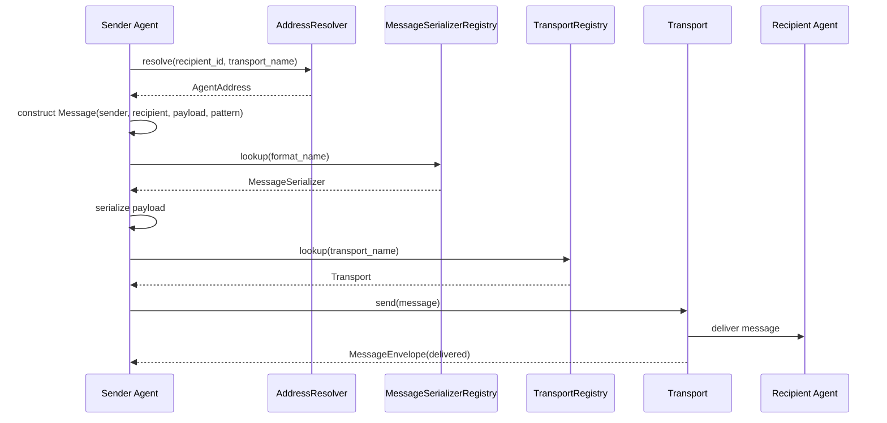
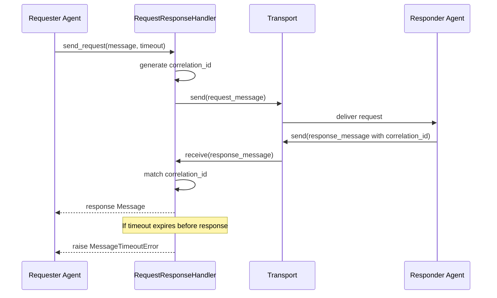
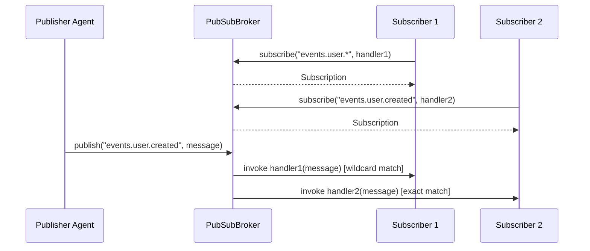

# Design Document — Communication & Messaging

## Overview

The Communication & Messaging feature extends the `codecraftai-agent-kit` SDK with a unified system for agent-to-agent communication and message exchange. It defines a pluggable transport layer abstraction with a common interface supporting multiple protocols (HTTP, WebSocket, gRPC, message queues), an agent-to-agent communication protocol with addressing and routing, pub/sub messaging for event-driven communication, request/response and fire-and-forget messaging patterns, and message serialization/deserialization across multiple formats (JSON, Protobuf, MessagePack).

The system provides:

- A `Transport` abstract base class with a common interface for connect, disconnect, send, and receive
- `TransportConfiguration` for declarative transport setup with credential resolution
- `TransportRegistry` for per-agent transport registration and lookup
- `Message` as an immutable communication unit with sender, recipient, payload, headers, and pattern
- `MessageEnvelope` for transport-level delivery metadata
- `MessagePattern` enumeration for REQUEST, RESPONSE, FIRE_AND_FORGET, and EVENT patterns
- `AgentAddress` for structured agent endpoint addressing
- `AddressResolver` for static and dynamic agent address resolution
- `MessageSerializer` abstract base class with built-in JSON, MessagePack, and Protobuf implementations
- `MessageSerializerRegistry` for serializer registration and lookup
- `MessageRouter` for routing incoming messages to registered handlers
- `PubSubBroker` for topic-based publish/subscribe messaging with wildcard support
- `RequestResponseHandler` for correlated request/response exchanges with timeout management
- `Subscription` for immutable subscription tracking
- `MessagingConfiguration` for declarative messaging system configuration
- Built-in transports: `HttpTransport`, `WebSocketTransport`, `GrpcTransport`, `MessageQueueTransport`

All classes live under `source/packages/ccai/agentkit/` with filenames in all-lowercase (no underscores), following the project naming conventions. The system integrates with:

- Core Agent Framework — `Agent` base class, `AgentConfiguration`, `AgentIdentity`, `AgentRegistry`
- Tool & Capability System — `ToolRegistry`, `ToolExecutor` (messaging tools can be registered as tools)
- `codecraftai-extension` — `ExtensionPoint` for transport and serializer plugin discovery
- `codecraftai-credentials` — `CredentialReference` resolution for transport authentication
- `codecraftai-dataprofiles` — `DataProfileReference` resolution for data profile management
- `codecraftai-this-app` — `AppContext` for settings, environment variables, and file path resolution

The design prioritizes debuggability over performance and readability over conciseness, per the project coding standards.

## Architecture

```mermaid
graph TD
    subgraph ccai.agentkit - Messaging System
        Transport[Transport base class]
        TransportConfiguration[TransportConfiguration]
        TransportRegistry[TransportRegistry]
        Message[Message]
        MessageEnvelope[MessageEnvelope]
        MessagePattern[MessagePattern enum]
        AgentAddress[AgentAddress]
        AddressResolver[AddressResolver]
        MessageSerializer[MessageSerializer base class]
        MessageSerializerRegistry[MessageSerializerRegistry]
        MessageRouter[MessageRouter]
        PubSubBroker[PubSubBroker]
        RequestResponseHandler[RequestResponseHandler]
        Subscription[Subscription]
        MessagingConfiguration[MessagingConfiguration]
        MessagingErrors[TransportError / MessageSerializationError / MessageRoutingError / MessageTimeoutError]
    end

    subgraph Built-in Transports
        HttpTransport[HttpTransport]
        WebSocketTransport[WebSocketTransport]
        GrpcTransport[GrpcTransport]
        MessageQueueTransport[MessageQueueTransport]
    end

    subgraph Built-in Serializers
        JsonMessageSerializer[JsonMessageSerializer]
        MsgpackMessageSerializer[MsgpackMessageSerializer]
        ProtobufMessageSerializer[ProtobufMessageSerializer]
    end

    subgraph Core Agent Framework
        Agent[Agent base class]
        AgentIdentity[AgentIdentity]
        AgentRegistry[AgentRegistry singleton]
    end

    subgraph External Packages
        Extension[codecraftai-extension]
        Credentials[codecraftai-credentials]
        ThisApp[codecraftai-this-app]
    end

    Agent --> TransportRegistry
    Agent --> MessageRouter
    Agent --> PubSubBroker
    Agent --> AddressResolver
    Agent --> RequestResponseHandler
    Agent --> MessagingConfiguration

    Transport --> TransportConfiguration
    TransportRegistry --> Transport
    MessageRouter --> Message
    PubSubBroker --> Subscription
    PubSubBroker --> Message
    RequestResponseHandler --> Message
    RequestResponseHandler --> Transport
    AddressResolver --> AgentRegistry
    AddressResolver --> AgentAddress

    Message --> MessagePattern
    Message --> AgentAddress
    MessageEnvelope --> Message

    MessageSerializer --> MessageSerializerRegistry
    JsonMessageSerializer --> MessageSerializer
    MsgpackMessageSerializer --> MessageSerializer
    ProtobufMessageSerializer --> MessageSerializer

    HttpTransport --> Transport
    WebSocketTransport --> Transport
    GrpcTransport --> Transport
    MessageQueueTransport --> Transport

    TransportConfiguration --> Credentials
    TransportConfiguration --> ThisApp
    MessagingConfiguration --> ThisApp
    Agent --> Extension
```



### Message Send Flow



### Request/Response Flow



### Pub/Sub Flow



### Design Decisions

1. `Transport` as abstract base class using `abc.ABC` with abstract methods for connect, disconnect, send, and receive — consistent with the Core Agent Framework pattern for `Agent` and Tool System pattern for `Tool`.
2. `TransportRegistry` as a per-agent instance (not singleton) — transports are scoped to individual agents, consistent with `ToolRegistry`.
3. `MessageSerializer` as abstract base class — allows pluggable serialization formats via `codecraftai-extension`.
4. `MessageRouter` uses ordered handler registration — handlers are invoked in registration order, consistent with lifecycle hooks in the Core Agent Framework.
5. `PubSubBroker` supports wildcard topic matching using `*` (single segment) and `#` (zero or more segments) with `.` as separator — follows MQTT/AMQP conventions.
6. `RequestResponseHandler` uses correlation identifiers for request/response tracking — standard pattern for asynchronous request/response over message-based transports.
7. `AddressResolver` supports both static (configured mapping) and dynamic (AgentRegistry lookup) resolution — provides flexibility for different deployment scenarios.
8. `Message` is immutable — prevents accidental modification during routing and delivery.
9. `MessageEnvelope` wraps `Message` with transport-level metadata — separates application-level message content from transport-level delivery tracking.
10. `MessagingConfiguration` follows the same serialization patterns as `AgentConfiguration` and `TransportConfiguration` — consistent API surface across the SDK.
11. Built-in transports as concrete `Transport` subclasses — consistent with built-in tools in the Tool & Capability System.
12. All messaging errors inherit from `AgentKitError` — consistent with the exception hierarchy established in the Core Agent Framework.
13. Structured logging under `ccai.agentkit.messaging` logger hierarchy — consistent with Python logging best practices and enables fine-grained log filtering.

### Structured Logging

All messaging components use the Python standard `logging` module under the `ccai.agentkit.messaging` logger hierarchy. The following table maps operations to log levels:

| Operation | Log Level | Logged Fields |
|---|---|---|
| Transport connect | INFO | transport name, protocol type, endpoint |
| Transport disconnect | INFO | transport name, protocol type |
| Message sent | INFO | message identifier, sender address, recipient address, transport name, pattern |
| Message received | INFO | message identifier, sender address, transport name, pattern |
| Message send failure | WARNING | message identifier, transport name, error detail |
| Fire-and-forget send | INFO | message identifier, sender address, recipient address |
| Pub/sub message published | INFO | topic, message identifier, subscriber count |
| Subscription created | INFO | topic, subscriber agent identifier |
| Subscription removed | INFO | topic, subscriber agent identifier |
| Request/response timeout | WARNING | request message identifier, correlation identifier, timeout duration |
| Handler invocation error (MessageRouter) | WARNING | message identifier, handler registration identifier, exception detail |
| Handler invocation error (PubSubBroker) | WARNING | topic, subscriber agent identifier, message identifier, exception detail |
| Transport plugin load failure | WARNING | plugin name, error detail |
| Serializer plugin load failure | WARNING | plugin name, error detail |
| Plugin name conflict (Transport) | WARNING | conflicting transport name |
| Plugin name conflict (Serializer) | WARNING | conflicting format name |

## Components and Interfaces

### File Layout

| File | Class(es) | Purpose |
|---|---|---|
| messagepattern.py | MessagePattern | Enum of message communication patterns |
| agentaddress.py | AgentAddress | Immutable agent endpoint address |
| message.py | Message | Immutable message object |
| messageenvelope.py | MessageEnvelope | Transport-level message wrapper |
| transportconfiguration.py | TransportConfiguration | Declarative transport configuration |
| transport.py | Transport | Abstract base class for transports |
| transportregistry.py | TransportRegistry | Per-agent transport registration and lookup |
| messageserializer.py | MessageSerializer | Abstract base class for serializers |
| messageserializerregistry.py | MessageSerializerRegistry | Serializer registration and lookup |
| jsonmessageserializer.py | JsonMessageSerializer | JSON serialization implementation |
| msgpackmessageserializer.py | MsgpackMessageSerializer | MessagePack serialization implementation |
| protobufmessageserializer.py | ProtobufMessageSerializer | Protobuf serialization implementation |
| messagerouter.py | MessageRouter | Message routing to handlers |
| addressresolver.py | AddressResolver | Agent address resolution |
| subscription.py | Subscription | Immutable subscription object |
| pubsubbroker.py | PubSubBroker | Topic-based pub/sub messaging |
| requestresponsehandler.py | RequestResponseHandler | Correlated request/response management |
| messagingconfiguration.py | MessagingConfiguration | Declarative messaging configuration |
| messagingerrors.py | TransportError, MessageSerializationError, MessageRoutingError, MessageTimeoutError | Messaging exceptions |
| transports/httptransport.py | HttpTransport | Built-in HTTP transport |
| transports/websockettransport.py | WebSocketTransport | Built-in WebSocket transport |
| transports/grpctransport.py | GrpcTransport | Built-in gRPC transport |
| transports/messagequeuetransport.py | MessageQueueTransport | Built-in message queue transport |

### MessagePattern

```python
import enum

class MessagePattern(enum.Enum):
    """
        Enumeration of message communication patterns.
    """

    REQUEST = "REQUEST"
    RESPONSE = "RESPONSE"
    FIRE_AND_FORGET = "FIRE_AND_FORGET"
    EVENT = "EVENT"

    @classmethod
    def from_string(cls, value: str) -> "MessagePattern":
        """
            Returns the MessagePattern member matching the given string value.

            :param value: The string value to match.

            :returns: The matching MessagePattern member.
            :raises: SemanticError
        """
        ...
```

### AgentAddress

```python
class AgentAddress:
    """
        Immutable object representing the network-addressable identity of an Agent.
    """

    def __init__(self, agent_identifier: str, transport_name: str,
                 endpoint: dict = None):
        self._agent_identifier = agent_identifier
        self._transport_name = transport_name
        self._endpoint = dict(endpoint) if endpoint is not None else {}
        return

    @property
    def agent_identifier(self) -> str: ...
    @property
    def transport_name(self) -> str: ...
    @property
    def endpoint(self) -> dict: ...

    def as_dict(self) -> dict: ...
    def to_json(self) -> str: ...

    @classmethod
    def from_dict(cls, data: dict) -> "AgentAddress": ...
    @classmethod
    def from_json(cls, json_str: str) -> "AgentAddress": ...

    def __eq__(self, other: object) -> bool:
        """
            Compares two AgentAddress instances by agent_identifier and transport_name.
        """
        ...

    def __hash__(self) -> int:
        """
            Returns a hash based on agent_identifier and transport_name.
        """
        ...

    def __repr__(self) -> str: ...
    def __str__(self) -> str: ...
```

### Message

```python
import uuid
from datetime import datetime, timezone

class Message:
    """
        Immutable object representing a unit of communication between agents.
    """

    def __init__(self, sender: AgentAddress, recipient: AgentAddress,
                 payload: object, pattern: MessagePattern,
                 headers: dict = None, correlation_id: str = None,
                 identifier: str = None, timestamp: datetime = None):
        self._identifier = identifier if identifier is not None else str(uuid.uuid4())
        self._sender = sender
        self._recipient = recipient
        self._payload = payload
        self._pattern = pattern
        self._headers = dict(headers) if headers is not None else {}
        self._correlation_id = correlation_id
        self._timestamp = timestamp if timestamp is not None else datetime.now(timezone.utc)
        return

    @property
    def identifier(self) -> str: ...
    @property
    def sender(self) -> AgentAddress: ...
    @property
    def recipient(self) -> AgentAddress: ...
    @property
    def payload(self) -> object: ...
    @property
    def pattern(self) -> MessagePattern: ...
    @property
    def headers(self) -> dict: ...
    @property
    def correlation_id(self) -> str: ...
    @property
    def timestamp(self) -> datetime: ...

    def as_dict(self) -> dict: ...
    def to_json(self) -> str: ...

    @classmethod
    def from_dict(cls, data: dict) -> "Message": ...
    @classmethod
    def from_json(cls, json_str: str) -> "Message": ...

    def __repr__(self) -> str: ...
    def __str__(self) -> str: ...
```

### MessageEnvelope

```python
class MessageEnvelope:
    """
        Immutable wrapper around a Message that adds transport-level delivery metadata.
    """

    VALID_STATUSES = {"pending", "delivered", "failed"}

    def __init__(self, message: Message, transport_name: str,
                 attempt_count: int = 1, delivery_status: str = "pending"):
        self._message = message
        self._transport_name = transport_name
        self._attempt_count = attempt_count
        self._delivery_status = delivery_status
        return

    @property
    def message(self) -> Message: ...
    @property
    def transport_name(self) -> str: ...
    @property
    def attempt_count(self) -> int: ...
    @property
    def delivery_status(self) -> str: ...

    def as_dict(self) -> dict: ...

    def __repr__(self) -> str: ...
    def __str__(self) -> str: ...
```

### TransportConfiguration

```python
class TransportConfiguration:
    """
        Configuration object defining transport protocol type, connection parameters,
        authentication settings, and protocol-specific options.
    """

    VALID_PROTOCOL_TYPES = {"http", "websocket", "grpc", "message_queue"}
    REQUIRED_FIELDS = ["protocol_type", "host", "port"]

    def __init__(self, protocol_type: str, host: str, port: int,
                 path: str = None, headers: dict = None,
                 timeout: float = 30.0, options: dict = None,
                 credential_references: dict = None):
        self._protocol_type = protocol_type
        self._host = host
        self._port = port
        self._path = path
        self._headers = dict(headers) if headers is not None else {}
        self._timeout = timeout
        self._options = dict(options) if options is not None else {}
        self._credential_references = dict(credential_references) if credential_references is not None else {}
        return

    @property
    def protocol_type(self) -> str: ...
    @property
    def host(self) -> str: ...
    @property
    def port(self) -> int: ...
    @property
    def path(self) -> str: ...
    @property
    def headers(self) -> dict: ...
    @property
    def timeout(self) -> float: ...
    @property
    def options(self) -> dict: ...

    def as_dict(self) -> dict: ...
    def to_json(self) -> str: ...
    def to_yaml(self) -> str: ...

    @classmethod
    def from_dict(cls, config_data: dict, app_context=None) -> "TransportConfiguration": ...
    @classmethod
    def from_json(cls, json_str: str, app_context=None) -> "TransportConfiguration": ...
    @classmethod
    def from_json_file(cls, file_path: str, app_context=None) -> "TransportConfiguration": ...
    @classmethod
    def from_yaml(cls, yaml_str: str, app_context=None) -> "TransportConfiguration": ...
    @classmethod
    def from_yaml_file(cls, file_path: str, app_context=None) -> "TransportConfiguration": ...

    def __repr__(self) -> str: ...
    def __str__(self) -> str: ...
```

### Transport (Abstract Base Class)

```python
import abc

class Transport(abc.ABC):
    """
        Abstract base class representing a communication channel for sending
        and receiving messages. Concrete implementations wrap specific protocols.
    """

    def __init__(self, name: str, protocol_type: str,
                 configuration: TransportConfiguration,
                 credential_names: list = None, tags: dict = None):
        self._name = name
        self._protocol_type = protocol_type
        self._configuration = configuration
        self._credential_names = list(credential_names) if credential_names is not None else []
        self._tags = dict(tags) if tags is not None else {}
        self._connected = False
        self._logger = logging.getLogger("ccai.agentkit.messaging.transport")

        if self._name is None or len(self._name.strip()) == 0:
            errmsg = "A transport name is required."
            raise SemanticError(errmsg)

        if self._protocol_type is None or len(self._protocol_type.strip()) == 0:
            errmsg = "A protocol type is required."
            raise SemanticError(errmsg)

        return

    @property
    def name(self) -> str: ...
    @property
    def protocol_type(self) -> str: ...
    @property
    def configuration(self) -> TransportConfiguration: ...
    @property
    def tags(self) -> dict: ...
    @property
    def credential_names(self) -> list: ...

    @abc.abstractmethod
    def connect(self) -> None:
        """
            Establishes a connection using the transport protocol.

            :raises: TransportError
        """
        ...

    @abc.abstractmethod
    def disconnect(self) -> None:
        """
            Closes the transport connection.

            :raises: TransportError
        """
        ...

    @abc.abstractmethod
    def send(self, message: Message) -> MessageEnvelope:
        """
            Sends a Message through the transport.

            :param message: The Message to send.

            :returns: A MessageEnvelope with delivery metadata.
            :raises: TransportError
        """
        ...

    @abc.abstractmethod
    def receive(self) -> Message:
        """
            Receives a Message from the transport.

            :returns: The received Message.
            :raises: TransportError
        """
        ...

    def is_connected(self) -> bool:
        """
            Returns whether the transport is currently connected.

            :returns: True if connected, False otherwise.
        """
        rtnval = self._connected
        return rtnval

    def __repr__(self) -> str: ...
    def __str__(self) -> str: ...
```

### TransportRegistry

```python
class TransportRegistry:
    """
        Registry tracking available Transport instances for an Agent.
        Provides lookup by name, protocol type, tags, and enumeration.
    """

    def __init__(self):
        self._transports: dict = {}
        return

    def register(self, transport: Transport) -> None:
        """
            Registers a Transport instance using its name as the key.

            :param transport: The Transport instance to register.

            :raises: SemanticError if a transport with the same name is already registered.
        """
        ...

    def deregister(self, transport_name: str) -> None: ...
    def lookup(self, transport_name: str) -> Transport: ...
    def lookup_by_protocol(self, protocol_type: str) -> list: ...
    def lookup_by_tags(self, **tags: str) -> list: ...
    def list_all(self) -> list: ...
    def has_transport(self, transport_name: str) -> bool: ...

    @property
    def count(self) -> int: ...

    def __repr__(self) -> str: ...
    def __str__(self) -> str: ...
```

### MessageSerializer (Abstract Base Class)

```python
import abc

class MessageSerializer(abc.ABC):
    """
        Abstract base class for serializing and deserializing message payloads
        between Python objects and wire format bytes.
    """

    def __init__(self, format_name: str, content_type: str):
        self._format_name = format_name
        self._content_type = content_type
        return

    @property
    def format_name(self) -> str: ...
    @property
    def content_type(self) -> str: ...

    @abc.abstractmethod
    def serialize(self, obj: object) -> bytes:
        """
            Serializes a Python object to bytes.

            :param obj: The Python object to serialize.

            :returns: The serialized bytes.
            :raises: MessageSerializationError
        """
        ...

    @abc.abstractmethod
    def deserialize(self, data: bytes) -> object:
        """
            Deserializes bytes to a Python object.

            :param data: The bytes to deserialize.

            :returns: The deserialized Python object.
            :raises: MessageSerializationError
        """
        ...

    def __repr__(self) -> str: ...
    def __str__(self) -> str: ...
```

### JsonMessageSerializer

```python
class JsonMessageSerializer(MessageSerializer):
    """
        Serializes Python objects to JSON-encoded bytes and deserializes
        JSON-encoded bytes to Python objects.
    """

    def __init__(self):
        super().__init__(format_name="json", content_type="application/json")
        return

    def serialize(self, obj: object) -> bytes: ...
    def deserialize(self, data: bytes) -> object: ...
```

### MsgpackMessageSerializer

```python
class MsgpackMessageSerializer(MessageSerializer):
    """
        Serializes Python objects to MessagePack-encoded bytes and deserializes
        MessagePack-encoded bytes to Python objects.
    """

    def __init__(self):
        super().__init__(format_name="msgpack", content_type="application/x-msgpack")
        return

    def serialize(self, obj: object) -> bytes: ...
    def deserialize(self, data: bytes) -> object: ...
```

### ProtobufMessageSerializer

```python
class ProtobufMessageSerializer(MessageSerializer):
    """
        Serializes Protobuf message objects to Protobuf-encoded bytes and deserializes
        Protobuf-encoded bytes to Protobuf message objects.
    """

    def __init__(self):
        super().__init__(format_name="protobuf", content_type="application/x-protobuf")
        return

    def serialize(self, obj: object) -> bytes: ...
    def deserialize(self, data: bytes) -> object: ...
```

### MessageSerializerRegistry

```python
class MessageSerializerRegistry:
    """
        Registry tracking available MessageSerializer instances.
        Provides lookup by format name and enumeration.
    """

    def __init__(self):
        self._serializers: dict = {}
        return

    def register(self, serializer: MessageSerializer) -> None:
        """
            Registers a MessageSerializer instance using its format name as the key.

            :param serializer: The MessageSerializer instance to register.

            :raises: SemanticError if a serializer with the same format name is already registered.
        """
        ...

    def deregister(self, format_name: str) -> None: ...
    def lookup(self, format_name: str) -> MessageSerializer: ...
    def list_all(self) -> list: ...
    def has_serializer(self, format_name: str) -> bool: ...

    @property
    def count(self) -> int: ...

    def __repr__(self) -> str: ...
    def __str__(self) -> str: ...
```

### MessageRouter

```python
class MessageRouter:
    """
        Routes incoming messages to registered MessageHandler callbacks
        based on topic, pattern, or custom filter criteria.
    """

    def __init__(self):
        self._handlers: list = []
        self._next_registration_id: int = 0
        self._logger = logging.getLogger("ccai.agentkit.messaging.router")
        return

    def register_by_topic(self, topic: str, handler: callable) -> str:
        """
            Registers a handler for a specific topic string.

            :param topic: The topic string to match.
            :param handler: The MessageHandler callback.

            :returns: A registration identifier string.
        """
        ...

    def register_by_pattern(self, pattern: MessagePattern, handler: callable) -> str:
        """
            Registers a handler for a specific MessagePattern value.

            :param pattern: The MessagePattern to match.
            :param handler: The MessageHandler callback.

            :returns: A registration identifier string.
        """
        ...

    def register_by_filter(self, filter_fn: callable, handler: callable) -> str:
        """
            Registers a handler with a custom filter callable.

            :param filter_fn: A callable accepting a Message and returning bool.
            :param handler: The MessageHandler callback.

            :returns: A registration identifier string.
        """
        ...

    def deregister(self, registration_id: str) -> None:
        """
            Removes a handler by its registration identifier.

            :param registration_id: The registration identifier returned at registration time.
        """
        ...

    def route(self, message: Message) -> None:
        """
            Routes a message to all matching handlers.

            :param message: The incoming Message.

            :raises: MessageRoutingError if no handler matches.
        """
        ...

    @property
    def handler_count(self) -> int: ...

    def __repr__(self) -> str: ...
    def __str__(self) -> str: ...
```

### AddressResolver

```python
class AddressResolver:
    """
        Resolves agent identifiers to AgentAddress instances using static
        mappings or dynamic AgentRegistry lookup.
    """

    def __init__(self, agent_registry=None):
        self._static_addresses: dict = {}
        self._agent_registry = agent_registry
        return

    def resolve(self, agent_identifier: str, transport_name: str) -> AgentAddress:
        """
            Resolves an agent identifier and transport name to an AgentAddress.

            :param agent_identifier: The agent identifier string.
            :param transport_name: The transport name string.

            :returns: The resolved AgentAddress.
            :raises: MessageRoutingError
        """
        ...

    def register_address(self, agent_identifier: str, transport_name: str,
                         endpoint: dict) -> None:
        """
            Stores a static address mapping.

            :param agent_identifier: The agent identifier.
            :param transport_name: The transport name.
            :param endpoint: The endpoint dictionary.
        """
        ...

    def deregister_address(self, agent_identifier: str, transport_name: str) -> None:
        """
            Removes a static address mapping.

            :param agent_identifier: The agent identifier.
            :param transport_name: The transport name.
        """
        ...

    def __repr__(self) -> str: ...
    def __str__(self) -> str: ...
```

### Subscription

```python
class Subscription:
    """
        Immutable object representing an agent's subscription to a topic.
    """

    def __init__(self, subscriber_agent_id: str, topic: str,
                 handler: callable, message_filter: callable = None,
                 identifier: str = None):
        self._identifier = identifier if identifier is not None else str(uuid.uuid4())
        self._subscriber_agent_id = subscriber_agent_id
        self._topic = topic
        self._handler = handler
        self._message_filter = message_filter
        return

    @property
    def identifier(self) -> str: ...
    @property
    def subscriber_agent_id(self) -> str: ...
    @property
    def topic(self) -> str: ...

    def as_dict(self) -> dict: ...

    def __repr__(self) -> str: ...
    def __str__(self) -> str: ...
```

### PubSubBroker

```python
class PubSubBroker:
    """
        Manages topic-based publish/subscribe messaging with wildcard support.
    """

    SINGLE_LEVEL_WILDCARD = "*"
    MULTI_LEVEL_WILDCARD = "#"
    TOPIC_SEPARATOR = "."

    def __init__(self):
        self._subscriptions: dict = {}
        self._logger = logging.getLogger("ccai.agentkit.messaging.pubsub")
        return

    def subscribe(self, topic: str, subscriber_agent_id: str,
                  handler: callable, message_filter: callable = None) -> Subscription:
        """
            Creates a subscription for a topic.

            :param topic: The topic string (supports wildcards).
            :param subscriber_agent_id: The subscriber agent identifier.
            :param handler: The MessageHandler callback.
            :param message_filter: Optional filter callable.

            :returns: A Subscription object.
        """
        ...

    def unsubscribe(self, subscription: Subscription) -> None:
        """
            Removes a subscription.

            :param subscription: The Subscription to remove.
        """
        ...

    def publish(self, topic: str, message: Message) -> None:
        """
            Publishes a message to all subscribers of the topic.

            :param topic: The topic string.
            :param message: The Message with MessagePattern.EVENT.
        """
        ...

    def topic_matches(self, subscription_topic: str, publish_topic: str) -> bool:
        """
            Checks if a subscription topic pattern matches a publish topic.
            Supports '*' for single segment and '#' for zero or more segments.

            :param subscription_topic: The subscription topic pattern.
            :param publish_topic: The actual publish topic.

            :returns: True if the pattern matches.
        """
        ...

    @property
    def active_topics(self) -> list: ...

    def get_subscriber_count(self, topic: str) -> int: ...
    def get_subscriber_ids(self, topic: str) -> list: ...

    def __repr__(self) -> str: ...
    def __str__(self) -> str: ...
```

### RequestResponseHandler

```python
class RequestResponseHandler:
    """
        Manages the lifecycle of request/response message exchanges including
        correlation tracking, timeout management, and response delivery.
    """

    def __init__(self, default_timeout: float = 30.0):
        self._pending_requests: dict = {}
        self._default_timeout = default_timeout
        self._logger = logging.getLogger("ccai.agentkit.messaging.requestresponse")
        return

    def send_request(self, message: Message, transport: Transport,
                     timeout: float = None) -> Message:
        """
            Sends a request message and waits for a correlated response.

            :param message: The request Message with MessagePattern.REQUEST.
            :param transport: The Transport to send through.
            :param timeout: Optional timeout in seconds (defaults to default_timeout).

            :returns: The correlated response Message.
            :raises: MessageTimeoutError
        """
        ...

    def handle_response(self, message: Message) -> None:
        """
            Delivers a response message to the waiting caller by matching
            the correlation identifier.

            :param message: The response Message.
        """
        ...

    def cancel(self, correlation_id: str) -> None:
        """
            Cancels a pending request.

            :param correlation_id: The correlation identifier.

            :raises: MessageTimeoutError to the waiting caller.
        """
        ...

    @property
    def pending_count(self) -> int: ...

    def __repr__(self) -> str: ...
    def __str__(self) -> str: ...
```

### MessagingConfiguration

```python
class MessagingConfiguration:
    """
        Configuration object defining default transport, serialization format,
        request timeout, and pub/sub settings for an Agent's messaging system.
    """

    REQUIRED_FIELDS = ["default_transport", "default_serialization_format", "default_request_timeout"]

    def __init__(self, default_transport: str, default_serialization_format: str,
                 default_request_timeout: float = 30.0, pubsub_settings: dict = None,
                 credential_references: dict = None):
        self._default_transport = default_transport
        self._default_serialization_format = default_serialization_format
        self._default_request_timeout = default_request_timeout
        self._pubsub_settings = dict(pubsub_settings) if pubsub_settings is not None else {}
        self._credential_references = dict(credential_references) if credential_references is not None else {}
        return

    @property
    def default_transport(self) -> str: ...
    @property
    def default_serialization_format(self) -> str: ...
    @property
    def default_request_timeout(self) -> float: ...
    @property
    def pubsub_settings(self) -> dict: ...

    def as_dict(self) -> dict: ...
    def to_json(self) -> str: ...

    @classmethod
    def from_dict(cls, config_data: dict, app_context=None) -> "MessagingConfiguration": ...
    @classmethod
    def from_json(cls, json_str: str, app_context=None) -> "MessagingConfiguration": ...
    @classmethod
    def from_json_file(cls, file_path: str, app_context=None) -> "MessagingConfiguration": ...
    @classmethod
    def from_yaml(cls, yaml_str: str, app_context=None) -> "MessagingConfiguration": ...
    @classmethod
    def from_yaml_file(cls, file_path: str, app_context=None) -> "MessagingConfiguration": ...

    def __repr__(self) -> str: ...
    def __str__(self) -> str: ...
```

### Messaging Errors

```python
class TransportError(AgentKitError):
    """
        Raised when a Transport operation fails due to a connection, send, or receive error.
    """

    def __init__(self, transport_name: str, operation: str, cause: Exception = None):
        self._transport_name = transport_name
        self._operation = operation
        self._cause = cause
        errmsg = self._format_message()
        super().__init__(errmsg)
        return

    @property
    def transport_name(self) -> str: ...
    @property
    def operation(self) -> str: ...
    @property
    def cause(self) -> Exception: ...

    def __repr__(self) -> str: ...


class MessageSerializationError(AgentKitError):
    """
        Raised when a MessageSerializer fails to serialize or deserialize a payload.
    """

    def __init__(self, format_name: str, direction: str, detail: str):
        self._format_name = format_name
        self._direction = direction
        self._detail = detail
        errmsg = self._format_message()
        super().__init__(errmsg)
        return

    @property
    def format_name(self) -> str: ...
    @property
    def direction(self) -> str: ...
    @property
    def detail(self) -> str: ...

    def __repr__(self) -> str: ...


class MessageRoutingError(AgentKitError):
    """
        Raised when the MessageRouter or AddressResolver cannot route or resolve
        a message destination.
    """

    def __init__(self, message_id: str = None, target: str = None, detail: str = None):
        self._message_id = message_id
        self._target = target
        self._detail = detail
        errmsg = self._format_message()
        super().__init__(errmsg)
        return

    @property
    def message_id(self) -> str: ...
    @property
    def target(self) -> str: ...
    @property
    def detail(self) -> str: ...

    def __repr__(self) -> str: ...


class MessageTimeoutError(AgentKitError):
    """
        Raised when a request/response exchange exceeds the configured timeout.
    """

    def __init__(self, request_message_id: str, correlation_id: str, timeout: float):
        self._request_message_id = request_message_id
        self._correlation_id = correlation_id
        self._timeout = timeout
        errmsg = self._format_message()
        super().__init__(errmsg)
        return

    @property
    def request_message_id(self) -> str: ...
    @property
    def correlation_id(self) -> str: ...
    @property
    def timeout(self) -> float: ...

    def __repr__(self) -> str: ...
```

### Built-in Transports

#### HttpTransport

```python
class HttpTransport(Transport):
    """
        Transport implementation using HTTP request/response semantics.
    """

    def __init__(self, name: str, configuration: TransportConfiguration,
                 credential_names: list = None, tags: dict = None):
        super().__init__(
            name=name, protocol_type="http",
            configuration=configuration,
            credential_names=credential_names, tags=tags
        )
        return

    def connect(self) -> None: ...
    def disconnect(self) -> None: ...
    def send(self, message: Message) -> MessageEnvelope: ...
    def receive(self) -> Message: ...
```

#### WebSocketTransport

```python
class WebSocketTransport(Transport):
    """
        Transport implementation using WebSocket protocol semantics
        with persistent bidirectional connections.
    """

    VALID_CONNECTION_STATES = {"disconnected", "connecting", "connected", "closing"}

    def __init__(self, name: str, configuration: TransportConfiguration,
                 credential_names: list = None, tags: dict = None):
        super().__init__(
            name=name, protocol_type="websocket",
            configuration=configuration,
            credential_names=credential_names, tags=tags
        )
        self._connection_state = "disconnected"
        return

    @property
    def connection_state(self) -> str: ...

    def connect(self) -> None: ...
    def disconnect(self) -> None: ...
    def send(self, message: Message) -> MessageEnvelope: ...
    def receive(self) -> Message: ...
```

#### GrpcTransport

```python
class GrpcTransport(Transport):
    """
        Transport implementation using gRPC protocol semantics.
    """

    def __init__(self, name: str, configuration: TransportConfiguration,
                 credential_names: list = None, tags: dict = None):
        super().__init__(
            name=name, protocol_type="grpc",
            configuration=configuration,
            credential_names=credential_names, tags=tags
        )
        return

    def connect(self) -> None: ...
    def disconnect(self) -> None: ...
    def send(self, message: Message) -> MessageEnvelope: ...
    def receive(self) -> Message: ...
```

#### MessageQueueTransport

```python
class MessageQueueTransport(Transport):
    """
        Transport implementation using message queue semantics
        for reliable asynchronous messaging.
    """

    def __init__(self, name: str, configuration: TransportConfiguration,
                 credential_names: list = None, tags: dict = None):
        super().__init__(
            name=name, protocol_type="message_queue",
            configuration=configuration,
            credential_names=credential_names, tags=tags
        )
        return

    def connect(self) -> None: ...
    def disconnect(self) -> None: ...
    def send(self, message: Message) -> MessageEnvelope: ...
    def receive(self) -> Message: ...
```

### Agent Integration (Extensions to Agent Base Class)

The `Agent` base class from the Core Agent Framework is extended with messaging-related properties and methods:

```python
# Additional properties and methods on Agent

@property
def transports(self) -> TransportRegistry:
    """
        Returns the Agent's TransportRegistry instance.
    """
    ...

@property
def message_router(self) -> MessageRouter:
    """
        Returns the Agent's MessageRouter instance.
    """
    ...

@property
def pubsub(self) -> PubSubBroker:
    """
        Returns the Agent's PubSubBroker instance.
    """
    ...

@property
def address_resolver(self) -> AddressResolver:
    """
        Returns the Agent's AddressResolver instance.
    """
    ...

def register_transport(self, transport: Transport) -> None:
    """
        Registers a Transport with this Agent's TransportRegistry.

        :param transport: The Transport instance to register.
    """
    ...

def send_message(self, recipient_id: str, payload: object,
                 transport_name: str = None, serialization_format: str = None,
                 pattern: MessagePattern = MessagePattern.FIRE_AND_FORGET,
                 headers: dict = None) -> MessageEnvelope:
    """
        Constructs and sends a Message to the specified recipient.

        :param recipient_id: The recipient agent identifier.
        :param payload: The message payload.
        :param transport_name: Optional transport name (defaults to MessagingConfiguration default).
        :param serialization_format: Optional serialization format name.
        :param pattern: The MessagePattern (defaults to FIRE_AND_FORGET).
        :param headers: Optional headers dictionary.

        :returns: A MessageEnvelope with delivery metadata.
        :raises: SemanticError if transport not found.
    """
    ...

def request(self, recipient_id: str, payload: object,
            transport_name: str = None, serialization_format: str = None,
            timeout: float = None, headers: dict = None) -> Message:
    """
        Sends a request and awaits a correlated response.

        :param recipient_id: The recipient agent identifier.
        :param payload: The request payload.
        :param transport_name: Optional transport name.
        :param serialization_format: Optional serialization format name.
        :param timeout: Optional timeout in seconds.
        :param headers: Optional headers dictionary.

        :returns: The correlated response Message.
        :raises: MessageTimeoutError
    """
    ...

def publish(self, topic: str, payload: object) -> None:
    """
        Publishes an event message to a topic.

        :param topic: The topic string.
        :param payload: The event payload.
    """
    ...

def subscribe(self, topic: str, handler: callable) -> Subscription:
    """
        Subscribes to a topic with a handler callback.

        :param topic: The topic string.
        :param handler: The MessageHandler callback.

        :returns: A Subscription object.
    """
    ...
```

### Extension Points

The framework defines two `codecraftai-extension` ExtensionPoint names for plugin discovery:

| ExtensionPoint Name | Plugin Type | Description |
|---|---|---|
| `ccai.agentkit.transports` | Transport | Registers Transport plugin implementations with an Agent's TransportRegistry |
| `ccai.agentkit.message_serializers` | MessageSerializer | Registers MessageSerializer plugin implementations with an Agent's MessageSerializerRegistry |

During `Agent.initialize()`, the agent:
1. Constructs `TransportRegistry`, `MessageRouter`, `PubSubBroker`, `AddressResolver`, and `RequestResponseHandler` from the `MessagingConfiguration`
2. Queries the `"ccai.agentkit.transports"` ExtensionPoint and registers all discovered `Transport` instances with the Agent's `TransportRegistry`
3. Queries the `"ccai.agentkit.message_serializers"` ExtensionPoint and registers all discovered `MessageSerializer` instances with the Agent's `MessageSerializerRegistry`
4. If a Transport or MessageSerializer plugin fails to load, logs the failure at WARNING level and continues loading remaining plugins
5. If a plugin provides a Transport or serializer with a name that conflicts with an already registered entry, logs the conflict at WARNING level and skips the conflicting plugin entry
6. If no `MessagingConfiguration` is provided, defaults to a `JsonMessageSerializer` and no registered transports

During `Agent.stop()`, the agent:
1. Disconnects all connected transports
2. Clears the `TransportRegistry`
3. Removes all `PubSubBroker` subscriptions

## Data Models

### AgentAddress Fields

| Field | Type | Required | Default | Description |
|---|---|---|---|---|
| agent_identifier | str | Yes | — | Unique identifier of the agent |
| transport_name | str | Yes | — | Name of the transport for addressing |
| endpoint | dict | No | {} | Protocol-specific endpoint info (host, port, path, queue_name, topic) |

### Message Fields

| Field | Type | Required | Default | Description |
|---|---|---|---|---|
| identifier | str | No | Auto-generated UUID | Unique message identifier |
| sender | AgentAddress | Yes | — | Sender agent address |
| recipient | AgentAddress | Yes | — | Recipient agent address |
| payload | object | Yes | — | Message payload (dict, list, str, or bytes) |
| pattern | MessagePattern | Yes | — | Communication pattern |
| headers | dict | No | {} | Message headers |
| correlation_id | str | No | None | Correlation identifier for request/response |
| timestamp | datetime | No | Current UTC time | Message creation timestamp |

### MessageEnvelope Fields

| Field | Type | Required | Default | Description |
|---|---|---|---|---|
| message | Message | Yes | — | The wrapped Message |
| transport_name | str | Yes | — | Name of the transport used for delivery |
| attempt_count | int | No | 1 | Number of delivery attempts |
| delivery_status | str | No | "pending" | One of: "pending", "delivered", "failed" |

### TransportConfiguration Fields

| Field | Type | Required | Default | Description |
|---|---|---|---|---|
| protocol_type | str | Yes | — | One of: "http", "websocket", "grpc", "message_queue" |
| host | str | Yes | — | Host address |
| port | int | Yes | — | Port number |
| path | str | No | None | Optional URL path |
| headers | dict | No | {} | Default headers |
| timeout | float | No | 30.0 | Connection/request timeout in seconds |
| options | dict | No | {} | Protocol-specific options |
| credential_references | dict | No | {} | Named credential references for authentication |

### TransportConfiguration Schema

```python
{
    "protocol_type": str,       # Required: "http", "websocket", "grpc", "message_queue"
    "host": str,                # Required
    "port": int,                # Required
    "path": str,                # Optional
    "headers": {str: str},      # Optional
    "timeout": float,           # Optional, default 30.0
    "options": {str: any},      # Optional, protocol-specific
    "credentials": {            # Optional
        str: {"provider": str, "key": str}
    }
}
```

### MessagingConfiguration Fields

| Field | Type | Required | Default | Description |
|---|---|---|---|---|
| default_transport | str | Yes | — | Default transport name |
| default_serialization_format | str | Yes | — | Default serialization format name |
| default_request_timeout | float | No | 30.0 | Default request/response timeout in seconds |
| pubsub_settings | dict | No | {} | Pub/sub configuration settings |
| credential_references | dict | No | {} | Named credential references |

### MessagingConfiguration Schema

```python
{
    "default_transport": str,               # Required
    "default_serialization_format": str,    # Required
    "default_request_timeout": float,       # Optional, default 30.0
    "pubsub_settings": {str: any},          # Optional
    "credentials": {                        # Optional
        str: {"provider": str, "key": str}
    }
}
```

### Subscription Fields

| Field | Type | Required | Default | Description |
|---|---|---|---|---|
| identifier | str | No | Auto-generated UUID | Unique subscription identifier |
| subscriber_agent_id | str | Yes | — | Subscriber agent identifier |
| topic | str | Yes | — | Topic string (supports wildcards) |
| handler | callable | Yes | — | MessageHandler callback |
| message_filter | callable | No | None | Optional message filter |

### Wildcard Topic Matching Rules

| Pattern | Matches | Does Not Match |
|---|---|---|
| `events.*` | `events.user`, `events.order` | `events.user.created`, `events` |
| `events.#` | `events`, `events.user`, `events.user.created` | `other.events` |
| `events.*.created` | `events.user.created`, `events.order.created` | `events.created`, `events.user.order.created` |
| `#` | Any topic | — |

### MessagePattern Values

| Value | Description |
|---|---|
| REQUEST | Expects a correlated response |
| RESPONSE | Reply to a request (carries correlation_id) |
| FIRE_AND_FORGET | No response expected |
| EVENT | Pub/sub broadcast |

### Error Type Fields

| Error Type | Fields |
|---|---|
| TransportError | transport_name (str), operation (str), cause (Exception) |
| MessageSerializationError | format_name (str), direction (str), detail (str) |
| MessageRoutingError | message_id (str, optional), target (str, optional), detail (str) |
| MessageTimeoutError | request_message_id (str), correlation_id (str), timeout (float) |
