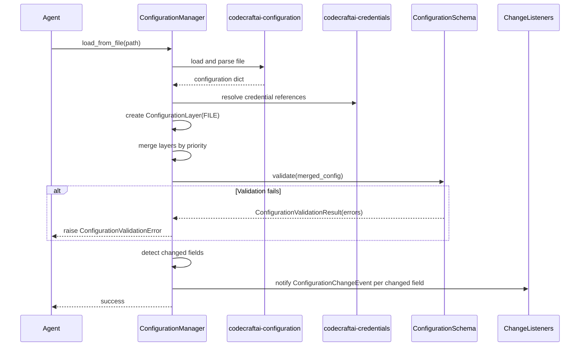
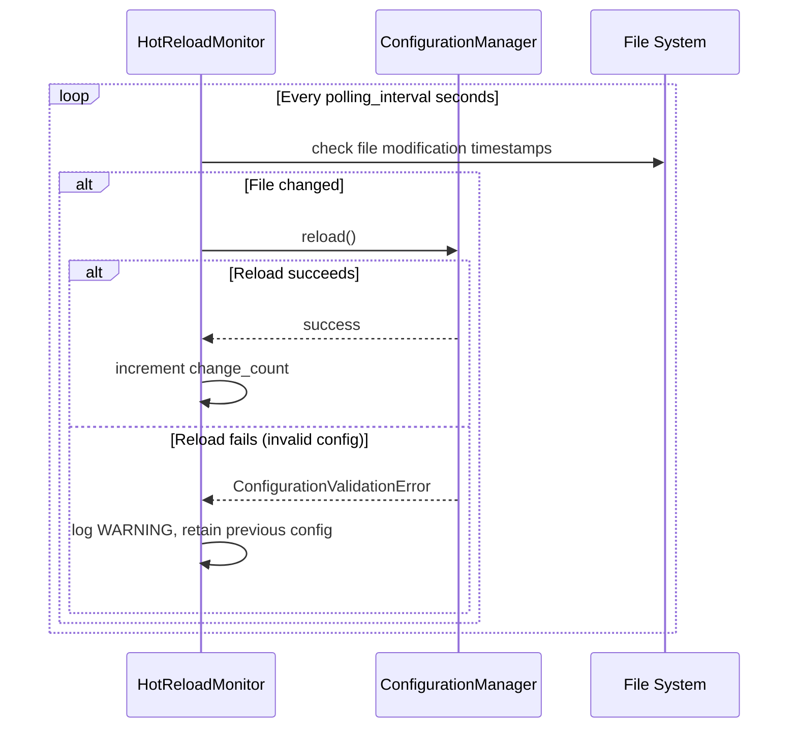
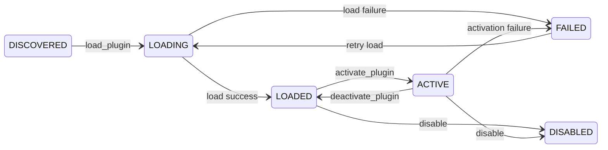

# Design Document — Configuration & Extensibility

## Overview

The Configuration & Extensibility feature extends the Core Agent Framework with a unified system for managing agent configuration through a hierarchical configuration model, validating configuration against schemas, toggling features and capabilities through feature flags, hot-reloading configuration changes at runtime, and extending agent functionality through a plugin architecture.

The system provides:

- A `ConfigurationManager` that coordinates hierarchical configuration loading, schema validation, credential resolution, change notification, and hot-reload monitoring for an Agent
- `ConfigurationLayer` and `ConfigurationLayerSource` for representing and classifying configuration layers by origin and priority
- `ConfigurationSchema`, `ConfigurationSchemaField`, and `ConfigurationValidationResult` for declarative schema definition and validation
- `ConfigurationChangeEvent` and `ConfigurationChangeListener` for reactive configuration change notification
- `HotReloadMonitor` and `HotReloadPolicy` for automatic configuration source monitoring and reload
- `FeatureFlag`, `FeatureFlagRegistry`, and `FeatureFlagEvaluator` for named boolean toggles with static, configuration-driven, and conditional evaluation
- `PluginManager`, `PluginDescriptor`, `PluginStatus`, `PluginDependency`, `PluginLifecycleHook`, and `PluginConfiguration` for plugin discovery, loading, lifecycle management, and dependency resolution
- `ConfigurationSerializer` for round-trip serialization of configuration dictionaries to JSON and YAML
- Agent integration properties and methods: `configuration_manager`, `feature_flags`, `plugin_manager`, `get_config`, `is_feature_enabled`

All classes live under `source/packages/ccai/agentkit/` with filenames in all-lowercase (no underscores), following the project naming conventions. The system integrates with:

- Core Agent Framework — `Agent` base class, `AgentConfiguration`, `LifecycleState`, `AgentStateMachine`
- `codecraftai-configuration` — Hierarchical configuration loading, merging, and schema validation
- `codecraftai-extension` — Plugin discovery, loading, and ExtensionPoint registration
- `codecraftai-credentials` — CredentialReference resolution for secrets in configuration values
- `codecraftai-this-app` — AppContext for settings, environment variables, and directory-based file path resolution
- `codecraftai-dataprofiles` — DataProfileReference resolution
- Observability & Debugging — StructuredLogger, CorrelationContext for tracing configuration and plugin events
- Security & Access Control — AuditLogger for auditing configuration changes

The design prioritizes debuggability over performance and readability over conciseness, per the project coding standards.

## Architecture

```mermaid
graph TD
    subgraph ccai.agentkit - Configuration & Extensibility
        ConfigurationManager[ConfigurationManager]
        ConfigurationLayer[ConfigurationLayer]
        ConfigurationLayerSource[ConfigurationLayerSource enum]
        ConfigurationSchema[ConfigurationSchema]
        ConfigurationSchemaField[ConfigurationSchemaField]
        ConfigurationValidationResult[ConfigurationValidationResult]
        ConfigurationChangeEvent[ConfigurationChangeEvent]
        HotReloadMonitor[HotReloadMonitor]
        HotReloadPolicy[HotReloadPolicy]
        FeatureFlag[FeatureFlag]
        FeatureFlagRegistry[FeatureFlagRegistry]
        FeatureFlagEvaluator[FeatureFlagEvaluator]
        PluginManager[PluginManager]
        PluginDescriptor[PluginDescriptor]
        PluginStatus[PluginStatus enum]
        PluginDependency[PluginDependency]
        PluginLifecycleHook[PluginLifecycleHook]
        PluginConfiguration[PluginConfiguration]
        ConfigurationSerializer[ConfigurationSerializer]
        ConfigErrors[ConfigurationValidationError / PluginLoadError]
    end

    subgraph Core Agent Framework
        Agent[Agent base class]
        AgentConfiguration[AgentConfiguration]
        LifecycleState[LifecycleState]
        Errors[SemanticError / ConfigurationError]
    end

    subgraph External Packages
        CodeCraftAIConfig[codecraftai-configuration]
        Extension[codecraftai-extension]
        Credentials[codecraftai-credentials]
        AppContext[codecraftai-this-app]
    end

    Agent --> ConfigurationManager
    Agent --> FeatureFlagRegistry
    Agent --> PluginManager
    ConfigurationManager --> ConfigurationLayer
    ConfigurationManager --> ConfigurationSchema
    ConfigurationManager --> ConfigurationChangeEvent
    ConfigurationManager --> HotReloadMonitor
    ConfigurationManager --> CodeCraftAIConfig
    ConfigurationManager --> Credentials
    ConfigurationLayer --> ConfigurationLayerSource
    ConfigurationSchema --> ConfigurationSchemaField
    ConfigurationSchema --> ConfigurationValidationResult
    HotReloadMonitor --> HotReloadPolicy
    FeatureFlagRegistry --> FeatureFlag
    FeatureFlagEvaluator --> FeatureFlagRegistry
    FeatureFlagEvaluator --> ConfigurationManager
    PluginManager --> PluginDescriptor
    PluginManager --> PluginConfiguration
    PluginManager --> Extension
    PluginDescriptor --> PluginStatus
    PluginDescriptor --> PluginDependency
    ConfigurationSerializer --> ConfigErrors
    ConfigurationManager --> AppContext
    FeatureFlagRegistry --> AppContext
    PluginConfiguration --> AppContext
```



### Configuration Loading and Validation Flow



### Hot-Reload Monitoring Flow



### Plugin Lifecycle Flow



### Design Decisions

1. `ConfigurationManager` as a per-agent component (not singleton) — configuration is scoped to individual agents, consistent with `ToolRegistry` pattern from the Tool & Capability System.
2. `ConfigurationLayer` as an immutable value object — layers are created once and merged, never mutated in place. This simplifies change detection and debugging.
3. Delegation to `codecraftai-configuration` for merge semantics and schema validation — the agentkit layer adds agent-specific lifecycle integration, not duplicate configuration logic.
4. `HotReloadMonitor` as a separate component from `ConfigurationManager` — separates monitoring concerns from configuration management, each with clear responsibilities.
5. `FeatureFlagRegistry` as a per-agent instance — feature flags are scoped to individual agents, allowing different agents to have different flag configurations.
6. `FeatureFlagEvaluator` with three-tier precedence (runtime override > configuration > default) — provides predictable evaluation order that supports both development overrides and production configuration.
7. `PluginManager` delegates discovery and loading to `codecraftai-extension` — the agentkit layer adds agent-specific lifecycle hooks, dependency resolution, and health monitoring on top.
8. `ConfigurationSerializer` excludes resolved credential values — prevents accidental credential leakage in serialized output, consistent with `AgentConfiguration` credential handling in the Core Agent Framework.
9. `ConfigurationValidationError` and `PluginLoadError` inherit from `AgentKitError` — consistent with the Core Agent Framework and Tool & Capability System exception hierarchies.
10. Serialization follows naming conventions: `as_dict`, `to_json`/`to_yaml`, `from_json`/`from_yaml` — consistent with all other agentkit classes.
11. `PluginLifecycleHook` as an abstract base class using `abc.ABC` — consistent with the `Tool` and `Agent` abstract base class patterns.
12. All `__repr__` and `__str__` methods follow the established pattern: `__repr__` includes class name and key identifying fields, `__str__` returns a human-readable summary.

## Components and Interfaces

### File Layout

| File | Class(es) | Purpose |
|---|---|---|
| configurationlayersource.py | ConfigurationLayerSource | Enum of configuration layer origins |
| configurationlayer.py | ConfigurationLayer | Immutable configuration layer with priority and source |
| configurationschemafield.py | ConfigurationSchemaField | Single field definition within a schema |
| configurationschema.py | ConfigurationSchema | Declarative schema for agent configuration |
| configurationvalidationresult.py | ConfigurationValidationResult | Structured validation outcome |
| configurationchangeevent.py | ConfigurationChangeEvent | Immutable change notification event |
| configurationmanager.py | ConfigurationManager | Central configuration coordinator |
| hotreloadpolicy.py | HotReloadPolicy | Declarative hot-reload behavior settings |
| hotreloadmonitor.py | HotReloadMonitor | File and environment monitoring for changes |
| featureflag.py | FeatureFlag | Named boolean toggle definition |
| featureflagregistry.py | FeatureFlagRegistry | Registry for feature flag instances |
| featureflagevaluator.py | FeatureFlagEvaluator | Flag evaluation with precedence logic |
| pluginstatus.py | PluginStatus | Enum of plugin lifecycle states |
| plugindependency.py | PluginDependency | Plugin dependency with optional version constraint |
| plugindescriptor.py | PluginDescriptor | Immutable plugin metadata |
| pluginlifecyclehook.py | PluginLifecycleHook | Abstract lifecycle callback interface |
| pluginconfiguration.py | PluginConfiguration | Declarative plugin management settings |
| pluginmanager.py | PluginManager | Plugin discovery, loading, and lifecycle management |
| configurationserializer.py | ConfigurationSerializer | JSON and YAML serialization for configuration dicts |
| configurationerrors.py | ConfigurationValidationError, PluginLoadError | Feature-specific exceptions |

### ConfigurationLayerSource

```python
import enum

class ConfigurationLayerSource(enum.Enum):
    """
        Enumeration defining the origin of a ConfigurationLayer.
    """

    DEFAULTS = "DEFAULTS"
    FILE = "FILE"
    ENVIRONMENT = "ENVIRONMENT"
    RUNTIME = "RUNTIME"
    OVERRIDE = "OVERRIDE"

    @classmethod
    def from_string(cls, value: str) -> "ConfigurationLayerSource":
        """
            Returns the ConfigurationLayerSource member matching the given string.

            :param value: The string value to match.

            :returns: The matching ConfigurationLayerSource member.
            :raises: SemanticError
        """
        ...
```

### ConfigurationLayer

```python
class ConfigurationLayer:
    """
        Immutable object representing a single layer in the configuration hierarchy.
        Contains a layer name, priority, source, and configuration dictionary.
        Layers are merged in ascending priority order by the ConfigurationManager.
    """

    def __init__(self, name: str, priority: int, source: ConfigurationLayerSource,
                 configuration: dict):
        self._name = name
        self._priority = priority
        self._source = source
        self._configuration = dict(configuration) if configuration is not None else {}
        return

    @property
    def name(self) -> str: ...
    @property
    def priority(self) -> int: ...
    @property
    def source(self) -> ConfigurationLayerSource: ...
    @property
    def configuration(self) -> dict: ...

    def as_dict(self) -> dict: ...
    def to_json(self) -> str: ...

    @classmethod
    def from_dict(cls, data: dict) -> "ConfigurationLayer": ...

    @classmethod
    def from_json(cls, json_str: str) -> "ConfigurationLayer": ...

    def __repr__(self) -> str: ...
    def __str__(self) -> str: ...
```

### ConfigurationSchemaField

```python
class ConfigurationSchemaField:
    """
        Immutable object representing a single field within a ConfigurationSchema.
        Contains a field path, type constraint, required flag, optional default,
        description, and optional validation callable.
    """

    VALID_TYPES = {"string", "integer", "float", "boolean", "list", "dictionary"}

    TYPE_MAP = {
        "string": str,
        "integer": int,
        "float": float,
        "boolean": bool,
        "list": list,
        "dictionary": dict,
    }

    def __init__(self, field_path: str, type_constraint: str, required: bool = True,
                 default_value=None, description: str = "",
                 validation_callable=None):
        self._field_path = field_path
        self._type_constraint = type_constraint
        self._required = required
        self._default_value = default_value
        self._description = description
        self._validation_callable = validation_callable

        if self._type_constraint not in self.VALID_TYPES:
            errmsg = "Invalid type constraint '{}'. Valid types: {}".format(
                self._type_constraint, ", ".join(sorted(self.VALID_TYPES)))
            raise SemanticError(errmsg)

        return

    @property
    def field_path(self) -> str: ...
    @property
    def type_constraint(self) -> str: ...
    @property
    def required(self) -> bool: ...
    @property
    def default_value(self): ...
    @property
    def description(self) -> str: ...
    @property
    def validation_callable(self): ...

    def validate_value(self, value) -> list:
        """
            Validates a value against this field's type constraint and custom validation.

            :param value: The value to validate.

            :returns: A list of validation error strings. Empty list if valid.
        """
        ...

    def as_dict(self) -> dict: ...
    def to_json(self) -> str: ...

    @classmethod
    def from_dict(cls, data: dict) -> "ConfigurationSchemaField": ...

    def __repr__(self) -> str: ...
    def __str__(self) -> str: ...
```

### ConfigurationSchema

```python
class ConfigurationSchema:
    """
        Declarative schema definition describing the expected structure, types,
        constraints, and default values of an Agent's configuration.
        Delegates validation to codecraftai-configuration schema validation.
    """

    def __init__(self, name: str, fields: list = None):
        self._name = name
        self._fields = list(fields) if fields is not None else []
        return

    @property
    def name(self) -> str: ...
    @property
    def fields(self) -> list: ...
    @property
    def field_count(self) -> int: ...

    def add_field(self, field: ConfigurationSchemaField) -> None: ...

    def get_field(self, field_path: str) -> ConfigurationSchemaField: ...

    def validate(self, configuration: dict) -> "ConfigurationValidationResult":
        """
            Validates a configuration dictionary against this schema.

            :param configuration: The configuration dictionary to validate.

            :returns: A ConfigurationValidationResult with the validation outcome.
        """
        ...

    def as_dict(self) -> dict: ...
    def to_json(self) -> str: ...

    @classmethod
    def from_dict(cls, data: dict) -> "ConfigurationSchema": ...

    @classmethod
    def from_json(cls, json_str: str) -> "ConfigurationSchema": ...

    def __repr__(self) -> str: ...
    def __str__(self) -> str: ...
```

### ConfigurationValidationResult

```python
class ConfigurationValidationResult:
    """
        Immutable object encapsulating the outcome of validating a configuration
        dictionary against a ConfigurationSchema.
    """

    def __init__(self, valid: bool, errors: list = None, warnings: list = None):
        self._valid = valid
        self._errors = list(errors) if errors is not None else []
        self._warnings = list(warnings) if warnings is not None else []
        return

    @property
    def valid(self) -> bool: ...
    @property
    def errors(self) -> list: ...
    @property
    def warnings(self) -> list: ...
    @property
    def is_valid(self) -> bool:
        """
            Returns True when the valid flag is True and the error list is empty.
        """
        ...

    def as_dict(self) -> dict: ...

    def __repr__(self) -> str: ...
    def __str__(self) -> str: ...
```

### ConfigurationChangeEvent

```python
class ConfigurationChangeEvent:
    """
        Immutable object representing a detected change in configuration.
        Contains the field path, previous value, new value, source, and timestamp.
    """

    def __init__(self, field_path: str, previous_value, new_value,
                 source: ConfigurationLayerSource, timestamp: datetime):
        self._field_path = field_path
        self._previous_value = previous_value
        self._new_value = new_value
        self._source = source
        self._timestamp = timestamp
        return

    @property
    def field_path(self) -> str: ...
    @property
    def previous_value(self): ...
    @property
    def new_value(self): ...
    @property
    def source(self) -> ConfigurationLayerSource: ...
    @property
    def timestamp(self) -> datetime: ...

    def as_dict(self) -> dict: ...
    def to_json(self) -> str: ...

    @classmethod
    def from_dict(cls, data: dict) -> "ConfigurationChangeEvent": ...

    @classmethod
    def from_json(cls, json_str: str) -> "ConfigurationChangeEvent": ...

    def __repr__(self) -> str: ...
    def __str__(self) -> str: ...
```

### ConfigurationManager

```python
import logging

class ConfigurationManager:
    """
        Manages the complete configuration lifecycle for an Agent.
        Coordinates hierarchical configuration loading, schema validation,
        credential resolution, feature flag evaluation, and hot-reload monitoring.
        Delegates configuration loading and merging to codecraftai-configuration.
    """

    def __init__(self, agent_identifier: str, schema: ConfigurationSchema = None):
        self._agent_identifier = agent_identifier
        self._schema = schema
        self._layers = []
        self._merged_configuration = {}
        self._change_listeners = []
        self._logger = logging.getLogger("ccai.agentkit.configuration")
        return

    @property
    def agent_identifier(self) -> str: ...
    @property
    def schema(self) -> ConfigurationSchema: ...
    @property
    def merged_configuration(self) -> dict: ...
    @property
    def layers(self) -> list: ...

    def get(self, field_path: str, default=None):
        """
            Returns the resolved configuration value at the given dot-separated
            field path, or the default value when not found.

            :param field_path: Dot-separated path string.
            :param default: Value to return when the field path is not found.

            :returns: The resolved configuration value or default.
        """
        ...

    def set(self, field_path: str, value) -> None:
        """
            Stores a value in the RUNTIME ConfigurationLayer at the given field path.

            :param field_path: Dot-separated path string.
            :param value: The value to store.
        """
        ...

    def load_defaults(self, defaults: dict) -> None:
        """
            Loads default configuration values as the lowest-priority layer.

            :param defaults: Dictionary of default configuration values.
        """
        ...

    def load_from_dict(self, data: dict, layer_name: str = None) -> None:
        """
            Loads configuration from a dictionary as a RUNTIME layer.

            :param data: Configuration dictionary.
            :param layer_name: Optional layer name.
        """
        ...

    def load_from_file(self, file_path: str) -> None:
        """
            Loads configuration from a JSON or YAML file as a FILE layer.
            Resolves the file path relative to AppContext from codecraftai-this-app.

            :param file_path: Path to the configuration file.

            :raises: ConfigurationError
        """
        ...

    def load_from_environment(self, prefix: str = None) -> None:
        """
            Loads configuration from environment variables as an ENVIRONMENT layer.
            Strips the prefix and converts underscores to dots for field paths.

            :param prefix: Optional prefix to filter environment variables.
        """
        ...

    def reload(self) -> None:
        """
            Re-reads all file-based and environment-based layers and re-merges.
        """
        ...

    def register_change_listener(self, listener) -> None:
        """
            Registers a ConfigurationChangeListener callback.

            :param listener: Callable that accepts a ConfigurationChangeEvent.
        """
        ...

    def deregister_change_listener(self, listener) -> None:
        """
            Deregisters a previously registered ConfigurationChangeListener.

            :param listener: The listener to remove.
        """
        ...

    def __repr__(self) -> str: ...
    def __str__(self) -> str: ...
```

### HotReloadPolicy

```python
class HotReloadPolicy:
    """
        Configuration object defining hot-reload behavior including polling
        interval, monitored file paths, and automatic reload settings.
    """

    def __init__(self, polling_interval: float = 5.0, monitored_files: list = None,
                 environment_monitoring_enabled: bool = False,
                 automatic_reload_enabled: bool = True):
        self._polling_interval = polling_interval
        self._monitored_files = list(monitored_files) if monitored_files is not None else []
        self._environment_monitoring_enabled = environment_monitoring_enabled
        self._automatic_reload_enabled = automatic_reload_enabled
        return

    @property
    def polling_interval(self) -> float: ...
    @property
    def monitored_files(self) -> list: ...
    @property
    def environment_monitoring_enabled(self) -> bool: ...
    @property
    def automatic_reload_enabled(self) -> bool: ...

    def as_dict(self) -> dict: ...
    def to_json(self) -> str: ...

    @classmethod
    def from_dict(cls, data: dict) -> "HotReloadPolicy": ...

    @classmethod
    def from_json(cls, json_str: str) -> "HotReloadPolicy": ...

    def __repr__(self) -> str: ...
    def __str__(self) -> str: ...
```

### HotReloadMonitor

```python
import logging

class HotReloadMonitor:
    """
        Watches configuration sources for changes and triggers reload.
        Runs on a configurable polling interval and notifies the
        ConfigurationManager of detected changes.
    """

    def __init__(self, configuration_manager: ConfigurationManager,
                 policy: HotReloadPolicy):
        self._configuration_manager = configuration_manager
        self._policy = policy
        self._is_active = False
        self._change_count = 0
        self._logger = logging.getLogger("ccai.agentkit.configuration")
        return

    @property
    def is_active(self) -> bool: ...
    @property
    def change_count(self) -> int: ...

    def start(self) -> None:
        """
            Begins monitoring configured file paths and environment variables
            at the polling interval defined in the HotReloadPolicy.
        """
        ...

    def stop(self) -> None:
        """
            Stops monitoring and releases resources.
        """
        ...

    def __repr__(self) -> str: ...
    def __str__(self) -> str: ...
```

### FeatureFlag

```python
class FeatureFlag:
    """
        Immutable object representing a named boolean toggle that controls
        whether a specific capability or behavior is enabled for an Agent.
    """

    def __init__(self, name: str, default_value: bool = False,
                 description: str = None, metadata: dict = None):
        self._name = name
        self._default_value = default_value
        self._description = description
        self._metadata = dict(metadata) if metadata is not None else {}
        return

    @property
    def name(self) -> str: ...
    @property
    def default_value(self) -> bool: ...
    @property
    def description(self) -> str: ...
    @property
    def metadata(self) -> dict: ...

    def as_dict(self) -> dict: ...
    def to_json(self) -> str: ...

    @classmethod
    def from_dict(cls, data: dict) -> "FeatureFlag": ...

    @classmethod
    def from_json(cls, json_str: str) -> "FeatureFlag": ...

    def __repr__(self) -> str: ...
    def __str__(self) -> str: ...
```

### FeatureFlagRegistry

```python
import logging

class FeatureFlagRegistry:
    """
        Registry tracking FeatureFlag instances for an Agent.
        Provides lookup, enumeration, runtime override, and file-based loading.
    """

    def __init__(self):
        self._flags = {}
        self._overrides = {}
        self._logger = logging.getLogger("ccai.agentkit.featureflags")
        return

    def register(self, flag: FeatureFlag) -> None:
        """
            Registers a FeatureFlag using its name as the key.

            :param flag: The FeatureFlag to register.

            :raises: SemanticError
        """
        ...

    def deregister(self, flag_name: str) -> None: ...
    def lookup(self, flag_name: str) -> FeatureFlag: ...
    def list_all(self) -> list: ...
    def has_flag(self, flag_name: str) -> bool: ...

    @property
    def count(self) -> int: ...

    def is_enabled(self, flag_name: str) -> bool:
        """
            Returns whether the flag is enabled, considering runtime overrides,
            configuration values, and the default value in that precedence order.

            :param flag_name: The flag name to evaluate.

            :returns: True if the flag is enabled.
        """
        ...

    def set_override(self, flag_name: str, value: bool) -> None: ...
    def clear_override(self, flag_name: str) -> None: ...
    def clear_all_overrides(self) -> None: ...

    def load_from_json_file(self, file_path: str) -> None:
        """
            Loads FeatureFlag definitions from a JSON file.
            Resolves file path relative to AppContext from codecraftai-this-app.

            :param file_path: Path to the JSON file.
        """
        ...

    def load_from_yaml_file(self, file_path: str) -> None:
        """
            Loads FeatureFlag definitions from a YAML file.
            Resolves file path relative to AppContext from codecraftai-this-app.

            :param file_path: Path to the YAML file.
        """
        ...

    def __repr__(self) -> str: ...
    def __str__(self) -> str: ...
```

### FeatureFlagEvaluator

```python
class FeatureFlagEvaluator:
    """
        Evaluates FeatureFlag values for an Agent with three-tier precedence:
        runtime override, configuration value, default value.
        Supports conditional evaluation based on context dictionaries.
    """

    def __init__(self, registry: FeatureFlagRegistry,
                 configuration_manager: ConfigurationManager = None):
        self._registry = registry
        self._configuration_manager = configuration_manager
        return

    def evaluate(self, flag_name: str) -> bool:
        """
            Evaluates a flag: runtime override > config at
            feature_flags.<flag_name> > default value.

            :param flag_name: The flag name to evaluate.

            :returns: True if the flag is enabled.
            :raises: SemanticError
        """
        ...

    def evaluate_with_context(self, flag_name: str, context: dict) -> bool:
        """
            Evaluates a flag with conditional rules based on context.

            :param flag_name: The flag name to evaluate.
            :param context: Context dictionary for conditional evaluation.

            :returns: True if the flag is enabled.
            :raises: SemanticError
        """
        ...

    def __repr__(self) -> str: ...
    def __str__(self) -> str: ...
```

### PluginStatus

```python
import enum

class PluginStatus(enum.Enum):
    """
        Enumeration defining the lifecycle status of a plugin.
    """

    DISCOVERED = "DISCOVERED"
    LOADING = "LOADING"
    LOADED = "LOADED"
    ACTIVE = "ACTIVE"
    FAILED = "FAILED"
    DISABLED = "DISABLED"

    @classmethod
    def from_string(cls, value: str) -> "PluginStatus":
        """
            Returns the PluginStatus member matching the given string.

            :param value: The string value to match.

            :returns: The matching PluginStatus member.
            :raises: SemanticError
        """
        ...
```

### PluginDependency

```python
class PluginDependency:
    """
        Immutable object representing a dependency of a plugin on another
        plugin or package, with an optional version constraint.
    """

    def __init__(self, name: str, version_constraint: str = None):
        self._name = name
        self._version_constraint = version_constraint
        return

    @property
    def name(self) -> str: ...
    @property
    def version_constraint(self) -> str: ...

    def is_satisfied_by(self, plugin_name: str, version: str) -> bool:
        """
            Returns whether the provided plugin satisfies this dependency.
            When no version constraint is specified, matches by name only.

            :param plugin_name: The plugin name to check.
            :param version: The plugin version to check.

            :returns: True if the dependency is satisfied.
        """
        ...

    def as_dict(self) -> dict: ...
    def to_json(self) -> str: ...

    @classmethod
    def from_dict(cls, data: dict) -> "PluginDependency": ...

    def __repr__(self) -> str: ...
    def __str__(self) -> str: ...
```

### PluginDescriptor

```python
class PluginDescriptor:
    """
        Immutable metadata object describing a discovered plugin.
        Contains plugin name, version, description, author, extension points,
        dependencies, and status.
    """

    def __init__(self, name: str, version: str, description: str, author: str,
                 extension_points: list = None, dependencies: list = None,
                 status: PluginStatus = PluginStatus.DISCOVERED):
        self._name = name
        self._version = version
        self._description = description
        self._author = author
        self._extension_points = list(extension_points) if extension_points is not None else []
        self._dependencies = list(dependencies) if dependencies is not None else []
        self._status = status
        return

    @property
    def name(self) -> str: ...
    @property
    def version(self) -> str: ...
    @property
    def description(self) -> str: ...
    @property
    def author(self) -> str: ...
    @property
    def extension_points(self) -> list: ...
    @property
    def dependencies(self) -> list: ...
    @property
    def status(self) -> PluginStatus: ...

    def as_dict(self) -> dict: ...
    def to_json(self) -> str: ...

    @classmethod
    def from_dict(cls, data: dict) -> "PluginDescriptor": ...

    @classmethod
    def from_json(cls, json_str: str) -> "PluginDescriptor": ...

    def __repr__(self) -> str: ...
    def __str__(self) -> str: ...
```

### PluginLifecycleHook

```python
import abc

class PluginLifecycleHook(abc.ABC):
    """
        Abstract callback interface that plugins implement to receive
        lifecycle notifications from the PluginManager.
    """

    @abc.abstractmethod
    def on_load(self) -> None:
        """
            Called when the plugin is being loaded.
        """
        ...

    @abc.abstractmethod
    def on_activate(self) -> None:
        """
            Called when the plugin is being activated.
        """
        ...

    @abc.abstractmethod
    def on_deactivate(self) -> None:
        """
            Called when the plugin is being deactivated.
        """
        ...

    @abc.abstractmethod
    def on_unload(self) -> None:
        """
            Called when the plugin is being unloaded.
        """
        ...
```

### PluginConfiguration

```python
class PluginConfiguration:
    """
        Configuration object defining plugin management settings including
        enabled/disabled plugin lists, search paths, and auto-discovery.
    """

    def __init__(self, enabled_plugins: list = None, disabled_plugins: list = None,
                 search_paths: list = None, automatic_discovery_enabled: bool = True):
        self._enabled_plugins = list(enabled_plugins) if enabled_plugins is not None else []
        self._disabled_plugins = list(disabled_plugins) if disabled_plugins is not None else []
        self._search_paths = list(search_paths) if search_paths is not None else []
        self._automatic_discovery_enabled = automatic_discovery_enabled
        return

    @property
    def enabled_plugins(self) -> list: ...
    @property
    def disabled_plugins(self) -> list: ...
    @property
    def search_paths(self) -> list: ...
    @property
    def automatic_discovery_enabled(self) -> bool: ...

    def as_dict(self) -> dict: ...
    def to_json(self) -> str: ...

    @classmethod
    def from_dict(cls, data: dict) -> "PluginConfiguration": ...

    @classmethod
    def from_json(cls, json_str: str) -> "PluginConfiguration": ...

    @classmethod
    def from_json_file(cls, file_path: str) -> "PluginConfiguration": ...

    @classmethod
    def from_yaml_file(cls, file_path: str) -> "PluginConfiguration": ...

    def __repr__(self) -> str: ...
    def __str__(self) -> str: ...
```

### PluginManager

```python
import logging

class PluginManager:
    """
        Coordinates plugin discovery, loading, validation, and lifecycle
        management for an Agent. Delegates discovery and loading to
        codecraftai-extension and adds agent-specific lifecycle integration.
    """

    def __init__(self, agent_identifier: str,
                 plugin_configuration: PluginConfiguration = None):
        self._agent_identifier = agent_identifier
        self._plugin_configuration = plugin_configuration
        self._plugins = {}
        self._logger = logging.getLogger("ccai.agentkit.plugins")
        return

    @property
    def agent_identifier(self) -> str: ...
    @property
    def loaded_count(self) -> int: ...
    @property
    def active_count(self) -> int: ...

    def discover(self) -> list:
        """
            Scans configured search paths and the codecraftai-extension registry
            for available plugins.

            :returns: A list of PluginDescriptor objects.
        """
        ...

    def load_plugin(self, plugin_name: str) -> None:
        """
            Loads a plugin through codecraftai-extension, validates it,
            and transitions status to LOADED.

            :param plugin_name: Name of the plugin to load.

            :raises: PluginLoadError
        """
        ...

    def activate_plugin(self, plugin_name: str) -> None:
        """
            Activates a loaded plugin, invokes on_activate hook,
            and transitions status to ACTIVE.

            :param plugin_name: Name of the plugin to activate.

            :raises: PluginLoadError
        """
        ...

    def deactivate_plugin(self, plugin_name: str) -> None:
        """
            Deactivates an active plugin, invokes on_deactivate hook,
            and transitions status to LOADED.

            :param plugin_name: Name of the plugin to deactivate.
        """
        ...

    def unload_plugin(self, plugin_name: str) -> None:
        """
            Unloads a plugin: deactivates if active, invokes on_unload hook,
            and removes from the manager.

            :param plugin_name: Name of the plugin to unload.
        """
        ...

    def get_plugin(self, plugin_name: str) -> PluginDescriptor:
        """
            Returns the PluginDescriptor for a loaded plugin, or None.

            :param plugin_name: Name of the plugin to look up.

            :returns: The PluginDescriptor or None.
        """
        ...

    def list_all(self) -> list: ...

    def __repr__(self) -> str: ...
    def __str__(self) -> str: ...
```

### ConfigurationSerializer

```python
class ConfigurationSerializer:
    """
        Serializes and deserializes configuration dictionaries to and from
        JSON and YAML formats with round-trip fidelity.
        Excludes resolved credential values from serialized output.
    """

    def to_json(self, configuration: dict) -> str:
        """
            Serializes a configuration dictionary to a JSON string.

            :param configuration: The configuration dictionary.

            :returns: A JSON string representation.
        """
        ...

    def from_json(self, json_str: str) -> dict:
        """
            Deserializes a JSON string to a configuration dictionary.

            :param json_str: The JSON string.

            :returns: A configuration dictionary.
            :raises: ConfigurationError
        """
        ...

    def to_yaml(self, configuration: dict) -> str:
        """
            Serializes a configuration dictionary to a YAML string.

            :param configuration: The configuration dictionary.

            :returns: A YAML string representation.
        """
        ...

    def from_yaml(self, yaml_str: str) -> dict:
        """
            Deserializes a YAML string to a configuration dictionary.

            :param yaml_str: The YAML string.

            :returns: A configuration dictionary.
            :raises: ConfigurationError
        """
        ...

    def __repr__(self) -> str: ...
    def __str__(self) -> str: ...
```

### ConfigurationErrors

```python
class ConfigurationValidationError(AgentKitError):
    """
        Raised when configuration validation against a ConfigurationSchema fails.
    """

    def __init__(self, schema_name: str, errors: list, warnings: list = None):
        self._schema_name = schema_name
        self._errors = list(errors)
        self._warnings = list(warnings) if warnings is not None else []
        errmsg = self._format_message()
        super().__init__(errmsg)
        return

    @property
    def schema_name(self) -> str: ...
    @property
    def errors(self) -> list: ...
    @property
    def warnings(self) -> list: ...

    def _format_message(self) -> str: ...
    def __repr__(self) -> str: ...


class PluginLoadError(AgentKitError):
    """
        Raised when a plugin fails to load or activate.
    """

    def __init__(self, plugin_name: str, cause: Exception):
        self._plugin_name = plugin_name
        self._cause = cause
        errmsg = self._format_message()
        super().__init__(errmsg)
        return

    @property
    def plugin_name(self) -> str: ...
    @property
    def cause(self) -> Exception: ...

    def _format_message(self) -> str: ...
    def __repr__(self) -> str: ...
```

### Agent Integration (Extensions to Agent Base Class)

The `Agent` base class from the Core Agent Framework is extended with configuration and extensibility properties and methods:

```python
# Additional properties and methods on Agent

@property
def configuration_manager(self) -> ConfigurationManager:
    """
        Returns the Agent's ConfigurationManager instance.
    """
    ...

@property
def feature_flags(self) -> FeatureFlagRegistry:
    """
        Returns the Agent's FeatureFlagRegistry instance.
    """
    ...

@property
def plugin_manager(self) -> PluginManager:
    """
        Returns the Agent's PluginManager instance.
    """
    ...

def get_config(self, field_path: str, default=None):
    """
        Returns the configuration value at the given field path,
        delegating to the ConfigurationManager.

        :param field_path: Dot-separated path string.
        :param default: Value to return when not found.

        :returns: The configuration value or default.
    """
    ...

def is_feature_enabled(self, flag_name: str) -> bool:
    """
        Returns whether the named feature flag is enabled,
        delegating to the FeatureFlagRegistry.

        :param flag_name: The flag name to check.

        :returns: True if the flag is enabled.
    """
    ...
```

During `Agent.initialize()` (transition to INITIALIZED):
1. Load configuration from AgentConfiguration, initialize ConfigurationManager with loaded layers
2. Validate configuration against ConfigurationSchema if defined
3. Discover and load all plugins through PluginManager, activate enabled plugins
4. Load FeatureFlag definitions from configuration and register with FeatureFlagRegistry

During `Agent.start()` (transition to RUNNING):
1. Start HotReloadMonitor if a HotReloadPolicy is configured

During `Agent.stop()` (transition to STOPPED):
1. Stop HotReloadMonitor if running
2. Deactivate and unload all plugins through PluginManager
3. Clear all runtime configuration overrides

## Data Models

### ConfigurationLayer Fields

| Field | Type | Required | Default | Description |
|---|---|---|---|---|
| name | str | Yes | — | Layer name |
| priority | int | Yes | — | Merge priority (higher overrides lower) |
| source | ConfigurationLayerSource | Yes | — | Origin of the layer |
| configuration | dict | Yes | — | Configuration key-value pairs |

### ConfigurationSchemaField Fields

| Field | Type | Required | Default | Description |
|---|---|---|---|---|
| field_path | str | Yes | — | Dot-separated field path |
| type_constraint | str | Yes | — | One of: string, integer, float, boolean, list, dictionary |
| required | bool | No | True | Whether the field is required |
| default_value | any | No | None | Default value for optional fields |
| description | str | No | "" | Human-readable description |
| validation_callable | callable | No | None | Custom validation function |

### ConfigurationValidationResult Fields

| Field | Type | Required | Default | Description |
|---|---|---|---|---|
| valid | bool | Yes | — | Whether validation passed |
| errors | list[str] | No | [] | Validation error strings |
| warnings | list[str] | No | [] | Validation warning strings |

### ConfigurationChangeEvent Fields

| Field | Type | Required | Default | Description |
|---|---|---|---|---|
| field_path | str | Yes | — | Dot-separated path of the changed field |
| previous_value | any | Yes | — | Value before the change |
| new_value | any | Yes | — | Value after the change |
| source | ConfigurationLayerSource | Yes | — | Source that caused the change |
| timestamp | datetime | Yes | — | UTC timestamp of the change |

### HotReloadPolicy Fields

| Field | Type | Required | Default | Description |
|---|---|---|---|---|
| polling_interval | float | No | 5.0 | Polling interval in seconds |
| monitored_files | list[str] | No | [] | File paths to monitor |
| environment_monitoring_enabled | bool | No | False | Whether to monitor environment variables |
| automatic_reload_enabled | bool | No | True | Whether automatic reload is enabled |

### FeatureFlag Fields

| Field | Type | Required | Default | Description |
|---|---|---|---|---|
| name | str | Yes | — | Flag name |
| default_value | bool | No | False | Default enabled state |
| description | str | No | None | Human-readable description |
| metadata | dict | No | {} | Optional metadata |

### PluginDescriptor Fields

| Field | Type | Required | Default | Description |
|---|---|---|---|---|
| name | str | Yes | — | Plugin name |
| version | str | Yes | — | Version string |
| description | str | Yes | — | Plugin description |
| author | str | Yes | — | Plugin author |
| extension_points | list[str] | No | [] | Provided extension point names |
| dependencies | list[PluginDependency] | No | [] | Plugin dependencies |
| status | PluginStatus | No | DISCOVERED | Current lifecycle status |

### PluginDependency Fields

| Field | Type | Required | Default | Description |
|---|---|---|---|---|
| name | str | Yes | — | Dependency name |
| version_constraint | str | No | None | Optional version constraint string |

### PluginConfiguration Fields

| Field | Type | Required | Default | Description |
|---|---|---|---|---|
| enabled_plugins | list[str] | No | [] | Plugin names to enable |
| disabled_plugins | list[str] | No | [] | Plugin names to disable |
| search_paths | list[str] | No | [] | Plugin search paths |
| automatic_discovery_enabled | bool | No | True | Whether auto-discovery is enabled |

### ConfigurationValidationError Fields

| Field | Type | Description |
|---|---|---|
| schema_name | str | Name of the schema that failed validation |
| errors | list[str] | Validation error strings |
| warnings | list[str] | Validation warning strings |

### PluginLoadError Fields

| Field | Type | Description |
|---|---|---|
| plugin_name | str | Name of the plugin that failed |
| cause | Exception | The original exception |

## Correctness Properties

The following properties must hold for the Configuration & Extensibility system. These are universal invariants suitable for property-based testing.

### Property 1: ConfigurationLayer JSON Round-Trip

For all valid `ConfigurationLayer` instances, calling `to_json` and then `from_json` shall produce an equivalent `ConfigurationLayer` object with the same name, priority, source, and configuration dictionary.

- Validates: Requirement 2 AC 8

### Property 2: ConfigurationSchema JSON Round-Trip

For all valid `ConfigurationSchema` instances, calling `to_json` and then `from_json` shall produce an equivalent `ConfigurationSchema` object with the same name and field definitions.

- Validates: Requirement 4 AC 12

### Property 3: ConfigurationSchemaField JSON Round-Trip

For all valid `ConfigurationSchemaField` instances (excluding the validation callable), calling `to_json` and then `from_dict` on the parsed JSON shall produce a `ConfigurationSchemaField` with equivalent field path, type constraint, required flag, default value, and description.

- Validates: Requirement 3 AC 10

### Property 4: ConfigurationChangeEvent JSON Round-Trip

For all valid `ConfigurationChangeEvent` instances with JSON-serializable values, calling `to_json` and then `from_json` shall produce an equivalent `ConfigurationChangeEvent` object with the same field path, previous value, new value, source, and timestamp.

- Validates: Requirement 6 AC 7

### Property 5: HotReloadPolicy JSON Round-Trip

For all valid `HotReloadPolicy` instances, calling `to_json` and then `from_json` shall produce an equivalent `HotReloadPolicy` object with the same polling interval, monitored files, environment monitoring enabled flag, and automatic reload enabled flag.

- Validates: Requirement 8 AC 7

### Property 6: FeatureFlag JSON Round-Trip

For all valid `FeatureFlag` instances, calling `to_json` and then `from_json` shall produce an equivalent `FeatureFlag` object with the same name, default value, description, and metadata.

- Validates: Requirement 9 AC 7

### Property 7: PluginDescriptor JSON Round-Trip

For all valid `PluginDescriptor` instances, calling `to_json` and then `from_json` shall produce an equivalent `PluginDescriptor` object with the same name, version, description, author, extension points, dependencies, and status.

- Validates: Requirement 14 AC 7

### Property 8: PluginDependency JSON Round-Trip

For all valid `PluginDependency` instances, calling `to_json` and then `from_dict` on the parsed JSON shall produce a `PluginDependency` with equivalent dependency name and version constraint.

- Validates: Requirement 15 AC 8

### Property 9: PluginConfiguration JSON Round-Trip

For all valid `PluginConfiguration` instances, calling `to_json` and then `from_json` shall produce an equivalent `PluginConfiguration` object with the same enabled plugins, disabled plugins, search paths, and automatic discovery enabled flag.

- Validates: Requirement 16 AC 11

### Property 10: Configuration Hierarchy Merge Priority

For any set of `ConfigurationLayer` instances with distinct priorities, the merged configuration value at any key shall equal the value from the highest-priority layer that defines that key. Lower-priority layers shall not override higher-priority values.

- Validates: Requirement 1 AC 3

### Property 11: FeatureFlag Evaluation Precedence

For any `FeatureFlag` with any combination of runtime override, configuration value, and default value, the `FeatureFlagEvaluator` shall return the runtime override when present, otherwise the configuration value when present, otherwise the default value. This three-tier precedence shall hold for all flag names and value combinations.

- Validates: Requirement 10 AC 4, Requirement 11 AC 1

### Property 12: Schema Validation Type Mismatch Detection

For any `ConfigurationSchemaField` with a type constraint and any configuration value whose Python type does not match the field's type constraint, the `ConfigurationSchema.validate` method shall return a `ConfigurationValidationResult` with `valid=False` and at least one error string identifying the type mismatch.

- Validates: Requirement 5 AC 1, Requirement 5 AC 2
