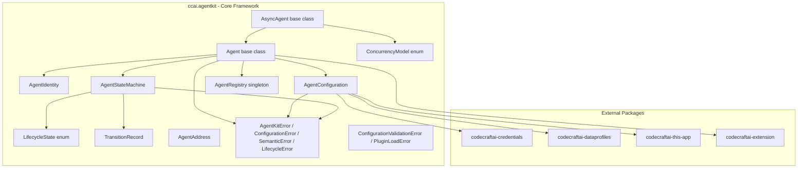
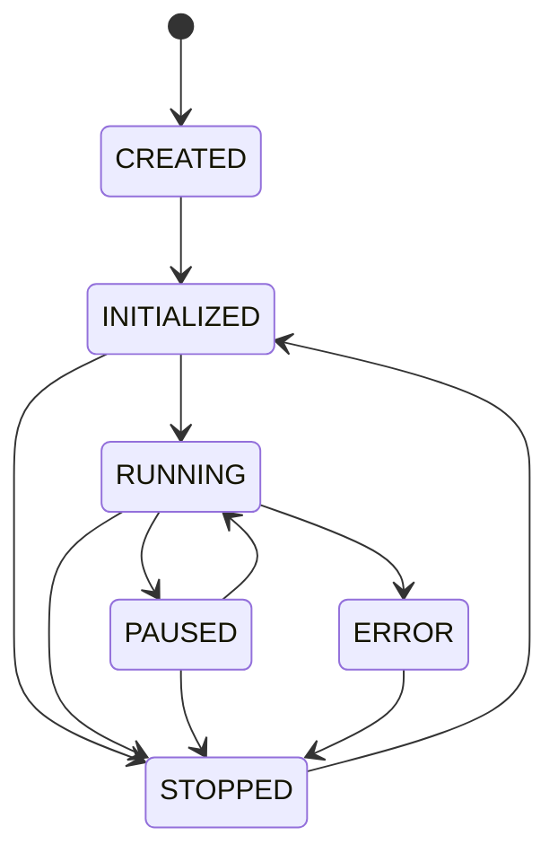
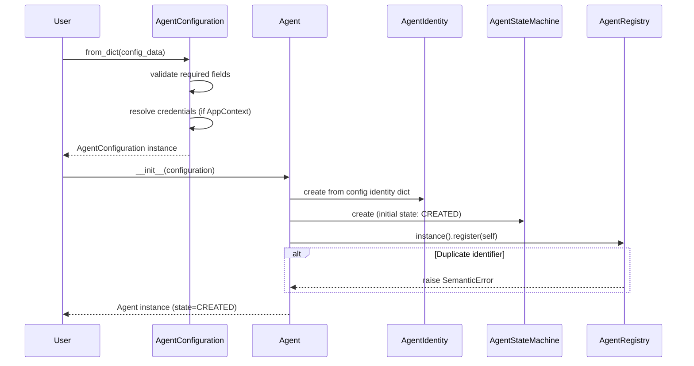
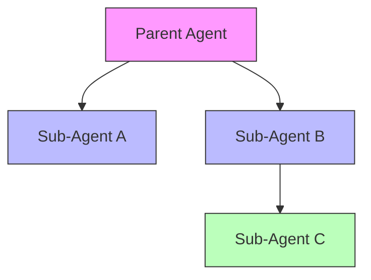

# Design Document — Core Agent Framework

## Overview

The Core Agent Framework provides the foundational building blocks for the `codecraftai-agent-kit` Python SDK. It defines the base `Agent` abstraction, agent identity and metadata (`AgentIdentity`), a declarative configuration system (`AgentConfiguration`), a state machine governing agent lifecycle transitions (`AgentStateMachine`), lifecycle hooks for extensibility, an agent registry for instance management (`AgentRegistry`), hierarchical agent composition with cycle detection, an immutable agent address (`AgentAddress`), concurrency model support (`ConcurrencyModel`, `AsyncAgent`), and a well-defined exception hierarchy.

All classes live under `source/packages/ccai/agentkit/` with filenames in all-lowercase, following the project naming conventions. The framework integrates with:

- `codecraftai-credentials` — Credential resolution for `AgentConfiguration`
- `codecraftai-dataprofiles` — Data profile resolution for `AgentConfiguration`
- `codecraftai-this-app` — AppContext for settings, environment, and directory-based presence
- `codecraftai-extension` — PluginManager and ExtensionPoint for plugin discovery
- `codecraftai-arcli` — CLI scaffolding for agents

The design prioritizes debuggability over performance and readability over conciseness, per the project coding standards.

## Architecture



### Agent Lifecycle State Machine



### Agent Construction and Registration Flow



### Hierarchical Agent Composition



When a sub-agent transitions to ERROR, the parent receives notification through its `on_error` lifecycle hooks with the child's identifier and name in the transition record metadata.

### Design Decisions

1. **Agent as abstract base class using `abc.ABC`** — Enforces that subclasses implement all lifecycle methods. Consistent with the SDK pattern used by AsyncAgent, Tool, and other extensible base classes.

2. **AgentStateMachine as a separate component** — Isolates state transition logic from the Agent class, making it independently testable and reusable. The state machine owns the transition table and history.

3. **AgentRegistry as a singleton** — A single global registry per runtime process enables cross-agent lookup and management. Thread-safe via `threading.Lock`. Provides `_reset_singleton()` for testing.

4. **AgentIdentity as an immutable value object** — Identity fields are set at construction and exposed as read-only properties. Tags return defensive copies. Supports JSON round-trip serialization.

5. **AgentConfiguration supports multiple loading formats** — Dict, JSON string, JSON file, YAML string, YAML file. Credential and data profile resolution happens during loading when an AppContext is provided. Serialization methods exclude resolved credential values for security.

6. **Lifecycle hooks as registered callables** — Hooks are stored per transition point in registration order. Hook exceptions are logged at WARNING and do not interrupt remaining hooks or the transition itself.

7. **Cycle detection in sub-agent composition** — Walking up the ancestor chain prevents circular parent-child relationships. Self-addition is also prevented. Both raise SemanticError with descriptive messages.

8. **AgentAddress equality by (agent_identifier, transport_name)** — Two addresses are equal when they identify the same agent on the same transport, regardless of endpoint details. This enables use as dictionary keys and set members.

9. **AsyncAgent delegates sync methods to async coroutines** — When an event loop is running, coroutines are scheduled as tasks. When no loop exists, `asyncio.run()` creates one. This bridges sync and async contexts.

10. **Exception hierarchy rooted at AgentKitError** — ConfigurationError, SemanticError, and LifecycleError provide clear categorization. SemanticError must never be caught by library code per coding standards.

## Components and Interfaces

### File Layout

| File | Class(es) | Purpose |
|---|---|---|
| lifecyclestate.py | LifecycleState | Enum of agent lifecycle states |
| transitionrecord.py | TransitionRecord | Immutable state transition record |
| errors.py | AgentKitError, ConfigurationError, SemanticError, LifecycleError | Exception hierarchy |
| configurationerrors.py | ConfigurationValidationError, PluginLoadError | Extended configuration exceptions |
| agentidentity.py | AgentIdentity | Agent identity and metadata |
| agentaddress.py | AgentAddress | Immutable network-addressable agent endpoint |
| agentconfiguration.py | AgentConfiguration | Declarative agent configuration |
| agentstatemachine.py | AgentStateMachine | Lifecycle state machine with transition table |
| agentregistry.py | AgentRegistry | Singleton agent instance registry |
| concurrencymodel.py | ConcurrencyModel | Enum of concurrency models |
| agent.py | Agent | Abstract base class for all agents |
| asyncagent.py | AsyncAgent | Async lifecycle agent base class |

### LifecycleState

```python
import enum

class LifecycleState(enum.Enum):
    CREATED = "CREATED"
    INITIALIZED = "INITIALIZED"
    RUNNING = "RUNNING"
    PAUSED = "PAUSED"
    STOPPED = "STOPPED"
    ERROR = "ERROR"
```

### TransitionRecord

```python
class TransitionRecord:
    """
        Immutable record of a lifecycle state transition.
    """

    def __init__(self, previous_state: LifecycleState, new_state: LifecycleState,
                 timestamp: datetime, metadata: Optional[dict] = None) -> None:
        ...

    @property
    def previous_state(self) -> LifecycleState: ...
    @property
    def new_state(self) -> LifecycleState: ...
    @property
    def timestamp(self) -> datetime: ...
    @property
    def metadata(self) -> dict: ...  # defensive copy

    def __repr__(self) -> str: ...
```

### AgentKitError Hierarchy

```python
class AgentKitError(Exception):
    def __init__(self, message: str, cause: Optional[Exception] = None) -> None: ...
    @property
    def message(self) -> str: ...
    @property
    def cause(self) -> Optional[Exception]: ...
    def __repr__(self) -> str: ...

class ConfigurationError(AgentKitError): ...
class SemanticError(AgentKitError): ...
class LifecycleError(AgentKitError): ...
```

### AgentIdentity

```python
class AgentIdentity:
    """
        Identity and metadata for an agent. Supports JSON round-trip serialization.
    """

    def __init__(self, name: str, version: str, tags: Optional[Dict[str, str]] = None,
                 identifier: Optional[str] = None) -> None:
        # Auto-generates UUID if identifier is None
        ...

    @property
    def identifier(self) -> str: ...
    @property
    def name(self) -> str: ...
    @property
    def version(self) -> str: ...
    @property
    def tags(self) -> Dict[str, str]: ...  # defensive copy

    def as_dict(self) -> dict: ...
    def to_json(self) -> str: ...

    @classmethod
    def from_json(cls, json_str: str) -> "AgentIdentity": ...

    def __repr__(self) -> str: ...
    def __str__(self) -> str: ...
```

### AgentAddress

```python
class AgentAddress:
    """
        Immutable network-addressable identity of an Agent.
        Equality and hash based on (agent_identifier, transport_name).
    """

    def __init__(self, agent_identifier: str, transport_name: str,
                 endpoint: Optional[Dict] = None) -> None: ...

    @property
    def agent_identifier(self) -> str: ...
    @property
    def transport_name(self) -> str: ...
    @property
    def endpoint(self) -> Dict: ...  # defensive copy

    def as_dict(self) -> dict: ...
    def to_json(self) -> str: ...

    @classmethod
    def from_dict(cls, data: dict) -> "AgentAddress": ...
    @classmethod
    def from_json(cls, json_str: str) -> "AgentAddress": ...

    def __eq__(self, other: object) -> bool: ...
    def __hash__(self) -> int: ...
    def __repr__(self) -> str: ...
    def __str__(self) -> str: ...
```

### AgentConfiguration

```python
class AgentConfiguration:
    """
        Declarative configuration for an agent. Supports loading from dict,
        JSON, YAML, and file paths. Validates required fields. Resolves
        credential and data profile references when AppContext is provided.
        Serialization excludes resolved credential values.
    """

    REQUIRED_FIELDS: List[str] = ["identity"]
    REQUIRED_IDENTITY_FIELDS: List[str] = ["name", "version"]

    def __init__(self, identity: dict, settings: Optional[dict] = None,
                 credentials: Optional[dict] = None,
                 data_profiles: Optional[dict] = None,
                 sub_agents: Optional[list] = None,
                 resolved_credentials: Optional[dict] = None,
                 resolved_data_profiles: Optional[dict] = None) -> None: ...

    @property
    def identity(self) -> dict: ...       # defensive copy
    @property
    def settings(self) -> dict: ...       # defensive copy
    @property
    def credentials(self) -> dict: ...    # defensive copy
    @property
    def data_profiles(self) -> dict: ...  # defensive copy
    @property
    def sub_agents(self) -> list: ...     # defensive copy
    @property
    def resolved_credentials(self) -> dict: ...
    @property
    def resolved_data_profiles(self) -> dict: ...

    @classmethod
    def from_dict(cls, config_data: dict, app_context: Any = None) -> "AgentConfiguration": ...
    @classmethod
    def from_json(cls, json_str: str, app_context: Any = None) -> "AgentConfiguration": ...
    @classmethod
    def from_json_file(cls, file_path: str, app_context: Any = None) -> "AgentConfiguration": ...
    @classmethod
    def from_yaml(cls, yaml_str: str, app_context: Any = None) -> "AgentConfiguration": ...
    @classmethod
    def from_yaml_file(cls, file_path: str, app_context: Any = None) -> "AgentConfiguration": ...

    def as_dict(self) -> dict: ...
    def to_json(self) -> str: ...
    def to_yaml(self) -> str: ...

    def __repr__(self) -> str: ...
    def __str__(self) -> str: ...
```

### AgentStateMachine

```python
class AgentStateMachine:
    """
        State machine enforcing valid lifecycle transitions.
        Thread-safe via threading.Lock. Records transition history.
    """

    VALID_TRANSITIONS: Dict[LifecycleState, List[LifecycleState]] = {
        LifecycleState.CREATED: [LifecycleState.INITIALIZED],
        LifecycleState.INITIALIZED: [LifecycleState.RUNNING, LifecycleState.STOPPED],
        LifecycleState.RUNNING: [LifecycleState.PAUSED, LifecycleState.STOPPED, LifecycleState.ERROR],
        LifecycleState.PAUSED: [LifecycleState.RUNNING, LifecycleState.STOPPED],
        LifecycleState.ERROR: [LifecycleState.STOPPED],
        LifecycleState.STOPPED: [LifecycleState.INITIALIZED],
    }

    def __init__(self) -> None: ...

    @property
    def current_state(self) -> LifecycleState: ...
    @property
    def transition_history(self) -> List[TransitionRecord]: ...

    def get_valid_transitions(self) -> List[LifecycleState]: ...
    def transition_to(self, target_state: LifecycleState,
                      metadata: dict = None) -> TransitionRecord: ...

    def __repr__(self) -> str: ...
    def __str__(self) -> str: ...
```

### AgentRegistry

```python
class AgentRegistry:
    """
        Singleton registry tracking all agent instances within a runtime process.
        Thread-safe via threading.Lock.
    """

    _instance: Optional["AgentRegistry"] = None
    _instance_lock: threading.Lock = threading.Lock()

    @classmethod
    def instance(cls) -> "AgentRegistry": ...

    def __init__(self) -> None: ...

    def register(self, agent: object) -> None: ...
    def deregister(self, identifier: str) -> None: ...
    def lookup_by_id(self, identifier: str) -> Optional[object]: ...
    def lookup_by_name(self, name: str) -> List[object]: ...
    def lookup_by_tags(self, **tags: str) -> List[object]: ...
    def list_all(self) -> List[object]: ...

    @property
    def count(self) -> int: ...

    def _reset(self) -> None: ...
    @classmethod
    def _reset_singleton(cls) -> None: ...

    def __repr__(self) -> str: ...
    def __str__(self) -> str: ...
```

### ConcurrencyModel

```python
import enum

class ConcurrencyModel(enum.Enum):
    ASYNCIO = "ASYNCIO"
    THREAD = "THREAD"
    THREAD_POOL = "THREAD_POOL"
```

### Agent (Abstract Base Class)

```python
class Agent(abc.ABC):
    """
        Abstract base class for all agents. Provides lifecycle management,
        identity, configuration, hooks, sub-agent composition with cycle
        detection, and structured logging.
    """

    def __init__(self, configuration: AgentConfiguration) -> None:
        # Creates AgentIdentity from config
        # Creates AgentStateMachine (initial state: CREATED)
        # Registers with AgentRegistry.instance()
        # Initializes hooks dict for all transition points
        # Creates scoped logger: ccai.agentkit.agent.<identifier>
        ...

    @property
    def state(self) -> LifecycleState: ...
    @property
    def identity(self) -> AgentIdentity: ...
    @property
    def configuration(self) -> AgentConfiguration: ...
    @property
    def parent(self) -> Optional["Agent"]: ...
    @property
    def sub_agents(self) -> List["Agent"]: ...
    @property
    def extensions(self) -> List: ...

    @abc.abstractmethod
    def initialize(self) -> None: ...
    @abc.abstractmethod
    def start(self) -> None: ...
    @abc.abstractmethod
    def pause(self) -> None: ...
    @abc.abstractmethod
    def resume(self) -> None: ...
    @abc.abstractmethod
    def stop(self) -> None: ...
    @abc.abstractmethod
    def reset(self) -> None: ...

    def register_hook(self, transition_point: str, callback: Callable) -> None: ...
    def deregister_hook(self, transition_point: str, callback: Callable) -> None: ...

    def add_sub_agent(self, agent: "Agent") -> None: ...
    def remove_sub_agent(self, identifier: str) -> None: ...

    def get_logger(self) -> logging.Logger: ...

    def _perform_transition(self, target_state: LifecycleState,
                            transition_point: str,
                            metadata: Optional[dict] = None) -> TransitionRecord: ...
    def _invoke_hooks(self, transition_point: str, record: TransitionRecord) -> None: ...

    def __repr__(self) -> str: ...
    def __str__(self) -> str: ...
```

### AsyncAgent

```python
class AsyncAgent(Agent):
    """
        Abstract base class for agents that run lifecycle methods as
        async coroutines on an asyncio event loop.
    """

    def __init__(self, configuration: AgentConfiguration) -> None:
        # Sets concurrency_model to ConcurrencyModel.ASYNCIO
        ...

    @property
    def concurrency_model(self) -> ConcurrencyModel: ...

    # Synchronous methods delegate to async versions
    def initialize(self) -> None: ...
    def start(self) -> None: ...
    def pause(self) -> None: ...
    def resume(self) -> None: ...
    def stop(self) -> None: ...
    def reset(self) -> None: ...

    # Abstract async lifecycle methods
    @abc.abstractmethod
    async def async_initialize(self) -> None: ...
    @abc.abstractmethod
    async def async_start(self) -> None: ...
    @abc.abstractmethod
    async def async_pause(self) -> None: ...
    @abc.abstractmethod
    async def async_resume(self) -> None: ...
    @abc.abstractmethod
    async def async_stop(self) -> None: ...
    @abc.abstractmethod
    async def async_reset(self) -> None: ...

    def _run_async(self, coroutine: object) -> None: ...
```

## Data Models

### AgentIdentity Fields

| Field | Type | Required | Default | Description |
|---|---|---|---|---|
| identifier | str | No | UUID auto-generated | Unique agent identifier |
| name | str | Yes | — | Human-readable agent name |
| version | str | Yes | — | Agent version string |
| tags | Dict[str, str] | No | {} | Descriptive key-value tags |

### AgentConfiguration Fields

| Field | Type | Required | Default | Description |
|---|---|---|---|---|
| identity | dict | Yes | — | Identity configuration (must contain name, version) |
| settings | dict | No | {} | Agent behavior settings |
| credentials | dict | No | {} | Credential reference entries |
| data_profiles | dict | No | {} | Data profile reference entries |
| sub_agents | list | No | [] | Sub-agent configuration dicts |
| resolved_credentials | dict | No | {} | Resolved credential objects (excluded from serialization) |
| resolved_data_profiles | dict | No | {} | Resolved data profile objects |

### AgentAddress Fields

| Field | Type | Required | Default | Description |
|---|---|---|---|---|
| agent_identifier | str | Yes | — | Unique identifier of the agent |
| transport_name | str | Yes | — | Transport used to reach the agent |
| endpoint | Dict | No | {} | Protocol-specific endpoint info (host, port, path, queue_name, topic) |

### TransitionRecord Fields

| Field | Type | Required | Default | Description |
|---|---|---|---|---|
| previous_state | LifecycleState | Yes | — | State before the transition |
| new_state | LifecycleState | Yes | — | State after the transition |
| timestamp | datetime | Yes | — | UTC timestamp of the transition |
| metadata | dict | No | {} | Optional metadata for the transition |

### LifecycleState Values

| Value | Description |
|---|---|
| CREATED | Agent constructed, not yet initialized |
| INITIALIZED | Agent initialized, ready to start |
| RUNNING | Agent actively processing |
| PAUSED | Agent temporarily suspended |
| STOPPED | Agent stopped, can be re-initialized |
| ERROR | Agent encountered an error, must stop before re-initializing |

### Valid State Transitions

| From State | Valid Target States |
|---|---|
| CREATED | INITIALIZED |
| INITIALIZED | RUNNING, STOPPED |
| RUNNING | PAUSED, STOPPED, ERROR |
| PAUSED | RUNNING, STOPPED |
| ERROR | STOPPED |
| STOPPED | INITIALIZED |

### ConcurrencyModel Values

| Value | Description |
|---|---|
| ASYNCIO | Agent runs lifecycle methods as async coroutines |
| THREAD | Agent runs in a dedicated thread |
| THREAD_POOL | Agent runs in a thread pool |

### Lifecycle Hook Transition Points

| Transition Point | Invoked When |
|---|---|
| on_initialize | Agent transitions to INITIALIZED |
| on_start | Agent transitions to RUNNING |
| on_pause | Agent transitions to PAUSED |
| on_resume | Agent transitions from PAUSED to RUNNING |
| on_stop | Agent transitions to STOPPED |
| on_error | Agent transitions to ERROR, or a sub-agent errors |

### Exception Hierarchy

| Exception | Parent | Purpose |
|---|---|---|
| AgentKitError | Exception | Base for all framework exceptions |
| ConfigurationError | AgentKitError | Configuration-related problems |
| SemanticError | AgentKitError | API misuse (must never be caught by library code) |
| LifecycleError | AgentKitError | Errors during lifecycle transitions |
| ConfigurationValidationError | AgentKitError | Schema validation failures |
| PluginLoadError | AgentKitError | Plugin loading/activation failures |

## Correctness Properties

*A property is a characteristic or behavior that should hold true across all valid executions of a system — essentially, a formal statement about what the system should do. Properties serve as the bridge between human-readable specifications and machine-verifiable correctness guarantees.*

### Property 1: AgentIdentity JSON round-trip

*For any* valid AgentIdentity instance (with any name, version, tags, and identifier), calling `to_json()` and then `from_json()` on the resulting string shall produce an AgentIdentity whose identifier, name, version, and tags are equal to the original.

**Validates: Requirements 2.5, 2.6, 2.7, 2.8**

### Property 2: AgentIdentity auto-generates UUID when no identifier provided

*For any* name and version string, constructing an AgentIdentity without an explicit identifier shall produce an instance whose identifier is a non-empty string that is a valid UUID format.

**Validates: Requirements 2.2**

### Property 3: AgentConfiguration JSON round-trip

*For any* valid AgentConfiguration instance (without resolved credentials or data profiles), calling `to_json()` and then `from_json()` on the resulting string shall produce an AgentConfiguration whose `as_dict()` output equals the original's `as_dict()` output.

**Validates: Requirements 3.1, 3.2, 3.9, 3.10, 3.12**

### Property 4: AgentConfiguration YAML round-trip

*For any* valid AgentConfiguration instance (without resolved credentials or data profiles), calling `to_yaml()` and then `from_yaml()` on the resulting string shall produce an AgentConfiguration whose `as_dict()` output equals the original's `as_dict()` output.

**Validates: Requirements 3.4, 3.11, 3.13**

### Property 5: AgentConfiguration rejects missing required fields

*For any* dictionary that is missing the "identity" key, or whose "identity" value is missing the "name" or "version" keys, calling `from_dict()` shall raise a ConfigurationError whose message identifies the missing field.

**Validates: Requirements 3.6, 3.7**

### Property 6: AgentConfiguration excludes resolved credentials from serialization

*For any* AgentConfiguration instance that has non-empty resolved_credentials, the output of `as_dict()`, `to_json()`, and `to_yaml()` shall not contain the resolved credential values.

**Validates: Requirements 3.14, 3.15, 11.3**

### Property 7: AgentStateMachine enforces valid transitions

*For any* LifecycleState and any target LifecycleState, if the target is in the VALID_TRANSITIONS table for the current state, then `transition_to()` shall succeed and update `current_state` to the target. If the target is not in the table, `transition_to()` shall raise a SemanticError whose message contains the current state, the target state, and the list of valid transitions.

**Validates: Requirements 4.2, 4.3, 4.4**

### Property 8: AgentStateMachine records transition history

*For any* sequence of N valid transitions on an AgentStateMachine, the `transition_history` shall contain exactly N TransitionRecord instances, each with the correct previous_state, new_state, and a UTC timestamp that is not None.

**Validates: Requirements 4.5, 4.7**

### Property 9: AgentAddress JSON round-trip

*For any* valid AgentAddress instance (with any agent_identifier, transport_name, and endpoint dictionary), calling `to_json()` and then `from_json()` on the resulting string shall produce an AgentAddress whose agent_identifier, transport_name, and endpoint are equal to the original.

**Validates: Requirements 9.4, 9.5, 9.6, 9.7, 9.8**

### Property 10: AgentAddress equality and hash consistency

*For any* two AgentAddress instances, if they share the same agent_identifier and transport_name, they shall be equal and have the same hash, regardless of endpoint differences. If they differ in agent_identifier or transport_name, they shall not be equal.

**Validates: Requirements 9.9, 9.10**

### Property 11: Defensive copies prevent mutation of internal state

*For any* AgentIdentity, modifying the dictionary returned by `tags` shall not change the result of a subsequent `tags` call. *For any* AgentAddress, modifying the dictionary returned by `endpoint` shall not change the result of a subsequent `endpoint` call. *For any* TransitionRecord, modifying the dictionary returned by `metadata` shall not change the result of a subsequent `metadata` call.

**Validates: Requirements 2.4, 5.3, 9.3**

### Property 12: Agent construction invariants

*For any* valid AgentConfiguration, constructing an Agent subclass shall produce an instance whose: (a) `state` is LifecycleState.CREATED, (b) `identity.name` matches the configuration's identity name, (c) `identity.version` matches the configuration's identity version, and (d) the agent is discoverable via `AgentRegistry.instance().lookup_by_id(agent.identity.identifier)`.

**Validates: Requirements 1.6, 1.7, 1.8**

### Property 13: Lifecycle hooks invoked in registration order with correct arguments

*For any* Agent and any sequence of N hooks registered at a transition point, when the corresponding transition occurs, all N hooks shall be invoked in registration order, each receiving the Agent instance and the TransitionRecord as arguments.

**Validates: Requirements 6.1, 6.2, 6.3**

### Property 14: Lifecycle hook exceptions do not prevent remaining hooks

*For any* Agent with multiple hooks registered at a transition point, if one hook raises an exception, the remaining hooks shall still be invoked.

**Validates: Requirements 6.4**

### Property 15: Invalid transition point raises SemanticError

*For any* string that is not one of the valid transition points (on_initialize, on_start, on_pause, on_resume, on_stop, on_error), calling `register_hook()` with that string shall raise a SemanticError whose message includes the invalid point and the list of valid points.

**Validates: Requirements 6.6**

### Property 16: Hook deregistration prevents invocation

*For any* Agent with a registered hook at a transition point, after deregistering that hook, the hook shall not be invoked when the corresponding transition occurs.

**Validates: Requirements 6.5**

### Property 17: AgentRegistry registration, lookup, and enumeration

*For any* set of N agents with unique identifiers: (a) after registration, `count` equals N, (b) `lookup_by_id(id)` returns the correct agent or None for unregistered IDs, (c) `lookup_by_name(name)` returns all agents with that name, (d) `lookup_by_tags(**criteria)` returns exactly those agents matching all tag criteria, (e) `list_all()` returns all N agents.

**Validates: Requirements 7.4, 7.5, 7.6, 7.7, 7.9**

### Property 18: AgentRegistry duplicate registration raises SemanticError

*For any* agent identifier, registering two agents with the same identifier shall raise a SemanticError whose message includes the duplicate identifier.

**Validates: Requirements 7.3**

### Property 19: AgentRegistry deregistration removes agent

*For any* registered agent, calling `deregister(identifier)` shall remove it so that `lookup_by_id(identifier)` returns None and `count` decreases by one.

**Validates: Requirements 7.8**

### Property 20: Sub-agent add sets parent, remove clears parent

*For any* two distinct agents A and B (where B is not an ancestor of A), calling `A.add_sub_agent(B)` shall make `B.parent` equal to A and B appear in `A.sub_agents`. Calling `A.remove_sub_agent(B.identity.identifier)` shall make `B.parent` None and B no longer appear in `A.sub_agents`.

**Validates: Requirements 8.1, 8.2, 8.5, 8.6**

### Property 21: Circular parent-child relationship detection

*For any* chain of agents A → B → C (where A is parent of B, B is parent of C), attempting to add A as a sub-agent of C shall raise a SemanticError. Attempting to add an agent as a sub-agent of itself shall also raise a SemanticError.

**Validates: Requirements 8.8, 8.9, 8.10**

### Property 22: Sub-agent ERROR notification propagates to parent

*For any* parent-child agent pair, when the child agent transitions to the ERROR state, the parent's on_error hooks shall be invoked with a TransitionRecord whose metadata contains the child's identifier and name.

**Validates: Requirements 8.7**

### Property 23: AsyncAgent sync methods delegate to async methods

*For any* AsyncAgent subclass, calling the synchronous `initialize()` method (outside an existing event loop) shall invoke the `async_initialize()` coroutine to completion. The same delegation shall hold for start, pause, resume, stop, and reset.

**Validates: Requirements 10.5, 10.7**

### Property 24: Exception hierarchy fields and chaining

*For any* AgentKitError (or subclass) constructed with a message and an optional cause, the `message` property shall return the message string, the `cause` property shall return the cause exception, and when a cause is provided, `__cause__` shall be set to the cause. The `__repr__` shall contain the class name and message.

**Validates: Requirements 14.5, 14.6, 14.7**

### Property 25: Agent logger scoped to identity

*For any* Agent, `get_logger()` shall return a logger whose name follows the pattern `ccai.agentkit.agent.<agent_identifier>`.

**Validates: Requirements 15.4**

### Property 26: String representations contain required information

*For any* Agent, `repr()` shall contain the class name, identifier, name, and state; `str()` shall contain the name and state. *For any* AgentIdentity, `repr()` shall contain the class name, identifier, name, and version; `str()` shall contain the name and version. *For any* AgentStateMachine, `repr()` shall contain the class name and current state; `str()` shall contain the state value. *For any* AgentAddress, `repr()` shall contain the class name, agent_identifier, and transport_name; `str()` shall contain the agent_identifier, transport_name, and endpoint. *For any* AgentRegistry, `repr()` shall contain the class name and count; `str()` shall contain the count. *For any* TransitionRecord, `repr()` shall contain the class name, previous_state, new_state, and timestamp.

**Validates: Requirements 1.9, 1.10, 2.9, 2.10, 4.10, 4.11, 7.11, 7.12, 5.4, 9.11, 9.12**

## Error Handling

### AgentKitError

Base exception for all framework errors. Accepts a descriptive message and an optional cause exception. When a cause is provided, Python's exception chaining mechanism (`__cause__`) is used. All subclasses inherit the `message` and `cause` properties.

### ConfigurationError

Raised for configuration-related problems. Used by:
- `AgentConfiguration.from_dict()` when required fields are missing (includes the missing field name and list of required fields)
- `AgentConfiguration.from_dict()` when the identity field is not a dictionary (includes the received type)
- `AgentConfiguration._resolve_credentials()` when a credential reference cannot be resolved (includes credential name, provider, and key)
- `AgentConfiguration._resolve_data_profiles()` when a data profile reference cannot be resolved (includes profile name, provider, and key)
- `AgentConfiguration.from_json()` when JSON parsing fails (includes the parse error)
- `AgentConfiguration.from_yaml()` when YAML parsing fails (includes the parse error)
- `AgentConfiguration.from_json_file()` / `from_yaml_file()` when file reading fails (includes file path and error)

All error messages use the multi-line formation pattern: build a list of lines, append contextual details, join with `os.linesep`, assign to a variable for debugger visibility, then raise.

### SemanticError

Raised for API misuse. Per coding standards, must never be caught by library code. Used by:
- `AgentRegistry.register()` when a duplicate identifier is detected (includes the identifier)
- `AgentStateMachine.transition_to()` when an invalid transition is requested (includes current state, target state, and valid transitions)
- `Agent.register_hook()` / `deregister_hook()` when an invalid transition point is provided (includes the invalid point and valid points)
- `Agent.add_sub_agent()` when a circular relationship or self-addition is detected (includes the agent identifiers)

### LifecycleError

Raised for errors during lifecycle transitions. Available for subclass implementations that need to signal transition failures distinct from configuration or semantic errors.

### ConfigurationValidationError

Raised when configuration validation against a ConfigurationSchema fails. Contains schema_name, errors list, and optional warnings list. Error message includes the schema name and all validation errors.

### PluginLoadError

Raised when a plugin fails to load or activate. Contains plugin_name and a descriptive message. Used internally by the PluginManager; the Agent base class catches these and logs at WARNING level.

### Lifecycle Hook Exception Handling

When a lifecycle hook callback raises an exception:
1. Log at WARNING level including the agent identifier and transition point
2. Continue invoking remaining hooks — do not re-raise
3. The transition itself is not affected

### Sub-Agent Error Propagation

When a sub-agent transitions to ERROR:
1. The parent's `on_error` hooks are invoked with a TransitionRecord containing `child_identifier` and `child_name` in metadata
2. The parent does not automatically transition to ERROR — hook handlers decide the response

## Testing Strategy

### Testing Framework

Tests use testbase and reside under `source/testroots/ccai/tests/singlehost/agentkit/`, mirroring the source hierarchy:

| Source File | Unit Test File | Property Test File |
|---|---|---|
| agentkit/lifecyclestate.py | test_lifecyclestate.py | — |
| agentkit/transitionrecord.py | test_transitionrecord.py | test_transitionrecord_properties.py |
| agentkit/errors.py | test_errors.py | test_errors_properties.py |
| agentkit/agentidentity.py | test_agentidentity.py | test_agentidentity_properties.py |
| agentkit/agentaddress.py | test_agentaddress.py | test_agentaddress_properties.py |
| agentkit/agentconfiguration.py | test_agentconfiguration.py | test_agentconfiguration_properties.py |
| agentkit/agentstatemachine.py | test_agentstatemachine.py | test_agentstatemachine_properties.py |
| agentkit/agentregistry.py | test_agentregistry.py | test_agentregistry_properties.py |
| agentkit/concurrencymodel.py | test_concurrencymodel.py | — |
| agentkit/agent.py | test_agent.py | test_agent_properties.py |
| agentkit/asyncagent.py | test_asyncagent.py | test_asyncagent_properties.py |

### Dual Testing Approach

- **Unit tests**: Verify specific examples, edge cases, error conditions, structural checks (abstract method enforcement, read-only properties), and integration with external packages (using `ccai.testbase.mocking.Mock`)
- **Property-based tests**: Verify universal properties across randomly generated inputs

Both are complementary and necessary for comprehensive coverage. Unit tests catch concrete bugs and verify specific behaviors; property tests verify general correctness across the input space.

### Property-Based Testing Configuration

- **Library**: ccai.testbase.properties (built-in testbase property testing engine)
- **Minimum 100 iterations** per property test (due to randomization)
- Each test tagged with a comment: **Feature: core-agent-framework, Property N: title**
- Each correctness property implemented by a **single** property-based test
- testbase property strategies generate random:
  - Agent names, versions, identifiers, and tag dictionaries
  - AgentConfiguration dictionaries with varying fields
  - LifecycleState values and transition sequences
  - AgentAddress instances with random identifiers, transport names, and endpoints
  - TransitionRecord instances with random states and metadata
  - Hook callback sequences for ordering verification
  - Sub-agent hierarchies for cycle detection testing

### Unit Test Focus Areas

- **Structural checks**: Abstract method enforcement on Agent and AsyncAgent, read-only properties on AgentIdentity/AgentAddress/TransitionRecord, LifecycleState enum values, ConcurrencyModel enum values
- **Error conditions**: Missing required config fields, invalid identity type, duplicate registry registration, invalid state transitions, circular sub-agent relationships, self-addition as sub-agent, invalid hook transition points
- **Integration**: Credential resolution with mocked `codecraftai-credentials`, data profile resolution with mocked `codecraftai-dataprofiles`, plugin discovery with mocked `codecraftai-extension`, AppContext integration with mocked `codecraftai-this-app`
- **Edge cases**: Agent with no tags, AgentAddress with empty endpoint, TransitionRecord with no metadata, AgentConfiguration with no settings/credentials/data_profiles, deregistering non-existent agent from registry
- **Logging**: Verify log output at correct levels using log capture (INFO for transitions, WARNING for hook exceptions)
- **File I/O**: AgentConfiguration from_json_file and from_yaml_file with real temp files
- **Async**: AsyncAgent sync-to-async delegation, event loop creation when none exists

### Running Tests

```bash
source .venv/bin/activate
testbase testing run --root source/testroots/ccai --includes=ccai.tests.singlehost.agentkit --output=./.output
```
