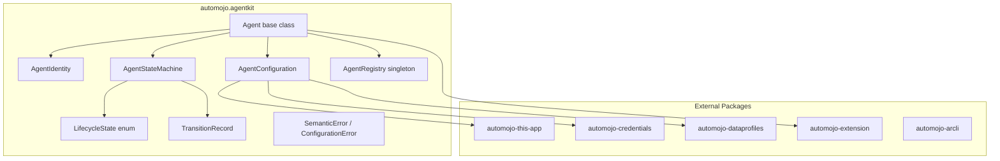
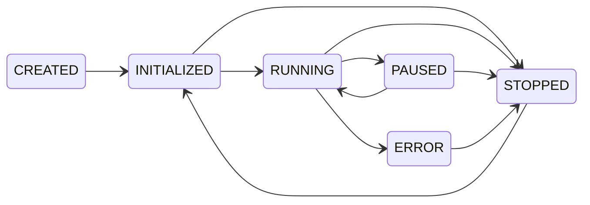

# Design Document — Core Agent Framework

## Overview

The Core Agent Framework provides the foundational abstractions for the `automojo-agent-kit` SDK. It defines the base `Agent` class, agent identity and metadata (`AgentIdentity`), a declarative configuration system (`AgentConfiguration`), a lifecycle state machine (`AgentStateMachine`), lifecycle hooks for extensibility, a singleton agent registry (`AgentRegistry`), and hierarchical agent composition (sub-agents).

All classes live under `source/packages/automojo/agentkit/` with filenames in all-lowercase (no underscores), following the project naming conventions. The framework integrates with five external automojo packages:

- `automojo-this-app` — AppContext for settings, environment variables, and directory-based presence
- `automojo-credentials` — CredentialReference resolution
- `automojo-dataprofiles` — DataProfileReference resolution
- `automojo-extension` — ExtensionPoint registration and plugin discovery
- `automojo-arcli` — Command line interface for agent management and scaffolding

The design prioritizes debuggability over performance and readability over conciseness, per the project coding standards.

## Architecture



### State Machine Transitions



### Design Decisions

1. Agent as abstract base class using abc.ABC with abstract methods for initialize, start, pause, resume, stop, and reset.
2. AgentStateMachine as a separate component for isolated, testable lifecycle transition logic.
3. AgentRegistry as a singleton providing a single registry per runtime.
4. Composition over inheritance for sub-agents with cycle detection via ancestor traversal.
5. Lifecycle hooks as plain callables compatible with automojo-extension ExtensionPoint.
6. SemanticError for API misuse, ConfigurationError for configuration problems.
7. Serialization follows naming conventions: as_dict, to_json/to_yaml, from_json/from_yaml.

## Components and Interfaces

### File Layout

| File | Class(es) | Purpose |
|---|---|---|
| lifecyclestate.py | LifecycleState | Enum of lifecycle states |
| transitionrecord.py | TransitionRecord | Immutable record of a state transition |
| agentstatemachine.py | AgentStateMachine | State machine enforcing valid transitions |
| agentidentity.py | AgentIdentity | Agent identity and metadata |
| agentconfiguration.py | AgentConfiguration | Declarative configuration with serialization |
| agentregistry.py | AgentRegistry | Singleton registry for agent instances |
| agent.py | Agent | Abstract base class for all agents |
| errors.py | SemanticError, ConfigurationError | Framework-specific exceptions |

### LifecycleState

```python
import enum

class LifecycleState(enum.Enum):
    CREATED = "CREATED"
    INITIALIZED = "INITIALIZED"
    RUNNING = "RUNNING"
    PAUSED = "PAUSED"
    STOPPED = "STOPPED"
    ERROR = "ERROR"
```

### TransitionRecord

```python
class TransitionRecord:
    def __init__(self, previous_state: LifecycleState, new_state: LifecycleState,
                 timestamp: datetime, metadata: dict = None):
        self._previous_state = previous_state
        self._new_state = new_state
        self._timestamp = timestamp
        self._metadata = dict(metadata) if metadata is not None else {}
        return

    @property
    def previous_state(self) -> LifecycleState:
        return self._previous_state

    @property
    def new_state(self) -> LifecycleState:
        return self._new_state

    @property
    def timestamp(self) -> datetime:
        return self._timestamp

    @property
    def metadata(self) -> dict:
        return dict(self._metadata)
```

### AgentStateMachine

```python
class AgentStateMachine:
    VALID_TRANSITIONS: Dict[LifecycleState, List[LifecycleState]] = {
        LifecycleState.CREATED: [LifecycleState.INITIALIZED],
        LifecycleState.INITIALIZED: [LifecycleState.RUNNING, LifecycleState.STOPPED],
        LifecycleState.RUNNING: [LifecycleState.PAUSED, LifecycleState.STOPPED, LifecycleState.ERROR],
        LifecycleState.PAUSED: [LifecycleState.RUNNING, LifecycleState.STOPPED],
        LifecycleState.ERROR: [LifecycleState.STOPPED],
        LifecycleState.STOPPED: [LifecycleState.INITIALIZED],
    }

    def __init__(self):
        self._current_state: LifecycleState = LifecycleState.CREATED
        self._history: List[TransitionRecord] = []
        return

    @property
    def current_state(self) -> LifecycleState: ...
    @property
    def transition_history(self) -> List[TransitionRecord]: ...
    def get_valid_transitions(self) -> List[LifecycleState]: ...
    def transition_to(self, target_state: LifecycleState) -> TransitionRecord: ...
```

### AgentIdentity

```python
class AgentIdentity:
    def __init__(self, name: str, version: str, tags: Dict[str, str] = None, identifier: str = None):
        self._identifier = identifier if identifier is not None else str(uuid.uuid4())
        self._name = name
        self._version = version
        self._tags = dict(tags) if tags is not None else {}
        return

    @property
    def identifier(self) -> str: ...
    @property
    def name(self) -> str: ...
    @property
    def version(self) -> str: ...
    @property
    def tags(self) -> Dict[str, str]: ...
    def as_dict(self) -> dict: ...
    def to_json(self) -> str: ...
    @classmethod
    def from_json(cls, json_str: str) -> "AgentIdentity": ...
```

### AgentConfiguration

```python
class AgentConfiguration:
    REQUIRED_FIELDS = ["identity"]
    REQUIRED_IDENTITY_FIELDS = ["name", "version"]

    @classmethod
    def from_dict(cls, config_data: dict, app_context=None) -> "AgentConfiguration": ...
    @classmethod
    def from_json(cls, json_str: str, app_context=None) -> "AgentConfiguration": ...
    @classmethod
    def from_json_file(cls, file_path: str, app_context=None) -> "AgentConfiguration": ...
    @classmethod
    def from_yaml(cls, yaml_str: str, app_context=None) -> "AgentConfiguration": ...
    @classmethod
    def from_yaml_file(cls, file_path: str, app_context=None) -> "AgentConfiguration": ...
    def as_dict(self) -> dict: ...
    def to_json(self) -> str: ...
    def to_yaml(self) -> str: ...
```

### AgentRegistry

```python
class AgentRegistry:
    _instance: Optional["AgentRegistry"] = None

    @classmethod
    def instance(cls) -> "AgentRegistry": ...
    def register(self, agent: "Agent") -> None: ...
    def deregister(self, identifier: str) -> None: ...
    def lookup_by_id(self, identifier: str) -> Optional["Agent"]: ...
    def lookup_by_name(self, name: str) -> List["Agent"]: ...
    def lookup_by_tags(self, **tags: str) -> List["Agent"]: ...
    def list_all(self) -> List["Agent"]: ...
    @property
    def count(self) -> int: ...
```

### Agent (Abstract Base Class)

```python
import abc

class Agent(abc.ABC):
    def __init__(self, configuration: AgentConfiguration):
        self._identity: AgentIdentity = None
        self._configuration: AgentConfiguration = configuration
        self._state_machine: AgentStateMachine = AgentStateMachine()
        self._parent: Optional["Agent"] = None
        self._sub_agents: List["Agent"] = []
        self._hooks: Dict[str, List[Callable]] = {
            "on_initialize": [], "on_start": [], "on_pause": [],
            "on_resume": [], "on_stop": [], "on_error": [],
        }
        self._extensions: List = []
        AgentRegistry.instance().register(self)
        return

    @property
    def state(self) -> LifecycleState: ...
    @property
    def identity(self) -> AgentIdentity: ...
    @property
    def configuration(self) -> AgentConfiguration: ...
    @property
    def parent(self) -> Optional["Agent"]: ...
    @property
    def sub_agents(self) -> List["Agent"]: ...
    @property
    def extensions(self) -> List: ...

    @abc.abstractmethod
    def initialize(self) -> None: ...
    @abc.abstractmethod
    def start(self) -> None: ...
    @abc.abstractmethod
    def pause(self) -> None: ...
    @abc.abstractmethod
    def resume(self) -> None: ...
    @abc.abstractmethod
    def stop(self) -> None: ...
    @abc.abstractmethod
    def reset(self) -> None: ...

    def register_hook(self, transition_point: str, callback: Callable) -> None: ...
    def deregister_hook(self, transition_point: str, callback: Callable) -> None: ...
    def add_sub_agent(self, agent: "Agent") -> None: ...
    def remove_sub_agent(self, identifier: str) -> None: ...
```

### Errors

```python
class SemanticError(Exception): ...
class ConfigurationError(Exception): ...
```

## Data Models

### AgentIdentity Fields

| Field | Type | Required | Default | Description |
|---|---|---|---|---|
| identifier | str | No | Auto-generated UUID | Unique identifier |
| name | str | Yes | — | Human-readable name |
| version | str | Yes | — | Version string |
| tags | Dict[str, str] | No | {} | Key-value tags |

### AgentConfiguration Schema

```python
{
    "identity": {"name": str, "version": str, "identifier": str, "tags": {str: str}},
    "credentials": {str: {"provider": str, "key": str}},
    "data_profiles": {str: {"provider": str, "key": str}},
    "sub_agents": [{"identity": {...}, "type": str}],
    "settings": {str: any}
}
```

### TransitionRecord Fields

| Field | Type | Description |
|---|---|---|
| previous_state | LifecycleState | State before the transition |
| new_state | LifecycleState | State after the transition |
| timestamp | datetime | UTC timestamp of the transition |
| metadata | dict | Optional metadata |

### Valid State Transitions

| From | To |
|---|---|
| CREATED | INITIALIZED |
| INITIALIZED | RUNNING, STOPPED |
| RUNNING | PAUSED, STOPPED, ERROR |
| PAUSED | RUNNING, STOPPED |
| ERROR | STOPPED |
| STOPPED | INITIALIZED |

## Correctness Properties

*A property is a characteristic or behavior that should hold true across all valid executions of a system — essentially, a formal statement about what the system should do. Properties serve as the bridge between human-readable specifications and machine-verifiable correctness guarantees.*

### Property 1: AgentIdentity JSON round-trip
*For any* valid AgentIdentity instance, calling to_json() and then from_json() on the resulting string shall produce an AgentIdentity whose identifier, name, version, and tags are equal to the original.
**Validates: Requirements 2.6, 12.7**

### Property 2: AgentIdentity serialization completeness
*For any* valid AgentIdentity instance, calling as_dict() shall return a dictionary containing keys identifier, name, version, and tags with values equal to the corresponding properties, and calling to_json() shall produce a valid JSON string that when parsed contains the same keys and values.
**Validates: Requirements 2.1, 2.4, 2.5, 12.1**

### Property 3: AgentIdentity auto-generates UUID
*For any* AgentIdentity created without an explicit identifier, the resulting identifier property shall be a valid UUID string parseable by uuid.UUID.
**Validates: Requirements 2.2**

### Property 4: AgentConfiguration JSON round-trip
*For any* valid AgentConfiguration instance (without credential references), calling to_json() and then from_json() shall produce an AgentConfiguration whose as_dict() output equals the original.
**Validates: Requirements 3.12, 12.8**

### Property 5: AgentConfiguration YAML round-trip
*For any* valid AgentConfiguration instance (without credential references), calling to_yaml() and then from_yaml() shall produce an AgentConfiguration whose as_dict() output equals the original.
**Validates: Requirements 3.13, 12.9**

### Property 6: AgentConfiguration validation rejects invalid configs
*For any* configuration dictionary missing required fields or containing invalid types, calling from_dict() shall raise ConfigurationError.
**Validates: Requirements 3.5, 3.8**

### Property 7: AgentConfiguration serialization excludes credentials
*For any* valid AgentConfiguration with CredentialReference entries, the output of as_dict(), to_json(), and to_yaml() shall not contain resolved credential secret values.
**Validates: Requirements 9.3, 3.9, 3.10, 3.11**

### Property 8: State machine accepts valid transitions and updates state
*For any* LifecycleState S and target state T in the valid transitions table for S, calling transition_to(T) shall update the current state to T.
**Validates: Requirements 4.2, 4.3**

### Property 9: State machine rejects invalid transitions
*For any* LifecycleState S and target state T NOT in the valid transitions table for S, calling transition_to(T) shall raise SemanticError whose message includes S, T, and the valid transitions from S.
**Validates: Requirements 4.4**

### Property 10: State machine records transition history
*For any* sequence of valid transitions, transition_history shall contain a TransitionRecord for each transition in order, with correct previous_state, new_state, and a valid timestamp.
**Validates: Requirements 4.5**

### Property 11: State machine get_valid_transitions matches transition table
*For any* LifecycleState S, get_valid_transitions() shall return exactly the target states defined in VALID_TRANSITIONS[S].
**Validates: Requirements 4.7**

### Property 12: Hooks invoked in registration order with correct arguments
*For any* Agent and any list of N hooks registered for a transition point, when the transition occurs, all N hooks shall be invoked in registration order, each receiving the Agent instance and TransitionRecord.
**Validates: Requirements 5.1, 5.2, 5.3**

### Property 13: Hook exception does not prevent remaining hooks
*For any* Agent with N hooks where hook K raises an exception, hooks K+1 through N-1 shall still be invoked.
**Validates: Requirements 5.4**

### Property 14: Hook deregistration removes hook
*For any* Agent with a registered hook, deregistering it and triggering the transition shall not invoke the deregistered hook.
**Validates: Requirements 5.5**

### Property 15: Registry registration and lookup correctness
*For any* set of N agents with unique identifiers: (a) count equals N, (b) lookup_by_id returns the correct agent or None, (c) lookup_by_name returns exactly matching agents, (d) lookup_by_tags returns agents matching all criteria, (e) list_all returns all N agents, (f) duplicate identifier raises SemanticError.
**Validates: Requirements 6.2, 6.3, 6.4, 6.5, 6.6, 6.7, 6.9**

### Property 16: Registry deregistration removes agent
*For any* registered agent, deregister removes it so lookup_by_id returns None and count decreases by one.
**Validates: Requirements 6.8**

### Property 17: Sub-agent add and remove correctness
*For any* parent and child Agent, adding the child as sub-agent places it in sub_agents and sets parent. Removing by identifier reverses both.
**Validates: Requirements 7.1, 7.2**

### Property 18: Parent lifecycle cascades to sub-agents
*For any* parent Agent with RUNNING sub-agents: (a) stopping parent stops all sub-agents, (b) pausing parent pauses RUNNING sub-agents, (c) resuming parent resumes sub-agents paused by parent.
**Validates: Requirements 7.5, 7.6, 7.7**

### Property 19: Sub-agent error notifies parent
*For any* parent-child pair, when the child transitions to ERROR, the parent on_error hooks are invoked with a record including the child identity.
**Validates: Requirements 7.8**

### Property 20: Cycle detection prevents circular parent-child relationships
*For any* agent hierarchy, adding an ancestor as a sub-agent of any descendant (or self) shall raise SemanticError.
**Validates: Requirements 7.9, 7.10**

### Property 21: AgentConfiguration from_dict produces valid configuration
*For any* valid configuration dictionary with all required fields, from_dict() shall produce an AgentConfiguration whose as_dict() contains the same identity, settings, and reference names.
**Validates: Requirements 3.1**

## Error Handling

### SemanticError
Raised for API misuse. Per coding standards, must never be caught by library code. Used for:
- Invalid state transitions (includes current state, requested target, valid transitions)
- Duplicate agent registration (includes the duplicate identifier)
- Circular parent-child relationships (includes the agent causing the cycle)

Error messages use the multi-line formation pattern: build a list of lines, join with os.linesep, assign to a variable for debugger visibility, then raise.

### ConfigurationError
Raised for configuration problems:
- Missing required fields (identifies the missing field)
- Invalid configuration values (identifies field and reason)
- Unresolvable CredentialReference (identifies the credential name)
- Unresolvable DataProfileReference (identifies the data profile name)
- Missing AppContext (indicates automojo-this-app must be initialized)

### Hook Exception Handling
When a LifecycleHook callback raises an exception:
1. Log the exception with agent identity and hook name
2. Continue invoking remaining registered hooks
3. Do not re-raise or transition to ERROR

### Sub-Agent Error Propagation
When a sub-agent transitions to ERROR:
1. Parent on_error hooks are invoked with a TransitionRecord containing the sub-agent identity in metadata
2. Parent does not automatically transition to ERROR — hook callbacks decide the response

## Testing Strategy

### Testing Framework
Tests use testbase and reside under source/testroots/automojo/tests/singlehost/agentkit/, mirroring the source hierarchy:

| Source File | Test File |
|---|---|
| agentkit/lifecyclestate.py | test_lifecyclestate.py |
| agentkit/transitionrecord.py | test_transitionrecord.py |
| agentkit/agentstatemachine.py | test_agentstatemachine.py |
| agentkit/agentidentity.py | test_agentidentity.py |
| agentkit/agentconfiguration.py | test_agentconfiguration.py |
| agentkit/agentregistry.py | test_agentregistry.py |
| agentkit/agent.py | test_agent.py |

### Dual Testing Approach
- Unit tests: specific examples, edge cases, error conditions, integration with external packages (using testbase.mocking.Mock)
- Property-based tests: universal properties across randomly generated inputs

### Property-Based Testing Configuration
- Library: automojo.testbase.properties (built-in testbase property testing engine)
- Minimum 100 iterations per property test
- Each test tagged: Feature: core-agent-framework, Property N: title
- Each correctness property implemented by a single property-based test
- testbase property strategies generate random identity fields, config dicts, state sequences, hook lists, and agent hierarchies

### Unit Test Focus Areas
- Structural checks (abstract method enforcement, read-only properties)
- External package integration via testbase.mocking.Mock
- Edge cases: empty tags, missing AppContext, unresolvable credentials, duplicate registration
- Error message content verification

### Running Tests
```bash
source .venv/bin/activate
testbase testing run --root source/testroots/automojo --includes=automojo.tests.singlehost.agentkit --output=./.output
```
