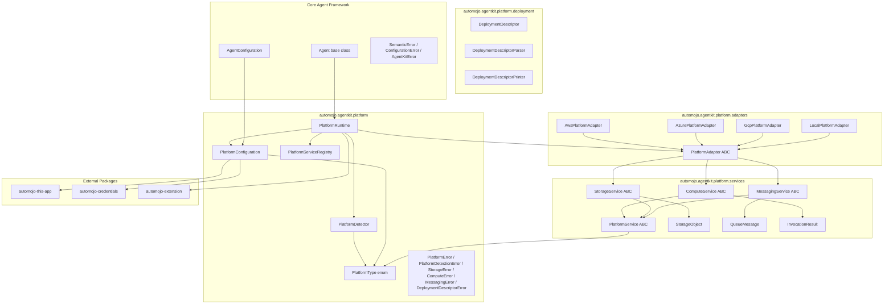
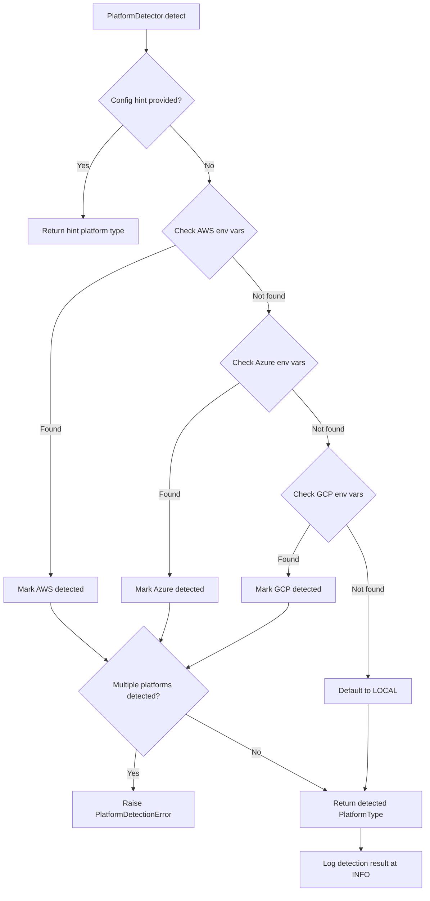
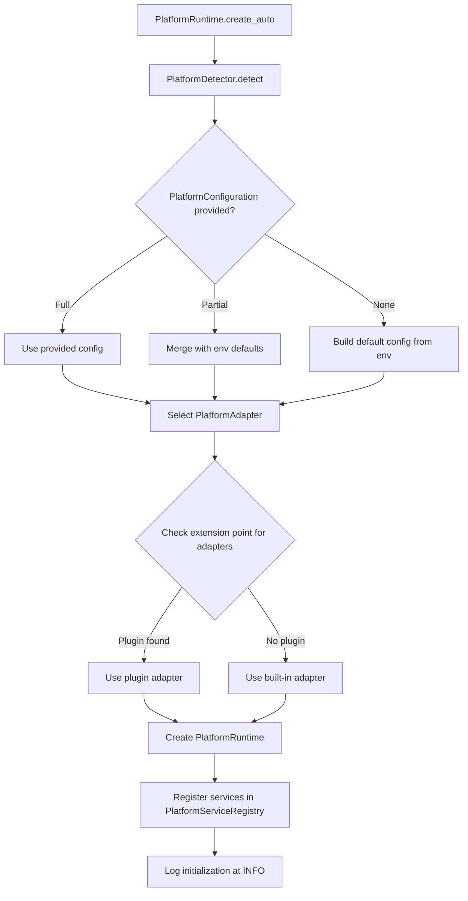

# Design Document — Cross-Platform Runtime

## Overview

The Cross-Platform Runtime feature extends the `automojo-agent-kit` SDK with a platform abstraction layer that enables agents to run across cloud providers (AWS, Azure, GCP) and local environments through a unified API surface. It provides:

1. **Platform Type & Detection** — `PlatformType` enumeration and `PlatformDetector` for environment-based platform identification
2. **Platform Configuration** — `PlatformConfiguration` for declarative platform-specific settings with JSON/YAML serialization
3. **Platform Service Abstractions** — Abstract base classes `PlatformService`, `ComputeService`, `StorageService`, `MessagingService` defining provider-agnostic interfaces
4. **Data Transfer Objects** — Immutable value objects `StorageObject`, `QueueMessage`, `InvocationResult` with round-trip serialization
5. **Platform Adapters** — `PlatformAdapter` base class with concrete implementations `AwsPlatformAdapter`, `AzurePlatformAdapter`, `GcpPlatformAdapter`, `LocalPlatformAdapter`
6. **Platform Service Registry** — `PlatformServiceRegistry` for service discovery by name and type
7. **Platform Runtime** — `PlatformRuntime` as the single entry point for agents to access platform services, with auto-configuration support
8. **Deployment Descriptors** — `DeploymentDescriptor`, `DeploymentDescriptorParser`, `DeploymentDescriptorPrinter` for portable deployment configuration
9. **Exception Hierarchy** — `PlatformError` and subtypes for precise error classification
10. **Extension & Logging** — Plugin-based adapter registration and structured logging

All classes live under `source/packages/automojo/agentkit/` with filenames in all-lowercase (no underscores), following the project naming conventions. The platform module is organized into sub-packages:

- `platform/` — Core platform abstractions, configuration, detection, runtime, registry, errors
- `platform/services/` — Abstract service base classes and data transfer objects
- `platform/adapters/` — Platform-specific adapter implementations
- `platform/deployment/` — Deployment descriptor, parser, and printer

The system integrates with:

- Core Agent Framework — `Agent` base class, `AgentConfiguration`, `LifecycleState`
- `automojo-this-app` — `AppContext` for settings, environment variables, and directory-based presence
- `automojo-credentials` — `CredentialReference` for cloud provider authentication
- `automojo-extension` — `ExtensionPoint` for platform adapter plugin discovery
- Testing & Quality — `PlatformTestHarness` and `SimulatedPlatformService` simulate the abstractions defined here

The design prioritizes debuggability over performance and readability over conciseness, per the project coding standards.

## Architecture



### Platform Detection Flow



### Auto-Configuration Flow



### Design Decisions

1. **Platform module as a sub-package** — The platform feature has enough classes to warrant a sub-package under `agentkit/platform/` rather than flat files in `agentkit/`. This keeps the file count per directory manageable while maintaining the all-lowercase no-underscore filename convention.

2. **Abstract base classes using `abc.ABC`** — `PlatformService`, `ComputeService`, `StorageService`, `MessagingService`, and `PlatformAdapter` use `abc.ABC` with `@abc.abstractmethod` to enforce implementation contracts. This ensures subclasses provide all required methods.

3. **Immutable data transfer objects** — `StorageObject`, `QueueMessage`, and `InvocationResult` use read-only properties backed by private attributes set in `__init__`. This prevents accidental mutation and makes the objects safe to pass across boundaries.

4. **Serialization follows naming conventions** — `as_dict` for dictionary conversion, `to_json`/`to_yaml` for encoding, `from_dict`/`from_json`/`from_yaml` as class methods for deserialization, per the project naming conventions.

5. **PlatformServiceRegistry as a simple dictionary-based registry** — Not a singleton (unlike `AgentRegistry`), because each `PlatformRuntime` owns its own registry. This avoids global state and supports multiple runtimes in testing.

6. **PlatformDetector as a stateless utility** — Detection is a pure function of environment state. The detector holds no mutable state beyond the last detection result for `__str__`.

7. **Adapter bundles all services** — Each `PlatformAdapter` provides compute, storage, and messaging as a unit. Swapping platforms means swapping one adapter, not three services.

8. **Extension point for custom adapters** — Third-party platforms can register adapters via `automojo-extension` without modifying the core codebase.

9. **Credential resolution at configuration time** — `PlatformConfiguration` resolves `CredentialReference` entries during initialization, failing fast if credentials are unavailable.

10. **Structured logging via Python standard logging** — All platform components log to the `automojo.agentkit.platform` logger hierarchy, consistent with the observability design.


## Components and Interfaces

### File Layout

| File | Class(es) | Purpose |
|---|---|---|
| `platform/__init__.py` | — | Package init, exports public API |
| `platform/platformtype.py` | `PlatformType` | Enum of supported platform types |
| `platform/platformdetector.py` | `PlatformDetector` | Environment-based platform detection |
| `platform/platformconfiguration.py` | `PlatformConfiguration` | Declarative platform settings with serialization |
| `platform/platformserviceregistry.py` | `PlatformServiceRegistry` | Service lookup by name and type |
| `platform/platformruntime.py` | `PlatformRuntime` | Entry point for agents to access platform services |
| `platform/errors.py` | `PlatformError`, `PlatformDetectionError`, `StorageError`, `ComputeError`, `MessagingError`, `DeploymentDescriptorError` | Platform exception hierarchy |
| `platform/services/__init__.py` | — | Services sub-package init |
| `platform/services/platformservice.py` | `PlatformService` | Abstract base class for all platform services |
| `platform/services/computeservice.py` | `ComputeService` | Abstract compute service interface |
| `platform/services/storageservice.py` | `StorageService` | Abstract storage service interface |
| `platform/services/messagingservice.py` | `MessagingService` | Abstract messaging service interface |
| `platform/services/storageobject.py` | `StorageObject` | Immutable stored object representation |
| `platform/services/queuemessage.py` | `QueueMessage` | Immutable queue message representation |
| `platform/services/invocationresult.py` | `InvocationResult` | Immutable compute invocation result |
| `platform/adapters/__init__.py` | — | Adapters sub-package init |
| `platform/adapters/platformadapter.py` | `PlatformAdapter` | Abstract adapter base class |
| `platform/adapters/awsplatformadapter.py` | `AwsPlatformAdapter`, `AwsComputeService`, `AwsStorageService`, `AwsMessagingService` | AWS adapter and services |
| `platform/adapters/azureplatformadapter.py` | `AzurePlatformAdapter`, `AzureComputeService`, `AzureStorageService`, `AzureMessagingService` | Azure adapter and services |
| `platform/adapters/gcpplatformadapter.py` | `GcpPlatformAdapter`, `GcpComputeService`, `GcpStorageService`, `GcpMessagingService` | GCP adapter and services |
| `platform/adapters/localplatformadapter.py` | `LocalPlatformAdapter`, `LocalComputeService`, `LocalStorageService`, `LocalMessagingService` | Local adapter and services |
| `platform/deployment/__init__.py` | — | Deployment sub-package init |
| `platform/deployment/deploymentdescriptor.py` | `DeploymentDescriptor` | Declarative deployment configuration |
| `platform/deployment/deploymentdescriptorparser.py` | `DeploymentDescriptorParser` | Parse descriptors from JSON/YAML/files |
| `platform/deployment/deploymentdescriptorprinter.py` | `DeploymentDescriptorPrinter` | Print descriptors to JSON/YAML/files |

### PlatformType (Requirement 1)

```python
import enum

class PlatformType(enum.Enum):
    """
        Enumeration of supported platform types.
    """

    AWS = "aws"
    AZURE = "azure"
    GCP = "gcp"
    LOCAL = "local"

    @classmethod
    def from_string(cls, value: str) -> "PlatformType":
        """
            Returns the PlatformType member matching the given case-insensitive string.

            :param value: A string representing the platform type.

            :returns: The matching PlatformType member.
            :raises: SemanticError
        """
        normalized = value.strip().lower()
        for member in cls:
            if member.value == normalized:
                rtnval = member
                return rtnval

        valid_values = [m.value for m in cls]
        err_msg_lines = [
            "Invalid platform type value '{}'.".format(value),
            "Valid platform types: {}".format(valid_values)
        ]
        err_msg = os.linesep.join(err_msg_lines)
        raise SemanticError(err_msg)

    def to_string(self) -> str:
        """
            Returns the lowercase string representation of the platform type.

            :returns: The lowercase string value.
        """
        rtnval = self.value
        return rtnval
```

### PlatformDetector (Requirement 2)

```python
import logging
import os

logger = logging.getLogger("automojo.agentkit.platform")

class PlatformDetector:
    """
        Inspects the runtime environment to determine which platform the agent
        is running on. Checks environment variables and optional configuration
        hints to return a PlatformType value.
    """

    AWS_ENV_VARS = ("AWS_LAMBDA_FUNCTION_NAME", "AWS_EXECUTION_ENV", "AWS_REGION")
    AZURE_ENV_VARS = ("AZURE_FUNCTIONS_ENVIRONMENT", "WEBSITE_SITE_NAME", "AZURE_REGION")
    GCP_ENV_VARS = ("GOOGLE_CLOUD_PROJECT", "FUNCTION_NAME", "GCP_REGION")

    def __init__(self):
        self._last_detected: PlatformType = None
        return

    def detect(self, configuration: "PlatformConfiguration" = None) -> PlatformType:
        """
            Inspects the runtime environment and returns the detected PlatformType.

            :param configuration: Optional configuration hint that overrides detection.

            :returns: The detected PlatformType value.
            :raises: PlatformDetectionError
        """
        if configuration is not None and configuration.platform_type is not None:
            detected = configuration.platform_type
            logger.info("Platform detected from configuration hint: %s", detected.to_string())
            self._last_detected = detected
            return detected

        detected_platforms = []
        indicators = {}

        aws_found = self._check_env_vars(self.AWS_ENV_VARS)
        if len(aws_found) > 0:
            detected_platforms.append(PlatformType.AWS)
            indicators["aws"] = aws_found

        azure_found = self._check_env_vars(self.AZURE_ENV_VARS)
        if len(azure_found) > 0:
            detected_platforms.append(PlatformType.AZURE)
            indicators["azure"] = azure_found

        gcp_found = self._check_env_vars(self.GCP_ENV_VARS)
        if len(gcp_found) > 0:
            detected_platforms.append(PlatformType.GCP)
            indicators["gcp"] = gcp_found

        if len(detected_platforms) > 1:
            err_msg_lines = [
                "Multiple cloud platforms detected simultaneously.",
                "Conflicting indicators: {}".format(indicators)
            ]
            err_msg = os.linesep.join(err_msg_lines)
            raise PlatformDetectionError(err_msg)

        if len(detected_platforms) == 1:
            detected = detected_platforms[0]
        else:
            detected = PlatformType.LOCAL

        logger.info("Platform detected: %s, indicators: %s", detected.to_string(), indicators)
        self._last_detected = detected
        rtnval = detected
        return rtnval

    def _check_env_vars(self, var_names: tuple) -> list:
        """
            Checks which of the given environment variable names are present.

            :param var_names: Tuple of environment variable names to check.

            :returns: List of environment variable names that are set.
        """
        found = []
        for var_name in var_names:
            if os.environ.get(var_name) is not None:
                found.append(var_name)
        rtnval = found
        return rtnval

    def __repr__(self) -> str:
        rtnval = "PlatformDetector()"
        return rtnval

    def __str__(self) -> str:
        last = self._last_detected.to_string() if self._last_detected is not None else "none"
        rtnval = "PlatformDetector(last_detected={})".format(last)
        return rtnval
```

### PlatformConfiguration (Requirement 3)

```python
import json
import yaml

class PlatformConfiguration:
    """
        Configuration object defining platform-specific settings including
        platform type, region, credential references, service endpoint
        overrides, and platform-specific options.
    """

    REQUIRED_FIELDS = ["platform_type"]

    def __init__(self, platform_type: PlatformType, region: str = None,
                 credential_references: list = None,
                 service_endpoint_overrides: dict = None,
                 options: dict = None):
        self._platform_type = platform_type
        self._region = region
        self._credential_references = list(credential_references) if credential_references is not None else []
        self._service_endpoint_overrides = dict(service_endpoint_overrides) if service_endpoint_overrides is not None else {}
        self._options = dict(options) if options is not None else {}
        self._resolved_credentials = {}
        return

    @property
    def platform_type(self) -> PlatformType: ...
    @property
    def region(self) -> str: ...
    @property
    def credential_references(self) -> list: ...
    @property
    def service_endpoint_overrides(self) -> dict: ...
    @property
    def options(self) -> dict: ...

    def resolve_credentials(self, credential_resolver) -> None:
        """
            Resolves each CredentialReference through the credential resolver.

            :param credential_resolver: The credential resolution service.

            :raises: ConfigurationError
        """
        ...

    def as_dict(self) -> dict:
        """
            Returns a dictionary representation excluding resolved credential values.

            :returns: Dictionary of configuration fields.
        """
        ...

    def to_json(self) -> str:
        """
            Returns a JSON string representation excluding resolved credential values.

            :returns: JSON string.
        """
        ...

    def to_yaml(self) -> str:
        """
            Returns a YAML string representation excluding resolved credential values.

            :returns: YAML string.
        """
        ...

    @classmethod
    def from_dict(cls, data: dict) -> "PlatformConfiguration":
        """
            Constructs a PlatformConfiguration from a dictionary.

            :param data: Dictionary containing configuration fields.

            :returns: A PlatformConfiguration instance.
            :raises: ConfigurationError
        """
        ...

    @classmethod
    def from_json(cls, json_str: str) -> "PlatformConfiguration":
        """
            Deserializes a JSON string into a PlatformConfiguration instance.

            :param json_str: JSON string.

            :returns: A PlatformConfiguration instance.
            :raises: ConfigurationError
        """
        ...

    @classmethod
    def from_yaml(cls, yaml_str: str) -> "PlatformConfiguration":
        """
            Deserializes a YAML string into a PlatformConfiguration instance.

            :param yaml_str: YAML string.

            :returns: A PlatformConfiguration instance.
            :raises: ConfigurationError
        """
        ...

    @classmethod
    def from_json_file(cls, file_path: str, app_context=None) -> "PlatformConfiguration":
        """
            Loads configuration from a JSON file, resolving the path relative
            to the AppContext directory.

            :param file_path: Path to the JSON configuration file.
            :param app_context: Optional AppContext for path resolution.

            :returns: A PlatformConfiguration instance.
            :raises: ConfigurationError
        """
        ...

    @classmethod
    def from_yaml_file(cls, file_path: str, app_context=None) -> "PlatformConfiguration":
        """
            Loads configuration from a YAML file, resolving the path relative
            to the AppContext directory.

            :param file_path: Path to the YAML configuration file.
            :param app_context: Optional AppContext for path resolution.

            :returns: A PlatformConfiguration instance.
            :raises: ConfigurationError
        """
        ...

    def __repr__(self) -> str:
        rtnval = "PlatformConfiguration(platform_type={}, region={})".format(
            self._platform_type.to_string(), self._region
        )
        return rtnval

    def __str__(self) -> str:
        override_count = len(self._service_endpoint_overrides)
        rtnval = "PlatformConfiguration(platform_type={}, region={}, endpoint_overrides={})".format(
            self._platform_type.to_string(), self._region, override_count
        )
        return rtnval
```

### PlatformService (Requirement 4)

```python
import abc

class PlatformService(abc.ABC):
    """
        Abstract base class representing a cloud or local service that a
        platform provides. Concrete subclasses include ComputeService,
        StorageService, and MessagingService.
    """

    def __init__(self, service_name: str, service_type: str,
                 platform_type: PlatformType,
                 configuration: PlatformConfiguration = None):
        self._service_name = service_name
        self._service_type = service_type
        self._platform_type = platform_type
        self._configuration = configuration
        return

    @property
    def service_name(self) -> str:
        rtnval = self._service_name
        return rtnval

    @property
    def service_type(self) -> str:
        rtnval = self._service_type
        return rtnval

    @property
    def platform_type(self) -> PlatformType:
        rtnval = self._platform_type
        return rtnval

    @abc.abstractmethod
    def is_available(self) -> bool:
        """
            Checks whether the service is available.

            :returns: True if the service is available, False otherwise.
        """
        ...

    @abc.abstractmethod
    def health_check(self) -> bool:
        """
            Returns a boolean indicating service health.

            :returns: True if the service is healthy, False otherwise.
        """
        ...

    def __repr__(self) -> str:
        rtnval = "{}(service_name={}, service_type={}, platform_type={})".format(
            self.__class__.__name__, self._service_name,
            self._service_type, self._platform_type.to_string()
        )
        return rtnval

    def __str__(self) -> str:
        rtnval = "{}: name={}, type={}, platform={}".format(
            self.__class__.__name__, self._service_name,
            self._service_type, self._platform_type.to_string()
        )
        return rtnval
```

### ComputeService (Requirement 5)

```python
class ComputeService(PlatformService, abc.ABC):
    """
        Abstract base class representing a compute service that can invoke
        functions, manage execution contexts, and report execution status.
    """

    def __init__(self, service_name: str, platform_type: PlatformType,
                 configuration: PlatformConfiguration = None):
        super().__init__(
            service_name=service_name,
            service_type="compute",
            platform_type=platform_type,
            configuration=configuration
        )
        return

    @abc.abstractmethod
    def invoke(self, function_name: str, payload: dict,
               timeout: float = None) -> "InvocationResult":
        """
            Invokes a function synchronously.

            :param function_name: Name of the function to invoke.
            :param payload: Dictionary payload to pass to the function.
            :param timeout: Optional timeout in seconds.

            :returns: An InvocationResult with the execution outcome.
            :raises: ComputeError
        """
        ...

    @abc.abstractmethod
    def invoke_async(self, function_name: str, payload: dict) -> str:
        """
            Invokes a function asynchronously.

            :param function_name: Name of the function to invoke.
            :param payload: Dictionary payload to pass to the function.

            :returns: A request identifier string for tracking.
            :raises: ComputeError
        """
        ...

    @abc.abstractmethod
    def get_invocation_status(self, request_id: str) -> "InvocationResult":
        """
            Returns the current status of an asynchronous invocation.

            :param request_id: The request identifier from invoke_async.

            :returns: An InvocationResult representing the current status.
            :raises: ComputeError
        """
        ...

    @abc.abstractmethod
    def list_functions(self) -> list:
        """
            Returns a list of available function name strings.

            :returns: List of function name strings.
            :raises: ComputeError
        """
        ...

    def __repr__(self) -> str:
        rtnval = "{}(service_name={}, platform_type={})".format(
            self.__class__.__name__, self._service_name,
            self._platform_type.to_string()
        )
        return rtnval

    def __str__(self) -> str:
        rtnval = "{}: name={}, platform={}".format(
            self.__class__.__name__, self._service_name,
            self._platform_type.to_string()
        )
        return rtnval
```

### StorageService (Requirement 6)

```python
class StorageService(PlatformService, abc.ABC):
    """
        Abstract base class representing an object storage service that can
        store, retrieve, list, and delete objects by key.
    """

    def __init__(self, service_name: str, platform_type: PlatformType,
                 configuration: PlatformConfiguration = None):
        super().__init__(
            service_name=service_name,
            service_type="storage",
            platform_type=platform_type,
            configuration=configuration
        )
        return

    @abc.abstractmethod
    def put_object(self, container_name: str, object_key: str,
                   content: bytes, content_type: str = None,
                   metadata: dict = None) -> None:
        """
            Stores an object in the specified container.

            :param container_name: Name of the storage container.
            :param object_key: Key identifying the object.
            :param content: Object content as bytes.
            :param content_type: Optional MIME content type string.
            :param metadata: Optional metadata dictionary.

            :raises: StorageError
        """
        ...

    @abc.abstractmethod
    def get_object(self, container_name: str, object_key: str) -> "StorageObject":
        """
            Retrieves an object from the specified container.

            :param container_name: Name of the storage container.
            :param object_key: Key identifying the object.

            :returns: A StorageObject instance.
            :raises: StorageError
        """
        ...

    @abc.abstractmethod
    def delete_object(self, container_name: str, object_key: str) -> None:
        """
            Removes an object from the specified container.

            :param container_name: Name of the storage container.
            :param object_key: Key identifying the object.

            :raises: StorageError
        """
        ...

    @abc.abstractmethod
    def list_objects(self, container_name: str, prefix: str = None) -> list:
        """
            Returns a list of object key strings matching the optional prefix.

            :param container_name: Name of the storage container.
            :param prefix: Optional prefix filter string.

            :returns: List of object key strings.
            :raises: StorageError
        """
        ...

    @abc.abstractmethod
    def object_exists(self, container_name: str, object_key: str) -> bool:
        """
            Checks whether an object exists in the specified container.

            :param container_name: Name of the storage container.
            :param object_key: Key identifying the object.

            :returns: True if the object exists, False otherwise.
            :raises: StorageError
        """
        ...

    @abc.abstractmethod
    def create_container(self, container_name: str) -> None:
        """
            Creates a storage container.

            :param container_name: Name of the container to create.

            :raises: StorageError
        """
        ...

    @abc.abstractmethod
    def delete_container(self, container_name: str) -> None:
        """
            Removes a storage container.

            :param container_name: Name of the container to remove.

            :raises: StorageError
        """
        ...

    @abc.abstractmethod
    def list_containers(self) -> list:
        """
            Returns a list of container name strings.

            :returns: List of container name strings.
            :raises: StorageError
        """
        ...

    def __repr__(self) -> str:
        rtnval = "{}(service_name={}, platform_type={})".format(
            self.__class__.__name__, self._service_name,
            self._platform_type.to_string()
        )
        return rtnval

    def __str__(self) -> str:
        rtnval = "{}: name={}, platform={}".format(
            self.__class__.__name__, self._service_name,
            self._platform_type.to_string()
        )
        return rtnval
```

### StorageObject (Requirement 7)

```python
import base64
from datetime import datetime

class StorageObject:
    """
        Immutable object representing a stored object, containing the object
        key, content, content type, metadata, size, and last modified timestamp.
    """

    def __init__(self, key: str, content: bytes, content_type: str,
                 metadata: dict, size: int, last_modified: datetime):
        self._key = key
        self._content = content
        self._content_type = content_type
        self._metadata = dict(metadata) if metadata is not None else {}
        self._size = size
        self._last_modified = last_modified
        return

    @property
    def key(self) -> str: ...
    @property
    def content(self) -> bytes: ...
    @property
    def content_type(self) -> str: ...
    @property
    def metadata(self) -> dict: ...
    @property
    def size(self) -> int: ...
    @property
    def last_modified(self) -> datetime: ...

    def as_dict(self) -> dict:
        """
            Returns a dictionary representation with content encoded as base64.

            :returns: Dictionary of object fields.
        """
        rtnval = {
            "key": self._key,
            "content": base64.b64encode(self._content).decode("utf-8"),
            "content_type": self._content_type,
            "metadata": dict(self._metadata),
            "size": self._size,
            "last_modified": self._last_modified.isoformat()
        }
        return rtnval

    def to_json(self) -> str:
        """
            Returns a JSON string representation.

            :returns: JSON string.
        """
        rtnval = json.dumps(self.as_dict())
        return rtnval

    @classmethod
    def from_dict(cls, data: dict) -> "StorageObject":
        """
            Constructs a StorageObject from a dictionary, decoding base64 content.

            :param data: Dictionary containing object fields.

            :returns: A StorageObject instance.
        """
        content = base64.b64decode(data["content"])
        last_modified = datetime.fromisoformat(data["last_modified"])
        rtnval = cls(
            key=data["key"],
            content=content,
            content_type=data["content_type"],
            metadata=data.get("metadata", {}),
            size=data["size"],
            last_modified=last_modified
        )
        return rtnval

    @classmethod
    def from_json(cls, json_str: str) -> "StorageObject":
        """
            Deserializes a JSON string into a StorageObject instance.

            :param json_str: JSON string.

            :returns: A StorageObject instance.
        """
        data = json.loads(json_str)
        rtnval = cls.from_dict(data)
        return rtnval

    def __repr__(self) -> str:
        rtnval = "StorageObject(key={}, content_type={}, size={})".format(
            self._key, self._content_type, self._size
        )
        return rtnval

    def __str__(self) -> str:
        rtnval = "StorageObject: key={}, content_type={}, size={}".format(
            self._key, self._content_type, self._size
        )
        return rtnval
```

### MessagingService (Requirement 8)

```python
class MessagingService(PlatformService, abc.ABC):
    """
        Abstract base class representing a message queuing service that can
        send messages, receive messages, and manage queue subscriptions.
    """

    def __init__(self, service_name: str, platform_type: PlatformType,
                 configuration: PlatformConfiguration = None):
        super().__init__(
            service_name=service_name,
            service_type="messaging",
            platform_type=platform_type,
            configuration=configuration
        )
        return

    @abc.abstractmethod
    def send_message(self, queue_name: str, body: object,
                     attributes: dict = None) -> str:
        """
            Sends a message to the specified queue.

            :param queue_name: Name of the target queue.
            :param body: Message body as a Python object.
            :param attributes: Optional message attributes dictionary.

            :returns: A message identifier string.
            :raises: MessagingError
        """
        ...

    @abc.abstractmethod
    def receive_messages(self, queue_name: str, max_count: int = 1,
                         wait_time: float = None) -> list:
        """
            Receives messages from the specified queue.

            :param queue_name: Name of the source queue.
            :param max_count: Maximum number of messages to receive.
            :param wait_time: Optional wait time in seconds.

            :returns: A list of QueueMessage objects.
            :raises: MessagingError
        """
        ...

    @abc.abstractmethod
    def acknowledge_message(self, queue_name: str, receipt_handle: str) -> None:
        """
            Acknowledges a message for deletion from the queue.

            :param queue_name: Name of the queue.
            :param receipt_handle: Receipt handle string for the message.

            :raises: MessagingError
        """
        ...

    @abc.abstractmethod
    def create_queue(self, queue_name: str) -> None:
        """
            Creates a message queue.

            :param queue_name: Name of the queue to create.

            :raises: MessagingError
        """
        ...

    @abc.abstractmethod
    def delete_queue(self, queue_name: str) -> None:
        """
            Removes a message queue.

            :param queue_name: Name of the queue to remove.

            :raises: MessagingError
        """
        ...

    @abc.abstractmethod
    def list_queues(self) -> list:
        """
            Returns a list of queue name strings.

            :returns: List of queue name strings.
            :raises: MessagingError
        """
        ...

    def __repr__(self) -> str:
        rtnval = "{}(service_name={}, platform_type={})".format(
            self.__class__.__name__, self._service_name,
            self._platform_type.to_string()
        )
        return rtnval

    def __str__(self) -> str:
        rtnval = "{}: name={}, platform={}".format(
            self.__class__.__name__, self._service_name,
            self._platform_type.to_string()
        )
        return rtnval
```

### QueueMessage (Requirement 9)

```python
class QueueMessage:
    """
        Immutable object representing a message in a queue, containing a
        unique identifier, queue name, body, attributes, receipt handle,
        and timestamp.
    """

    def __init__(self, identifier: str, queue_name: str, body: object,
                 attributes: dict, receipt_handle: str, timestamp: datetime):
        self._identifier = identifier
        self._queue_name = queue_name
        self._body = body
        self._attributes = dict(attributes) if attributes is not None else {}
        self._receipt_handle = receipt_handle
        self._timestamp = timestamp
        return

    @property
    def identifier(self) -> str: ...
    @property
    def queue_name(self) -> str: ...
    @property
    def body(self) -> object: ...
    @property
    def attributes(self) -> dict: ...
    @property
    def receipt_handle(self) -> str: ...
    @property
    def timestamp(self) -> datetime: ...

    def as_dict(self) -> dict:
        """
            Returns a dictionary representation of the message fields.

            :returns: Dictionary of message fields.
        """
        rtnval = {
            "identifier": self._identifier,
            "queue_name": self._queue_name,
            "body": self._body,
            "attributes": dict(self._attributes),
            "receipt_handle": self._receipt_handle,
            "timestamp": self._timestamp.isoformat()
        }
        return rtnval

    def to_json(self) -> str:
        """
            Returns a JSON string representation.

            :returns: JSON string.
        """
        rtnval = json.dumps(self.as_dict())
        return rtnval

    @classmethod
    def from_dict(cls, data: dict) -> "QueueMessage":
        """
            Constructs a QueueMessage from a dictionary.

            :param data: Dictionary containing message fields.

            :returns: A QueueMessage instance.
        """
        timestamp = datetime.fromisoformat(data["timestamp"])
        rtnval = cls(
            identifier=data["identifier"],
            queue_name=data["queue_name"],
            body=data["body"],
            attributes=data.get("attributes", {}),
            receipt_handle=data["receipt_handle"],
            timestamp=timestamp
        )
        return rtnval

    @classmethod
    def from_json(cls, json_str: str) -> "QueueMessage":
        """
            Deserializes a JSON string into a QueueMessage instance.

            :param json_str: JSON string.

            :returns: A QueueMessage instance.
        """
        data = json.loads(json_str)
        rtnval = cls.from_dict(data)
        return rtnval

    def __repr__(self) -> str:
        rtnval = "QueueMessage(identifier={}, queue_name={})".format(
            self._identifier, self._queue_name
        )
        return rtnval

    def __str__(self) -> str:
        body_preview = str(self._body)
        if len(body_preview) > 50:
            body_preview = body_preview[:50] + "..."
        rtnval = "QueueMessage: id={}, queue={}, body={}".format(
            self._identifier, self._queue_name, body_preview
        )
        return rtnval
```

### InvocationResult (Requirement 10)

```python
class InvocationResult:
    """
        Immutable object representing the result of a compute invocation,
        containing status, response payload, optional error message,
        execution duration, and request identifier.
    """

    VALID_STATUSES = ("success", "error", "timeout")

    def __init__(self, status: str, response: object, error_message: str = None,
                 duration: float = 0.0, request_id: str = ""):
        self._status = status
        self._response = response
        self._error_message = error_message
        self._duration = duration
        self._request_id = request_id
        return

    @property
    def status(self) -> str: ...
    @property
    def response(self) -> object: ...
    @property
    def error_message(self) -> str: ...
    @property
    def duration(self) -> float: ...
    @property
    def request_id(self) -> str: ...

    def as_dict(self) -> dict:
        """
            Returns a dictionary representation of the result fields.

            :returns: Dictionary of result fields.
        """
        rtnval = {
            "status": self._status,
            "response": self._response,
            "error_message": self._error_message,
            "duration": self._duration,
            "request_id": self._request_id
        }
        return rtnval

    def to_json(self) -> str:
        """
            Returns a JSON string representation.

            :returns: JSON string.
        """
        rtnval = json.dumps(self.as_dict())
        return rtnval

    @classmethod
    def from_dict(cls, data: dict) -> "InvocationResult":
        """
            Constructs an InvocationResult from a dictionary.

            :param data: Dictionary containing result fields.

            :returns: An InvocationResult instance.
        """
        rtnval = cls(
            status=data["status"],
            response=data.get("response"),
            error_message=data.get("error_message"),
            duration=data.get("duration", 0.0),
            request_id=data.get("request_id", "")
        )
        return rtnval

    @classmethod
    def from_json(cls, json_str: str) -> "InvocationResult":
        """
            Deserializes a JSON string into an InvocationResult instance.

            :param json_str: JSON string.

            :returns: An InvocationResult instance.
        """
        data = json.loads(json_str)
        rtnval = cls.from_dict(data)
        return rtnval

    def __repr__(self) -> str:
        rtnval = "InvocationResult(status={}, request_id={})".format(
            self._status, self._request_id
        )
        return rtnval

    def __str__(self) -> str:
        rtnval = "InvocationResult: status={}, request_id={}, duration={:.3f}s".format(
            self._status, self._request_id, self._duration
        )
        return rtnval
```

### PlatformAdapter (Requirement 11)

```python
class PlatformAdapter(abc.ABC):
    """
        Abstract base class that bundles a complete set of platform service
        implementations for a specific platform. Concrete implementations
        provide compute, storage, and messaging services.
    """

    def __init__(self, configuration: PlatformConfiguration):
        self._configuration = configuration
        return

    @property
    @abc.abstractmethod
    def platform_type(self) -> PlatformType:
        """
            Returns the PlatformType for this adapter.

            :returns: The PlatformType value.
        """
        ...

    @abc.abstractmethod
    def get_compute_service(self) -> ComputeService:
        """
            Returns the ComputeService for this platform.

            :returns: A ComputeService instance.
        """
        ...

    @abc.abstractmethod
    def get_storage_service(self) -> StorageService:
        """
            Returns the StorageService for this platform.

            :returns: A StorageService instance.
        """
        ...

    @abc.abstractmethod
    def get_messaging_service(self) -> MessagingService:
        """
            Returns the MessagingService for this platform.

            :returns: A MessagingService instance.
        """
        ...

    def get_all_services(self) -> list:
        """
            Returns a list of all PlatformService instances.

            :returns: List of PlatformService instances.
        """
        rtnval = [
            self.get_compute_service(),
            self.get_storage_service(),
            self.get_messaging_service()
        ]
        return rtnval

    def health_check(self) -> dict:
        """
            Invokes health_check on each service and returns a dictionary
            mapping service names to boolean health status values.

            :returns: Dictionary of service name to health boolean.
        """
        result = {}
        services = self.get_all_services()
        for service in services:
            try:
                healthy = service.health_check()
                result[service.service_name] = healthy
            except Exception as ex:
                logger.warning(
                    "Health check failed for service '%s' on platform '%s': %s",
                    service.service_name, self.platform_type.to_string(), str(ex)
                )
                result[service.service_name] = False
        rtnval = result
        return rtnval

    def __repr__(self) -> str:
        rtnval = "{}(platform_type={})".format(
            self.__class__.__name__, self.platform_type.to_string()
        )
        return rtnval

    def __str__(self) -> str:
        service_names = [s.service_name for s in self.get_all_services()]
        rtnval = "{}: platform={}, services={}".format(
            self.__class__.__name__, self.platform_type.to_string(), service_names
        )
        return rtnval
```

### AwsPlatformAdapter (Requirement 12)

```python
class AwsPlatformAdapter(PlatformAdapter):
    """
        PlatformAdapter implementation providing AWS-specific service
        implementations using AWS SDK clients for Lambda, S3, and SQS.
    """

    def __init__(self, configuration: PlatformConfiguration):
        super().__init__(configuration=configuration)
        self._region = self._resolve_region()
        self._compute_service = AwsComputeService(
            platform_type=PlatformType.AWS,
            configuration=configuration,
            region=self._region
        )
        self._storage_service = AwsStorageService(
            platform_type=PlatformType.AWS,
            configuration=configuration,
            region=self._region
        )
        self._messaging_service = AwsMessagingService(
            platform_type=PlatformType.AWS,
            configuration=configuration,
            region=self._region
        )
        return

    @property
    def platform_type(self) -> PlatformType:
        rtnval = PlatformType.AWS
        return rtnval

    def get_compute_service(self) -> ComputeService: ...
    def get_storage_service(self) -> StorageService: ...
    def get_messaging_service(self) -> MessagingService: ...

    def _resolve_region(self) -> str:
        """
            Resolves the AWS region from configuration, falling back to
            the AWS_REGION environment variable.

            :returns: The resolved region string.
        """
        if self._configuration.region is not None:
            rtnval = self._configuration.region
            return rtnval
        rtnval = os.environ.get("AWS_REGION", "us-east-1")
        return rtnval
```

The `AwsComputeService`, `AwsStorageService`, and `AwsMessagingService` are concrete implementations that wrap AWS SDK clients (boto3). Each service:
- Resolves credentials through `CredentialReference` entries in the configuration, falling back to the default AWS credential chain
- Uses service endpoint overrides from `PlatformConfiguration` when configured
- Raises the appropriate error type (`ComputeError`, `StorageError`, `MessagingError`) on service failures

### AzurePlatformAdapter (Requirement 13)

Follows the same pattern as `AwsPlatformAdapter` but wraps Azure SDK clients:
- `AzureComputeService` — Azure Functions invocation via Azure SDK
- `AzureStorageService` — Azure Blob Storage operations via Azure SDK
- `AzureMessagingService` — Azure Service Bus operations via Azure SDK
- Region fallback: `AZURE_REGION` environment variable
- Credential fallback: default Azure credential chain

### GcpPlatformAdapter (Requirement 14)

Follows the same pattern as `AwsPlatformAdapter` but wraps GCP SDK clients:
- `GcpComputeService` — GCP Cloud Functions invocation via GCP SDK
- `GcpStorageService` — GCP Cloud Storage operations via GCP SDK
- `GcpMessagingService` — GCP Pub/Sub operations via GCP SDK
- Region fallback: `GCP_REGION` environment variable
- Credential fallback: GCP application default credentials

### LocalPlatformAdapter (Requirement 15)

```python
import subprocess
import threading
from collections import defaultdict

class LocalPlatformAdapter(PlatformAdapter):
    """
        PlatformAdapter implementation providing local environment service
        implementations using subprocess execution, file system storage,
        and in-memory message queuing.
    """

    def __init__(self, configuration: PlatformConfiguration):
        super().__init__(configuration=configuration)
        base_dir = self._resolve_base_directory()
        self._compute_service = LocalComputeService(
            platform_type=PlatformType.LOCAL,
            configuration=configuration,
            default_timeout=30.0
        )
        self._storage_service = LocalStorageService(
            platform_type=PlatformType.LOCAL,
            configuration=configuration,
            base_directory=base_dir
        )
        self._messaging_service = LocalMessagingService(
            platform_type=PlatformType.LOCAL,
            configuration=configuration
        )
        return

    @property
    def platform_type(self) -> PlatformType:
        rtnval = PlatformType.LOCAL
        return rtnval

    def get_compute_service(self) -> ComputeService: ...
    def get_storage_service(self) -> StorageService: ...
    def get_messaging_service(self) -> MessagingService: ...

    def _resolve_base_directory(self) -> str:
        """
            Resolves the base directory for local storage from configuration
            options, falling back to a directory under AppContext.

            :returns: The resolved base directory path string.
        """
        ...
```

Key implementation details for local services:
- `LocalComputeService` — Uses `subprocess.run` with configurable timeout (default 30s). Returns `InvocationResult` with status "timeout" when subprocess exceeds timeout.
- `LocalStorageService` — Stores objects as files under `{base_directory}/{container_name}/{object_key}`. Metadata stored in companion `.meta.json` files.
- `LocalMessagingService` — Uses `threading.Lock` for concurrent access to in-memory `collections.deque` queues. Messages are `QueueMessage` instances stored in per-queue deques.

### PlatformServiceRegistry (Requirement 16)

```python
class PlatformServiceRegistry:
    """
        Registry that tracks all available PlatformService instances within
        a PlatformRuntime, providing lookup by service name and service type.
    """

    def __init__(self):
        self._services: dict = {}
        return

    def register(self, service: PlatformService) -> None:
        """
            Registers a PlatformService instance using the service name as key.

            :param service: The PlatformService to register.

            :raises: SemanticError
        """
        name = service.service_name
        if name in self._services:
            err_msg = "Duplicate service name '{}' in PlatformServiceRegistry.".format(name)
            raise SemanticError(err_msg)
        self._services[name] = service
        return

    def deregister(self, service_name: str) -> None:
        """
            Removes a PlatformService by name.

            :param service_name: Name of the service to remove.
        """
        if service_name in self._services:
            del self._services[service_name]
        return

    def lookup_by_name(self, service_name: str) -> PlatformService:
        """
            Returns the PlatformService with the given name, or None.

            :param service_name: Name of the service to look up.

            :returns: The PlatformService instance or None.
        """
        rtnval = self._services.get(service_name)
        return rtnval

    def lookup_by_type(self, service_type: str) -> list:
        """
            Returns a list of PlatformService instances matching the type.

            :param service_type: The service type string to filter by.

            :returns: List of matching PlatformService instances.
        """
        rtnval = []
        for service in self._services.values():
            if service.service_type == service_type:
                rtnval.append(service)
        return rtnval

    def list_all(self) -> list:
        """
            Returns a list of all registered PlatformService instances.

            :returns: List of PlatformService instances.
        """
        rtnval = list(self._services.values())
        return rtnval

    @property
    def count(self) -> int:
        """
            Returns the count of currently registered services.

            :returns: Integer count.
        """
        rtnval = len(self._services)
        return rtnval

    def has_service(self, service_name: str) -> bool:
        """
            Returns whether a service with the given name is registered.

            :param service_name: Name of the service to check.

            :returns: True if registered, False otherwise.
        """
        rtnval = service_name in self._services
        return rtnval

    def __repr__(self) -> str:
        rtnval = "PlatformServiceRegistry(count={})".format(self.count)
        return rtnval

    def __str__(self) -> str:
        entries = []
        for name, service in self._services.items():
            entries.append("{}({})".format(name, service.service_type))
        rtnval = "PlatformServiceRegistry: [{}]".format(", ".join(entries))
        return rtnval
```

### PlatformRuntime (Requirements 17, 18)

```python
class PlatformRuntime:
    """
        Manages the active platform environment for an Agent, providing
        access to platform services through a single entry point.
    """

    def __init__(self, configuration: PlatformConfiguration,
                 adapter: PlatformAdapter):
        self._configuration = configuration
        self._adapter = adapter
        self._registry = PlatformServiceRegistry()
        self._initialize_services()
        logger.info(
            "PlatformRuntime initialized: platform=%s, region=%s, services=%s",
            configuration.platform_type.to_string(),
            configuration.region,
            [s.service_name for s in self._registry.list_all()]
        )
        return

    def _initialize_services(self) -> None:
        """
            Registers all services from the adapter into the service registry.
        """
        services = self._adapter.get_all_services()
        for service in services:
            self._registry.register(service)
        return

    @property
    def platform_type(self) -> PlatformType:
        rtnval = self._configuration.platform_type
        return rtnval

    @property
    def configuration(self) -> PlatformConfiguration:
        rtnval = self._configuration
        return rtnval

    @property
    def adapter(self) -> PlatformAdapter:
        rtnval = self._adapter
        return rtnval

    def get_compute_service(self) -> ComputeService:
        """
            Returns the ComputeService from the active adapter.

            :returns: A ComputeService instance.
        """
        rtnval = self._adapter.get_compute_service()
        return rtnval

    def get_storage_service(self) -> StorageService:
        """
            Returns the StorageService from the active adapter.

            :returns: A StorageService instance.
        """
        rtnval = self._adapter.get_storage_service()
        return rtnval

    def get_messaging_service(self) -> MessagingService:
        """
            Returns the MessagingService from the active adapter.

            :returns: A MessagingService instance.
        """
        rtnval = self._adapter.get_messaging_service()
        return rtnval

    def get_service(self, service_name: str) -> PlatformService:
        """
            Returns a PlatformService by name from the registry.

            :param service_name: Name of the service to look up.

            :returns: The PlatformService instance or None.
        """
        rtnval = self._registry.lookup_by_name(service_name)
        return rtnval

    def health_check(self) -> dict:
        """
            Delegates to the adapter health_check and returns the result.

            :returns: Dictionary of service name to health boolean.
        """
        rtnval = self._adapter.health_check()
        logger.info(
            "PlatformRuntime health check: platform=%s, results=%s",
            self.platform_type.to_string(), rtnval
        )
        return rtnval

    @classmethod
    def create_auto(cls, configuration: PlatformConfiguration = None) -> "PlatformRuntime":
        """
            Auto-configures a PlatformRuntime by detecting the current platform
            and creating the appropriate adapter.

            :param configuration: Optional PlatformConfiguration. If None or
                partial, environment-derived defaults are used.

            :returns: A configured PlatformRuntime instance.
            :raises: PlatformError
        """
        detector = PlatformDetector()
        detected_type = detector.detect(configuration=configuration)

        if configuration is None:
            configuration = PlatformConfiguration(platform_type=detected_type)
        elif configuration.platform_type is None:
            configuration = PlatformConfiguration(
                platform_type=detected_type,
                region=configuration.region,
                credential_references=configuration.credential_references,
                service_endpoint_overrides=configuration.service_endpoint_overrides,
                options=configuration.options
            )

        # Check extension point for plugin adapters
        adapter = cls._load_adapter_from_extensions(detected_type, configuration)
        if adapter is None:
            adapter = cls._create_builtin_adapter(detected_type, configuration)

        rtnval = cls(configuration=configuration, adapter=adapter)
        return rtnval

    @classmethod
    def _load_adapter_from_extensions(cls, platform_type: PlatformType,
                                       configuration: PlatformConfiguration) -> PlatformAdapter:
        """
            Discovers and loads PlatformAdapter implementations from the
            automojo.agentkit.platform.adapters extension point.

            :param platform_type: The target PlatformType.
            :param configuration: The PlatformConfiguration.

            :returns: A PlatformAdapter instance or None.
        """
        # Integration with automojo-extension ExtensionPoint
        # Returns None if no plugin adapter matches the platform type
        ...

    @classmethod
    def _create_builtin_adapter(cls, platform_type: PlatformType,
                                 configuration: PlatformConfiguration) -> PlatformAdapter:
        """
            Creates a built-in PlatformAdapter for the given platform type.

            :param platform_type: The target PlatformType.
            :param configuration: The PlatformConfiguration.

            :returns: A PlatformAdapter instance.
            :raises: PlatformError
        """
        adapter_map = {
            PlatformType.AWS: AwsPlatformAdapter,
            PlatformType.AZURE: AzurePlatformAdapter,
            PlatformType.GCP: GcpPlatformAdapter,
            PlatformType.LOCAL: LocalPlatformAdapter,
        }
        adapter_cls = adapter_map.get(platform_type)
        if adapter_cls is None:
            err_msg = "No built-in adapter for platform type '{}'.".format(
                platform_type.to_string()
            )
            raise PlatformError(err_msg, platform_type=platform_type)
        rtnval = adapter_cls(configuration=configuration)
        return rtnval

    def __repr__(self) -> str:
        rtnval = "PlatformRuntime(platform_type={})".format(
            self.platform_type.to_string()
        )
        return rtnval

    def __str__(self) -> str:
        rtnval = "PlatformRuntime: platform={}, region={}, services={}".format(
            self.platform_type.to_string(),
            self._configuration.region,
            self._registry.count
        )
        return rtnval
```

### DeploymentDescriptor (Requirement 19)

```python
class DeploymentDescriptor:
    """
        Declarative configuration object defining how an agent is deployed
        on a specific platform, including compute, storage, messaging
        configuration, environment variables, and scaling parameters.
    """

    def __init__(self, name: str, target_platform: PlatformType,
                 compute_config: dict = None, storage_config: dict = None,
                 messaging_config: dict = None, environment_variables: dict = None,
                 scaling_parameters: dict = None):
        self._name = name
        self._target_platform = target_platform
        self._compute_config = dict(compute_config) if compute_config is not None else {}
        self._storage_config = dict(storage_config) if storage_config is not None else {}
        self._messaging_config = dict(messaging_config) if messaging_config is not None else {}
        self._environment_variables = dict(environment_variables) if environment_variables is not None else {}
        self._scaling_parameters = dict(scaling_parameters) if scaling_parameters is not None else {}
        return

    @property
    def name(self) -> str: ...
    @property
    def target_platform(self) -> PlatformType: ...
    @property
    def compute_config(self) -> dict: ...
    @property
    def storage_config(self) -> dict: ...
    @property
    def messaging_config(self) -> dict: ...
    @property
    def environment_variables(self) -> dict: ...
    @property
    def scaling_parameters(self) -> dict: ...

    def as_dict(self) -> dict:
        """
            Returns a dictionary representation of the descriptor fields.

            :returns: Dictionary of descriptor fields.
        """
        rtnval = {
            "name": self._name,
            "target_platform": self._target_platform.to_string(),
            "compute_config": dict(self._compute_config),
            "storage_config": dict(self._storage_config),
            "messaging_config": dict(self._messaging_config),
            "environment_variables": dict(self._environment_variables),
            "scaling_parameters": dict(self._scaling_parameters)
        }
        return rtnval

    def to_json(self) -> str:
        """
            Returns a JSON string representation.

            :returns: JSON string.
        """
        rtnval = json.dumps(self.as_dict(), indent=2)
        return rtnval

    def to_yaml(self) -> str:
        """
            Returns a YAML string representation.

            :returns: YAML string.
        """
        rtnval = yaml.dump(self.as_dict(), default_flow_style=False)
        return rtnval

    @classmethod
    def from_dict(cls, data: dict) -> "DeploymentDescriptor":
        """
            Constructs a DeploymentDescriptor from a dictionary.

            :param data: Dictionary containing descriptor fields.

            :returns: A DeploymentDescriptor instance.
            :raises: DeploymentDescriptorError
        """
        platform_type = PlatformType.from_string(data["target_platform"])
        rtnval = cls(
            name=data["name"],
            target_platform=platform_type,
            compute_config=data.get("compute_config", {}),
            storage_config=data.get("storage_config", {}),
            messaging_config=data.get("messaging_config", {}),
            environment_variables=data.get("environment_variables", {}),
            scaling_parameters=data.get("scaling_parameters", {})
        )
        return rtnval

    @classmethod
    def from_json(cls, json_str: str) -> "DeploymentDescriptor":
        """
            Deserializes a JSON string into a DeploymentDescriptor instance.

            :param json_str: JSON string.

            :returns: A DeploymentDescriptor instance.
        """
        data = json.loads(json_str)
        rtnval = cls.from_dict(data)
        return rtnval

    @classmethod
    def from_yaml(cls, yaml_str: str) -> "DeploymentDescriptor":
        """
            Deserializes a YAML string into a DeploymentDescriptor instance.

            :param yaml_str: YAML string.

            :returns: A DeploymentDescriptor instance.
        """
        data = yaml.safe_load(yaml_str)
        rtnval = cls.from_dict(data)
        return rtnval

    def __repr__(self) -> str:
        rtnval = "DeploymentDescriptor(name={}, target_platform={})".format(
            self._name, self._target_platform.to_string()
        )
        return rtnval

    def __str__(self) -> str:
        rtnval = "DeploymentDescriptor: name={}, platform={}, scaling={}".format(
            self._name, self._target_platform.to_string(), self._scaling_parameters
        )
        return rtnval
```

### DeploymentDescriptorParser and DeploymentDescriptorPrinter (Requirement 20)

```python
class DeploymentDescriptorParser:
    """
        Parses DeploymentDescriptor objects from JSON, YAML, or files.
        Validates descriptors against a schema and resolves platform-specific
        defaults.
    """

    SUPPORTED_EXTENSIONS = (".json", ".yaml", ".yml")
    REQUIRED_FIELDS = ["name", "target_platform"]

    def parse_json(self, json_str: str) -> DeploymentDescriptor:
        """
            Parses a JSON string into a DeploymentDescriptor.

            :param json_str: JSON string.

            :returns: A DeploymentDescriptor instance.
            :raises: DeploymentDescriptorError
        """
        data = json.loads(json_str)
        self._validate_schema(data)
        rtnval = DeploymentDescriptor.from_dict(data)
        return rtnval

    def parse_yaml(self, yaml_str: str) -> DeploymentDescriptor:
        """
            Parses a YAML string into a DeploymentDescriptor.

            :param yaml_str: YAML string.

            :returns: A DeploymentDescriptor instance.
            :raises: DeploymentDescriptorError
        """
        data = yaml.safe_load(yaml_str)
        self._validate_schema(data)
        rtnval = DeploymentDescriptor.from_dict(data)
        return rtnval

    def parse_file(self, file_path: str, app_context=None) -> DeploymentDescriptor:
        """
            Parses a deployment descriptor from a file, detecting format
            from the file extension.

            :param file_path: Path to the descriptor file.
            :param app_context: Optional AppContext for path resolution.

            :returns: A DeploymentDescriptor instance.
            :raises: DeploymentDescriptorError
        """
        resolved_path = self._resolve_path(file_path, app_context)
        ext = os.path.splitext(resolved_path)[1].lower()

        if ext == ".json":
            with open(resolved_path, "r") as f:
                content = f.read()
            rtnval = self.parse_json(content)
            return rtnval
        elif ext in (".yaml", ".yml"):
            with open(resolved_path, "r") as f:
                content = f.read()
            rtnval = self.parse_yaml(content)
            return rtnval
        else:
            err_msg_lines = [
                "Unrecognized file extension '{}'.".format(ext),
                "Supported extensions: {}".format(list(self.SUPPORTED_EXTENSIONS))
            ]
            err_msg = os.linesep.join(err_msg_lines)
            raise DeploymentDescriptorError(err_msg)

    def _validate_schema(self, data: dict) -> None:
        """
            Validates the descriptor data against the required schema.

            :param data: Dictionary to validate.

            :raises: DeploymentDescriptorError
        """
        for field in self.REQUIRED_FIELDS:
            if field not in data:
                err_msg = "Missing required field '{}' in deployment descriptor.".format(field)
                raise DeploymentDescriptorError(err_msg)
        return

    def _resolve_path(self, file_path: str, app_context) -> str:
        """
            Resolves the file path relative to the AppContext directory.

            :param file_path: The file path to resolve.
            :param app_context: Optional AppContext.

            :returns: The resolved absolute file path.
        """
        ...

    def __repr__(self) -> str:
        rtnval = "DeploymentDescriptorParser()"
        return rtnval


class DeploymentDescriptorPrinter:
    """
        Formats DeploymentDescriptor objects into JSON or YAML strings
        or writes them to files.
    """

    def print_json(self, descriptor: DeploymentDescriptor) -> str:
        """
            Returns a JSON string representation of the descriptor.

            :param descriptor: The DeploymentDescriptor to format.

            :returns: JSON string.
        """
        rtnval = descriptor.to_json()
        return rtnval

    def print_yaml(self, descriptor: DeploymentDescriptor) -> str:
        """
            Returns a YAML string representation of the descriptor.

            :param descriptor: The DeploymentDescriptor to format.

            :returns: YAML string.
        """
        rtnval = descriptor.to_yaml()
        return rtnval

    def print_file(self, descriptor: DeploymentDescriptor,
                   file_path: str) -> None:
        """
            Writes the descriptor to a file in the format determined
            by the file extension.

            :param descriptor: The DeploymentDescriptor to write.
            :param file_path: Path to the output file.

            :raises: DeploymentDescriptorError
        """
        ext = os.path.splitext(file_path)[1].lower()
        if ext == ".json":
            content = self.print_json(descriptor)
        elif ext in (".yaml", ".yml"):
            content = self.print_yaml(descriptor)
        else:
            err_msg_lines = [
                "Unrecognized file extension '{}'.".format(ext),
                "Supported extensions: .json, .yaml, .yml"
            ]
            err_msg = os.linesep.join(err_msg_lines)
            raise DeploymentDescriptorError(err_msg)

        with open(file_path, "w") as f:
            f.write(content)
        logger.debug("Deployment descriptor written: name=%s, platform=%s",
                      descriptor.name, descriptor.target_platform.to_string())
        return

    def __repr__(self) -> str:
        rtnval = "DeploymentDescriptorPrinter()"
        return rtnval
```

### Agent Platform Integration (Requirement 21)

The `Agent` base class (defined in Core Agent Framework) is extended with platform runtime support:

```python
# Additions to the Agent base class

class Agent(abc.ABC):
    def __init__(self, configuration: AgentConfiguration):
        # ... existing initialization ...
        self._platform_runtime: PlatformRuntime = None

        # If AgentConfiguration contains a PlatformConfiguration, auto-create runtime
        platform_config = configuration.get_platform_configuration()
        if platform_config is not None:
            self._platform_runtime = PlatformRuntime.create_auto(
                configuration=platform_config
            )
        return

    @property
    def platform_runtime(self) -> PlatformRuntime:
        """
            Returns the PlatformRuntime instance, or None when not configured.

            :returns: The PlatformRuntime or None.
        """
        rtnval = self._platform_runtime
        return rtnval

    def get_compute_service(self) -> ComputeService:
        """
            Convenience method delegating to the PlatformRuntime.

            :returns: A ComputeService instance.
            :raises: SemanticError
        """
        if self._platform_runtime is None:
            err_msg = "PlatformRuntime must be configured before accessing platform services."
            raise SemanticError(err_msg)
        rtnval = self._platform_runtime.get_compute_service()
        return rtnval

    def get_storage_service(self) -> StorageService:
        """
            Convenience method delegating to the PlatformRuntime.

            :returns: A StorageService instance.
            :raises: SemanticError
        """
        if self._platform_runtime is None:
            err_msg = "PlatformRuntime must be configured before accessing platform services."
            raise SemanticError(err_msg)
        rtnval = self._platform_runtime.get_storage_service()
        return rtnval

    def get_messaging_service(self) -> MessagingService:
        """
            Convenience method delegating to the PlatformRuntime.

            :returns: A MessagingService instance.
            :raises: SemanticError
        """
        if self._platform_runtime is None:
            err_msg = "PlatformRuntime must be configured before accessing platform services."
            raise SemanticError(err_msg)
        rtnval = self._platform_runtime.get_messaging_service()
        return rtnval
```

When the Agent transitions to the STOPPED state, the stop lifecycle hook logs the platform runtime status at INFO level including the platform type and service health.

### Exception Hierarchy (Requirement 22)

```python
class PlatformError(AgentKitError):
    """
        Raised for general platform operation failures.
    """

    def __init__(self, message: str, cause: Exception = None,
                 platform_type: PlatformType = None):
        super().__init__(message)
        self._cause = cause
        self._platform_type = platform_type
        return

    @property
    def cause(self) -> Exception: ...
    @property
    def platform_type(self) -> PlatformType: ...

    def __repr__(self) -> str:
        platform_str = self._platform_type.to_string() if self._platform_type is not None else "unknown"
        rtnval = "PlatformError(message={}, platform_type={})".format(
            str(self), platform_str
        )
        return rtnval


class PlatformDetectionError(PlatformError):
    """
        Raised when platform detection fails or produces ambiguous results.
    """
    pass


class StorageError(PlatformError):
    """
        Raised when a storage operation fails.
    """

    def __init__(self, message: str, operation_name: str = None,
                 container_name: str = None, object_key: str = None,
                 cause: Exception = None, platform_type: PlatformType = None):
        super().__init__(message, cause=cause, platform_type=platform_type)
        self._operation_name = operation_name
        self._container_name = container_name
        self._object_key = object_key
        return

    @property
    def operation_name(self) -> str: ...
    @property
    def container_name(self) -> str: ...
    @property
    def object_key(self) -> str: ...

    def __repr__(self) -> str:
        platform_str = self._platform_type.to_string() if self._platform_type is not None else "unknown"
        rtnval = "StorageError(message={}, operation={}, container={}, platform_type={})".format(
            str(self), self._operation_name, self._container_name, platform_str
        )
        return rtnval


class ComputeError(PlatformError):
    """
        Raised when a compute operation fails.
    """

    def __init__(self, message: str, function_name: str = None,
                 cause: Exception = None, platform_type: PlatformType = None):
        super().__init__(message, cause=cause, platform_type=platform_type)
        self._function_name = function_name
        return

    @property
    def function_name(self) -> str: ...

    def __repr__(self) -> str:
        platform_str = self._platform_type.to_string() if self._platform_type is not None else "unknown"
        rtnval = "ComputeError(message={}, function_name={}, platform_type={})".format(
            str(self), self._function_name, platform_str
        )
        return rtnval


class MessagingError(PlatformError):
    """
        Raised when a messaging operation fails.
    """

    def __init__(self, message: str, queue_name: str = None,
                 cause: Exception = None, platform_type: PlatformType = None):
        super().__init__(message, cause=cause, platform_type=platform_type)
        self._queue_name = queue_name
        return

    @property
    def queue_name(self) -> str: ...

    def __repr__(self) -> str:
        platform_str = self._platform_type.to_string() if self._platform_type is not None else "unknown"
        rtnval = "MessagingError(message={}, queue_name={}, platform_type={})".format(
            str(self), self._queue_name, platform_str
        )
        return rtnval


class DeploymentDescriptorError(PlatformError):
    """
        Raised when a deployment descriptor is invalid or cannot be parsed.
    """
    pass
```

### Extension Point Integration (Requirement 23)

The framework defines an `ExtensionPoint` named `"automojo.agentkit.platform.adapters"` through `automojo-extension` for registering `PlatformAdapter` implementations.

- During `PlatformRuntime.create_auto`, the runtime discovers all registered adapters from the extension point
- If a plugin provides an adapter matching the detected `PlatformType`, the plugin adapter is used
- If a plugin fails to load, the failure is logged at WARNING level with the plugin name and error detail, and remaining plugins continue loading
- Built-in adapters serve as fallbacks when no plugin adapter matches

### Structured Logging (Requirement 24)

All platform components use the Python standard `logging` module with a logger hierarchy rooted at `automojo.agentkit.platform`:

| Logger Name | Component |
|---|---|
| `automojo.agentkit.platform` | Root platform logger |
| `automojo.agentkit.platform.detector` | PlatformDetector |
| `automojo.agentkit.platform.runtime` | PlatformRuntime |
| `automojo.agentkit.platform.services` | PlatformService subclasses |
| `automojo.agentkit.platform.adapters` | PlatformAdapter subclasses |
| `automojo.agentkit.platform.deployment` | DeploymentDescriptor parsing/printing |

Logging levels:
- **INFO** — Platform detection results, runtime initialization, health check results
- **WARNING** — Service operation failures, adapter health check failures, plugin load failures
- **DEBUG** — Deployment descriptor parsing

## Data Models

### PlatformType Values

| Member | String Value | Description |
|---|---|---|
| AWS | "aws" | Amazon Web Services |
| AZURE | "azure" | Microsoft Azure |
| GCP | "gcp" | Google Cloud Platform |
| LOCAL | "local" | Local development environment |

### PlatformConfiguration Schema

```python
{
    "platform_type": str,                    # Required. One of "aws", "azure", "gcp", "local"
    "region": str,                           # Optional. Cloud region identifier
    "credential_references": [str],          # Optional. List of CredentialReference names
    "service_endpoint_overrides": {str: str},# Optional. Service name to endpoint URL mapping
    "options": {str: any}                    # Optional. Platform-specific options
}
```

### StorageObject Fields

| Field | Type | Description |
|---|---|---|
| key | str | Object key identifier |
| content | bytes | Object content (base64-encoded in serialized form) |
| content_type | str | MIME content type |
| metadata | dict | Key-value metadata |
| size | int | Content size in bytes |
| last_modified | datetime | Last modification timestamp |

### QueueMessage Fields

| Field | Type | Description |
|---|---|---|
| identifier | str | Unique message identifier |
| queue_name | str | Name of the source queue |
| body | object | Message body (must be JSON-serializable for round-trip) |
| attributes | dict | Message attributes |
| receipt_handle | str | Handle for message acknowledgment |
| timestamp | datetime | Message timestamp |

### InvocationResult Fields

| Field | Type | Description |
|---|---|---|
| status | str | One of "success", "error", "timeout" |
| response | object | Response payload (must be JSON-serializable for round-trip) |
| error_message | str | Optional error description |
| duration | float | Execution duration in seconds |
| request_id | str | Request identifier |

### DeploymentDescriptor Schema

```python
{
    "name": str,                             # Required. Descriptor name
    "target_platform": str,                  # Required. One of "aws", "azure", "gcp", "local"
    "compute_config": {str: any},            # Optional. Compute configuration
    "storage_config": {str: any},            # Optional. Storage configuration
    "messaging_config": {str: any},          # Optional. Messaging configuration
    "environment_variables": {str: str},     # Optional. Environment variable mappings
    "scaling_parameters": {str: any}         # Optional. Scaling configuration
}
```

### Platform Detection Environment Variables

| Platform | Environment Variables Checked |
|---|---|
| AWS | `AWS_LAMBDA_FUNCTION_NAME`, `AWS_EXECUTION_ENV`, `AWS_REGION` |
| Azure | `AZURE_FUNCTIONS_ENVIRONMENT`, `WEBSITE_SITE_NAME`, `AZURE_REGION` |
| GCP | `GOOGLE_CLOUD_PROJECT`, `FUNCTION_NAME`, `GCP_REGION` |
| LOCAL | Default when no cloud variables detected |

### Cloud Adapter Region Fallback

| Adapter | Config Field | Environment Variable Fallback |
|---|---|---|
| AwsPlatformAdapter | `PlatformConfiguration.region` | `AWS_REGION` |
| AzurePlatformAdapter | `PlatformConfiguration.region` | `AZURE_REGION` |
| GcpPlatformAdapter | `PlatformConfiguration.region` | `GCP_REGION` |
| LocalPlatformAdapter | N/A | N/A |

## Error Handling

### PlatformError
Base exception for all platform operation failures. Includes a descriptive message, optional cause exception, and optional platform type. Used for:
- Auto-configuration failures (missing credentials, unavailable services)
- Unrecognized platform types in adapter creation

### PlatformDetectionError
Raised when the `PlatformDetector` cannot determine the current platform:
- Multiple cloud platform environments detected simultaneously (includes conflicting indicators)

### StorageError
Raised when a `StorageService` operation fails:
- Nonexistent object retrieval (includes container name, object key, platform type)
- Service connectivity or authentication failures (includes operation name, container name, platform type, error detail)

### ComputeError
Raised when a `ComputeService` operation fails:
- Function invocation failures (includes function name, platform type, error detail)
- Service connectivity or authentication failures

Note: Timeout conditions return an `InvocationResult` with status "timeout" rather than raising an exception.

### MessagingError
Raised when a `MessagingService` operation fails:
- Send/receive failures (includes queue name, platform type, error detail)
- Service connectivity or authentication failures

### DeploymentDescriptorError
Raised when a `DeploymentDescriptor` is invalid or cannot be parsed:
- Missing required fields (identifies the missing field)
- Unrecognized file extensions (lists supported extensions)
- Malformed JSON or YAML content

### ConfigurationError
Raised for `PlatformConfiguration` problems:
- Missing required fields (identifies the missing field)
- Unresolvable `CredentialReference` (identifies the credential name)
- Missing `AppContext` for file path resolution

### SemanticError
Raised for API misuse (never caught by library code):
- Invalid `PlatformType.from_string` value (lists valid values)
- Duplicate service name in `PlatformServiceRegistry`
- Accessing platform services on an Agent without a configured `PlatformRuntime`

Error messages follow the multi-line formation pattern: build a list of lines, join with `os.linesep`, assign to a variable for debugger visibility, then raise.

## Testing Strategy

### Testing Framework

Tests use `testbase` and reside under `source/testroots/automojo/tests/singlehost/agentkit/platform/`, mirroring the source hierarchy:

| Source File | Test File |
|---|---|
| `platform/platformtype.py` | `platform/test_platformtype.py` |
| `platform/platformdetector.py` | `platform/test_platformdetector.py` |
| `platform/platformconfiguration.py` | `platform/test_platformconfiguration.py` |
| `platform/platformserviceregistry.py` | `platform/test_platformserviceregistry.py` |
| `platform/platformruntime.py` | `platform/test_platformruntime.py` |
| `platform/errors.py` | `platform/test_errors.py` |
| `platform/services/storageobject.py` | `platform/services/test_storageobject.py` |
| `platform/services/queuemessage.py` | `platform/services/test_queuemessage.py` |
| `platform/services/invocationresult.py` | `platform/services/test_invocationresult.py` |
| `platform/adapters/localplatformadapter.py` | `platform/adapters/test_localplatformadapter.py` |
| `platform/deployment/deploymentdescriptor.py` | `platform/deployment/test_deploymentdescriptor.py` |
| `platform/deployment/deploymentdescriptorparser.py` | `platform/deployment/test_deploymentdescriptorparser.py` |
| `platform/deployment/deploymentdescriptorprinter.py` | `platform/deployment/test_deploymentdescriptorprinter.py` |

### Dual Testing Approach

- **Unit tests**: Specific examples, edge cases, error conditions, integration with external packages (using `automojo.testbase.mocking.Mock`)
- **Property-based tests**: Universal properties across randomly generated inputs using Hypothesis

### Property-Based Testing Configuration

- Library: Hypothesis for Python property-based testing
- Minimum 100 iterations per property test
- Each test tagged: `Feature: cross-platform-runtime, Property N: title`
- Each correctness property implemented by a single property-based test
- Hypothesis strategies generate random platform types, configuration dicts, storage objects, queue messages, invocation results, deployment descriptors, and service registrations

### Unit Test Focus Areas

- `PlatformType.from_string` with valid and invalid inputs
- `PlatformDetector` with mocked environment variables (using `automojo.testbase.mocking.create_module_patch` on `os.environ`)
- `PlatformConfiguration` loading from dict, JSON, YAML with valid and invalid data
- `PlatformServiceRegistry` registration, deregistration, lookup, duplicate detection
- `PlatformRuntime` initialization, service access, auto-configuration with mocked detector and adapters
- Abstract base class enforcement (cannot instantiate `PlatformService`, `ComputeService`, `StorageService`, `MessagingService`, `PlatformAdapter` directly)
- `LocalPlatformAdapter` end-to-end: put/get/delete objects, send/receive messages, invoke functions
- `DeploymentDescriptorParser` schema validation, file extension detection, error cases
- Exception hierarchy: correct inheritance, field access, `__repr__` content
- Agent platform integration: convenience methods with and without configured runtime

### Mocking Strategy

Cloud platform adapters (AWS, Azure, GCP) are tested using `automojo.testbase.mocking.Mock` to simulate SDK clients:

```python
from automojo.testbase.mocking import Mock

# Example: Mock AWS S3 client for AwsStorageService testing
mock_s3_client = Mock()
mock_s3_client.configure(recursive=True)
ctx = mock_s3_client.mock_context()
ctx.mock_method('get_object', return_value={'Body': b'content', 'ContentType': 'text/plain'})
```

The `LocalPlatformAdapter` is tested with real file system operations (using temporary directories) and real in-memory queues, since it has no external dependencies.

### Running Tests

```bash
source .venv/bin/activate
testbase testing run --root source/testroots/automojo --includes=automojo.tests.singlehost.agentkit.platform --output=./.output
```
