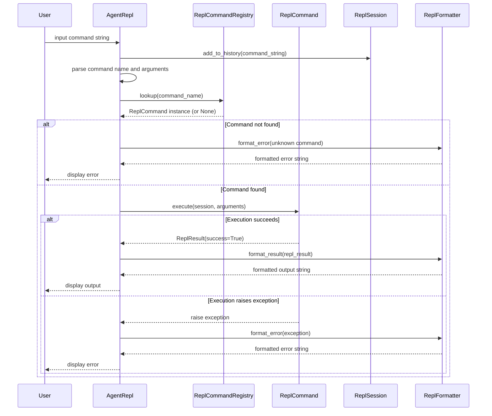
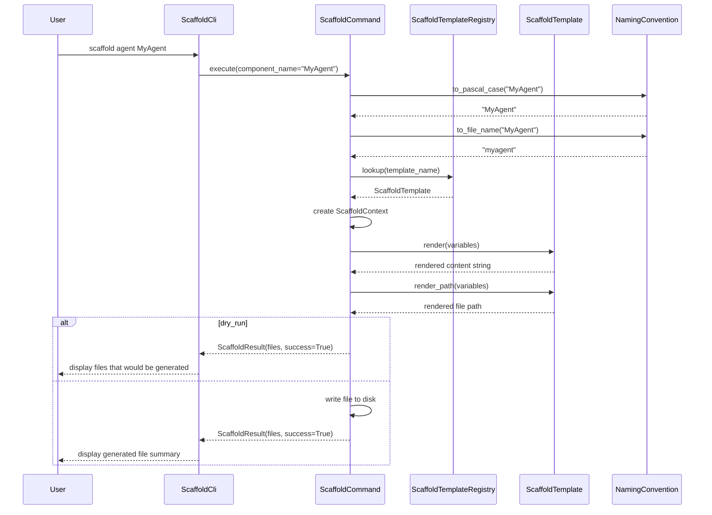

# Design Document — Developer Experience

## Overview

The Developer Experience feature extends the `automojo-agent-kit` SDK with developer-facing tools and utilities organized into five interconnected subsystems:

1. **Scaffold CLI & Commands** — Command-line interface built on `automojo-arcli` for scaffolding agents, tools, workflows, serializers, and other SDK components from templates via `ScaffoldCli`, `ScaffoldCommand`, `ScaffoldTemplate`, `ScaffoldTemplateRegistry`, `ScaffoldContext`, and `ScaffoldResult`
2. **Agent REPL** — Interactive read-eval-print loop for real-time agent interaction, tool invocation, state inspection, and behavior debugging via `AgentRepl`, `ReplCommand`, `ReplCommandRegistry`, `ReplSession`, `ReplResult`, and `ReplFormatter`
3. **Documentation System** — API reference generation, inline help, and example code management via `DocGenerator`, `DocEntry`, `DocRegistry`, `InlineHelpProvider`, `ExampleCode`, and `ExampleRegistry`
4. **Type Annotation & Checking** — Type annotation validation and optional runtime type checking in debug mode via `TypeAnnotationValidator`, `RuntimeTypeChecker`, and `TypeCheckConfiguration`
5. **API Surface Management** — Public API surface validation and compliance reporting via `ApiSurface`, `ApiSurfaceValidator`, and `ApiSurfaceReport`

A unified `DevExConfiguration` object controls all subsystem settings. A `NamingConvention` utility provides naming style conversions used across scaffolding and validation.

All classes live under `source/packages/automojo/agentkit/` with filenames in all-lowercase (no underscores), following the project naming conventions. The system integrates with:

- Core Agent Framework — `Agent` base class, `AgentConfiguration`, `AgentIdentity`, `LifecycleState` for REPL interaction and scaffolding
- Tool & Capability System — `ToolRegistry`, `ToolDescriptor`, `ToolResult` for REPL tool invocation and scaffolding
- LLM Integration — LLM providers testable interactively through the REPL
- Memory & Context Management — Memory stores inspectable from the REPL
- Communication & Messaging — Messages sendable and receivable interactively through the REPL
- Workflow & Orchestration — Workflows scaffoldable and steppable through the REPL
- Observability & Debugging — `StructuredLogger`, `CorrelationContext`, `DebugSession`, `DebugInspector` for REPL debugging integration
- Configuration & Extensibility — `ConfigurationManager`, `FeatureFlag` for scaffolding configuration and debug mode toggling
- Error Handling & Resilience — Error diagnostics surfaced in the REPL
- `automojo-arcli` — CLI framework for all command-line operations
- `automojo-extension` — `ExtensionPoint` for plugin discovery of CLI commands, REPL commands, scaffolding templates, and examples
- `automojo-configuration` — Scaffolding template configuration management
- `automojo-credentials` — `CredentialReference` for credential management during interactive sessions
- `automojo-dataprofiles` — `DataProfileReference` for data profile management
- `automojo-this-app` — `AppContext` for settings, environment, and directory-based project presence

The design prioritizes debuggability over performance and readability over conciseness, per the project coding standards.

## Architecture

```mermaid
graph TD
    subgraph "automojo.agentkit - Developer Experience"
        subgraph "Scaffold CLI & Commands"
            ScaffoldCli[ScaffoldCli]
            ScaffoldCommand[ScaffoldCommand ABC]
            AgentScaffoldCmd[AgentScaffoldCommand]
            ToolScaffoldCmd[ToolScaffoldCommand]
            WorkflowScaffoldCmd[WorkflowScaffoldCommand]
            SerializerScaffoldCmd[SerializerScaffoldCommand]
            ScaffoldTemplate[ScaffoldTemplate]
            ScaffoldTemplateRegistry[ScaffoldTemplateRegistry]
            ScaffoldContext[ScaffoldContext]
            ScaffoldResult[ScaffoldResult]
        end

        subgraph "Agent REPL"
            AgentRepl[AgentRepl]
            ReplCommand[ReplCommand ABC]
            ReplCommandRegistry[ReplCommandRegistry]
            ReplSession[ReplSession]
            ReplResult[ReplResult]
            ReplFormatter[ReplFormatter ABC]
            PlainTextReplFormatter[PlainTextReplFormatter]
            ColoredReplFormatter[ColoredReplFormatter]
        end

        subgraph "Documentation System"
            DocGenerator[DocGenerator]
            DocEntry[DocEntry]
            DocRegistry[DocRegistry]
            InlineHelpProvider[InlineHelpProvider]
            ExampleCode[ExampleCode]
            ExampleRegistry[ExampleRegistry]
        end

        subgraph "Type Annotation & Checking"
            TypeAnnotationValidator[TypeAnnotationValidator]
            RuntimeTypeChecker[RuntimeTypeChecker]
            TypeCheckConfiguration[TypeCheckConfiguration]
        end

        subgraph "API Surface Management"
            ApiSurface[ApiSurface]
            ApiSurfaceValidator[ApiSurfaceValidator]
            ApiSurfaceReport[ApiSurfaceReport]
        end

        NamingConvention[NamingConvention]
        DevExConfiguration[DevExConfiguration]
        DevExErrors[ScaffoldError / ReplError / TypeCheckError / ApiSurfaceError]
    end

    subgraph "Core Agent Framework"
        Agent[Agent base class]
        AgentConfiguration[AgentConfiguration]
        AgentIdentity[AgentIdentity]
        LifecycleState[LifecycleState]
        Errors[SemanticError / ConfigurationError / AgentKitError]
    end

    subgraph "Tool & Capability System"
        ToolRegistry[ToolRegistry]
        ToolDescriptor[ToolDescriptor]
        ToolResult[ToolResult]
    end

    subgraph "Observability & Debugging"
        StructuredLogger[StructuredLogger]
        CorrelationContext[CorrelationContext]
        DebugSession[DebugSession]
        DebugInspector[DebugInspector]
    end

    subgraph "External Packages"
        ArcCli[automojo-arcli]
        Extension[automojo-extension]
        AppContext[automojo-this-app]
        Credentials[automojo-credentials]
    end

    ScaffoldCli --> ArcCli
    ScaffoldCli --> ScaffoldCommand
    ScaffoldCli --> ScaffoldTemplateRegistry
    ScaffoldCli --> InlineHelpProvider
    ScaffoldCli --> Extension
    ScaffoldCli --> AppContext

    ScaffoldCommand --> ScaffoldTemplate
    ScaffoldCommand --> ScaffoldContext
    ScaffoldCommand --> ScaffoldResult
    ScaffoldCommand --> NamingConvention

    AgentScaffoldCmd --> ScaffoldCommand
    ToolScaffoldCmd --> ScaffoldCommand
    WorkflowScaffoldCmd --> ScaffoldCommand
    SerializerScaffoldCmd --> ScaffoldCommand

    ScaffoldTemplateRegistry --> ScaffoldTemplate
    ScaffoldTemplateRegistry --> Extension

    AgentRepl --> ReplCommandRegistry
    AgentRepl --> ReplSession
    AgentRepl --> ReplFormatter
    AgentRepl --> Agent
    AgentRepl --> Extension
    AgentRepl --> CorrelationContext

    ReplCommandRegistry --> ReplCommand
    ReplCommandRegistry --> Extension

    ReplSession --> Agent
    ReplSession --> CorrelationContext

    ReplCommand --> ReplResult
    ReplCommand --> ReplSession

    PlainTextReplFormatter --> ReplFormatter
    ColoredReplFormatter --> ReplFormatter

    DocGenerator --> DocEntry
    DocGenerator --> DocRegistry

    InlineHelpProvider --> DocRegistry
    InlineHelpProvider --> ReplCommand

    ExampleRegistry --> ExampleCode
    ExampleRegistry --> Extension

    RuntimeTypeChecker --> TypeCheckConfiguration
    TypeAnnotationValidator --> TypeCheckConfiguration

    ApiSurfaceValidator --> ApiSurface
    ApiSurfaceValidator --> ApiSurfaceReport

    DevExConfiguration --> TypeCheckConfiguration
```



### REPL Command Execution Flow



### Scaffold Command Execution Flow



### Design Decisions

1. **ScaffoldCli built on `automojo-arcli`** — uses the existing CLI framework for command registration, argument parsing, and help generation. Consistent with how other SDK tools integrate with `automojo-arcli`.
2. **ScaffoldCommand as abstract base class using `abc.ABC`** — consistent with `Tool`, `InputSanitizer`, `OutputFilter`, `HealthCheck`, and other pluggable abstractions in the SDK. Allows external plugins to contribute scaffold commands.
3. **ScaffoldTemplate as an immutable value object** — templates are data, not behavior. Immutability prevents accidental modification after registration. Placeholder rendering is a pure function of the template content and variable dictionary.
4. **NamingConvention as a utility class with class methods** — stateless conversion functions that don't require instantiation. Class methods allow direct invocation without creating an instance, consistent with utility patterns in the SDK.
5. **ReplCommand as abstract base class using `abc.ABC`** — consistent with ScaffoldCommand and other pluggable abstractions. Allows external plugins to contribute REPL commands.
6. **ReplSession as a mutable context carrier** — carries the active agent, command history, and correlation context. Mutable because the session state changes as commands are executed. The active agent can be swapped via `set_agent`.
7. **ReplResult as an immutable value object** — command outcomes are data. Immutability prevents accidental modification after creation. Consistent with `ScaffoldResult`, `ToolResult`, and `SanitizationResult`.
8. **ReplFormatter as abstract base class using `abc.ABC`** — allows pluggable output formatting. Two built-in implementations (plain text, colored) cover common terminal environments. Consistent with the pluggable pattern used throughout the SDK.
9. **DocEntry and ExampleCode as immutable value objects with round-trip serialization** — consistent with all other agentkit data objects that provide `as_dict`, `to_json`, `from_dict`, `from_json`.
10. **DocRegistry and ExampleRegistry as registries with extension point loading** — consistent with `ScaffoldTemplateRegistry`, `ReplCommandRegistry`, `AccessPolicyRegistry`, and other registries in the SDK.
11. **TypeAnnotationValidator as a static analysis tool** — inspects modules at import time or on demand. Does not modify behavior. Separate from RuntimeTypeChecker which operates at call time.
12. **RuntimeTypeChecker uses a `checked` decorator for opt-in wrapping** — the decorator only adds metadata and registers the function for checking. Actual type validation happens at call time only when debug mode is enabled. This follows the project's decorator policy (decorators for metadata/registration only).
13. **ApiSurface introspects a single module** — keeps the scope focused. ApiSurfaceValidator aggregates multiple ApiSurface instances for cross-module validation.
14. **DevExConfiguration as a unified configuration surface** — single object controls all subsystem settings. Consistent with `SecurityConfiguration`, `ResilienceConfiguration`, and `ObservabilityConfiguration`.
15. **All serialization follows naming conventions: `as_dict`, `to_json`, `from_json`, `from_dict`** — consistent with all other agentkit classes.
16. **All `__repr__` and `__str__` methods follow the established pattern** — `__repr__` includes class name and key identifying fields, `__str__` returns a human-readable summary.
17. **Developer experience errors inherit from AgentKitError** — `ScaffoldError`, `ReplError`, `TypeCheckError`, and `ApiSurfaceError` all inherit from `AgentKitError`, consistent with the error hierarchy used across the SDK.
18. **Extension points for developer experience plugins** — four extension points for scaffold commands, scaffold templates, REPL commands, and examples follow the same pattern as other agentkit extension points.
19. **Structured logging under `automojo.agentkit.devex`** — uses Python standard logging module with a dedicated logger hierarchy, consistent with other subsystems using `automojo.agentkit.security`, `automojo.agentkit.resilience`, etc.
20. **Separate registries for templates, commands, docs, and examples** — each registry manages a single concern. Cross-cutting lookup (e.g., InlineHelpProvider searching DocRegistry) is handled by composition, not inheritance.

## Components and Interfaces

### File Layout

| File | Class(es) | Purpose |
|---|---|---|
| scaffoldtemplate.py | ScaffoldTemplate | Immutable file generation template with placeholder rendering |
| scaffoldtemplateregistry.py | ScaffoldTemplateRegistry | Registry of scaffold templates with extension point loading |
| scaffoldcontext.py | ScaffoldContext | Mutable scaffolding state carrier |
| scaffoldresult.py | ScaffoldResult | Immutable scaffolding outcome |
| scaffoldcommand.py | ScaffoldCommand | Abstract base class for scaffold CLI commands |
| agentscaffoldcommand.py | AgentScaffoldCommand | Scaffold command for generating Agent subclasses |
| toolscaffoldcommand.py | ToolScaffoldCommand | Scaffold command for generating Tool subclasses |
| workflowscaffoldcommand.py | WorkflowScaffoldCommand | Scaffold command for generating WorkflowDefinition files |
| serializerscaffoldcommand.py | SerializerScaffoldCommand | Scaffold command for generating MessageSerializer subclasses |
| scaffoldcli.py | ScaffoldCli | Top-level CLI application built on automojo-arcli |
| namingconvention.py | NamingConvention | Utility for naming style conversions and validation |
| replresult.py | ReplResult | Immutable REPL command outcome |
| replsession.py | ReplSession | Mutable REPL session state carrier |
| replcommand.py | ReplCommand | Abstract base class for REPL commands |
| replcommandregistry.py | ReplCommandRegistry | Registry of REPL commands with alias support |
| replformatter.py | ReplFormatter | Abstract base class for REPL output formatting |
| plaintextreplformatter.py | PlainTextReplFormatter | Plain text REPL output formatter |
| coloredreplformatter.py | ColoredReplFormatter | ANSI-colored REPL output formatter |
| agentrepl.py | AgentRepl | Interactive REPL for agent interaction |
| docentry.py | DocEntry | Immutable documentation entry |
| docregistry.py | DocRegistry | Registry of documentation entries with search |
| docgenerator.py | DocGenerator | API reference documentation generator |
| inlinehelpprovider.py | InlineHelpProvider | Contextual help text provider |
| examplecode.py | ExampleCode | Immutable runnable code example |
| exampleregistry.py | ExampleRegistry | Registry of code examples with extension point loading |
| typecheckconfiguration.py | TypeCheckConfiguration | Type checking configuration object |
| typeannotationvalidator.py | TypeAnnotationValidator | Static type annotation validator |
| runtimetypechecker.py | RuntimeTypeChecker | Optional runtime type checker for debug mode |
| apisurface.py | ApiSurface | Public API surface introspector for a single module |
| apisurfacereport.py | ApiSurfaceReport | Immutable API surface validation report |
| apisurfacevalidator.py | ApiSurfaceValidator | API surface quality validator |
| devexconfiguration.py | DevExConfiguration | Unified developer experience configuration |
| devexerrors.py | ScaffoldError, ReplError, TypeCheckError, ApiSurfaceError | Developer experience exceptions |

### ScaffoldTemplate

```python
import json

class ScaffoldTemplate:
    """
        Immutable object representing a file generation template. Contains
        a template name, component type, target file path pattern with
        placeholder variables, template content string with placeholder
        variables, and a dictionary of default variable values.

        Supported placeholder variables: {class_name}, {file_name},
        {module_name}, {component_name}.
    """

    VALID_COMPONENT_TYPES = ("agent", "tool", "workflow", "serializer", "custom")

    def __init__(self, name: str, component_type: str, path_pattern: str,
                 content: str, defaults: dict = None):
        if component_type not in self.VALID_COMPONENT_TYPES:
            # SemanticError for invalid component type
            ...
        self._name = name
        self._component_type = component_type
        self._path_pattern = path_pattern
        self._content = content
        self._defaults = dict(defaults) if defaults is not None else {}
        return

    @property
    def name(self) -> str: ...
    @property
    def component_type(self) -> str: ...
    @property
    def path_pattern(self) -> str: ...
    @property
    def content(self) -> str: ...
    @property
    def defaults(self) -> dict: ...

    def render(self, variables: dict = None) -> str:
        """
            Renders the template content string by merging the provided
            variable dictionary with the default variable values and
            replacing all placeholders.

            :param variables: Dictionary of variable values to merge with defaults.

            :returns: The rendered template content string.
            :raises: ScaffoldError when a placeholder variable is missing.
        """
        ...

    def render_path(self, variables: dict = None) -> str:
        """
            Renders the target file path pattern by merging the provided
            variable dictionary with the default variable values and
            replacing all placeholders.

            :param variables: Dictionary of variable values to merge with defaults.

            :returns: The rendered target file path string.
            :raises: ScaffoldError when a placeholder variable is missing.
        """
        ...

    def as_dict(self) -> dict:
        """
            Returns a dictionary representation of the template fields.

            :returns: A dictionary of template fields.
        """
        ...

    def to_json(self) -> str:
        """
            Returns a JSON string representation of the template fields.

            :returns: A JSON string.
        """
        ...

    @classmethod
    def from_dict(cls, data: dict) -> "ScaffoldTemplate":
        """
            Constructs a ScaffoldTemplate from a dictionary.

            :param data: Dictionary containing template fields.

            :returns: A ScaffoldTemplate instance.
        """
        ...

    @classmethod
    def from_json(cls, json_str: str) -> "ScaffoldTemplate":
        """
            Deserializes a JSON string into a ScaffoldTemplate instance.

            :param json_str: JSON string to deserialize.

            :returns: A ScaffoldTemplate instance.
        """
        ...

    def __repr__(self) -> str: ...
    def __str__(self) -> str: ...
```

### ScaffoldTemplateRegistry

```python
class ScaffoldTemplateRegistry:
    """
        Registry that tracks all available ScaffoldTemplate instances.
        Provides lookup by name, lookup by component type, and
        enumeration. Supports loading templates from automojo-extension
        plugins.
    """

    def __init__(self):
        self._templates = {}  # name -> ScaffoldTemplate
        return

    @property
    def count(self) -> int:
        """
            Returns the count of currently registered templates.

            :returns: Integer count.
        """
        ...

    def register(self, template: "ScaffoldTemplate") -> None:
        """
            Registers a ScaffoldTemplate using the template name as key.

            :param template: The ScaffoldTemplate instance to register.

            :raises: SemanticError when a template with the same name is already registered.
        """
        ...

    def deregister(self, name: str) -> None:
        """
            Removes a registered ScaffoldTemplate by name.

            :param name: The template name to deregister.
        """
        ...

    def lookup(self, name: str) -> "ScaffoldTemplate":
        """
            Returns the ScaffoldTemplate registered under the given name,
            or None when the name is not found.

            :param name: The template name to look up.

            :returns: A ScaffoldTemplate instance or None.
        """
        ...

    def lookup_by_type(self, component_type: str) -> list:
        """
            Returns a list of ScaffoldTemplate instances matching the
            provided component type.

            :param component_type: The component type string to filter by.

            :returns: A list of ScaffoldTemplate instances.
        """
        ...

    def list_all(self) -> list:
        """
            Returns a list of all registered ScaffoldTemplate instances.

            :returns: A list of ScaffoldTemplate instances.
        """
        ...

    def has_template(self, name: str) -> bool:
        """
            Returns True when a template with the given name is registered.

            :param name: The template name to check.

            :returns: Boolean indicating registration status.
        """
        ...

    def load_extensions(self) -> None:
        """
            Discovers and loads ScaffoldTemplate plugins through the
            automojo-extension ExtensionPoint mechanism.
        """
        ...

    def __repr__(self) -> str: ...
    def __str__(self) -> str: ...
```

### ScaffoldContext

```python
class ScaffoldContext:
    """
        Mutable context object that carries scaffolding state during
        file generation. Contains the target project directory, component
        name, component type, resolved template variables, and a mutable
        list of generated file paths.
    """

    def __init__(self, target_directory: str, component_name: str,
                 component_type: str, variables: dict = None):
        self._target_directory = target_directory
        self._component_name = component_name
        self._component_type = component_type
        self._variables = dict(variables) if variables is not None else {}
        self._generated_files = []
        return

    @property
    def target_directory(self) -> str: ...
    @property
    def component_name(self) -> str: ...
    @property
    def component_type(self) -> str: ...
    @property
    def variables(self) -> dict: ...
    @property
    def generated_files(self) -> list: ...

    def add_generated_file(self, file_path: str) -> None:
        """
            Appends a file path to the list of generated files.

            :param file_path: The file path string to append.
        """
        ...

    def __repr__(self) -> str: ...
    def __str__(self) -> str: ...
```

### ScaffoldResult

```python
import json

class ScaffoldResult:
    """
        Immutable object encapsulating the outcome of a scaffolding
        operation. Contains the component name, component type, list
        of generated file paths, and a success flag.
    """

    def __init__(self, component_name: str, component_type: str,
                 generated_files: list, success: bool):
        self._component_name = component_name
        self._component_type = component_type
        self._generated_files = list(generated_files)
        self._success = success
        return

    @property
    def component_name(self) -> str: ...
    @property
    def component_type(self) -> str: ...
    @property
    def generated_files(self) -> list: ...
    @property
    def success(self) -> bool: ...

    def as_dict(self) -> dict:
        """
            Returns a dictionary representation of the result fields.

            :returns: A dictionary of result fields.
        """
        ...

    def to_json(self) -> str:
        """
            Returns a JSON string representation of the result fields.

            :returns: A JSON string.
        """
        ...

    @classmethod
    def from_dict(cls, data: dict) -> "ScaffoldResult":
        """
            Constructs a ScaffoldResult from a dictionary.

            :param data: Dictionary containing result fields.

            :returns: A ScaffoldResult instance.
        """
        ...

    @classmethod
    def from_json(cls, json_str: str) -> "ScaffoldResult":
        """
            Deserializes a JSON string into a ScaffoldResult instance.

            :param json_str: JSON string to deserialize.

            :returns: A ScaffoldResult instance.
        """
        ...

    def __repr__(self) -> str: ...
    def __str__(self) -> str: ...
```

### NamingConvention

```python
import re

class NamingConvention:
    """
        Utility class providing methods for converting between naming
        styles used in the project: PascalCase for class names,
        all-lowercase-no-underscores for file names, and snake_case
        for function and variable names.
    """

    @classmethod
    def to_pascal_case(cls, name: str) -> str:
        """
            Converts a string to PascalCase for use as a class name.

            :param name: The input string.

            :returns: The PascalCase representation.
        """
        ...

    @classmethod
    def to_file_name(cls, name: str) -> str:
        """
            Converts a string to all-lowercase-no-underscores for use
            as a file name.

            :param name: The input string.

            :returns: The all-lowercase-no-underscores representation.
        """
        ...

    @classmethod
    def to_snake_case(cls, name: str) -> str:
        """
            Converts a string to snake_case for use as a function or
            variable name.

            :param name: The input string.

            :returns: The snake_case representation.
        """
        ...

    @classmethod
    def to_module_path(cls, file_path: str) -> str:
        """
            Converts a file path relative to the source root to a
            dot-separated Python module path.

            :param file_path: The file path string relative to source root.

            :returns: The dot-separated module path string.
        """
        ...

    @classmethod
    def validate_class_name(cls, name: str) -> bool:
        """
            Returns True when the string follows PascalCase conventions.

            :param name: The string to validate.

            :returns: Boolean indicating PascalCase compliance.
        """
        ...

    @classmethod
    def validate_file_name(cls, name: str) -> bool:
        """
            Returns True when the string follows all-lowercase-no-underscores
            conventions.

            :param name: The string to validate.

            :returns: Boolean indicating file name compliance.
        """
        ...

    def __repr__(self) -> str: ...
    def __str__(self) -> str: ...
```

### ScaffoldCommand

```python
import abc

class ScaffoldCommand(abc.ABC):
    """
        Abstract base class representing a single CLI command that
        generates one or more files from a ScaffoldTemplate. Concrete
        implementations provide commands for scaffolding agents, tools,
        workflows, serializers, and other component types.
    """

    @property
    @abc.abstractmethod
    def name(self) -> str:
        """
            Returns the command name string.

            :returns: The command name.
        """
        ...

    @property
    @abc.abstractmethod
    def component_type(self) -> str:
        """
            Returns the component type string this command scaffolds.

            :returns: The component type.
        """
        ...

    @property
    @abc.abstractmethod
    def description(self) -> str:
        """
            Returns a human-readable description of the command.

            :returns: The description string.
        """
        ...

    @abc.abstractmethod
    def execute(self, component_name: str, context: "ScaffoldContext",
                template_registry: "ScaffoldTemplateRegistry",
                template_name: str = None, dry_run: bool = False,
                force: bool = False) -> "ScaffoldResult":
        """
            Executes the scaffold command, generating files from templates.

            :param component_name: The name of the component to scaffold.
            :param context: The ScaffoldContext carrying scaffolding state.
            :param template_registry: The ScaffoldTemplateRegistry for template lookup.
            :param template_name: Optional template name override.
            :param dry_run: When True, display files without writing.
            :param force: When True, overwrite existing files.

            :returns: A ScaffoldResult encapsulating the outcome.
            :raises: ScaffoldError on template rendering or file write failure.
        """
        ...

    def __repr__(self) -> str: ...
    def __str__(self) -> str: ...
```

### ScaffoldCli

```python
import logging

class ScaffoldCli:
    """
        Top-level CLI application built on automojo-arcli that provides
        commands for scaffolding SDK components from templates. Discovers
        and loads ScaffoldCommand plugins through automojo-extension at
        startup. Resolves the target project directory from AppContext.
    """

    def __init__(self, template_registry: "ScaffoldTemplateRegistry" = None):
        self._template_registry = template_registry if template_registry is not None else ScaffoldTemplateRegistry()
        self._commands = {}  # name -> ScaffoldCommand
        self._logger = logging.getLogger("automojo.agentkit.devex.cli")
        return

    @property
    def command_count(self) -> int:
        """
            Returns the count of registered scaffold commands.

            :returns: Integer count.
        """
        ...

    def register_command(self, command: "ScaffoldCommand") -> None:
        """
            Registers a ScaffoldCommand using the command name as key.

            :param command: The ScaffoldCommand instance to register.

            :raises: SemanticError when a command with the same name is already registered.
        """
        ...

    def load_extensions(self) -> None:
        """
            Discovers and loads ScaffoldCommand plugins through the
            automojo-extension ExtensionPoint mechanism.
        """
        ...

    def execute(self, command_name: str, component_name: str,
                template_name: str = None, output_dir: str = None,
                dry_run: bool = False, force: bool = False) -> "ScaffoldResult":
        """
            Executes a scaffold command by name.

            :param command_name: The name of the scaffold command to execute.
            :param component_name: The name of the component to scaffold.
            :param template_name: Optional template name override.
            :param output_dir: Optional output directory override.
            :param dry_run: When True, display files without writing.
            :param force: When True, overwrite existing files.

            :returns: A ScaffoldResult encapsulating the outcome.
            :raises: ScaffoldError on failure.
        """
        ...

    def __repr__(self) -> str: ...
    def __str__(self) -> str: ...
```

### ReplResult

```python
class ReplResult:
    """
        Immutable object encapsulating the outcome of a REPL command
        execution. Contains the command name, output string, success
        flag, and optional error message.
    """

    def __init__(self, command_name: str, output: str, success: bool,
                 error_message: str = None):
        self._command_name = command_name
        self._output = output
        self._success = success
        self._error_message = error_message
        return

    @property
    def command_name(self) -> str: ...
    @property
    def output(self) -> str: ...
    @property
    def success(self) -> bool: ...
    @property
    def error_message(self) -> str: ...

    def as_dict(self) -> dict:
        """
            Returns a dictionary representation of the result fields.

            :returns: A dictionary of result fields.
        """
        ...

    def __repr__(self) -> str: ...
    def __str__(self) -> str: ...
```

### ReplSession

```python
from datetime import datetime

class ReplSession:
    """
        Mutable context object that carries the state of an active REPL
        session. Contains the active Agent instance, command history,
        session start timestamp, and current CorrelationContext.
    """

    def __init__(self, agent=None, correlation_context=None):
        self._agent = agent
        self._history = []
        self._start_time = datetime.utcnow()
        self._correlation_context = correlation_context
        return

    @property
    def agent(self):
        """
            Returns the active Agent instance, or None when no agent
            is active.

            :returns: An Agent instance or None.
        """
        ...

    @property
    def history(self) -> list:
        """
            Returns the command history as a list of strings.

            :returns: A list of command strings.
        """
        ...

    @property
    def duration_seconds(self) -> float:
        """
            Returns the session duration in seconds as a float.

            :returns: Duration in seconds.
        """
        ...

    @property
    def correlation_context(self):
        """
            Returns the current CorrelationContext for tracing.

            :returns: A CorrelationContext instance or None.
        """
        ...

    def set_agent(self, agent) -> None:
        """
            Sets the active agent for the session.

            :param agent: The Agent instance to set as active.
        """
        ...

    def add_to_history(self, command: str) -> None:
        """
            Appends a command string to the history list.

            :param command: The command string to append.
        """
        ...

    def __repr__(self) -> str: ...
    def __str__(self) -> str: ...
```

### ReplCommand

```python
import abc

class ReplCommand(abc.ABC):
    """
        Abstract base class representing a single command available
        within the AgentRepl. Concrete implementations provide commands
        for agent lifecycle management, tool invocation, state inspection,
        memory queries, message sending, and help display.
    """

    @property
    @abc.abstractmethod
    def name(self) -> str:
        """
            Returns the command name string.

            :returns: The command name.
        """
        ...

    @property
    @abc.abstractmethod
    def aliases(self) -> list:
        """
            Returns a list of alternative command name strings.

            :returns: A list of alias strings.
        """
        ...

    @property
    @abc.abstractmethod
    def description(self) -> str:
        """
            Returns a human-readable description of the command.

            :returns: The description string.
        """
        ...

    @property
    @abc.abstractmethod
    def usage(self) -> str:
        """
            Returns a usage string showing command syntax.

            :returns: The usage string.
        """
        ...

    @abc.abstractmethod
    def execute(self, session: "ReplSession", arguments: list) -> "ReplResult":
        """
            Executes the REPL command with the given session and arguments.

            :param session: The active ReplSession.
            :param arguments: A list of argument strings.

            :returns: A ReplResult encapsulating the outcome.
            :raises: ReplError on command execution failure.
        """
        ...

    def __repr__(self) -> str: ...
    def __str__(self) -> str: ...
```

### ReplCommandRegistry

```python
class ReplCommandRegistry:
    """
        Registry that tracks all available ReplCommand instances within
        the AgentRepl. Provides lookup by name or alias, enumeration,
        and extension point loading. Aliases are registered as additional
        lookup keys pointing to the same ReplCommand instance.
    """

    def __init__(self):
        self._commands = {}  # name -> ReplCommand
        self._aliases = {}   # alias -> name
        return

    @property
    def count(self) -> int:
        """
            Returns the count of registered commands, excluding aliases.

            :returns: Integer count.
        """
        ...

    def register(self, command: "ReplCommand") -> None:
        """
            Registers a ReplCommand using the command name as key and
            all aliases as additional lookup keys.

            :param command: The ReplCommand instance to register.

            :raises: SemanticError when a duplicate name or alias is detected.
        """
        ...

    def deregister(self, name: str) -> None:
        """
            Removes a registered ReplCommand by name, including all
            its aliases.

            :param name: The command name to deregister.
        """
        ...

    def lookup(self, name: str) -> "ReplCommand":
        """
            Returns the ReplCommand registered under the given name or
            alias, or None when not found.

            :param name: The command name or alias to look up.

            :returns: A ReplCommand instance or None.
        """
        ...

    def list_all(self) -> list:
        """
            Returns a list of all registered ReplCommand instances,
            excluding alias duplicates.

            :returns: A list of ReplCommand instances.
        """
        ...

    def has_command(self, name: str) -> bool:
        """
            Returns True when a command with the given name or alias
            is registered.

            :param name: The name or alias to check.

            :returns: Boolean indicating registration status.
        """
        ...

    def load_extensions(self) -> None:
        """
            Discovers and loads ReplCommand plugins through the
            automojo-extension ExtensionPoint mechanism.
        """
        ...

    def __repr__(self) -> str: ...
    def __str__(self) -> str: ...
```

### ReplFormatter

```python
import abc

class ReplFormatter(abc.ABC):
    """
        Abstract base class for formatting REPL output for display.
        Concrete implementations provide plain text and colored terminal
        output formatting.
    """

    @property
    @abc.abstractmethod
    def formatter_name(self) -> str:
        """
            Returns the formatter name string.

            :returns: The formatter name.
        """
        ...

    @abc.abstractmethod
    def format_result(self, result: "ReplResult") -> str:
        """
            Formats a ReplResult for display.

            :param result: The ReplResult to format.

            :returns: A formatted output string.
        """
        ...

    @abc.abstractmethod
    def format_error(self, error: Exception) -> str:
        """
            Formats an exception for display.

            :param error: The exception to format.

            :returns: A formatted error string.
        """
        ...

    @abc.abstractmethod
    def format_prompt(self, agent=None) -> str:
        """
            Formats the REPL prompt for display.

            :param agent: Optional Agent instance for prompt context.

            :returns: A formatted prompt string.
        """
        ...

    def __repr__(self) -> str: ...
    def __str__(self) -> str: ...
```

### PlainTextReplFormatter

```python
class PlainTextReplFormatter(ReplFormatter):
    """
        Formats REPL output as plain text without terminal escape codes.
    """

    @property
    def formatter_name(self) -> str: ...

    def format_result(self, result: "ReplResult") -> str: ...
    def format_error(self, error: Exception) -> str: ...
    def format_prompt(self, agent=None) -> str: ...
```

### ColoredReplFormatter

```python
class ColoredReplFormatter(ReplFormatter):
    """
        Formats REPL output with ANSI color codes for syntax highlighting,
        error highlighting, and prompt styling.
    """

    @property
    def formatter_name(self) -> str: ...

    def format_result(self, result: "ReplResult") -> str: ...
    def format_error(self, error: Exception) -> str: ...
    def format_prompt(self, agent=None) -> str: ...
```

### AgentRepl

```python
import logging

class AgentRepl:
    """
        Interactive read-eval-print loop that allows developers to
        interact with agents in real-time. Supports command completion,
        plugin loading, and pluggable output formatting. Integrates
        with the Agent lifecycle and DebugSession from the Observability
        & Debugging feature.
    """

    def __init__(self, agent=None, agent_configuration: dict = None,
                 formatter: "ReplFormatter" = None):
        self._agent = agent
        self._agent_configuration = agent_configuration
        self._command_registry = ReplCommandRegistry()
        self._session = None
        self._formatter = formatter if formatter is not None else PlainTextReplFormatter()
        self._logger = logging.getLogger("automojo.agentkit.devex.repl")
        return

    @property
    def session(self) -> "ReplSession":
        """
            Returns the current ReplSession, or None when the REPL
            has not been started.

            :returns: A ReplSession instance or None.
        """
        ...

    @property
    def command_registry(self) -> "ReplCommandRegistry":
        """
            Returns the ReplCommandRegistry for this REPL instance.

            :returns: A ReplCommandRegistry instance.
        """
        ...

    def start(self) -> None:
        """
            Starts the interactive REPL loop. Creates a ReplSession,
            loads extension plugins, registers built-in commands, and
            enters the command loop.
        """
        ...

    def execute_command(self, command_string: str) -> "ReplResult":
        """
            Parses and executes a single command string. Adds the
            command to session history, looks up the command in the
            registry, and executes it.

            :param command_string: The raw command string from user input.

            :returns: A ReplResult encapsulating the outcome.
        """
        ...

    def __repr__(self) -> str: ...
    def __str__(self) -> str: ...
```

### DocEntry

```python
import json

class DocEntry:
    """
        Immutable object representing a single documentation entry for
        a class, method, or function. Contains the qualified name,
        signature string, docstring, parameter descriptions, return
        type description, and a list of ExampleCode instances.
    """

    def __init__(self, qualified_name: str, signature: str, docstring: str,
                 parameter_descriptions: list = None,
                 return_description: str = None,
                 examples: list = None):
        self._qualified_name = qualified_name
        self._signature = signature
        self._docstring = docstring
        self._parameter_descriptions = list(parameter_descriptions) if parameter_descriptions is not None else []
        self._return_description = return_description if return_description is not None else ""
        self._examples = list(examples) if examples is not None else []
        return

    @property
    def qualified_name(self) -> str: ...
    @property
    def signature(self) -> str: ...
    @property
    def docstring(self) -> str: ...
    @property
    def parameter_descriptions(self) -> list: ...
    @property
    def return_description(self) -> str: ...
    @property
    def examples(self) -> list: ...

    def as_dict(self) -> dict:
        """
            Returns a dictionary representation of the entry fields.

            :returns: A dictionary of entry fields.
        """
        ...

    def to_json(self) -> str:
        """
            Returns a JSON string representation of the entry fields.

            :returns: A JSON string.
        """
        ...

    @classmethod
    def from_dict(cls, data: dict) -> "DocEntry":
        """
            Constructs a DocEntry from a dictionary.

            :param data: Dictionary containing entry fields.

            :returns: A DocEntry instance.
        """
        ...

    @classmethod
    def from_json(cls, json_str: str) -> "DocEntry":
        """
            Deserializes a JSON string into a DocEntry instance.

            :param json_str: JSON string to deserialize.

            :returns: A DocEntry instance.
        """
        ...

    def __repr__(self) -> str: ...
    def __str__(self) -> str: ...
```

### DocRegistry

```python
class DocRegistry:
    """
        Registry that tracks all DocEntry instances for the SDK.
        Provides lookup by qualified name, lookup by module path prefix,
        full-text search across docstrings and parameter descriptions,
        and enumeration.
    """

    def __init__(self):
        self._entries = {}  # qualified_name -> DocEntry
        return

    @property
    def count(self) -> int:
        """
            Returns the count of registered documentation entries.

            :returns: Integer count.
        """
        ...

    def register(self, entry: "DocEntry") -> None:
        """
            Registers a DocEntry using the qualified name as key.

            :param entry: The DocEntry instance to register.
        """
        ...

    def lookup(self, qualified_name: str) -> "DocEntry":
        """
            Returns the DocEntry registered under the given qualified
            name, or None when not found.

            :param qualified_name: The qualified name to look up.

            :returns: A DocEntry instance or None.
        """
        ...

    def lookup_by_module(self, module_path: str) -> list:
        """
            Returns a list of DocEntry instances whose qualified names
            start with the provided module path prefix.

            :param module_path: The module path prefix to filter by.

            :returns: A list of DocEntry instances.
        """
        ...

    def search(self, term: str) -> list:
        """
            Returns a list of DocEntry instances containing the search
            term in their docstrings or parameter descriptions.

            :param term: The search term string.

            :returns: A list of matching DocEntry instances.
        """
        ...

    def list_all(self) -> list:
        """
            Returns a list of all registered DocEntry instances.

            :returns: A list of DocEntry instances.
        """
        ...

    def __repr__(self) -> str: ...
    def __str__(self) -> str: ...
```

### DocGenerator

```python
import logging

class DocGenerator:
    """
        Generates API reference documentation from Python module
        introspection. Extracts class signatures, method signatures,
        parameter types, return types, and docstrings. Populates a
        DocRegistry with generated DocEntry instances.
    """

    def __init__(self, module_paths: list = None):
        self._module_paths = list(module_paths) if module_paths is not None else []
        self._modules_processed = 0
        self._entries_generated = 0
        self._logger = logging.getLogger("automojo.agentkit.devex.docs")
        return

    @property
    def modules_processed(self) -> int:
        """
            Returns the count of modules processed.

            :returns: Integer count.
        """
        ...

    @property
    def entries_generated(self) -> int:
        """
            Returns the count of DocEntry instances generated.

            :returns: Integer count.
        """
        ...

    def generate(self, registry: "DocRegistry") -> None:
        """
            Introspects all configured modules and populates the
            DocRegistry with generated DocEntry instances.

            :param registry: The DocRegistry to populate.
        """
        ...

    def __repr__(self) -> str: ...
    def __str__(self) -> str: ...
```

### InlineHelpProvider

```python
class InlineHelpProvider:
    """
        Provides contextual help text for CLI commands, REPL commands,
        and SDK classes by looking up DocEntry instances from the
        DocRegistry.
    """

    def __init__(self, doc_registry: "DocRegistry"):
        self._doc_registry = doc_registry
        return

    @property
    def entry_count(self) -> int:
        """
            Returns the count of available documentation entries.

            :returns: Integer count.
        """
        ...

    def get_help(self, qualified_name: str) -> str:
        """
            Returns formatted help text for the given qualified name,
            or None when no entry is found.

            :param qualified_name: The qualified name to look up.

            :returns: A formatted help text string or None.
        """
        ...

    def get_command_help(self, command: "ReplCommand") -> str:
        """
            Returns formatted help text for a ReplCommand including
            name, aliases, description, and usage.

            :param command: The ReplCommand instance.

            :returns: A formatted help text string.
        """
        ...

    def get_class_help(self, cls: type) -> str:
        """
            Returns formatted help text for a class type including
            class name, constructor signature, public methods, and
            docstring.

            :param cls: The class type to document.

            :returns: A formatted help text string.
        """
        ...

    def search_help(self, term: str) -> list:
        """
            Returns a list of formatted help text summaries for
            DocEntry instances matching the search term.

            :param term: The search term string.

            :returns: A list of formatted help text strings.
        """
        ...

    def __repr__(self) -> str: ...
    def __str__(self) -> str: ...
```

### ExampleCode

```python
import json

class ExampleCode:
    """
        Immutable object representing a runnable code example. Contains
        a title, description, code string, expected output string, and
        a list of required component name strings.
    """

    def __init__(self, title: str, description: str, code: str,
                 expected_output: str, required_components: list = None):
        self._title = title
        self._description = description
        self._code = code
        self._expected_output = expected_output
        self._required_components = list(required_components) if required_components is not None else []
        return

    @property
    def title(self) -> str: ...
    @property
    def description(self) -> str: ...
    @property
    def code(self) -> str: ...
    @property
    def expected_output(self) -> str: ...
    @property
    def required_components(self) -> list: ...

    def as_dict(self) -> dict:
        """
            Returns a dictionary representation of the example fields.

            :returns: A dictionary of example fields.
        """
        ...

    def to_json(self) -> str:
        """
            Returns a JSON string representation of the example fields.

            :returns: A JSON string.
        """
        ...

    @classmethod
    def from_dict(cls, data: dict) -> "ExampleCode":
        """
            Constructs an ExampleCode from a dictionary.

            :param data: Dictionary containing example fields.

            :returns: An ExampleCode instance.
        """
        ...

    @classmethod
    def from_json(cls, json_str: str) -> "ExampleCode":
        """
            Deserializes a JSON string into an ExampleCode instance.

            :param json_str: JSON string to deserialize.

            :returns: An ExampleCode instance.
        """
        ...

    def __repr__(self) -> str: ...
    def __str__(self) -> str: ...
```

### ExampleRegistry

```python
class ExampleRegistry:
    """
        Registry that tracks all ExampleCode instances for the SDK.
        Provides lookup by title, lookup by component name, enumeration,
        and extension point loading.
    """

    def __init__(self):
        self._examples = {}  # title -> ExampleCode
        return

    @property
    def count(self) -> int:
        """
            Returns the count of registered examples.

            :returns: Integer count.
        """
        ...

    def register(self, example: "ExampleCode") -> None:
        """
            Registers an ExampleCode using the title as key.

            :param example: The ExampleCode instance to register.
        """
        ...

    def lookup_by_component(self, component_name: str) -> list:
        """
            Returns a list of ExampleCode instances that reference
            the provided component name in their required components.

            :param component_name: The component name to filter by.

            :returns: A list of ExampleCode instances.
        """
        ...

    def list_all(self) -> list:
        """
            Returns a list of all registered ExampleCode instances.

            :returns: A list of ExampleCode instances.
        """
        ...

    def load_extensions(self) -> None:
        """
            Discovers and loads ExampleCode plugins through the
            automojo-extension ExtensionPoint mechanism.
        """
        ...

    def __repr__(self) -> str: ...
    def __str__(self) -> str: ...
```

### TypeCheckConfiguration

```python
import json

class TypeCheckConfiguration:
    """
        Configuration object defining type checking behavior. Contains
        a runtime checking enabled flag, a list of module paths to check,
        and a raise on mismatch flag.
    """

    def __init__(self, enabled: bool = False, module_paths: list = None,
                 raise_on_mismatch: bool = False):
        self._enabled = enabled
        self._module_paths = list(module_paths) if module_paths is not None else []
        self._raise_on_mismatch = raise_on_mismatch
        return

    @property
    def enabled(self) -> bool: ...
    @property
    def module_paths(self) -> list: ...
    @property
    def raise_on_mismatch(self) -> bool: ...

    def as_dict(self) -> dict:
        """
            Returns a dictionary representation of the configuration fields.

            :returns: A dictionary of configuration fields.
        """
        ...

    def to_json(self) -> str:
        """
            Returns a JSON string representation of the configuration fields.

            :returns: A JSON string.
        """
        ...

    @classmethod
    def from_dict(cls, data: dict) -> "TypeCheckConfiguration":
        """
            Constructs a TypeCheckConfiguration from a dictionary.

            :param data: Dictionary containing configuration fields.

            :returns: A TypeCheckConfiguration instance.
        """
        ...

    @classmethod
    def from_json(cls, json_str: str) -> "TypeCheckConfiguration":
        """
            Deserializes a JSON string into a TypeCheckConfiguration instance.

            :param json_str: JSON string to deserialize.

            :returns: A TypeCheckConfiguration instance.
        """
        ...

    def __repr__(self) -> str: ...
    def __str__(self) -> str: ...
```

### TypeAnnotationValidator

```python
import logging

class TypeAnnotationValidator:
    """
        Validates type annotations on public API classes and methods.
        Inspects configured modules and reports warnings for missing
        or incomplete type annotations. Skips private members except
        for __init__, __repr__, and __str__.
    """

    def __init__(self, module_paths: list = None):
        self._module_paths = list(module_paths) if module_paths is not None else []
        self._warnings = []
        self._logger = logging.getLogger("automojo.agentkit.devex.types")
        return

    @property
    def warnings(self) -> list:
        """
            Returns the list of validation warning strings from the
            most recent validate call.

            :returns: A list of warning strings.
        """
        ...

    @property
    def module_count(self) -> int:
        """
            Returns the count of configured modules.

            :returns: Integer count.
        """
        ...

    def validate(self) -> list:
        """
            Inspects all configured modules and returns a list of
            validation warning strings for missing or incomplete
            type annotations.

            :returns: A list of warning strings.
        """
        ...

    def __repr__(self) -> str: ...
    def __str__(self) -> str: ...
```

### RuntimeTypeChecker

```python
import logging

class RuntimeTypeChecker:
    """
        Performs runtime type checking on public API method calls when
        debug mode is enabled. Validates argument types against declared
        parameter type hints and return values against declared return
        type hints. Supports generic type hints from the typing module.
    """

    def __init__(self, configuration: "TypeCheckConfiguration"):
        self._configuration = configuration
        self._logger = logging.getLogger("automojo.agentkit.devex.types")
        return

    @property
    def enabled(self) -> bool:
        """
            Returns True when runtime type checking is enabled.

            :returns: Boolean indicating enabled status.
        """
        ...

    def check_call(self, callable_obj, args: tuple, kwargs: dict) -> None:
        """
            Validates that argument types match the callable's parameter
            type hints. Raises TypeCheckError or logs a warning when a
            mismatch is detected.

            :param callable_obj: The callable to validate against.
            :param args: Positional arguments tuple.
            :param kwargs: Keyword arguments dictionary.

            :raises: TypeCheckError when raise_on_mismatch is True and a mismatch is detected.
        """
        ...

    def check_return(self, callable_obj, return_value) -> None:
        """
            Validates that the return value type matches the callable's
            return type hint. Raises TypeCheckError or logs a warning
            when a mismatch is detected.

            :param callable_obj: The callable to validate against.
            :param return_value: The return value to check.

            :raises: TypeCheckError when raise_on_mismatch is True and a mismatch is detected.
        """
        ...

    def checked(self, func):
        """
            Decorator that wraps a function or method to automatically
            validate argument types on entry and return type on exit.
            Only performs validation when runtime checking is enabled.

            :param func: The function or method to wrap.

            :returns: The wrapped function.
        """
        ...

    def __repr__(self) -> str: ...
    def __str__(self) -> str: ...
```

### ApiSurface

```python
class ApiSurface:
    """
        Manages the public API surface of a single SDK module. Introspects
        the module to catalog all public classes, functions, and constants.
        Provides access to the __all__ export list and individual members.
    """

    def __init__(self, module_path: str):
        self._module_path = module_path
        self._public_classes = []
        self._public_functions = []
        self._all_exports = None
        return

    @property
    def module_path(self) -> str: ...
    @property
    def public_classes(self) -> list: ...
    @property
    def public_functions(self) -> list: ...
    @property
    def all_exports(self) -> list: ...

    def get_class(self, class_name: str) -> type:
        """
            Returns the class type for the given name, or None when
            the class is not found in the module.

            :param class_name: The class name to look up.

            :returns: A class type or None.
        """
        ...

    def get_function(self, function_name: str):
        """
            Returns the function object for the given name, or None
            when the function is not found in the module.

            :param function_name: The function name to look up.

            :returns: A function object or None.
        """
        ...

    def __repr__(self) -> str: ...
    def __str__(self) -> str: ...
```

### ApiSurfaceReport

```python
import json

class ApiSurfaceReport:
    """
        Immutable object encapsulating the results of an API surface
        validation. Contains the module path, validation warnings,
        validation errors, and a compliance score between 0.0 and 1.0.
    """

    def __init__(self, module_path: str, warnings: list = None,
                 errors: list = None, compliance_score: float = 1.0):
        self._module_path = module_path
        self._warnings = list(warnings) if warnings is not None else []
        self._errors = list(errors) if errors is not None else []
        self._compliance_score = compliance_score
        return

    @property
    def module_path(self) -> str: ...
    @property
    def warnings(self) -> list: ...
    @property
    def errors(self) -> list: ...
    @property
    def compliance_score(self) -> float: ...

    @property
    def is_compliant(self) -> bool:
        """
            Returns True when the error list is empty.

            :returns: Boolean indicating compliance status.
        """
        ...

    def as_dict(self) -> dict:
        """
            Returns a dictionary representation of the report fields.

            :returns: A dictionary of report fields.
        """
        ...

    def to_json(self) -> str:
        """
            Returns a JSON string representation of the report fields.

            :returns: A JSON string.
        """
        ...

    @classmethod
    def from_dict(cls, data: dict) -> "ApiSurfaceReport":
        """
            Constructs an ApiSurfaceReport from a dictionary.

            :param data: Dictionary containing report fields.

            :returns: An ApiSurfaceReport instance.
        """
        ...

    @classmethod
    def from_json(cls, json_str: str) -> "ApiSurfaceReport":
        """
            Deserializes a JSON string into an ApiSurfaceReport instance.

            :param json_str: JSON string to deserialize.

            :returns: An ApiSurfaceReport instance.
        """
        ...

    def __repr__(self) -> str: ...
    def __str__(self) -> str: ...
```

### ApiSurfaceValidator

```python
import logging

class ApiSurfaceValidator:
    """
        Validates the public API surface of SDK modules. Checks for
        missing __all__ definitions, undocumented public classes and
        methods, missing type hints, and inconsistent parameter naming.
        Returns an ApiSurfaceReport per module.
    """

    def __init__(self, module_paths: list = None):
        self._module_paths = list(module_paths) if module_paths is not None else []
        self._logger = logging.getLogger("automojo.agentkit.devex.api")
        return

    @property
    def module_count(self) -> int:
        """
            Returns the count of configured modules.

            :returns: Integer count.
        """
        ...

    def validate(self) -> list:
        """
            Inspects all configured modules and returns a list of
            ApiSurfaceReport instances, one per module.

            :returns: A list of ApiSurfaceReport instances.
        """
        ...

    def __repr__(self) -> str: ...
    def __str__(self) -> str: ...
```

### DevExConfiguration

```python
import json

class DevExConfiguration:
    """
        Unified configuration object for all developer experience
        settings. Contains a TypeCheckConfiguration, default formatter
        name, documentation output directory, scaffolding template
        overrides, and debug mode flag.
    """

    def __init__(self, type_check_configuration: "TypeCheckConfiguration" = None,
                 default_formatter: str = "plain",
                 documentation_output_dir: str = None,
                 template_overrides: dict = None,
                 debug_mode: bool = False):
        self._type_check_configuration = type_check_configuration if type_check_configuration is not None else TypeCheckConfiguration()
        self._default_formatter = default_formatter
        self._documentation_output_dir = documentation_output_dir if documentation_output_dir is not None else ""
        self._template_overrides = dict(template_overrides) if template_overrides is not None else {}
        self._debug_mode = debug_mode
        return

    @property
    def type_check_configuration(self) -> "TypeCheckConfiguration": ...
    @property
    def default_formatter(self) -> str: ...
    @property
    def documentation_output_dir(self) -> str: ...
    @property
    def template_overrides(self) -> dict: ...
    @property
    def debug_mode(self) -> bool: ...

    def as_dict(self) -> dict:
        """
            Returns a dictionary representation of the configuration fields.

            :returns: A dictionary of configuration fields.
        """
        ...

    def to_json(self) -> str:
        """
            Returns a JSON string representation of the configuration fields.

            :returns: A JSON string.
        """
        ...

    @classmethod
    def from_dict(cls, data: dict) -> "DevExConfiguration":
        """
            Constructs a DevExConfiguration from a dictionary.

            :param data: Dictionary containing configuration fields.

            :returns: A DevExConfiguration instance.
        """
        ...

    @classmethod
    def from_json(cls, json_str: str) -> "DevExConfiguration":
        """
            Deserializes a JSON string into a DevExConfiguration instance.

            :param json_str: JSON string to deserialize.

            :returns: A DevExConfiguration instance.
        """
        ...

    def __repr__(self) -> str: ...
    def __str__(self) -> str: ...
```

### DevExErrors

```python
class ScaffoldError(AgentKitError):
    """
        Raised when a scaffolding operation fails due to a template
        rendering error, file write error, or naming convention violation.
    """

    def __init__(self, message: str, cause: Exception = None):
        super().__init__(message)
        self._cause = cause
        return

    def __repr__(self) -> str: ...


class ReplError(AgentKitError):
    """
        Raised when a REPL command execution fails due to a command
        parsing error, agent interaction error, or session state error.
    """

    def __init__(self, message: str, cause: Exception = None):
        super().__init__(message)
        self._cause = cause
        return

    def __repr__(self) -> str: ...


class TypeCheckError(AgentKitError):
    """
        Raised when runtime type checking detects a type mismatch
        in debug mode.
    """

    def __init__(self, message: str, cause: Exception = None):
        super().__init__(message)
        self._cause = cause
        return

    def __repr__(self) -> str: ...


class ApiSurfaceError(AgentKitError):
    """
        Raised when API surface validation detects a critical
        compliance violation.
    """

    def __init__(self, message: str, cause: Exception = None):
        super().__init__(message)
        self._cause = cause
        return

    def __repr__(self) -> str: ...
```

## Data Models

### ScaffoldTemplate Fields

| Field | Type | Required | Default | Description |
|---|---|---|---|---|
| name | str | Yes | — | Template name used as registry key |
| component_type | str | Yes | — | One of "agent", "tool", "workflow", "serializer", "custom" |
| path_pattern | str | Yes | — | Target file path pattern with placeholders |
| content | str | Yes | — | Template content string with placeholders |
| defaults | dict | No | {} | Default variable values for placeholder rendering |

### ScaffoldTemplate JSON Schema

```json
{
    "name": "default-agent",
    "component_type": "agent",
    "path_pattern": "source/packages/automojo/agentkit/{file_name}.py",
    "content": "import abc\n\nclass {class_name}(Agent):\n    ...\n",
    "defaults": {
        "module_name": "automojo.agentkit"
    }
}
```

### ScaffoldResult Fields

| Field | Type | Required | Default | Description |
|---|---|---|---|---|
| component_name | str | Yes | — | Name of the scaffolded component |
| component_type | str | Yes | — | Component type string |
| generated_files | list[str] | Yes | — | List of generated file paths |
| success | bool | Yes | — | Whether the operation succeeded |

### ScaffoldContext Fields

| Field | Type | Required | Default | Description |
|---|---|---|---|---|
| target_directory | str | Yes | — | Target project directory path |
| component_name | str | Yes | — | Name of the component being scaffolded |
| component_type | str | Yes | — | Component type string |
| variables | dict | No | {} | Resolved template variables |
| generated_files | list[str] | No | [] | Mutable list of generated file paths |

### ReplResult Fields

| Field | Type | Required | Default | Description |
|---|---|---|---|---|
| command_name | str | Yes | — | Name of the executed command |
| output | str | Yes | — | Command output string |
| success | bool | Yes | — | Whether the command succeeded |
| error_message | str | No | None | Error message when unsuccessful |

### ReplSession Fields

| Field | Type | Required | Default | Description |
|---|---|---|---|---|
| agent | Agent | No | None | Active Agent instance |
| history | list[str] | No | [] | Command history list |
| start_time | datetime | Auto | utcnow() | Session start timestamp |
| correlation_context | CorrelationContext | No | None | Tracing context |

### DocEntry Fields

| Field | Type | Required | Default | Description |
|---|---|---|---|---|
| qualified_name | str | Yes | — | Fully qualified name (e.g., "automojo.agentkit.ScaffoldTemplate.render") |
| signature | str | Yes | — | Method/function signature string |
| docstring | str | Yes | — | Documentation string |
| parameter_descriptions | list[str] | No | [] | Parameter description strings |
| return_description | str | No | "" | Return type description |
| examples | list[ExampleCode] | No | [] | Associated code examples |

### DocEntry JSON Schema

```json
{
    "qualified_name": "automojo.agentkit.ScaffoldTemplate.render",
    "signature": "render(self, variables: dict = None) -> str",
    "docstring": "Renders the template content string...",
    "parameter_descriptions": ["variables: Dictionary of variable values to merge with defaults."],
    "return_description": "The rendered template content string.",
    "examples": []
}
```

### ExampleCode Fields

| Field | Type | Required | Default | Description |
|---|---|---|---|---|
| title | str | Yes | — | Example title used as registry key |
| description | str | Yes | — | Example description |
| code | str | Yes | — | Runnable code string |
| expected_output | str | Yes | — | Expected output string |
| required_components | list[str] | No | [] | Required component names |

### ExampleCode JSON Schema

```json
{
    "title": "Create a ScaffoldTemplate",
    "description": "Shows how to create and render a scaffold template.",
    "code": "template = ScaffoldTemplate(...)\nresult = template.render({...})",
    "expected_output": "class MyAgent(Agent):\n    ...",
    "required_components": ["ScaffoldTemplate"]
}
```

### TypeCheckConfiguration Fields

| Field | Type | Required | Default | Description |
|---|---|---|---|---|
| enabled | bool | No | False | Whether runtime type checking is enabled |
| module_paths | list[str] | No | [] | Module paths to check |
| raise_on_mismatch | bool | No | False | Raise errors vs log warnings |

### TypeCheckConfiguration JSON Schema

```json
{
    "enabled": true,
    "module_paths": ["automojo.agentkit"],
    "raise_on_mismatch": false
}
```

### ApiSurfaceReport Fields

| Field | Type | Required | Default | Description |
|---|---|---|---|---|
| module_path | str | Yes | — | Module path that was validated |
| warnings | list[str] | No | [] | Validation warning strings |
| errors | list[str] | No | [] | Validation error strings |
| compliance_score | float | No | 1.0 | Score between 0.0 and 1.0 |

### ApiSurfaceReport JSON Schema

```json
{
    "module_path": "automojo.agentkit.scaffoldtemplate",
    "warnings": ["Missing docstring on ScaffoldTemplate.defaults"],
    "errors": [],
    "compliance_score": 0.95
}
```

### DevExConfiguration Fields

| Field | Type | Required | Default | Description |
|---|---|---|---|---|
| type_check_configuration | TypeCheckConfiguration | No | TypeCheckConfiguration() | Runtime type checking settings |
| default_formatter | str | No | "plain" | Default REPL formatter name |
| documentation_output_dir | str | No | "" | Documentation output directory path |
| template_overrides | dict | No | {} | Scaffolding template override mappings |
| debug_mode | bool | No | False | Whether debug mode is enabled |

### DevExConfiguration JSON Schema

```json
{
    "type_check_configuration": {
        "enabled": false,
        "module_paths": [],
        "raise_on_mismatch": false
    },
    "default_formatter": "plain",
    "documentation_output_dir": "./docs/api",
    "template_overrides": {},
    "debug_mode": false
}
```

## Error Handling

### SemanticError
Raised for API misuse. Per coding standards, must never be caught by library code. Used for:
- Invalid component type in ScaffoldTemplate (includes invalid type and valid types)
- Duplicate template name in ScaffoldTemplateRegistry (includes the duplicate name)
- Duplicate command name or alias in ReplCommandRegistry (includes the duplicate name or alias)
- Duplicate command name in ScaffoldCli (includes the duplicate name)

Error messages use the multi-line formation pattern: build a list of lines, join with `os.linesep`, assign to a variable for debugger visibility, then raise.

### ConfigurationError
Raised for configuration problems:
- Missing AppContext when resolving target project directory in ScaffoldCli (includes context description)
- Invalid DevExConfiguration values (identifies field and reason)
- Missing required fields in DevExConfiguration (identifies the missing field)

### ScaffoldError
Raised when a scaffolding operation fails:
- Missing placeholder variable in template rendering (includes variable name and template name)
- File write failure during scaffolding (includes file path and underlying I/O error)
- Naming convention violation in component name (includes the invalid name and the convention violated)
- Template not found in registry (includes the template name)
- Provides meaningful `__repr__` with class name and descriptive message

### ReplError
Raised when a REPL command execution fails:
- Unknown command name (includes the command name)
- Agent interaction failure (includes the command name and underlying error)
- Session state error such as no active agent when one is required (includes the command name and state description)
- Command argument parsing failure (includes the command name and argument details)
- Provides meaningful `__repr__` with class name and descriptive message

### TypeCheckError
Raised when runtime type checking detects a type mismatch in debug mode:
- Parameter type mismatch (includes callable name, parameter name, expected type, actual type)
- Return type mismatch (includes callable name, expected return type, actual return type)
- Provides meaningful `__repr__` with class name, callable name, and mismatch description

### ApiSurfaceError
Raised when API surface validation detects a critical compliance violation:
- Module with zero compliance score (includes module path)
- Provides meaningful `__repr__` with class name and module path

### Structured Logging

All developer experience operations log through the Python standard logging module under the `automojo.agentkit.devex` logger hierarchy:

| Event | Level | Fields |
|---|---|---|
| Scaffold operation completed | INFO | component name, component type, generated file count |
| Scaffold file generated | DEBUG | file path, template name |
| Scaffold file skipped (exists) | WARNING | file path |
| REPL command executed | DEBUG | command name, execution duration |
| REPL command failed | WARNING | command name, error type, error message |
| REPL session started | INFO | agent identifier (or "no agent") |
| REPL session ended | INFO | session duration, command count |
| Documentation generation completed | INFO | module count, entry count |
| Type annotation warning | WARNING | module path, member name, missing annotation |
| Type mismatch detected | WARNING | callable name, parameter name, expected type, actual type |
| API surface validation completed | INFO | module path, compliance score, warning count |
| Extension plugin loaded | DEBUG | plugin type, plugin name |
| Extension plugin load failure | WARNING | plugin type, error detail |

## Testing Strategy

### Testing Framework
Tests use testbase and reside under `source/testroots/automojo/tests/singlehost/agentkit/`, mirroring the source hierarchy:

| Source File | Test File |
|---|---|
| agentkit/scaffoldtemplate.py | test_scaffoldtemplate.py |
| agentkit/scaffoldtemplateregistry.py | test_scaffoldtemplateregistry.py |
| agentkit/scaffoldcontext.py | test_scaffoldcontext.py |
| agentkit/scaffoldresult.py | test_scaffoldresult.py |
| agentkit/scaffoldcommand.py | test_scaffoldcommand.py |
| agentkit/agentscaffoldcommand.py | test_agentscaffoldcommand.py |
| agentkit/toolscaffoldcommand.py | test_toolscaffoldcommand.py |
| agentkit/workflowscaffoldcommand.py | test_workflowscaffoldcommand.py |
| agentkit/serializerscaffoldcommand.py | test_serializerscaffoldcommand.py |
| agentkit/scaffoldcli.py | test_scaffoldcli.py |
| agentkit/namingconvention.py | test_namingconvention.py |
| agentkit/replresult.py | test_replresult.py |
| agentkit/replsession.py | test_replsession.py |
| agentkit/replcommand.py | test_replcommand.py |
| agentkit/replcommandregistry.py | test_replcommandregistry.py |
| agentkit/replformatter.py | test_replformatter.py |
| agentkit/plaintextreplformatter.py | test_plaintextreplformatter.py |
| agentkit/coloredreplformatter.py | test_coloredreplformatter.py |
| agentkit/agentrepl.py | test_agentrepl.py |
| agentkit/docentry.py | test_docentry.py |
| agentkit/docregistry.py | test_docregistry.py |
| agentkit/docgenerator.py | test_docgenerator.py |
| agentkit/inlinehelpprovider.py | test_inlinehelpprovider.py |
| agentkit/examplecode.py | test_examplecode.py |
| agentkit/exampleregistry.py | test_exampleregistry.py |
| agentkit/typecheckconfiguration.py | test_typecheckconfiguration.py |
| agentkit/typeannotationvalidator.py | test_typeannotationvalidator.py |
| agentkit/runtimetypechecker.py | test_runtimetypechecker.py |
| agentkit/apisurface.py | test_apisurface.py |
| agentkit/apisurfacereport.py | test_apisurfacereport.py |
| agentkit/apisurfacevalidator.py | test_apisurfacevalidator.py |
| agentkit/devexconfiguration.py | test_devexconfiguration.py |
| agentkit/devexerrors.py | test_devexerrors.py |

### Dual Testing Approach
- Unit tests: specific examples, edge cases, error conditions, integration with external packages (using `testbase.mocking.Mock`)
- Property-based tests: universal properties across randomly generated inputs

### Property-Based Testing Configuration
- Library: automojo.testbase.properties (built-in testbase property testing engine)
- Minimum 100 iterations per property test
- Each test tagged: `Feature: developer-experience, Property N: title`
- Each correctness property implemented by a single property-based test
- testbase property strategies generate random scaffold templates, scaffold results, doc entries, example codes, type check configurations, API surface reports, dev ex configurations, naming convention inputs, and REPL results

### Unit Test Focus Areas
- Structural checks (abstract method enforcement on ScaffoldCommand, ReplCommand, ReplFormatter)
- Read-only property enforcement on immutable objects (ScaffoldTemplate, ScaffoldResult, ReplResult, DocEntry, ExampleCode, TypeCheckConfiguration, ApiSurfaceReport, DevExConfiguration)
- External package integration via `testbase.mocking.Mock` (automojo-arcli, automojo-extension, automojo-this-app, automojo-credentials)
- ScaffoldTemplate placeholder rendering with all supported variables ({class_name}, {file_name}, {module_name}, {component_name})
- ScaffoldTemplate missing variable error with descriptive ScaffoldError message
- ScaffoldTemplateRegistry duplicate name detection with SemanticError
- ScaffoldTemplateRegistry lookup by type filtering
- NamingConvention conversions between PascalCase, file name, and snake_case
- NamingConvention validation methods for class names and file names
- ReplCommandRegistry alias registration and lookup
- ReplCommandRegistry duplicate name/alias detection with SemanticError
- ReplSession agent lifecycle (set_agent, history tracking, duration calculation)
- ReplFormatter concrete implementations (PlainTextReplFormatter, ColoredReplFormatter)
- AgentRepl command execution with success and error paths
- AgentRepl unknown command handling
- DocGenerator module introspection (public classes, methods, functions, skipping private members)
- DocRegistry full-text search across docstrings
- DocRegistry module path prefix lookup
- InlineHelpProvider formatting for commands, classes, and search results
- TypeAnnotationValidator detection of missing parameter and return type hints
- RuntimeTypeChecker validation of generic types (Optional, List, Dict, Union)
- RuntimeTypeChecker disabled mode pass-through
- RuntimeTypeChecker checked decorator behavior
- ApiSurface module introspection (__all__ detection, public member cataloging)
- ApiSurfaceValidator checks (missing __all__, undocumented classes, missing type hints, inconsistent parameter names)
- ApiSurfaceReport is_compliant property (True when errors list is empty)
- DevExConfiguration nested TypeCheckConfiguration serialization
- Error message content verification for all error types (ScaffoldError, ReplError, TypeCheckError, ApiSurfaceError)
- Edge cases: empty template registries, empty command registries, empty doc registries, empty example registries
- Edge cases: scaffold with --dry-run (no files written), scaffold with --force (overwrite existing)
- Edge cases: REPL with no active agent, REPL command with no arguments

### Running Tests
```bash
source .venv/bin/activate
testbase testing run --root source/testroots/automojo --includes=automojo.tests.singlehost.agentkit --output=./.output
```
