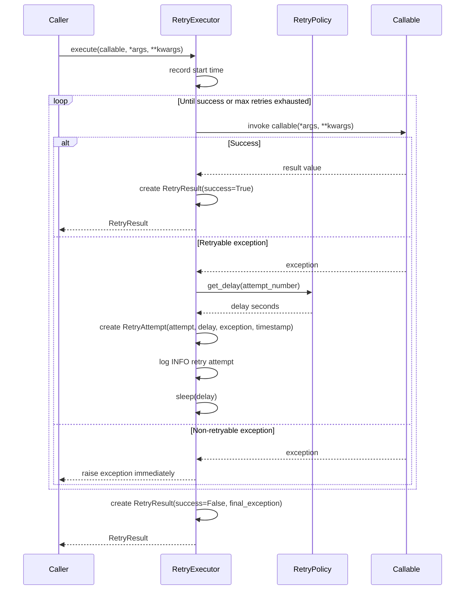
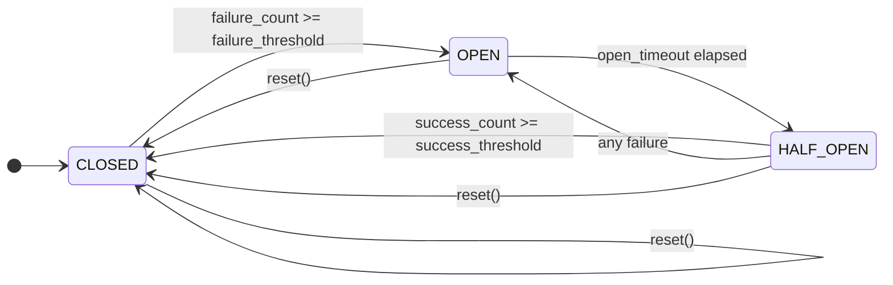
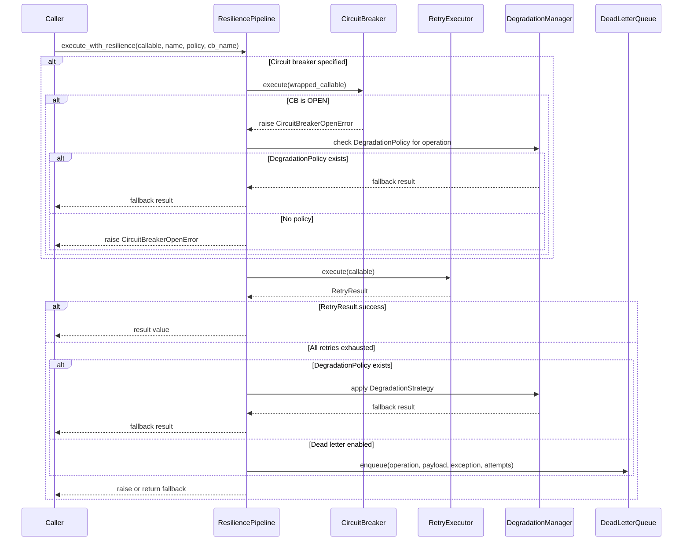
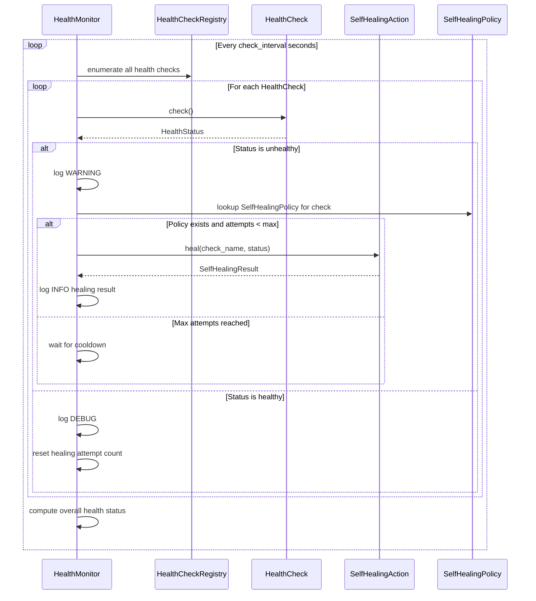

# Design Document — Error Handling & Resilience

## Overview

The Error Handling & Resilience feature extends the `codecraftai-agent-kit` SDK with a cross-cutting system for handling failures, recovering from transient errors, and maintaining system health across all agent subsystems. The system provides:

- A `RetryExecutor` that applies `RetryPolicy`-based retry logic to any callable operation, producing structured `RetryAttempt` and `RetryResult` objects for inspection and debugging
- A `CircuitBreaker` that monitors failure rates for external services and transitions between CLOSED, OPEN, and HALF_OPEN states to prevent cascading failures, managed through a `CircuitBreakerRegistry`
- A `DegradationManager` that monitors dependency availability and applies pluggable `DegradationStrategy` implementations (cached result, default value, alternate provider) to maintain agent operation under partial failure
- A `DeadLetterQueue` backed by pluggable `DeadLetterStore` implementations (in-memory, file-based) for capturing, inspecting, and replaying permanently failed operations
- A `HealthMonitor` that periodically executes pluggable `HealthCheck` implementations and triggers `SelfHealingAction` instances when unhealthy components are detected
- A `ResiliencePipeline` that coordinates all resilience components for an Agent, providing a unified `execute_with_resilience` method
- A `ResilienceConfiguration` for declarative configuration of all resilience settings with JSON and YAML serialization support

All classes live under `source/packages/ccai/agentkit/` with filenames in all-lowercase (no underscores), following the project naming conventions. The system integrates with:

- Core Agent Framework — `Agent` base class, `AgentConfiguration`, `LifecycleState`, `AgentStateMachine`
- LLM Integration — `RetryPolicy` (reused as the unified retry configuration), `FallbackChain`
- Tool & Capability System — `ToolExecutor` wrapped by `RetryExecutor` and `CircuitBreaker`
- Communication & Messaging — `Transport`, `Message`, `MessageEnvelope` protected by resilience components
- Memory & Context Management — `MemoryStore` protected by `RetryExecutor`
- Workflow & Orchestration — `WorkflowExecutor` using `RetryPolicy` and `CircuitBreaker`
- Observability & Debugging — `StructuredLogger`, `CorrelationContext`, `MetricsCollector`, `Tracer`
- Security & Access Control — `AuditLogger` for auditing resilience events
- Configuration & Extensibility — `ConfigurationManager`, `FeatureFlagRegistry` for configuration and feature toggles
- `codecraftai-extension` — `ExtensionPoint` for plugin discovery and registration
- `codecraftai-credentials` — `CredentialReference` for secret access
- `codecraftai-this-app` — `AppContext` for settings, environment, and directory resolution
- `codecraftai-dataprofiles` — `DataProfileReference` for data profile management

The design prioritizes debuggability over performance and readability over conciseness, per the project coding standards.

## Architecture

```mermaid
graph TD
    subgraph "ccai.agentkit - Error Handling & Resilience"
        RetryExecutor[RetryExecutor]
        RetryAttempt[RetryAttempt]
        RetryResult[RetryResult]
        CircuitBreaker[CircuitBreaker]
        CircuitBreakerState[CircuitBreakerState enum]
        CircuitBreakerConfiguration[CircuitBreakerConfiguration]
        CircuitBreakerEvent[CircuitBreakerEvent]
        CircuitBreakerRegistry[CircuitBreakerRegistry]
        DegradationStrategy[DegradationStrategy ABC]
        CachedResultStrategy[CachedResultStrategy]
        DefaultValueStrategy[DefaultValueStrategy]
        AlternateProviderStrategy[AlternateProviderStrategy]
        DegradationLevel[DegradationLevel enum]
        DegradationPolicy[DegradationPolicy]
        DegradationManager[DegradationManager]
        DegradationChangeEvent[DegradationChangeEvent]
        DeadLetterQueue[DeadLetterQueue]
        DeadLetterEntry[DeadLetterEntry]
        DeadLetterStore[DeadLetterStore ABC]
        InMemoryDeadLetterStore[InMemoryDeadLetterStore]
        FileDeadLetterStore[FileDeadLetterStore]
        DeadLetterQuery[DeadLetterQuery]
        DeadLetterQueryResult[DeadLetterQueryResult]
        HealthCheck[HealthCheck ABC]
        TransportHealthCheck[TransportHealthCheck]
        MemoryStoreHealthCheck[MemoryStoreHealthCheck]
        CircuitBreakerHealthCheck[CircuitBreakerHealthCheck]
        HealthStatus[HealthStatus]
        HealthCheckRegistry[HealthCheckRegistry]
        HealthMonitor[HealthMonitor]
        SelfHealingAction[SelfHealingAction ABC]
        ReconnectTransportAction[ReconnectTransportAction]
        ClearCacheAction[ClearCacheAction]
        ResetCircuitBreakerAction[ResetCircuitBreakerAction]
        SelfHealingPolicy[SelfHealingPolicy]
        SelfHealingResult[SelfHealingResult]
        ResilienceConfiguration[ResilienceConfiguration]
        ResiliencePipeline[ResiliencePipeline]
        ResilienceErrors[CircuitBreakerOpenError / ResilienceError]
    end

    subgraph "Core Agent Framework"
        Agent[Agent base class]
        AgentConfiguration[AgentConfiguration]
        LifecycleState[LifecycleState]
        Errors[SemanticError / ConfigurationError / AgentKitError]
    end

    subgraph "LLM Integration"
        RetryPolicy[RetryPolicy]
    end

    subgraph "External Packages"
        Extension[codecraftai-extension]
        Credentials[codecraftai-credentials]
        AppContext[codecraftai-this-app]
    end

    Agent --> ResiliencePipeline
    ResiliencePipeline --> RetryExecutor
    ResiliencePipeline --> CircuitBreakerRegistry
    ResiliencePipeline --> DegradationManager
    ResiliencePipeline --> DeadLetterQueue
    ResiliencePipeline --> HealthMonitor
    ResiliencePipeline --> ResilienceConfiguration
    RetryExecutor --> RetryPolicy
    RetryExecutor --> RetryAttempt
    RetryExecutor --> RetryResult
    CircuitBreaker --> CircuitBreakerState
    CircuitBreaker --> CircuitBreakerConfiguration
    CircuitBreaker --> CircuitBreakerEvent
    CircuitBreakerRegistry --> CircuitBreaker
    DegradationManager --> DegradationPolicy
    DegradationManager --> DegradationChangeEvent
    DegradationPolicy --> DegradationStrategy
    DegradationPolicy --> DegradationLevel
    DeadLetterQueue --> DeadLetterStore
    DeadLetterQueue --> DeadLetterEntry
    DeadLetterStore --> InMemoryDeadLetterStore
    DeadLetterStore --> FileDeadLetterStore
    HealthMonitor --> HealthCheckRegistry
    HealthMonitor --> SelfHealingPolicy
    HealthMonitor --> SelfHealingResult
    HealthCheckRegistry --> HealthCheck
    SelfHealingPolicy --> SelfHealingAction
    HealthCheck --> HealthStatus
    FileDeadLetterStore --> AppContext
    ResilienceConfiguration --> AppContext
    Agent --> Extension
```



### Retry Execution Flow



### Circuit Breaker State Machine



### Resilience Pipeline Execution Flow



### Health Monitoring and Self-Healing Flow



### Design Decisions

1. **RetryExecutor reuses RetryPolicy from LLM Integration** — avoids duplicating retry configuration and ensures consistent retry behavior across all subsystems. The RetryPolicy already defines max retries, backoff strategy, base delay, max delay, and retryable exception types.
2. **CircuitBreaker as a per-service component** — each external service gets its own CircuitBreaker with independent failure tracking and state transitions, consistent with the per-agent component pattern used by `ToolRegistry` and `ConfigurationManager`.
3. **CircuitBreakerRegistry as a per-agent instance** — circuit breakers are scoped to individual agents, allowing different agents to have different circuit breaker configurations for the same service.
4. **DegradationStrategy as an abstract base class using `abc.ABC`** — consistent with the `Tool`, `Agent`, and `PluginLifecycleHook` abstract base class patterns. Allows external plugins to contribute custom strategies.
5. **DeadLetterStore as a pluggable abstraction** — separates storage concerns from queue management. Built-in implementations (in-memory, file-based) cover development and single-agent deployments; plugins can provide database-backed stores.
6. **FileDeadLetterStore uses one JSON file per entry** — simplifies concurrent access and avoids file locking issues. Entry identifier is used as the filename.
7. **HealthMonitor as a separate component from HealthCheckRegistry** — separates monitoring scheduling from check registration, each with clear responsibilities. Consistent with the HotReloadMonitor/ConfigurationManager separation.
8. **SelfHealingPolicy with attempt limits and cooldown** — prevents infinite healing loops when a component cannot be recovered. The cooldown interval allows external conditions to change before retrying.
9. **ResiliencePipeline as the single coordination point** — all resilience components are accessed through the pipeline, providing a unified interface and ensuring consistent component lifecycle management.
10. **ResilienceConfiguration supports JSON and YAML** — consistent with `ResilienceConfiguration` loading patterns in the Configuration & Extensibility feature. File paths are resolved relative to `AppContext`.
11. **All serialization follows naming conventions: `as_dict`, `to_json`, `from_json`, `from_dict`** — consistent with all other agentkit classes.
12. **All `__repr__` and `__str__` methods follow the established pattern** — `__repr__` includes class name and key identifying fields, `__str__` returns a human-readable summary.
13. **Thread-safe CircuitBreaker** — uses `threading.Lock` for state transitions and counter updates, since agents may execute operations concurrently across threads.
14. **CircuitBreakerOpenError and ResilienceError inherit from AgentKitError** — consistent with the Core Agent Framework and Tool & Capability System exception hierarchies.
15. **Extension point "ccai.agentkit.resilience"** — follows the same pattern as other agentkit extension points, allowing external packages to contribute HealthCheck, DegradationStrategy, SelfHealingAction, and DeadLetterStore implementations.

## Components and Interfaces

### File Layout

| File | Class(es) | Purpose |
|---|---|---|
| retryattempt.py | RetryAttempt | Immutable retry attempt record |
| retryresult.py | RetryResult | Immutable retry outcome with attempt history |
| retryexecutor.py | RetryExecutor | Cross-cutting retry logic using RetryPolicy |
| circuitbreakerstate.py | CircuitBreakerState | Enum of circuit breaker states |
| circuitbreakerconfiguration.py | CircuitBreakerConfiguration | Immutable circuit breaker settings |
| circuitbreakerevent.py | CircuitBreakerEvent | Immutable state transition event |
| circuitbreaker.py | CircuitBreaker | Stateful circuit breaker with execute method |
| circuitbreakerregistry.py | CircuitBreakerRegistry | Per-agent registry of CircuitBreaker instances |
| degradationlevel.py | DegradationLevel | Enum of degradation severity levels |
| degradationstrategy.py | DegradationStrategy | Abstract base class for fallback strategies |
| cachedresultstrategy.py | CachedResultStrategy | Returns cached successful result |
| defaultvaluestrategy.py | DefaultValueStrategy | Returns configured default value |
| alternateproviderstrategy.py | AlternateProviderStrategy | Routes to alternative provider |
| degradationpolicy.py | DegradationPolicy | Immutable degradation policy per dependency |
| degradationchangeevent.py | DegradationChangeEvent | Immutable degradation level change event |
| degradationmanager.py | DegradationManager | Monitors dependencies and applies policies |
| deadletterentry.py | DeadLetterEntry | Immutable failed operation record |
| deadletterquery.py | DeadLetterQuery, DeadLetterQueryResult | Query and result for dead letter search |
| deadletterstore.py | DeadLetterStore | Abstract base class for dead letter persistence |
| inmemorydeadletterstore.py | InMemoryDeadLetterStore | In-process dictionary-based store |
| filedeadletterstore.py | FileDeadLetterStore | JSON file-based store |
| deadletterqueue.py | DeadLetterQueue | Queue with enqueue, query, replay, purge |
| healthstatus.py | HealthStatus | Immutable health check result |
| healthcheck.py | HealthCheck | Abstract base class for health checks |
| transporthealthcheck.py | TransportHealthCheck | Checks Transport connectivity |
| memorystorehealthcheck.py | MemoryStoreHealthCheck | Checks MemoryStore availability |
| circuitbreakerhealthcheck.py | CircuitBreakerHealthCheck | Checks CircuitBreaker state |
| healthcheckregistry.py | HealthCheckRegistry | Per-agent registry of HealthCheck instances |
| selfhealingaction.py | SelfHealingAction | Abstract base class for healing actions |
| reconnecttransportaction.py | ReconnectTransportAction | Reconnects a Transport |
| clearcacheaction.py | ClearCacheAction | Clears component cache |
| resetcircuitbreakeraction.py | ResetCircuitBreakerAction | Resets a CircuitBreaker |
| selfhealingpolicy.py | SelfHealingPolicy | Immutable healing policy per health check |
| selfhealingresult.py | SelfHealingResult | Immutable healing action outcome |
| healthmonitor.py | HealthMonitor | Periodic health check execution and self-healing |
| resilienceconfiguration.py | ResilienceConfiguration | Declarative resilience settings |
| resiliencepipeline.py | ResiliencePipeline | Unified resilience coordinator |
| resilienceerrors.py | CircuitBreakerOpenError, ResilienceError | Feature-specific exceptions |

### RetryAttempt

```python
import json
from datetime import datetime

class RetryAttempt:
    """
        Immutable object representing a single retry attempt.
        Contains the attempt number, delay before the attempt, the exception
        that triggered the retry, and a timestamp.
    """

    def __init__(self, attempt_number: int, delay: float, exception: Exception,
                 timestamp: datetime = None):
        self._attempt_number = attempt_number
        self._delay = delay
        self._exception = exception
        self._timestamp = timestamp if timestamp is not None else datetime.utcnow()
        return

    @property
    def attempt_number(self) -> int: ...
    @property
    def delay(self) -> float: ...
    @property
    def exception(self) -> Exception: ...
    @property
    def timestamp(self) -> datetime: ...

    def as_dict(self) -> dict:
        """
            Returns a dictionary representation of the attempt fields.
            The exception is represented as a string containing the exception
            type and message.

            :returns: A dictionary of attempt fields.
        """
        ...

    def to_json(self) -> str:
        """
            Returns a JSON string representation of the attempt fields.

            :returns: A JSON string.
        """
        ...

    @classmethod
    def from_dict(cls, data: dict) -> "RetryAttempt":
        """
            Constructs a RetryAttempt from a dictionary.

            :param data: Dictionary containing attempt fields.

            :returns: A RetryAttempt instance.
        """
        ...

    @classmethod
    def from_json(cls, json_str: str) -> "RetryAttempt":
        """
            Deserializes a JSON string into a RetryAttempt instance.

            :param json_str: JSON string to deserialize.

            :returns: A RetryAttempt instance.
        """
        ...

    def __repr__(self) -> str: ...
    def __str__(self) -> str: ...
```

### RetryResult

```python
class RetryResult:
    """
        Immutable object encapsulating the outcome of a retried operation.
        Contains the result value on success, the final exception on failure,
        the list of RetryAttempt objects, the total elapsed time, and a success flag.
    """

    def __init__(self, success: bool, result=None, exception: Exception = None,
                 attempts: list = None, elapsed_time: float = 0.0):
        self._success = success
        self._result = result
        self._exception = exception
        self._attempts = list(attempts) if attempts is not None else []
        self._elapsed_time = elapsed_time
        return

    @property
    def success(self) -> bool: ...
    @property
    def result(self): ...
    @property
    def exception(self) -> Exception: ...
    @property
    def attempts(self) -> list: ...
    @property
    def elapsed_time(self) -> float: ...

    @property
    def is_success(self) -> bool:
        """
            Returns True when the success flag is True.

            :returns: Boolean indicating success.
        """
        ...

    @property
    def attempt_count(self) -> int:
        """
            Returns the total number of attempts including the initial attempt
            and all retries.

            :returns: Integer count of attempts.
        """
        ...

    def as_dict(self) -> dict:
        """
            Returns a dictionary representation of the result fields.

            :returns: A dictionary of result fields.
        """
        ...

    def to_json(self) -> str:
        """
            Returns a JSON string representation of the result fields.

            :returns: A JSON string.
        """
        ...

    @classmethod
    def from_json(cls, json_str: str) -> "RetryResult":
        """
            Deserializes a JSON string into a RetryResult instance.

            :param json_str: JSON string to deserialize.

            :returns: A RetryResult instance.
        """
        ...

    def __repr__(self) -> str: ...
    def __str__(self) -> str: ...
```

### RetryExecutor

```python
import logging

class RetryExecutor:
    """
        Executes a callable with retry logic governed by a RetryPolicy.
        Handles delay calculation, attempt tracking, and retryable exception
        filtering. This is the cross-cutting retry mechanism used by all
        agent subsystems.
    """

    def __init__(self, retry_policy):
        self._retry_policy = retry_policy
        self._logger = logging.getLogger("ccai.agentkit.resilience")
        return

    @property
    def retry_policy(self):
        """
            Returns the configured RetryPolicy instance.

            :returns: The RetryPolicy.
        """
        ...

    def execute(self, callable_op, *args, **kwargs) -> RetryResult:
        """
            Executes the callable with retry logic. Retries on retryable
            exceptions up to the maximum retry count. Non-retryable exceptions
            are raised immediately.

            :param callable_op: The callable to execute.
            :param args: Positional arguments for the callable.
            :param kwargs: Keyword arguments for the callable.

            :returns: A RetryResult containing the operation outcome.
            :raises: Non-retryable exceptions immediately.
        """
        ...

    def __repr__(self) -> str: ...
    def __str__(self) -> str: ...
```

### CircuitBreakerState

```python
import enum

class CircuitBreakerState(enum.Enum):
    """
        Enumeration defining the state of a CircuitBreaker.
    """

    CLOSED = "CLOSED"
    OPEN = "OPEN"
    HALF_OPEN = "HALF_OPEN"

    @classmethod
    def from_string(cls, value: str) -> "CircuitBreakerState":
        """
            Returns the CircuitBreakerState member matching the given string.

            :param value: The string value to match.

            :returns: The matching CircuitBreakerState member.
            :raises: SemanticError
        """
        ...
```

### CircuitBreakerConfiguration

```python
class CircuitBreakerConfiguration:
    """
        Immutable configuration object defining the thresholds and timing
        for a CircuitBreaker.
    """

    def __init__(self, failure_threshold: int, success_threshold: int,
                 open_state_timeout: float, half_open_max_attempts: int,
                 monitored_exception_types: list = None):
        self._failure_threshold = failure_threshold
        self._success_threshold = success_threshold
        self._open_state_timeout = open_state_timeout
        self._half_open_max_attempts = half_open_max_attempts
        self._monitored_exception_types = list(monitored_exception_types) if monitored_exception_types is not None else []
        return

    @property
    def failure_threshold(self) -> int: ...
    @property
    def success_threshold(self) -> int: ...
    @property
    def open_state_timeout(self) -> float: ...
    @property
    def half_open_max_attempts(self) -> int: ...
    @property
    def monitored_exception_types(self) -> list: ...

    def as_dict(self) -> dict: ...
    def to_json(self) -> str: ...

    @classmethod
    def from_dict(cls, data: dict) -> "CircuitBreakerConfiguration": ...

    @classmethod
    def from_json(cls, json_str: str) -> "CircuitBreakerConfiguration": ...

    def __repr__(self) -> str: ...
    def __str__(self) -> str: ...
```

### CircuitBreakerEvent

```python
class CircuitBreakerEvent:
    """
        Immutable object representing a state transition or significant event
        in a CircuitBreaker. Contains the circuit breaker name, previous state,
        new state, reason, and timestamp.
    """

    def __init__(self, name: str, previous_state: CircuitBreakerState,
                 new_state: CircuitBreakerState, reason: str,
                 timestamp: datetime = None):
        self._name = name
        self._previous_state = previous_state
        self._new_state = new_state
        self._reason = reason
        self._timestamp = timestamp if timestamp is not None else datetime.utcnow()
        return

    @property
    def name(self) -> str: ...
    @property
    def previous_state(self) -> CircuitBreakerState: ...
    @property
    def new_state(self) -> CircuitBreakerState: ...
    @property
    def reason(self) -> str: ...
    @property
    def timestamp(self) -> datetime: ...

    def as_dict(self) -> dict: ...
    def to_json(self) -> str: ...

    @classmethod
    def from_dict(cls, data: dict) -> "CircuitBreakerEvent": ...

    @classmethod
    def from_json(cls, json_str: str) -> "CircuitBreakerEvent": ...

    def __repr__(self) -> str: ...
    def __str__(self) -> str: ...
```

### CircuitBreaker

```python
import logging
import threading

class CircuitBreaker:
    """
        Monitors the success and failure rate of operations directed at an
        external service and transitions between CLOSED, OPEN, and HALF_OPEN
        states. Thread-safe via threading.Lock.
    """

    def __init__(self, name: str, configuration: CircuitBreakerConfiguration):
        self._name = name
        self._configuration = configuration
        self._state = CircuitBreakerState.CLOSED
        self._failure_count = 0
        self._success_count = 0
        self._half_open_attempt_count = 0
        self._open_timestamp = None
        self._events = []
        self._lock = threading.Lock()
        self._logger = logging.getLogger("ccai.agentkit.resilience")
        return

    @property
    def name(self) -> str: ...
    @property
    def state(self) -> CircuitBreakerState: ...
    @property
    def failure_count(self) -> int: ...
    @property
    def success_count(self) -> int: ...
    @property
    def events(self) -> list: ...

    def execute(self, callable_op, *args, **kwargs):
        """
            Evaluates the current state and either executes the callable or
            rejects the request. Tracks success/failure outcomes and triggers
            state transitions.

            :param callable_op: The callable to execute.
            :param args: Positional arguments for the callable.
            :param kwargs: Keyword arguments for the callable.

            :returns: The callable result on success.
            :raises: CircuitBreakerOpenError, or the callable's exception.
        """
        ...

    def reset(self) -> None:
        """
            Transitions the CircuitBreaker to the CLOSED state and clears
            all counters and event history.
        """
        ...

    def __repr__(self) -> str: ...
    def __str__(self) -> str: ...
```

### CircuitBreakerRegistry

```python
class CircuitBreakerRegistry:
    """
        Registry tracking all CircuitBreaker instances for an Agent.
        Provides lookup by name and enumeration.
    """

    def __init__(self):
        self._circuit_breakers = {}
        return

    def register(self, circuit_breaker: CircuitBreaker) -> None:
        """
            Registers a CircuitBreaker using its name as the key.

            :param circuit_breaker: The CircuitBreaker to register.

            :raises: SemanticError
        """
        ...

    def deregister(self, name: str) -> None: ...
    def lookup(self, name: str) -> CircuitBreaker: ...
    def list_all(self) -> list: ...

    @property
    def count(self) -> int: ...

    def has_circuit_breaker(self, name: str) -> bool: ...
    def reset_all(self) -> None: ...

    def __repr__(self) -> str: ...
    def __str__(self) -> str: ...
```

### DegradationLevel

```python
import enum

class DegradationLevel(enum.Enum):
    """
        Enumeration defining the severity of degradation.
    """

    NORMAL = "NORMAL"
    DEGRADED = "DEGRADED"
    CRITICAL = "CRITICAL"

    @classmethod
    def from_string(cls, value: str) -> "DegradationLevel":
        """
            Returns the DegradationLevel member matching the given string.

            :param value: The string value to match.

            :returns: The matching DegradationLevel member.
            :raises: SemanticError
        """
        ...
```

### DegradationStrategy

```python
import abc

class DegradationStrategy(abc.ABC):
    """
        Abstract base class representing a strategy for graceful degradation
        when a dependency is unavailable. Concrete implementations define
        fallback behavior.
    """

    def __init__(self, strategy_name: str):
        self._strategy_name = strategy_name
        return

    @property
    def strategy_name(self) -> str: ...

    @abc.abstractmethod
    def degrade(self, dependency_name: str, exception: Exception,
                context: dict = None):
        """
            Applies the degradation strategy and returns a fallback result.

            :param dependency_name: Name of the unavailable dependency.
            :param exception: The exception that triggered degradation.
            :param context: Optional context dictionary.

            :returns: A fallback result value.
        """
        ...

    def __repr__(self) -> str: ...
    def __str__(self) -> str: ...
```

### CachedResultStrategy

```python
class CachedResultStrategy(DegradationStrategy):
    """
        Returns the most recently cached successful result for the dependency
        when the dependency is unavailable.
    """

    def __init__(self):
        super().__init__(strategy_name="cached_result")
        self._cache = {}
        return

    def cache_result(self, dependency_name: str, result) -> None:
        """
            Stores a successful result for the given dependency.

            :param dependency_name: Name of the dependency.
            :param result: The successful result to cache.
        """
        ...

    def degrade(self, dependency_name: str, exception: Exception,
                context: dict = None):
        ...
```

### DefaultValueStrategy

```python
class DefaultValueStrategy(DegradationStrategy):
    """
        Returns a configured default value when the dependency is unavailable.
    """

    def __init__(self, default_value=None):
        super().__init__(strategy_name="default_value")
        self._default_value = default_value
        return

    def degrade(self, dependency_name: str, exception: Exception,
                context: dict = None):
        ...
```

### AlternateProviderStrategy

```python
class AlternateProviderStrategy(DegradationStrategy):
    """
        Routes the operation to an alternative provider or backend when the
        primary dependency is unavailable.
    """

    def __init__(self, alternate_callable=None):
        super().__init__(strategy_name="alternate_provider")
        self._alternate_callable = alternate_callable
        return

    def degrade(self, dependency_name: str, exception: Exception,
                context: dict = None):
        ...
```

### DegradationPolicy

```python
class DegradationPolicy:
    """
        Immutable configuration object defining the degradation behavior
        for a specific dependency.
    """

    def __init__(self, dependency_name: str, strategy: DegradationStrategy,
                 activation_level: DegradationLevel,
                 fallback_value=None):
        self._dependency_name = dependency_name
        self._strategy = strategy
        self._activation_level = activation_level
        self._fallback_value = fallback_value
        return

    @property
    def dependency_name(self) -> str: ...
    @property
    def strategy(self) -> DegradationStrategy: ...
    @property
    def activation_level(self) -> DegradationLevel: ...
    @property
    def fallback_value(self): ...

    def as_dict(self) -> dict: ...
    def to_json(self) -> str: ...

    @classmethod
    def from_dict(cls, data: dict, strategy: DegradationStrategy) -> "DegradationPolicy": ...

    def __repr__(self) -> str: ...
    def __str__(self) -> str: ...
```

### DegradationChangeEvent

```python
class DegradationChangeEvent:
    """
        Immutable object representing a change in degradation level.
        Contains the dependency name, previous level, new level, reason,
        and timestamp.
    """

    def __init__(self, dependency_name: str, previous_level: DegradationLevel,
                 new_level: DegradationLevel, reason: str,
                 timestamp: datetime = None):
        self._dependency_name = dependency_name
        self._previous_level = previous_level
        self._new_level = new_level
        self._reason = reason
        self._timestamp = timestamp if timestamp is not None else datetime.utcnow()
        return

    @property
    def dependency_name(self) -> str: ...
    @property
    def previous_level(self) -> DegradationLevel: ...
    @property
    def new_level(self) -> DegradationLevel: ...
    @property
    def reason(self) -> str: ...
    @property
    def timestamp(self) -> datetime: ...

    def as_dict(self) -> dict: ...
    def to_json(self) -> str: ...

    @classmethod
    def from_dict(cls, data: dict) -> "DegradationChangeEvent": ...

    @classmethod
    def from_json(cls, json_str: str) -> "DegradationChangeEvent": ...

    def __repr__(self) -> str: ...
    def __str__(self) -> str: ...
```

### DegradationManager

```python
import logging

class DegradationManager:
    """
        Monitors dependency availability and applies DegradationPolicy rules
        to maintain agent operation when dependencies fail. Tracks the current
        DegradationLevel per dependency and notifies registered listeners.
    """

    def __init__(self, agent_identifier: str):
        self._agent_identifier = agent_identifier
        self._policies = {}
        self._dependency_levels = {}
        self._change_listeners = []
        self._logger = logging.getLogger("ccai.agentkit.resilience")
        return

    @property
    def agent_identifier(self) -> str: ...

    @property
    def overall_level(self) -> DegradationLevel:
        """
            Returns the highest DegradationLevel across all tracked dependencies.

            :returns: The overall DegradationLevel.
        """
        ...

    def register_policy(self, policy: DegradationPolicy) -> None: ...
    def deregister_policy(self, dependency_name: str) -> None: ...

    def report_failure(self, dependency_name: str, exception: Exception):
        """
            Reports a dependency failure. Evaluates the registered policy
            and applies the DegradationStrategy when the activation level
            is reached.

            :param dependency_name: Name of the failed dependency.
            :param exception: The exception from the failure.

            :returns: The fallback result from the strategy, or None.
        """
        ...

    def report_recovery(self, dependency_name: str) -> None:
        """
            Reports a dependency recovery. Transitions the dependency
            back to NORMAL DegradationLevel.

            :param dependency_name: Name of the recovered dependency.
        """
        ...

    def get_dependency_levels(self) -> dict: ...

    def register_change_listener(self, listener) -> None: ...
    def deregister_change_listener(self, listener) -> None: ...

    def __repr__(self) -> str: ...
    def __str__(self) -> str: ...
```

### DeadLetterEntry

```python
import uuid

class DeadLetterEntry:
    """
        Immutable object representing a failed operation or message stored
        in the DeadLetterQueue. Contains full context about the failure
        for diagnosis and replay.
    """

    def __init__(self, operation_type: str, payload: dict,
                 exception_info: str, retry_attempts: list,
                 source_component: str, agent_identifier: str,
                 identifier: str = None, timestamp: datetime = None,
                 metadata: dict = None):
        self._identifier = identifier if identifier is not None else str(uuid.uuid4())
        self._operation_type = operation_type
        self._payload = dict(payload) if payload is not None else {}
        self._exception_info = exception_info
        self._retry_attempts = list(retry_attempts) if retry_attempts is not None else []
        self._source_component = source_component
        self._agent_identifier = agent_identifier
        self._timestamp = timestamp if timestamp is not None else datetime.utcnow()
        self._metadata = dict(metadata) if metadata is not None else {}
        return

    @property
    def identifier(self) -> str: ...
    @property
    def operation_type(self) -> str: ...
    @property
    def payload(self) -> dict: ...
    @property
    def exception_info(self) -> str: ...
    @property
    def retry_attempts(self) -> list: ...
    @property
    def source_component(self) -> str: ...
    @property
    def agent_identifier(self) -> str: ...
    @property
    def timestamp(self) -> datetime: ...
    @property
    def metadata(self) -> dict: ...

    def as_dict(self) -> dict: ...
    def to_json(self) -> str: ...

    @classmethod
    def from_dict(cls, data: dict) -> "DeadLetterEntry": ...

    @classmethod
    def from_json(cls, json_str: str) -> "DeadLetterEntry": ...

    def __repr__(self) -> str: ...
    def __str__(self) -> str: ...
```

### DeadLetterQuery and DeadLetterQueryResult

```python
class DeadLetterQuery:
    """
        Immutable object representing a search request against a DeadLetterStore.
        Contains optional filter criteria for operation type, source component,
        agent identifier, time range, and max results.
    """

    def __init__(self, operation_type: str = None, source_component: str = None,
                 agent_identifier: str = None, start_time: datetime = None,
                 end_time: datetime = None, max_results: int = None):
        self._operation_type = operation_type
        self._source_component = source_component
        self._agent_identifier = agent_identifier
        self._start_time = start_time
        self._end_time = end_time
        self._max_results = max_results
        return

    @property
    def operation_type(self) -> str: ...
    @property
    def source_component(self) -> str: ...
    @property
    def agent_identifier(self) -> str: ...
    @property
    def start_time(self) -> datetime: ...
    @property
    def end_time(self) -> datetime: ...
    @property
    def max_results(self) -> int: ...

    def as_dict(self) -> dict: ...

    def __repr__(self) -> str: ...
    def __str__(self) -> str: ...


class DeadLetterQueryResult:
    """
        Immutable object encapsulating the result of a DeadLetterQuery.
        Contains the list of matching entries and the total count.
    """

    def __init__(self, entries: list, total_count: int):
        self._entries = list(entries) if entries is not None else []
        self._total_count = total_count
        return

    @property
    def entries(self) -> list: ...
    @property
    def total_count(self) -> int: ...

    def as_dict(self) -> dict: ...

    def __repr__(self) -> str: ...
    def __str__(self) -> str: ...
```

### DeadLetterStore

```python
import abc

class DeadLetterStore(abc.ABC):
    """
        Abstract base class for persisting DeadLetterEntry objects.
        Provides append-only write semantics with support for replay
        and purge operations.
    """

    def __init__(self, store_name: str):
        self._store_name = store_name
        return

    @property
    def store_name(self) -> str: ...

    @abc.abstractmethod
    def store(self, entry: DeadLetterEntry) -> None: ...

    @abc.abstractmethod
    def retrieve(self, identifier: str) -> DeadLetterEntry: ...

    @abc.abstractmethod
    def search(self, query: DeadLetterQuery) -> DeadLetterQueryResult: ...

    @abc.abstractmethod
    def delete(self, identifier: str) -> None: ...

    @abc.abstractmethod
    def purge(self, age_threshold: float = None) -> int: ...

    @abc.abstractmethod
    def count(self) -> int: ...

    def __repr__(self) -> str: ...
    def __str__(self) -> str: ...
```

### InMemoryDeadLetterStore

```python
class InMemoryDeadLetterStore(DeadLetterStore):
    """
        Built-in DeadLetterStore implementation using in-process
        dictionary-based storage. Suitable for development, testing,
        and short-lived agents.
    """

    def __init__(self):
        super().__init__(store_name="in_memory")
        self._entries = {}
        return

    def store(self, entry: DeadLetterEntry) -> None: ...
    def retrieve(self, identifier: str) -> DeadLetterEntry: ...
    def search(self, query: DeadLetterQuery) -> DeadLetterQueryResult: ...
    def delete(self, identifier: str) -> None: ...
    def purge(self, age_threshold: float = None) -> int: ...
    def count(self) -> int: ...
```

### FileDeadLetterStore

```python
class FileDeadLetterStore(DeadLetterStore):
    """
        Built-in DeadLetterStore implementation that persists DeadLetterEntry
        objects to JSON files on the local file system. Each entry is stored
        as a separate JSON file using the entry identifier as the filename.
    """

    def __init__(self, directory_path: str):
        super().__init__(store_name="file")
        self._directory_path = directory_path
        # Creates directory if it does not exist
        return

    @property
    def directory_path(self) -> str: ...

    def store(self, entry: DeadLetterEntry) -> None: ...
    def retrieve(self, identifier: str) -> DeadLetterEntry: ...
    def search(self, query: DeadLetterQuery) -> DeadLetterQueryResult: ...
    def delete(self, identifier: str) -> None: ...
    def purge(self, age_threshold: float = None) -> int: ...
    def count(self) -> int: ...
```

### DeadLetterQueue

```python
import logging

class DeadLetterQueue:
    """
        Stores operations and messages that have permanently failed after
        exhausting all retry attempts and fallback options. Provides
        inspection, replay, and purge capabilities.
    """

    def __init__(self, store: DeadLetterStore):
        self._store = store
        self._logger = logging.getLogger("ccai.agentkit.resilience")
        return

    @property
    def entry_count(self) -> int: ...

    def enqueue(self, operation_type: str, payload: dict,
                exception: Exception, retry_attempts: list,
                source_component: str, agent_identifier: str,
                metadata: dict = None) -> DeadLetterEntry:
        """
            Creates a DeadLetterEntry and stores it in the DeadLetterStore.

            :param operation_type: Type of the failed operation.
            :param payload: The original operation payload.
            :param exception: The final exception.
            :param retry_attempts: List of RetryAttempt objects.
            :param source_component: Name of the source component.
            :param agent_identifier: The agent identifier.
            :param metadata: Optional metadata dictionary.

            :returns: The created DeadLetterEntry.
        """
        ...

    def query(self, query: DeadLetterQuery) -> DeadLetterQueryResult: ...
    def get_entry(self, identifier: str) -> DeadLetterEntry: ...

    def replay(self, identifier: str, callable_op) -> object:
        """
            Retrieves the entry, invokes the callable with the entry payload,
            and returns the result. Removes the entry on success, updates
            metadata on failure.

            :param identifier: The DeadLetterEntry identifier.
            :param callable_op: The callable to replay with.

            :returns: The callable result on success.
            :raises: ResilienceError
        """
        ...

    def purge(self, age_threshold: float = None) -> int: ...

    def __repr__(self) -> str: ...
    def __str__(self) -> str: ...
```

### HealthStatus

```python
class HealthStatus:
    """
        Immutable object representing the result of a health check.
        Contains the check name, status classification, optional detail,
        response time, and timestamp.
    """

    VALID_STATUSES = {"healthy", "degraded", "unhealthy"}

    def __init__(self, check_name: str, status: str, detail: str = None,
                 response_time: float = 0.0, timestamp: datetime = None):
        self._check_name = check_name
        if status not in self.VALID_STATUSES:
            errmsg = "Invalid status '{}'. Valid statuses: {}".format(
                status, ", ".join(sorted(self.VALID_STATUSES)))
            raise SemanticError(errmsg)
        self._status = status
        self._detail = detail
        self._response_time = response_time
        self._timestamp = timestamp if timestamp is not None else datetime.utcnow()
        return

    @property
    def check_name(self) -> str: ...
    @property
    def status(self) -> str: ...
    @property
    def detail(self) -> str: ...
    @property
    def response_time(self) -> float: ...
    @property
    def timestamp(self) -> datetime: ...

    @property
    def is_healthy(self) -> bool:
        """
            Returns True when the status is "healthy".

            :returns: Boolean indicating healthy status.
        """
        ...

    def as_dict(self) -> dict: ...
    def to_json(self) -> str: ...

    @classmethod
    def from_dict(cls, data: dict) -> "HealthStatus": ...

    @classmethod
    def from_json(cls, json_str: str) -> "HealthStatus": ...

    def __repr__(self) -> str: ...
    def __str__(self) -> str: ...
```

### HealthCheck

```python
import abc

class HealthCheck(abc.ABC):
    """
        Abstract base class representing a health check for a specific
        agent component or external dependency.
    """

    def __init__(self, name: str, check_interval: float = 30.0):
        self._name = name
        self._check_interval = check_interval
        return

    @property
    def name(self) -> str: ...
    @property
    def check_interval(self) -> float: ...

    @abc.abstractmethod
    def check(self) -> HealthStatus:
        """
            Executes the health check and returns a HealthStatus.

            :returns: A HealthStatus object.
        """
        ...

    def __repr__(self) -> str: ...
    def __str__(self) -> str: ...
```

### TransportHealthCheck

```python
class TransportHealthCheck(HealthCheck):
    """
        Checks the connection status of a Transport instance and returns
        a HealthStatus reflecting the transport connectivity.
    """

    def __init__(self, name: str, transport, check_interval: float = 30.0):
        super().__init__(name=name, check_interval=check_interval)
        self._transport = transport
        return

    def check(self) -> HealthStatus: ...
```

### MemoryStoreHealthCheck

```python
class MemoryStoreHealthCheck(HealthCheck):
    """
        Checks the availability of a MemoryStore instance by performing
        a lightweight read operation.
    """

    def __init__(self, name: str, memory_store, check_interval: float = 30.0):
        super().__init__(name=name, check_interval=check_interval)
        self._memory_store = memory_store
        return

    def check(self) -> HealthStatus: ...
```

### CircuitBreakerHealthCheck

```python
class CircuitBreakerHealthCheck(HealthCheck):
    """
        Checks the state of a CircuitBreaker instance. Returns "degraded"
        when the circuit breaker is OPEN, "healthy" when CLOSED.
    """

    def __init__(self, name: str, circuit_breaker: CircuitBreaker,
                 check_interval: float = 30.0):
        super().__init__(name=name, check_interval=check_interval)
        self._circuit_breaker = circuit_breaker
        return

    def check(self) -> HealthStatus: ...
```

### HealthCheckRegistry

```python
class HealthCheckRegistry:
    """
        Registry tracking all HealthCheck instances for an Agent.
        Provides lookup by name and enumeration.
    """

    def __init__(self):
        self._health_checks = {}
        return

    def register(self, health_check: HealthCheck) -> None:
        """
            Registers a HealthCheck using its name as the key.

            :param health_check: The HealthCheck to register.

            :raises: SemanticError
        """
        ...

    def deregister(self, name: str) -> None: ...
    def lookup(self, name: str) -> HealthCheck: ...
    def list_all(self) -> list: ...

    @property
    def count(self) -> int: ...

    def has_health_check(self, name: str) -> bool: ...

    def __repr__(self) -> str: ...
    def __str__(self) -> str: ...
```

### HealthMonitor

```python
import logging

class HealthMonitor:
    """
        Periodically executes registered HealthCheck instances and aggregates
        results into an overall agent health status. Triggers self-healing
        actions when unhealthy components are detected.
    """

    def __init__(self, health_check_registry: HealthCheckRegistry,
                 check_interval: float = 30.0):
        self._health_check_registry = health_check_registry
        self._check_interval = check_interval
        self._is_active = False
        self._latest_results = {}
        self._healing_policies = {}
        self._healing_attempt_counts = {}
        self._healing_cooldown_timestamps = {}
        self._logger = logging.getLogger("ccai.agentkit.resilience")
        return

    @property
    def is_active(self) -> bool: ...

    @property
    def latest_results(self) -> dict:
        """
            Returns the most recent HealthStatus for each registered check.

            :returns: Dictionary of check name to HealthStatus.
        """
        ...

    @property
    def overall_status(self) -> str:
        """
            Returns the overall agent health status: "healthy" when all checks
            are healthy, "degraded" when any is degraded but none unhealthy,
            "unhealthy" when any check is unhealthy.

            :returns: Overall status string.
        """
        ...

    def register_healing_policy(self, policy: "SelfHealingPolicy") -> None: ...

    def start(self) -> None: ...
    def stop(self) -> None: ...

    def check_now(self) -> dict:
        """
            Immediately executes all registered health checks.

            :returns: Dictionary of check name to HealthStatus.
        """
        ...

    def __repr__(self) -> str: ...
    def __str__(self) -> str: ...
```

### SelfHealingAction

```python
import abc

class SelfHealingAction(abc.ABC):
    """
        Abstract base class representing an automated recovery action
        triggered when a HealthCheck reports an unhealthy status.
    """

    def __init__(self, action_name: str):
        self._action_name = action_name
        return

    @property
    def action_name(self) -> str: ...

    @abc.abstractmethod
    def heal(self, check_name: str, status: HealthStatus) -> "SelfHealingResult":
        """
            Executes the healing action.

            :param check_name: Name of the health check that triggered healing.
            :param status: The HealthStatus that triggered the action.

            :returns: A SelfHealingResult.
        """
        ...

    def __repr__(self) -> str: ...
    def __str__(self) -> str: ...
```

### ReconnectTransportAction

```python
class ReconnectTransportAction(SelfHealingAction):
    """
        Attempts to disconnect and reconnect a Transport instance.
    """

    def __init__(self, transport):
        super().__init__(action_name="reconnect_transport")
        self._transport = transport
        return

    def heal(self, check_name: str, status: HealthStatus) -> "SelfHealingResult": ...
```

### ClearCacheAction

```python
class ClearCacheAction(SelfHealingAction):
    """
        Clears cached data in a specified component.
    """

    def __init__(self, cache_clear_callable):
        super().__init__(action_name="clear_cache")
        self._cache_clear_callable = cache_clear_callable
        return

    def heal(self, check_name: str, status: HealthStatus) -> "SelfHealingResult": ...
```

### ResetCircuitBreakerAction

```python
class ResetCircuitBreakerAction(SelfHealingAction):
    """
        Resets a CircuitBreaker to the CLOSED state.
    """

    def __init__(self, circuit_breaker: CircuitBreaker):
        super().__init__(action_name="reset_circuit_breaker")
        self._circuit_breaker = circuit_breaker
        return

    def heal(self, check_name: str, status: HealthStatus) -> "SelfHealingResult": ...
```

### SelfHealingPolicy

```python
class SelfHealingPolicy:
    """
        Immutable configuration object defining the self-healing behavior
        for a specific health check.
    """

    def __init__(self, check_name: str, action: SelfHealingAction,
                 max_attempts: int, cooldown_interval: float):
        self._check_name = check_name
        self._action = action
        self._max_attempts = max_attempts
        self._cooldown_interval = cooldown_interval
        return

    @property
    def check_name(self) -> str: ...
    @property
    def action(self) -> SelfHealingAction: ...
    @property
    def max_attempts(self) -> int: ...
    @property
    def cooldown_interval(self) -> float: ...

    def as_dict(self) -> dict: ...

    def __repr__(self) -> str: ...
    def __str__(self) -> str: ...
```

### SelfHealingResult

```python
class SelfHealingResult:
    """
        Immutable object representing the outcome of a self-healing action.
    """

    def __init__(self, check_name: str, action_name: str, success: bool,
                 error_message: str = None, attempt_number: int = 1,
                 timestamp: datetime = None):
        self._check_name = check_name
        self._action_name = action_name
        self._success = success
        self._error_message = error_message
        self._attempt_number = attempt_number
        self._timestamp = timestamp if timestamp is not None else datetime.utcnow()
        return

    @property
    def check_name(self) -> str: ...
    @property
    def action_name(self) -> str: ...
    @property
    def success(self) -> bool: ...
    @property
    def error_message(self) -> str: ...
    @property
    def attempt_number(self) -> int: ...
    @property
    def timestamp(self) -> datetime: ...

    @property
    def is_success(self) -> bool: ...

    def as_dict(self) -> dict: ...
    def to_json(self) -> str: ...

    @classmethod
    def from_dict(cls, data: dict) -> "SelfHealingResult": ...

    @classmethod
    def from_json(cls, json_str: str) -> "SelfHealingResult": ...

    def __repr__(self) -> str: ...
    def __str__(self) -> str: ...
```

### ResilienceConfiguration

```python
class ResilienceConfiguration:
    """
        Configuration object defining the resilience settings for an Agent.
        Supports loading from dictionaries, JSON files, and YAML files.
    """

    def __init__(self, default_retry_policy=None,
                 circuit_breaker_enabled: bool = True,
                 degradation_enabled: bool = True,
                 dead_letter_enabled: bool = True,
                 health_monitoring_enabled: bool = True,
                 health_check_interval: float = 30.0,
                 self_healing_enabled: bool = True):
        self._default_retry_policy = default_retry_policy
        self._circuit_breaker_enabled = circuit_breaker_enabled
        self._degradation_enabled = degradation_enabled
        self._dead_letter_enabled = dead_letter_enabled
        self._health_monitoring_enabled = health_monitoring_enabled
        self._health_check_interval = health_check_interval
        self._self_healing_enabled = self_healing_enabled
        return

    @property
    def default_retry_policy(self): ...
    @property
    def circuit_breaker_enabled(self) -> bool: ...
    @property
    def degradation_enabled(self) -> bool: ...
    @property
    def dead_letter_enabled(self) -> bool: ...
    @property
    def health_monitoring_enabled(self) -> bool: ...
    @property
    def health_check_interval(self) -> float: ...
    @property
    def self_healing_enabled(self) -> bool: ...

    def as_dict(self) -> dict: ...
    def to_json(self) -> str: ...
    def to_yaml(self) -> str: ...

    @classmethod
    def from_dict(cls, data: dict) -> "ResilienceConfiguration": ...

    @classmethod
    def from_json(cls, json_str: str) -> "ResilienceConfiguration": ...

    @classmethod
    def from_yaml(cls, yaml_str: str) -> "ResilienceConfiguration": ...

    def __repr__(self) -> str: ...
    def __str__(self) -> str: ...
```

### ResiliencePipeline

```python
import logging

class ResiliencePipeline:
    """
        Coordinates the RetryExecutor, CircuitBreakerRegistry,
        DegradationManager, DeadLetterQueue, and HealthMonitor for an Agent.
        Provides a unified resilience surface.
    """

    def __init__(self, configuration: ResilienceConfiguration,
                 agent_identifier: str):
        self._configuration = configuration
        self._agent_identifier = agent_identifier
        self._retry_executor = None
        self._circuit_breaker_registry = None
        self._degradation_manager = None
        self._dead_letter_queue = None
        self._health_monitor = None
        self._logger = logging.getLogger("ccai.agentkit.resilience")
        # Initialize components based on configuration enablement flags
        return

    @property
    def retry_executor(self) -> RetryExecutor: ...
    @property
    def circuit_breaker_registry(self) -> CircuitBreakerRegistry: ...
    @property
    def degradation_manager(self) -> DegradationManager: ...
    @property
    def dead_letter_queue(self) -> DeadLetterQueue: ...
    @property
    def health_monitor(self) -> HealthMonitor: ...

    def execute_with_resilience(self, callable_op, operation_name: str = None,
                                 retry_policy=None,
                                 circuit_breaker_name: str = None):
        """
            Executes the callable with retry logic and circuit breaker
            protection. On permanent failure, enqueues to dead letter queue
            and/or applies degradation strategy.

            :param callable_op: The callable to execute.
            :param operation_name: Optional name for the operation.
            :param retry_policy: Optional RetryPolicy override.
            :param circuit_breaker_name: Optional circuit breaker name.

            :returns: The operation result.
            :raises: CircuitBreakerOpenError, ResilienceError
        """
        ...

    def __repr__(self) -> str: ...
    def __str__(self) -> str: ...
```

### Resilience Exception Hierarchy

```python
class CircuitBreakerOpenError(AgentKitError):
    """
        Raised when a request is rejected because the CircuitBreaker
        is in the OPEN state.
    """

    def __init__(self, circuit_breaker_name: str, service_name: str,
                 time_remaining: float):
        self._circuit_breaker_name = circuit_breaker_name
        self._service_name = service_name
        self._time_remaining = time_remaining
        message = "CircuitBreaker '{}' for service '{}' is OPEN. Retry in {:.1f}s".format(
            circuit_breaker_name, service_name, time_remaining)
        super().__init__(message)
        return

    @property
    def circuit_breaker_name(self) -> str: ...
    @property
    def service_name(self) -> str: ...
    @property
    def time_remaining(self) -> float: ...

    def __repr__(self) -> str: ...


class ResilienceError(AgentKitError):
    """
        Raised when a resilience operation fails due to a configuration
        or execution error.
    """

    def __init__(self, message: str, cause: Exception = None):
        super().__init__(message)
        self._cause = cause
        return

    @property
    def cause(self) -> Exception: ...

    def __repr__(self) -> str: ...
```

## Data Models

### Serialization Formats

All data objects follow the project naming conventions for serialization:
- `as_dict()` — converts to a Python dictionary without serialization
- `to_json()` — serializes to a JSON string via `json.dumps(self.as_dict())`
- `from_dict(data)` — class method constructing from a dictionary
- `from_json(json_str)` — class method deserializing from a JSON string via `json.loads` then `from_dict`

For `ResilienceConfiguration`, additional YAML support:
- `to_yaml()` — serializes to a YAML string
- `from_yaml(yaml_str)` — class method deserializing from a YAML string

### RetryAttempt Dictionary Format

```json
{
    "attempt_number": 1,
    "delay": 1.5,
    "exception": "ConnectionError: Connection refused",
    "timestamp": "2024-01-15T10:30:00.000000"
}
```

### RetryResult Dictionary Format

```json
{
    "success": true,
    "result": null,
    "exception": null,
    "attempts": [],
    "elapsed_time": 0.5,
    "attempt_count": 1
}
```

### CircuitBreakerConfiguration Dictionary Format

```json
{
    "failure_threshold": 5,
    "success_threshold": 3,
    "open_state_timeout": 30.0,
    "half_open_max_attempts": 3,
    "monitored_exception_types": []
}
```

### CircuitBreakerEvent Dictionary Format

```json
{
    "name": "llm-provider-openai",
    "previous_state": "CLOSED",
    "new_state": "OPEN",
    "reason": "Failure threshold reached (5 failures)",
    "timestamp": "2024-01-15T10:30:00.000000"
}
```

### DegradationChangeEvent Dictionary Format

```json
{
    "dependency_name": "openai-api",
    "previous_level": "NORMAL",
    "new_level": "DEGRADED",
    "reason": "ConnectionError: API unreachable",
    "timestamp": "2024-01-15T10:30:00.000000"
}
```

### DeadLetterEntry Dictionary Format

```json
{
    "identifier": "550e8400-e29b-41d4-a716-446655440000",
    "operation_type": "tool_execution",
    "payload": {"tool_name": "http_request", "url": "https://api.example.com"},
    "exception_info": "ConnectionError: Connection refused",
    "retry_attempts": [],
    "source_component": "ToolExecutor",
    "agent_identifier": "agent-001",
    "timestamp": "2024-01-15T10:30:00.000000",
    "metadata": {}
}
```

### HealthStatus Dictionary Format

```json
{
    "check_name": "transport-websocket",
    "status": "healthy",
    "detail": null,
    "response_time": 0.015,
    "timestamp": "2024-01-15T10:30:00.000000"
}
```

### SelfHealingResult Dictionary Format

```json
{
    "check_name": "transport-websocket",
    "action_name": "reconnect_transport",
    "success": true,
    "error_message": null,
    "attempt_number": 1,
    "timestamp": "2024-01-15T10:30:00.000000"
}
```

### ResilienceConfiguration Dictionary Format

```json
{
    "default_retry_policy": {
        "max_retries": 3,
        "backoff_strategy": "exponential_with_jitter",
        "base_delay": 1.0,
        "max_delay": 30.0,
        "retryable_exceptions": []
    },
    "circuit_breaker_enabled": true,
    "degradation_enabled": true,
    "dead_letter_enabled": true,
    "health_monitoring_enabled": true,
    "health_check_interval": 30.0,
    "self_healing_enabled": true
}
```


### Agent Integration (Extensions to Agent Base Class)

The `Agent` base class from the Core Agent Framework is extended with resilience properties and methods:

```python
# Additional properties and methods on Agent

@property
def resilience(self) -> ResiliencePipeline:
    """
        Returns the Agent's ResiliencePipeline instance.
    """
    ...

@property
def health_monitor(self) -> HealthMonitor:
    """
        Returns the Agent's HealthMonitor instance from the ResiliencePipeline.
    """
    ...

@property
def circuit_breakers(self) -> CircuitBreakerRegistry:
    """
        Returns the Agent's CircuitBreakerRegistry instance from the ResiliencePipeline.
    """
    ...

@property
def dead_letter_queue(self) -> DeadLetterQueue:
    """
        Returns the Agent's DeadLetterQueue instance from the ResiliencePipeline.
    """
    ...

def execute_resilient(self, callable_op, operation_name: str = None,
                      retry_policy=None, circuit_breaker_name: str = None):
    """
        Executes the callable with resilience protection, delegating to
        the ResiliencePipeline execute_with_resilience method.

        :param callable_op: The callable to execute.
        :param operation_name: Optional name for the operation.
        :param retry_policy: Optional RetryPolicy override.
        :param circuit_breaker_name: Optional circuit breaker name.

        :returns: The operation result.
    """
    ...
```

During `Agent.initialize()` (transition to INITIALIZED):
1. Load ResilienceConfiguration from AgentConfiguration
2. Initialize ResiliencePipeline with the loaded configuration
3. Discover and register all ResiliencePlugin instances from `codecraftai-extension` ExtensionPoint "ccai.agentkit.resilience"
4. Register discovered HealthCheck, DegradationStrategy, SelfHealingAction, and DeadLetterStore instances with the appropriate pipeline components

During `Agent.start()` (transition to RUNNING):
1. Start HealthMonitor if health monitoring is enabled in ResilienceConfiguration

During `Agent.stop()` (transition to STOPPED):
1. Stop HealthMonitor if running
2. Release resilience resources

## Correctness Properties

*A property is a characteristic or behavior that should hold true across all valid executions of a system — essentially, a formal statement about what the system should do. Properties serve as the bridge between human-readable specifications and machine-verifiable correctness guarantees.*

### Retry System Properties

1. **RetryAttempt JSON round-trip**: FOR ALL valid RetryAttempt instances constructed with arbitrary attempt_number (positive int), delay (non-negative float), exception (Exception with arbitrary message), and timestamp (datetime), calling `to_json()` and then `RetryAttempt.from_json()` on the result SHALL produce a RetryAttempt with equivalent attempt_number, delay, exception string representation, and timestamp values.
   - Derived from: Requirement 2, Acceptance Criteria 7

2. **RetryResult JSON round-trip**: FOR ALL valid RetryResult instances constructed with arbitrary success flag (bool), result value (None), exception (Exception or None), attempts (list of RetryAttempt), and elapsed_time (non-negative float), calling `to_json()` and then `RetryResult.from_json()` on the result SHALL produce a RetryResult with equivalent success flag, attempt list length, and elapsed_time values.
   - Derived from: Requirement 2, Acceptance Criteria 17

3. **RetryExecutor success path**: FOR ALL callables that return a value without raising an exception, the RetryExecutor `execute` method SHALL return a RetryResult with `is_success == True`, `result` equal to the callable's return value, and an empty attempts list.
   - Derived from: Requirement 1, Acceptance Criteria 5

4. **RetryExecutor failure path with exhausted retries**: FOR ALL callables that always raise a retryable exception and FOR ALL RetryPolicy instances with max_retries >= 1, the RetryExecutor `execute` method SHALL return a RetryResult with `is_success == False` and `len(attempts) == max_retries`.
   - Derived from: Requirement 1, Acceptance Criteria 6, 7

5. **RetryExecutor non-retryable exception propagation**: FOR ALL callables that raise a non-retryable exception, the RetryExecutor `execute` method SHALL raise the same exception type immediately without creating any RetryAttempt objects.
   - Derived from: Requirement 1, Acceptance Criteria 4

6. **RetryResult attempt_count consistency**: FOR ALL valid RetryResult instances, the `attempt_count` property SHALL equal `len(attempts) + 1` (the initial attempt plus all retry attempts).
   - Derived from: Requirement 2, Acceptance Criteria 13

### Circuit Breaker Properties

7. **CircuitBreakerConfiguration JSON round-trip**: FOR ALL valid CircuitBreakerConfiguration instances constructed with arbitrary failure_threshold (positive int), success_threshold (positive int), open_state_timeout (positive float), and half_open_max_attempts (positive int), calling `to_json()` and then parsing the JSON and calling `CircuitBreakerConfiguration.from_dict()` SHALL produce a CircuitBreakerConfiguration with equivalent failure_threshold, success_threshold, open_state_timeout, and half_open_max_attempts values.
   - Derived from: Requirement 4, Acceptance Criteria 10

8. **CircuitBreakerEvent JSON round-trip**: FOR ALL valid CircuitBreakerEvent instances constructed with arbitrary name (non-empty string), previous_state (CircuitBreakerState), new_state (CircuitBreakerState), reason (string), and timestamp (datetime), calling `to_json()` and then `CircuitBreakerEvent.from_json()` SHALL produce an equivalent CircuitBreakerEvent object.
   - Derived from: Requirement 5, Acceptance Criteria 7

9. **CircuitBreaker initial state is CLOSED**: FOR ALL CircuitBreaker instances constructed with any valid name and CircuitBreakerConfiguration, the initial `state` property SHALL be `CircuitBreakerState.CLOSED`.
   - Derived from: Requirement 3, Acceptance Criteria 2

10. **CircuitBreaker CLOSED-to-OPEN transition on failure threshold**: FOR ALL CircuitBreaker instances with failure_threshold N, after exactly N consecutive failures from executed callables in the CLOSED state, the CircuitBreaker `state` SHALL be `CircuitBreakerState.OPEN`.
    - Derived from: Requirement 3, Acceptance Criteria 5

11. **CircuitBreaker OPEN state rejects all requests**: FOR ALL CircuitBreaker instances in the OPEN state, calling `execute` with any callable SHALL raise `CircuitBreakerOpenError` without invoking the callable.
    - Derived from: Requirement 3, Acceptance Criteria 6

12. **CircuitBreaker reset returns to CLOSED**: FOR ALL CircuitBreaker instances in any state (CLOSED, OPEN, or HALF_OPEN), calling `reset()` SHALL transition the state to `CircuitBreakerState.CLOSED` and set both failure_count and success_count to 0.
    - Derived from: Requirement 3, Acceptance Criteria 16

13. **CircuitBreaker event count matches transition count**: FOR ALL sequences of operations on a CircuitBreaker that cause N state transitions, the `events` list SHALL contain exactly N CircuitBreakerEvent objects.
    - Derived from: Requirement 3, Acceptance Criteria 11

14. **CircuitBreakerState from_string round-trip**: FOR ALL CircuitBreakerState members, calling `CircuitBreakerState.from_string(state.value)` SHALL return the same CircuitBreakerState member.
    - Derived from: Requirement 4, Acceptance Criteria 2

### Circuit Breaker Registry Properties

15. **CircuitBreakerRegistry register-lookup consistency**: FOR ALL sequences of unique-named CircuitBreaker registrations, looking up each registered name SHALL return the same CircuitBreaker instance that was registered.
    - Derived from: Requirement 6, Acceptance Criteria 1, 4

16. **CircuitBreakerRegistry count consistency**: FOR ALL sequences of N unique-named CircuitBreaker registrations (with no deregistrations), the `count` property SHALL equal N and `list_all()` SHALL return a list of length N.
    - Derived from: Requirement 6, Acceptance Criteria 5, 6

17. **CircuitBreakerRegistry has_circuit_breaker consistency**: FOR ALL CircuitBreakerRegistry instances, after registering a CircuitBreaker with name X, `has_circuit_breaker(X)` SHALL return True, and after deregistering name X, `has_circuit_breaker(X)` SHALL return False.
    - Derived from: Requirement 6, Acceptance Criteria 3, 7

### Degradation System Properties

18. **DegradationChangeEvent JSON round-trip**: FOR ALL valid DegradationChangeEvent instances constructed with arbitrary dependency_name (non-empty string), previous_level (DegradationLevel), new_level (DegradationLevel), reason (string), and timestamp (datetime), calling `to_json()` and then `DegradationChangeEvent.from_json()` SHALL produce an equivalent DegradationChangeEvent object.
    - Derived from: Requirement 10, Acceptance Criteria 7

19. **DegradationLevel from_string round-trip**: FOR ALL DegradationLevel members, calling `DegradationLevel.from_string(level.value)` SHALL return the same DegradationLevel member.
    - Derived from: Requirement 8, Acceptance Criteria 2

20. **DegradationManager overall level is maximum**: FOR ALL DegradationManager instances with tracked dependencies at various DegradationLevel values, the `overall_level` property SHALL equal the highest DegradationLevel across all tracked dependencies (CRITICAL > DEGRADED > NORMAL).
    - Derived from: Requirement 9, Acceptance Criteria 6

21. **DefaultValueStrategy returns configured default**: FOR ALL DefaultValueStrategy instances constructed with an arbitrary default_value, calling `degrade()` with any dependency_name and exception SHALL return the configured default_value.
    - Derived from: Requirement 7, Acceptance Criteria 5

22. **CachedResultStrategy returns cached result**: FOR ALL CachedResultStrategy instances, after calling `cache_result(dependency_name, value)`, calling `degrade(dependency_name, exception)` SHALL return the cached value.
    - Derived from: Requirement 7, Acceptance Criteria 4

### Dead Letter System Properties

23. **DeadLetterEntry JSON round-trip**: FOR ALL valid DeadLetterEntry instances constructed with arbitrary identifier (UUID string), operation_type (non-empty string), payload (dict of string keys and string values), exception_info (string), retry_attempts (list), source_component (string), agent_identifier (string), timestamp (datetime), and metadata (dict of string keys and string values), calling `to_json()` and then `DeadLetterEntry.from_json()` SHALL produce an equivalent DeadLetterEntry object.
    - Derived from: Requirement 12, Acceptance Criteria 9

24. **DeadLetterEntry auto-generates identifier and timestamp**: FOR ALL DeadLetterEntry instances created without explicit identifier and timestamp, the `identifier` property SHALL be a non-empty string and the `timestamp` property SHALL be a datetime instance.
    - Derived from: Requirement 12, Acceptance Criteria 2, 3

25. **InMemoryDeadLetterStore store-retrieve consistency**: FOR ALL DeadLetterEntry instances stored in an InMemoryDeadLetterStore, calling `retrieve(entry.identifier)` SHALL return the same DeadLetterEntry instance.
    - Derived from: Requirement 13, Acceptance Criteria 4

26. **DeadLetterQueue enqueue increases count**: FOR ALL DeadLetterQueue instances, after N enqueue operations, the `entry_count` property SHALL equal N (assuming no purge or replay operations).
    - Derived from: Requirement 11, Acceptance Criteria 9

27. **DeadLetterQuery filtering correctness**: FOR ALL InMemoryDeadLetterStore instances containing a set of DeadLetterEntry objects, a DeadLetterQuery filtering by operation_type SHALL return only entries whose operation_type matches the filter value.
    - Derived from: Requirement 14, Acceptance Criteria 1

### Health System Properties

28. **HealthStatus JSON round-trip**: FOR ALL valid HealthStatus instances constructed with arbitrary check_name (non-empty string), status (one of "healthy", "degraded", "unhealthy"), detail (optional string), response_time (non-negative float), and timestamp (datetime), calling `to_json()` and then `HealthStatus.from_json()` SHALL produce an equivalent HealthStatus object.
    - Derived from: Requirement 16, Acceptance Criteria 10

29. **HealthStatus is_healthy consistency**: FOR ALL valid HealthStatus instances, the `is_healthy` property SHALL return True if and only if the `status` property equals "healthy".
    - Derived from: Requirement 16, Acceptance Criteria 5

30. **HealthCheckRegistry register-lookup consistency**: FOR ALL sequences of unique-named HealthCheck registrations, looking up each registered name SHALL return the same HealthCheck instance that was registered.
    - Derived from: Requirement 17, Acceptance Criteria 1, 4

31. **HealthCheckRegistry count consistency**: FOR ALL sequences of N unique-named HealthCheck registrations (with no deregistrations), the `count` property SHALL equal N and `list_all()` SHALL return a list of length N.
    - Derived from: Requirement 17, Acceptance Criteria 5, 6

32. **HealthMonitor overall status computation**: FOR ALL HealthMonitor instances where all registered health checks return "healthy", the `overall_status` SHALL be "healthy". When any check returns "degraded" but none return "unhealthy", the `overall_status` SHALL be "degraded". When any check returns "unhealthy", the `overall_status` SHALL be "unhealthy".
    - Derived from: Requirement 18, Acceptance Criteria 6

### Self-Healing Properties

33. **SelfHealingResult JSON round-trip**: FOR ALL valid SelfHealingResult instances constructed with arbitrary check_name (non-empty string), action_name (non-empty string), success (bool), error_message (optional string), attempt_number (positive int), and timestamp (datetime), calling `to_json()` and then `SelfHealingResult.from_json()` SHALL produce an equivalent SelfHealingResult object.
    - Derived from: Requirement 20, Acceptance Criteria 13

### Configuration Properties

34. **ResilienceConfiguration JSON round-trip**: FOR ALL valid ResilienceConfiguration instances constructed with arbitrary circuit_breaker_enabled (bool), degradation_enabled (bool), dead_letter_enabled (bool), health_monitoring_enabled (bool), health_check_interval (positive float), and self_healing_enabled (bool), calling `to_json()` and then `ResilienceConfiguration.from_json()` SHALL produce an equivalent ResilienceConfiguration object.
    - Derived from: Requirement 21, Acceptance Criteria 13

35. **ResilienceConfiguration YAML round-trip**: FOR ALL valid ResilienceConfiguration instances constructed with arbitrary enablement flags and health_check_interval, calling `to_yaml()` and then `ResilienceConfiguration.from_yaml()` SHALL produce an equivalent ResilienceConfiguration object.
    - Derived from: Requirement 21, Acceptance Criteria 14

## Error Handling

### Exception Hierarchy

All resilience-specific exceptions inherit from `AgentKitError`, consistent with the Core Agent Framework exception hierarchy:

```
AgentKitError
├── SemanticError          (API misuse: invalid enum strings, duplicate registry names)
├── ConfigurationError     (configuration loading/validation failures)
├── CircuitBreakerOpenError (request rejected by OPEN circuit breaker)
└── ResilienceError        (resilience operation failure)
```

### Error Handling by Component

**RetryExecutor**:
- Non-retryable exceptions are raised immediately without wrapping
- Retryable exceptions are caught, recorded as `RetryAttempt`, and retried
- After exhausting all retries, returns `RetryResult` with `success=False` and the final exception — does not raise
- Invalid `RetryPolicy` at construction raises `ConfigurationError`

**CircuitBreaker**:
- OPEN state raises `CircuitBreakerOpenError` with circuit breaker name, service name, and time remaining
- Callable exceptions in CLOSED/HALF_OPEN states are re-raised after updating failure counters
- Invalid `CircuitBreakerConfiguration` values raise `ConfigurationError`
- Thread-safety violations are prevented by `threading.Lock`

**CircuitBreakerRegistry / HealthCheckRegistry**:
- Duplicate name registration raises `SemanticError` with the duplicate name
- Lookup of non-existent name returns `None` (does not raise)
- Deregistration of non-existent name is a no-op (does not raise)

**DegradationManager**:
- `DegradationChangeListener` exceptions are caught, logged at WARNING, and do not prevent other listeners from being notified
- `report_failure` for an unregistered dependency is a no-op
- `report_recovery` for an unregistered dependency is a no-op

**DeadLetterQueue**:
- `replay` failure updates entry metadata and retains the entry in the store
- `get_entry` for non-existent identifier returns `None`
- `enqueue` with invalid parameters raises `ResilienceError`

**FileDeadLetterStore**:
- File I/O failures raise `ResilienceError` with the file path and underlying error detail
- Missing directory is created at construction time
- Corrupted JSON files during `retrieve` raise `ResilienceError`

**HealthMonitor**:
- `HealthCheck.check()` exceptions are caught and recorded as `HealthStatus` with status "unhealthy"
- `SelfHealingAction.heal()` exceptions are caught, logged at WARNING, and recorded as `SelfHealingResult` with `success=False`
- Monitoring continues after individual check or healing failures

**ResilienceConfiguration**:
- Missing required fields during loading raise `ConfigurationError`
- Invalid file paths raise `ConfigurationError`
- Invalid YAML/JSON content raises `ConfigurationError`

**ResiliencePipeline**:
- `execute_with_resilience` with a non-existent circuit breaker name raises `ResilienceError`
- Component initialization failures based on configuration raise `ConfigurationError`

**Enum from_string methods** (CircuitBreakerState, DegradationLevel):
- Invalid string values raise `SemanticError` identifying the invalid value and listing valid values

### Resilience Plugin Error Handling

- Plugin load failures are logged at WARNING and do not prevent other plugins from loading
- Plugin component name conflicts are logged at WARNING and the conflicting component is skipped
- Plugin exceptions during registration do not propagate to the Agent initialization flow

## Testing Strategy

### Dual Testing Approach

The Error Handling & Resilience feature uses both unit tests and property-based tests:

- **Unit tests**: Verify specific examples, edge cases, error conditions, string representations, and integration points
- **Property tests**: Verify universal properties across randomly generated inputs using property-based testing

### Property-Based Testing Configuration

- **Library**: [hypothesis](https://hypothesis.readthedocs.io/) for Python property-based testing
- **Minimum iterations**: 100 per property test (configured via `@settings(max_examples=100)`)
- **Tag format**: Each property test includes a comment referencing the design property:
  `# Feature: error-handling-resilience, Property {number}: {property_text}`
- Each correctness property is implemented by a single property-based test

### Test Organization

Tests are located under `source/testroots/ccai/tests/singlehost/agentkit/resilience/`, mirroring the source hierarchy:

| Test File | Tests For |
|---|---|
| test_retryattempt.py | RetryAttempt construction, serialization, round-trip |
| test_retryresult.py | RetryResult construction, serialization, round-trip |
| test_retryexecutor.py | RetryExecutor retry logic, success/failure paths |
| test_circuitbreakerstate.py | CircuitBreakerState enum, from_string |
| test_circuitbreakerconfiguration.py | CircuitBreakerConfiguration serialization, round-trip |
| test_circuitbreakerevent.py | CircuitBreakerEvent serialization, round-trip |
| test_circuitbreaker.py | CircuitBreaker state machine transitions |
| test_circuitbreakerregistry.py | CircuitBreakerRegistry register/lookup/count |
| test_degradationlevel.py | DegradationLevel enum, from_string |
| test_degradationstrategy.py | CachedResultStrategy, DefaultValueStrategy, AlternateProviderStrategy |
| test_degradationpolicy.py | DegradationPolicy construction, serialization |
| test_degradationchangeevent.py | DegradationChangeEvent serialization, round-trip |
| test_degradationmanager.py | DegradationManager failure/recovery, listener notification |
| test_deadletterentry.py | DeadLetterEntry construction, serialization, round-trip |
| test_deadletterquery.py | DeadLetterQuery filtering, DeadLetterQueryResult |
| test_inmemorydeadletterstore.py | InMemoryDeadLetterStore store/retrieve/search/delete/purge |
| test_filedeadletterstore.py | FileDeadLetterStore file persistence, round-trip |
| test_deadletterqueue.py | DeadLetterQueue enqueue/query/replay/purge |
| test_healthstatus.py | HealthStatus construction, serialization, round-trip |
| test_healthcheck.py | Built-in health checks (Transport, MemoryStore, CircuitBreaker) |
| test_healthcheckregistry.py | HealthCheckRegistry register/lookup/count |
| test_healthmonitor.py | HealthMonitor check_now, overall_status, self-healing |
| test_selfhealingresult.py | SelfHealingResult serialization, round-trip |
| test_selfhealingpolicy.py | SelfHealingPolicy construction |
| test_resilienceconfiguration.py | ResilienceConfiguration JSON/YAML round-trip |
| test_resiliencepipeline.py | ResiliencePipeline execute_with_resilience |
| test_resilienceerrors.py | CircuitBreakerOpenError, ResilienceError |

### Unit Test Focus Areas

- Specific construction examples with known inputs
- Edge cases: empty strings, zero thresholds, None values
- Error conditions: invalid enum strings, duplicate registry names, file I/O failures
- String representations (`__repr__`, `__str__`) contain expected fields
- Integration points between components (e.g., RetryExecutor + CircuitBreaker via ResiliencePipeline)

### Property Test Focus Areas

- Round-trip serialization for all data objects (RetryAttempt, RetryResult, CircuitBreakerConfiguration, CircuitBreakerEvent, DegradationChangeEvent, DeadLetterEntry, HealthStatus, SelfHealingResult, ResilienceConfiguration)
- RetryExecutor behavioral invariants (success path, failure path, non-retryable exception path)
- CircuitBreaker state machine invariants (transition correctness, counter tracking)
- Registry register/lookup/count invariants
- DeadLetterQueue enqueue/retrieve/purge invariants
- HealthMonitor overall status computation
- DegradationManager overall level computation

### Running Tests

```bash
source .venv/bin/activate

testbase testing run --root source/testroots/ccai --includes=ccai.tests.singlehost.agentkit.resilience --output=./.output
```
