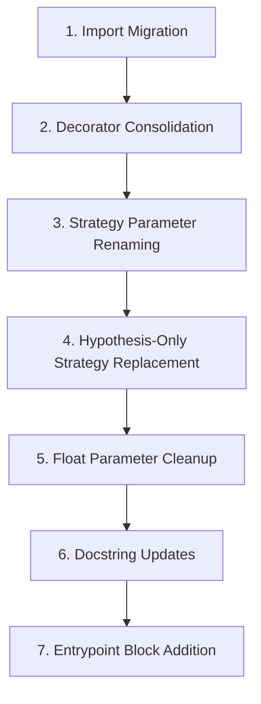

# Design Document — Hypothesis to Testbase Property Testing Migration

## Overview

This design describes the mechanical migration of 82 test files and ~30 specification documents from the external `hypothesis` library to the built-in `automojo.testbase.properties` engine. No new source modules are created. The migration applies a set of deterministic transformation rules to imports, decorators, strategy expressions, parameter names, and documentation references. The goal is to eliminate the `hypothesis` dependency entirely while preserving identical test behavior and coverage.

The migration targets three file categories:
1. **Property test files** (45 files with `_properties.py` suffix) — contain only `@given`-decorated property tests
2. **Mixed test files** (15+ files) — contain both unit tests and `@given`-decorated property tests
3. **Specification documents** (~30 markdown files) — design, task, and requirements docs referencing Hypothesis

All files reside under `source/testroots/automojo/tests/singlehost/agentkit/` (including `resilience/` and `builtins/` subdirectories) and `specs/` / `.kiro/specs/` directories.

## Architecture

The migration is a set of file-level text transformations applied in a defined order. There is no runtime architecture change — the `automojo.testbase.properties` engine already exists and provides API-compatible replacements for the Hypothesis features in use.

### Transformation Pipeline

Each test file passes through these transformation stages in order:



Spec documents pass through a single stage: text replacement of Hypothesis references.

### Ordering Rationale

1. **Imports first** — all subsequent transformations depend on correct import paths
2. **Decorators second** — `@settings` consolidation into `@given` must happen before any strategy changes, since `@settings` removal changes line positions
3. **Strategy parameters third** — `whitelist_categories` → `categories` renaming is independent of strategy replacement
4. **Hypothesis-only strategies fourth** — `st.from_regex`, `st.uuids`, `st.data`, `st.datetimes` replacements may introduce `@composite` strategies or new imports
5. **Float cleanup fifth** — removing `allow_nan`/`allow_infinity` is a simple parameter deletion
6. **Docstrings sixth** — text-only changes, no code impact
7. **Entrypoint last** — appending the block at EOF has no interaction with other changes

## Components and Interfaces

This migration does not introduce new components. It modifies existing files using the following transformation rules, organized by category.

### Component 1: Import Statement Transformations

These rules apply to all 82 test files (both property-only and mixed).

| # | Hypothesis Import | Testbase Replacement |
|---|---|---|
| I1 | `from hypothesis import given` | `from automojo.testbase.properties import given` |
| I2 | `from hypothesis import settings` | `from automojo.testbase.properties import settings` |
| I3 | `from hypothesis import assume` | `from automojo.testbase.properties import assume` |
| I4 | `from hypothesis import strategies as st` | `from automojo.testbase.properties import strategies as st` |
| I5 | `from hypothesis.strategies import (name1, name2, ...)` | `from automojo.testbase.properties import strategies as st` + prefix all bare strategy names with `st.` |
| I6 | `from hypothesis import HealthCheck` | Remove entirely |
| I7 | `from hypothesis.strategies import composite` | `from automojo.testbase.properties.strategies import composite` |
| I8 | `from hypothesis import given, settings` (combined) | `from automojo.testbase.properties import given, settings` |
| I9 | `from hypothesis import given, settings, assume` (combined) | `from automojo.testbase.properties import given, settings, assume` |

When rule I5 applies, all bare strategy references in the file body (e.g., `integers(...)`, `text(...)`, `composite`) must be prefixed with `st.` except for `composite` which gets its own import per rule I7. The `@composite` decorator usage remains `@composite` (not `@st.composite`).

### Component 2: Decorator Pattern Transformations

These rules consolidate standalone `@settings` decorators into the `@given` call.

| # | Before | After |
|---|---|---|
| D1 | `@settings(max_examples=N)`<br>`@given(...)` | `@given(..., settings=settings(max_examples=N))` |
| D2 | `@settings(max_examples=N, suppress_health_check=[...])`<br>`@given(...)` | `@given(..., settings=settings(max_examples=N))` |
| D3 | `@settings(max_examples=N, seed=S)`<br>`@given(...)` | `@given(..., settings=settings(max_examples=N, seed=S))` |
| D4 | `@given(...)`<br>`@settings(...)` (reversed order) | `@given(..., settings=settings(...))` |

The `suppress_health_check` parameter is always dropped since testbase has no HealthCheck concept. Only `max_examples` and `seed` are preserved.

### Component 3: Strategy Parameter Renaming

These rules rename Hypothesis-specific parameter names to testbase equivalents.

| # | Hypothesis Parameter | Testbase Parameter | Applies To |
|---|---|---|---|
| P1 | `whitelist_categories=(...)` | `categories=(...)` | `st.characters()` |
| P2 | `blacklist_characters=(...)` | `characters=(...)` with filtering logic | `st.characters()` |
| P3 | `whitelist_characters="..."` | `characters="..."` | `st.characters()` |
| P4 | `allow_nan=False, allow_infinity=False` | Remove (testbase floats never generate NaN/Infinity within bounded ranges) | `st.floats()` |

For P2 (blacklist_characters), when both `whitelist_categories` and `blacklist_characters` are present, the migration converts to `categories=(...)` and constructs an explicit `characters=` string that excludes the blacklisted characters. This is done by building the character set from the categories and removing the blacklisted characters, then passing the result as the `characters` parameter instead of `categories`.

### Component 4: Hypothesis-Only Strategy Replacements

These strategies exist in Hypothesis but not in testbase. Each requires a custom replacement.

#### S1: `st.from_regex(pattern, fullmatch=True)` → `@composite` strategy

Used in 4 files for version string generation (`r"[0-9]{1,3}\.[0-9]{1,3}\.[0-9]{1,3}"`).

Replacement:
```python
@composite
def _version_string(draw):
    major = draw(st.integers(min_value=0, max_value=999))
    minor = draw(st.integers(min_value=0, max_value=999))
    patch = draw(st.integers(min_value=0, max_value=999))
    return f"{major}.{minor}.{patch}"
```

#### S2: `st.uuids().map(str)` → `@composite` strategy

Used in 6 files for UUID string generation.

Replacement:
```python
@composite
def _uuid_string(draw):
    hex_chars = "0123456789abcdef"
    parts = []
    for length in (8, 4, 4, 4, 12):
        parts.append(draw(st.text(alphabet=hex_chars, min_size=length, max_size=length)))
    return f"{parts[0]}-{parts[1]}-4{parts[2][1:]}-{parts[3]}-{parts[4]}"
```

Alternatively, a simpler approach using `st.integers` and string formatting:
```python
@composite
def _uuid_string(draw):
    segments = [
        draw(st.integers(min_value=0, max_value=0xFFFFFFFF)),
        draw(st.integers(min_value=0, max_value=0xFFFF)),
        draw(st.integers(min_value=0x4000, max_value=0x4FFF)),
        draw(st.integers(min_value=0x8000, max_value=0xBFFF)),
        draw(st.integers(min_value=0, max_value=0xFFFFFFFFFFFF)),
    ]
    return f"{segments[0]:08x}-{segments[1]:04x}-{segments[2]:04x}-{segments[3]:04x}-{segments[4]:012x}"
```

#### S3: `st.data()` → explicit `@given` parameters or `@composite` strategies

Used in ~15 mixed test files for interactive drawing (`data.draw(strategy)`). Two migration patterns:

**Pattern A** — When `data.draw()` calls use fixed strategies, convert to explicit `@given` parameters:
```python
# Before
@given(data=st.data())
def test_something(data):
    name = data.draw(name_strategy)
    value = data.draw(value_strategy)

# After
@given(name=name_strategy, value=value_strategy, settings=settings(max_examples=100))
def test_something(name, value):
```

**Pattern B** — When `data.draw()` calls depend on previously drawn values (conditional drawing), convert to a `@composite` strategy:
```python
# Before
@given(data=st.data())
def test_something(data):
    count = data.draw(st.integers(min_value=1, max_value=5))
    items = [data.draw(item_strategy) for _ in range(count)]

# After
@composite
def _test_something_data(draw):
    count = draw(st.integers(min_value=1, max_value=5))
    items = [draw(item_strategy) for _ in range(count)]
    return (count, items)

@given(data=_test_something_data(), settings=settings(max_examples=100))
def test_something(data):
    count, items = data
```

#### S4: `st.datetimes(min_value=..., max_value=...)` → `@composite` strategy

Used in ~18 files for datetime generation. Testbase has no `datetimes` strategy.

Replacement:
```python
from datetime import datetime

@composite
def _datetimes(draw, min_value=datetime(2000, 1, 1), max_value=datetime(2099, 12, 31)):
    min_ts = int(min_value.timestamp())
    max_ts = int(max_value.timestamp())
    ts = draw(st.integers(min_value=min_ts, max_value=max_ts))
    return datetime.fromtimestamp(ts)
```

This generates datetimes uniformly distributed across the range at second granularity, which is sufficient for the test patterns observed (timestamp comparisons, serialization round-trips).

### Component 5: Entrypoint Block

All 82 test files must end with:
```python
if __name__ == "__main__":
    from automojo.testbase.entrypoints import generic_test_entrypoint
    generic_test_entrypoint()
```

If a file already has this block, no change is needed. If it has a different `__main__` block, replace it.

### Component 6: Module Docstring Updates

Replace Hypothesis references in module docstrings:
- `"using Hypothesis"` → `"using automojo.testbase.properties"`
- `"hypothesis library"` → `"automojo.testbase.properties engine"`
- `"hypothesis"` (standalone) → `"automojo.testbase.properties"`
- `"Hypothesis"` (standalone) → `"automojo.testbase.properties"`

Preserve all other docstring content (requirement references, property descriptions, feature tags).

### Component 7: Specification Document Updates

Apply text replacements across all `specs/` and `.kiro/specs/` markdown files:

| Hypothesis Text | Testbase Replacement |
|---|---|
| `Library: Hypothesis for Python property-based testing` | `Library: automojo.testbase.properties (built-in testbase property testing engine)` |
| `Hypothesis strategies generate random` | `testbase property strategies generate random` |
| `using Hypothesis` | `using automojo.testbase.properties` |
| `Hypothesis library` | `automojo.testbase.properties engine` |
| `Hypothesis SearchStrategy` | `Strategy from automojo.testbase.properties.strategies` |
| `Hypothesis strategies from InvariantStrategy` | `testbase property strategies from InvariantStrategy` |
| `the Hypothesis library` | `the automojo.testbase.properties engine` |
| `via Hypothesis` | `via automojo.testbase.properties` |
| `Hypothesis max_examples` | `testbase max_examples` |
| `returns Hypothesis SearchStrategy` | `returns Strategy from automojo.testbase.properties.strategies` |
| `providing Hypothesis strategies` | `providing testbase property strategies` |
| `use the Hypothesis library` | `use the automojo.testbase.properties engine` |
| `Hypothesis` as external dependency listing | `automojo.testbase.properties` as built-in dependency |

## Data Models

This migration does not introduce new data models. The transformation operates on source text (Python files and Markdown files). The relevant data structures are the existing testbase properties API objects, documented here for reference during migration.

### Testbase Properties API Surface

**Module**: `automojo.testbase.properties`

| Export | Type | Description |
|---|---|---|
| `given` | Decorator | Marks a test function as a property test; accepts keyword strategy arguments and `settings=` |
| `settings` | Class | Configures test execution: `max_examples`, `seed`, `max_shrink_attempts` |
| `assume` | Function | Skips current example if condition is falsy |
| `expect_exception` | Decorator | Marks a test as expected to raise a specific exception |

**Module**: `automojo.testbase.properties.strategies` (aliased as `st`)

| Strategy | Parameters | Notes |
|---|---|---|
| `st.integers` | `min_value`, `max_value` | Same parameter names as Hypothesis |
| `st.floats` | `min_value`, `max_value` | No `allow_nan`/`allow_infinity` — always generates finite floats in range |
| `st.text` | `alphabet`, `min_size`, `max_size` | `alphabet` accepts string or Strategy |
| `st.characters` | `categories`, `characters` | `categories` replaces Hypothesis `whitelist_categories`; `characters` replaces both `whitelist_characters` and `blacklist_characters` |
| `st.booleans` | — | Identical to Hypothesis |
| `st.none` | — | Identical to Hypothesis |
| `st.just` | `value` | Identical to Hypothesis |
| `st.lists` | `element`, `min_size`, `max_size` | Identical to Hypothesis |
| `st.tuples` | `*strategies` | Identical to Hypothesis |
| `st.sets` | `element`, `min_size`, `max_size` | Identical to Hypothesis |
| `st.frozensets` | `element`, `min_size`, `max_size` | Identical to Hypothesis |
| `st.dictionaries` | `keys`, `values`, `min_size`, `max_size` | Identical to Hypothesis |
| `st.fixed_dictionaries` | `mapping` | Identical to Hypothesis |
| `st.sampled_from` | `elements` | Identical to Hypothesis |
| `st.one_of` | `*strategies` | Identical to Hypothesis |
| `st.explicit` | `values` | Testbase-only; deterministic sequence cycling |
| `st.builds` | `target`, `**kwarg_strategies` | Identical to Hypothesis |
| `st.binary` | `min_size`, `max_size` | Identical to Hypothesis |

**Module**: `automojo.testbase.properties.strategies` (direct import)

| Export | Type | Description |
|---|---|---|
| `composite` | Decorator | Creates composite strategies using `draw` callable |

### Strategies NOT Available in Testbase (Requiring Replacement)

| Hypothesis Strategy | Replacement Approach |
|---|---|
| `st.from_regex(pattern)` | `@composite` with `st.integers` for structured generation |
| `st.uuids()` | `@composite` with `st.integers` for UUID segment generation |
| `st.data()` | Explicit `@given` parameters or `@composite` strategies |
| `st.datetimes(min_value, max_value)` | `@composite` with `st.integers` over timestamp range |
| `HealthCheck` | Not needed — remove entirely |

### Parameter Name Mapping

| Hypothesis Parameter | Testbase Parameter | Context |
|---|---|---|
| `whitelist_categories` | `categories` | `st.characters()` |
| `blacklist_characters` | `characters` (with exclusion logic) | `st.characters()` |
| `whitelist_characters` | `characters` | `st.characters()` |
| `allow_nan` | N/A (remove) | `st.floats()` |
| `allow_infinity` | N/A (remove) | `st.floats()` |
| `suppress_health_check` | N/A (remove) | `@settings()` |

## Correctness Properties

*A property is a characteristic or behavior that should hold true across all valid executions of a system — essentially, a formal statement about what the system should do. Properties serve as the bridge between human-readable specifications and machine-verifiable correctness guarantees.*

### Property 1: No Hypothesis imports remain in any test file

*For any* Python test file in the migration scope, after migration the file shall contain zero import statements referencing the `hypothesis` package (including `hypothesis.strategies`, `hypothesis.HealthCheck`, and any other `hypothesis.*` submodule).

**Validates: Requirements 1.1, 1.2, 1.3, 1.4, 1.5, 1.6, 1.7, 1.8, 2.1, 2.2, 6.1**

### Property 2: Non-Hypothesis imports are preserved in mixed test files

*For any* mixed test file and any import line that does not reference the `hypothesis` package, that import line shall be identical before and after migration.

**Validates: Requirements 2.3**

### Property 3: No standalone @settings decorators remain

*For any* `@given`-decorated test function across all migrated files, there shall be no standalone `@settings(...)` decorator on the function, and the `@given(...)` call shall contain a `settings=settings(...)` parameter with at least `max_examples` specified.

**Validates: Requirements 3.1, 3.2, 3.3, 3.4, 3.5**

### Property 4: Strategy parameter values are preserved

*For any* strategy call in a migrated test file (e.g., `st.integers`, `st.text`, `st.floats`, `st.lists`, `st.dictionaries`, `st.sampled_from`, `st.one_of`, `st.tuples`, `st.sets`, `st.builds`), the constraint parameters (`min_value`, `max_value`, `min_size`, `max_size`, `alphabet`, `element`, filter predicates) shall have the same values as in the original Hypothesis-based file.

**Validates: Requirements 4.1, 4.2, 4.3, 4.4, 4.5, 4.6, 4.7, 13.4**

### Property 5: Hypothesis-specific parameters are removed or renamed

*For any* test file in the migration scope, after migration the file shall contain zero occurrences of `whitelist_categories`, `blacklist_characters`, `whitelist_characters`, `allow_nan`, `allow_infinity`, or `suppress_health_check` as parameter names.

**Validates: Requirements 4.8, 4.9, 3.2**

### Property 6: No Hypothesis-only strategy calls remain

*For any* test file in the migration scope, after migration the file shall contain zero calls to `st.from_regex`, `st.uuids`, `st.data`, `st.recursive`, `st.deferred`, or `st.datetimes` (bare `datetimes` included).

**Validates: Requirements 5.1, 5.2, 5.3, 5.4, 5.5**

### Property 7: Replacement strategies generate values in the original domain

*For any* replacement composite strategy (version strings, UUID strings, datetimes), the generated values shall match the format constraints of the original Hypothesis strategy. Specifically: version strings match `\d{1,3}\.\d{1,3}\.\d{1,3}`, UUID strings match the UUID hex-dash format `[0-9a-f]{8}-[0-9a-f]{4}-4[0-9a-f]{3}-[89ab][0-9a-f]{3}-[0-9a-f]{12}`, and datetimes fall within the specified min/max range.

**Validates: Requirements 5.6, 6.4**

### Property 8: Test function count is preserved per file

*For any* migrated test file, the number of `def test_` functions shall be identical before and after migration.

**Validates: Requirements 13.1**

### Property 9: Assertion logic is preserved

*For any* `assert` statement or `testbase.assert_*` call in a migrated test file, the assertion condition and message string shall be identical before and after migration.

**Validates: Requirements 13.3, 7.1**

### Property 10: Standard entrypoint block is present in all test files

*For any* test file in the migration scope, the file shall end with the standard entrypoint block containing `if __name__ == "__main__":` followed by `from automojo.testbase.entrypoints import generic_test_entrypoint` and `generic_test_entrypoint()`.

**Validates: Requirements 8.1, 8.2, 8.3, 8.4**

### Property 11: No Hypothesis references remain in specification documents

*For any* markdown file under `specs/` or `.kiro/specs/` (excluding the hypothesis-to-testbase-migration spec itself), after migration the file shall contain zero occurrences of the word "Hypothesis" (case-sensitive) as a reference to the external library.

**Validates: Requirements 10.1, 10.2, 10.3, 10.4, 10.5, 10.6, 11.1, 11.2, 11.3, 11.4, 12.1, 12.2, 12.3**

### Property 12: No Hypothesis references remain in module docstrings

*For any* test file in the migration scope, the module docstring shall contain zero occurrences of "hypothesis" or "Hypothesis" as a reference to the external library.

**Validates: Requirements 9.1, 9.2, 9.3**

### Property 13: max_examples values are preserved

*For any* `@given`-decorated test function, the `max_examples` value in the migrated `settings=settings(max_examples=N)` parameter shall equal the original `max_examples` value from the Hypothesis `@settings` decorator (defaulting to 100 where the original used the Hypothesis default).

**Validates: Requirements 13.2**

### Property 14: No Hypothesis dependency in project files

*For any* dependency declaration file (`pyproject.toml`, `requirements.txt`, `setup.py`, `setup.cfg`) in the project, after migration the file shall not list `hypothesis` as a dependency. Additionally, no Python file under `source/` shall contain an import from the `hypothesis` package.

**Validates: Requirements 14.1, 14.2, 14.3**

## Error Handling

Since this is a mechanical migration (no new runtime code), error handling applies to the migration process itself rather than to runtime behavior.

### Migration-Time Errors

| Error Condition | Handling Strategy |
|---|---|
| `st.characters` with both `whitelist_categories` and `blacklist_characters` | Build explicit character string from categories, remove blacklisted chars, pass as `characters=` parameter |
| `st.characters` with both `whitelist_categories` and `whitelist_characters` | Combine: pass `categories=` for category chars and append `whitelist_characters` value to the `characters=` parameter |
| `st.floats` with `allow_nan=False, allow_infinity=False` and explicit `min_value`/`max_value` | Simply remove `allow_nan` and `allow_infinity` parameters; testbase `floats(min_value, max_value)` already generates only finite values in range |
| `st.floats` with `allow_nan=False, allow_infinity=False` but no explicit bounds | Remove `allow_nan` and `allow_infinity`; testbase defaults to `(-1e6, 1e6)` which is finite |
| `st.data()` with conditional drawing (value depends on previously drawn value) | Convert to `@composite` strategy that encapsulates the drawing logic |
| `st.data()` with independent draws | Convert to explicit `@given` parameters |
| `@settings` decorator appears below `@given` (reversed order) | Handle both orderings — detect `@settings` adjacent to `@given` regardless of position |
| File already has correct testbase imports | Skip — idempotent migration |
| File already has standard entrypoint block | Skip — no duplicate block |

### Post-Migration Validation

After all file transformations, run the full test suite to catch any behavioral regressions:
```bash
source .venv/bin/activate
testbase testing run --root source/testroots/automojo --includes=automojo.tests.singlehost --output=./.output
```

Any test failure indicates a migration error that must be investigated and corrected before the migration is considered complete.

## Testing Strategy

### Dual Testing Approach

- **Unit tests**: Verify specific migration examples, edge cases, and error conditions
- **Property tests**: Verify universal migration invariants across all files

Both are complementary and necessary for comprehensive coverage of this migration.

### Property-Based Testing Configuration

- **Library**: automojo.testbase.properties (built-in testbase property testing engine)
- **Minimum 100 iterations** per property test (due to randomization)
- Each test tagged with a comment: **Feature: hypothesis-to-testbase-migration, Property N: title**
- Each correctness property implemented by a **single** property-based test

### Property Test Implementation

Property tests for this migration verify post-migration invariants by scanning the migrated files. Since this is a file transformation migration (not a library with an API), the property tests operate on the file system state after migration.

| Property | Test Approach |
|---|---|
| Property 1: No Hypothesis imports | Scan all test files, assert no `from hypothesis` or `import hypothesis` lines |
| Property 2: Non-Hypothesis imports preserved | Compare non-hypothesis import lines before/after (requires baseline snapshot) |
| Property 3: No standalone @settings | Parse all test files, assert no `@settings(` decorator lines outside `@given(` calls |
| Property 4: Strategy parameters preserved | Compare strategy call parameter values before/after (requires baseline snapshot) |
| Property 5: Hypothesis-specific params removed | Scan all test files for banned parameter names |
| Property 6: No Hypothesis-only strategies | Scan all test files for banned strategy calls |
| Property 7: Replacement strategy domain | Generate values from replacement strategies, assert format compliance |
| Property 8: Test function count preserved | Count `def test_` in each file before/after |
| Property 9: Assertion logic preserved | Compare assert lines before/after |
| Property 10: Entrypoint block present | Check last lines of each test file |
| Property 11: No Hypothesis in specs | Scan all spec markdown files |
| Property 12: No Hypothesis in docstrings | Parse module docstrings from all test files |
| Property 13: max_examples preserved | Extract max_examples values before/after |
| Property 14: No Hypothesis dependency | Check pyproject.toml and scan all Python imports |

### Unit Test Focus Areas

- Specific `st.characters` parameter conversion examples (whitelist_categories + blacklist_characters combinations)
- Specific `st.from_regex` to `@composite` conversion for version strings
- Specific `st.uuids().map(str)` to `@composite` conversion
- Specific `st.data()` to explicit parameters conversion for each affected file
- Specific `st.datetimes` to `@composite` conversion
- Specific `@settings` + `@given` decorator consolidation patterns (above, below, with suppress_health_check)
- Edge case: file with both `from hypothesis.strategies import composite` and `from hypothesis.strategies import text, integers`
- Edge case: `@settings` with only `suppress_health_check` and no `max_examples`
- Integration: full test suite execution after migration to verify all tests pass

### Verification Workflow

1. **Pre-migration baseline**: Capture file checksums, test function counts, import lists, and strategy parameter values
2. **Execute migration**: Apply all transformation rules in order
3. **Post-migration scan**: Run property tests to verify all invariants hold
4. **Full test suite**: Execute `testbase testing run` to verify behavioral equivalence
5. **Dependency check**: Verify `hypothesis` is not importable / not in dependency files
