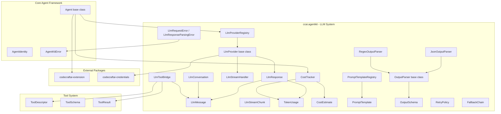
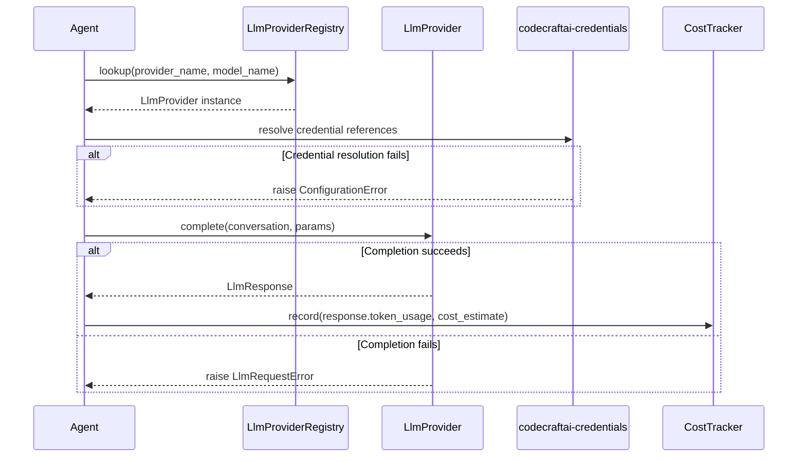
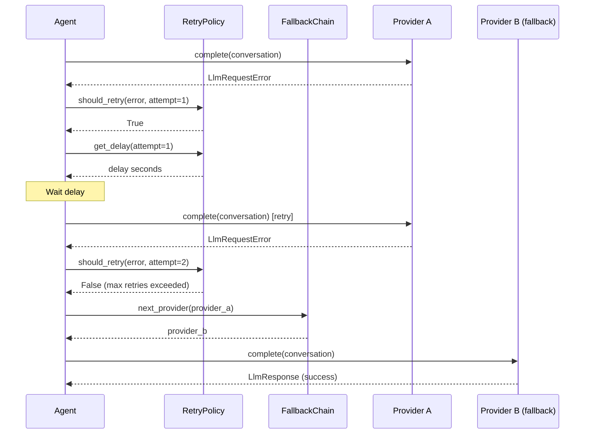
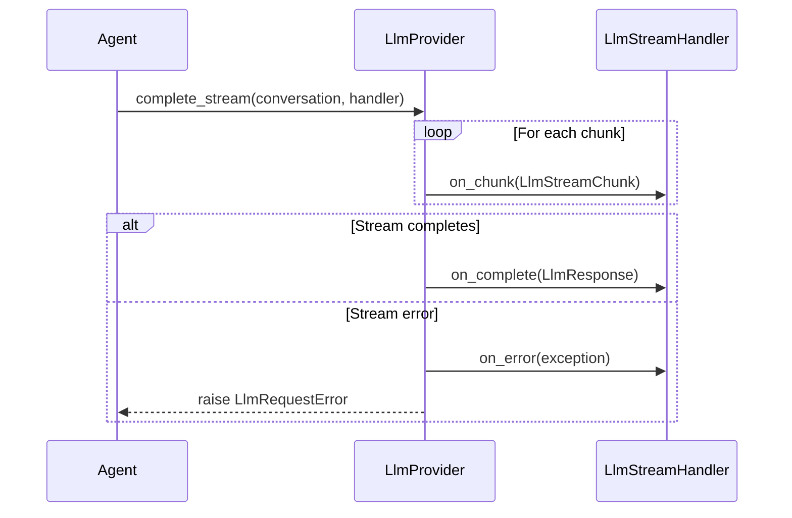

# Design Document — LLM Integration

## Overview

The LLM Integration feature extends the `codecraftai-agent-kit` SDK with a unified interface for interacting with Large Language Model providers. It defines an LLM provider abstraction with a common interface, a provider registry for managing available providers, prompt template management with versioning, structured output parsing and validation, token usage tracking and cost estimation, streaming response support, retry and fallback strategies across providers, conversation/message history management, and a tool bridge for LLM-to-tool interoperability.

The system provides:

- `LlmProvider` abstract base class with `complete` and `complete_stream` methods
- `LlmMessage` and `LlmConversation` for structured conversation history
- `LlmResponse` for immutable completion results with token usage and provider metadata
- `LlmStreamChunk` and `LlmStreamHandler` for streaming response processing
- `TokenUsage` and `CostEstimate` for immutable usage/cost records
- `CostTracker` for accumulating usage and cost across requests
- `PromptTemplate` and `PromptTemplateRegistry` for versioned prompt management
- `OutputParser`, `JsonOutputParser`, `RegexOutputParser`, and `OutputSchema` for structured output parsing and validation
- `LlmProviderRegistry` for provider registration, lookup by name/model/tags, and enumeration
- `RetryPolicy` and `FallbackChain` for resilient request handling
- `LlmToolBridge` for converting between tool descriptors and LLM function definitions
- `LlmRequestError` and `LlmResponseParsingError` for LLM-specific error handling

All classes live under `source/packages/ccai/agentkit/` with filenames in all-lowercase (no underscores), following the project naming conventions. The system integrates with:

- Core Agent Framework — `Agent` base class, `AgentIdentity`, `AgentConfiguration`, `AgentKitError`, `SemanticError`, `ConfigurationError`
- Tool & Capability System — `Tool`, `ToolDescriptor`, `ToolSchema`, `ToolRegistry`, `ToolResult`
- `codecraftai-extension` — `ExtensionPoint` for LLM provider plugin discovery
- `codecraftai-credentials` — `CredentialReference` resolution for API keys and secrets

The design prioritizes debuggability over performance and readability over conciseness, per the project coding standards.

## Architecture



### LLM Completion Flow



### Retry and Fallback Flow



### Streaming Completion Flow



### Design Decisions

1. `LlmProvider` as abstract base class using `abc.ABC` with abstract `complete` and `complete_stream` methods — consistent with the Core Agent Framework pattern for `Agent` and the Tool System pattern for `Tool`.
2. `LlmProviderRegistry` as a per-agent instance (not singleton) — providers are scoped to individual agents, consistent with `ToolRegistry`.
3. `LlmMessage` and `LlmConversation` as separate classes — messages are immutable value objects, conversations are mutable ordered collections of messages.
4. `TokenUsage` and `CostEstimate` as immutable value objects with validation — fail-fast on construction if totals don't match component sums.
5. `CostTracker` as a mutable accumulator — tracks usage across multiple requests with per-provider breakdown.
6. `PromptTemplate` uses Python `str.format` syntax — simple, well-known, no external template engine dependency.
7. `PromptTemplateRegistry` uses composite key of name + version — supports multiple versions of the same template.
8. `OutputParser` as abstract base class with optional `OutputSchema` — separates parsing from validation, allows parsers to work with or without schema validation.
9. `RetryPolicy` and `FallbackChain` as separate configuration objects — retry is per-request behavior, fallback is a provider-level strategy.
10. `LlmToolBridge` as a stateless utility — converts between tool system types and LLM function calling format without holding state.
11. Credential resolution happens before completion requests — providers receive resolved credentials, keeping credential logic out of provider implementations.
12. All serializable classes follow the naming convention: `as_dict` for dictionary conversion, `to_json` for JSON serialization, `from_dict`/`from_json` for deserialization.


## Components and Interfaces

### File Layout

| File | Class(es) | Purpose |
|---|---|---|
| llmprovider.py | LlmProvider | Abstract base class for LLM providers |
| llmmessage.py | LlmMessage | Immutable message with role, content, metadata |
| llmconversation.py | LlmConversation | Ordered mutable collection of LlmMessage objects |
| llmresponse.py | LlmResponse | Immutable completion result with token usage |
| llmstreamchunk.py | LlmStreamChunk | Immutable partial streaming response chunk |
| llmstreamhandler.py | LlmStreamHandler | Callback interface for streaming responses |
| tokenusage.py | TokenUsage | Immutable token count record |
| costestimate.py | CostEstimate | Immutable cost record |
| costtracker.py | CostTracker | Mutable accumulator for usage and cost |
| prompttemplate.py | PromptTemplate | Named, versioned template with placeholders |
| prompttemplateregistry.py | PromptTemplateRegistry | Registry for prompt templates by name+version |
| outputparser.py | OutputParser | Abstract base class for output parsers |
| jsonoutputparser.py | JsonOutputParser | JSON parsing implementation |
| regexoutputparser.py | RegexOutputParser | Regex-based parsing implementation |
| outputschema.py | OutputSchema | Declarative schema for output validation |
| llmproviderregistry.py | LlmProviderRegistry | Per-agent provider registration and lookup |
| retrypolicy.py | RetryPolicy | Retry configuration with backoff strategies |
| fallbackchain.py | FallbackChain | Ordered fallback provider sequence |
| llmtoolbridge.py | LlmToolBridge | Converts between tool descriptors and LLM function defs |
| llmerrors.py | LlmRequestError, LlmResponseParsingError | LLM-specific exceptions |

### LlmProvider

```python
import abc

class LlmProvider(abc.ABC):
    """
        Abstract base class for Large Language Model providers.
        Subclasses implement the complete and complete_stream methods
        for a specific LLM service.
    """

    def __init__(self, provider_name: str, model_name: str,
                 config: dict = None, credential_names: list = None,
                 tags: dict = None):
        """
            Constructs an LlmProvider.

            :param provider_name: The name of the LLM provider (e.g. "openai").
            :param model_name: The name of the model (e.g. "gpt-4").
            :param config: Optional provider configuration dictionary.
            :param credential_names: Optional list of CredentialReference names.
            :param tags: Optional dictionary of tags for categorization.

            :raises: SemanticError if provider_name or model_name is not provided.
        """
        if provider_name is None or len(str(provider_name).strip()) == 0:
            errmsg = "A provider name is required when constructing an LlmProvider."
            raise SemanticError(errmsg)

        if model_name is None or len(str(model_name).strip()) == 0:
            errmsg = "A model name is required when constructing an LlmProvider."
            raise SemanticError(errmsg)

        self._provider_name = provider_name
        self._model_name = model_name
        self._config = dict(config) if config is not None else {}
        self._credential_names = list(credential_names) if credential_names is not None else []
        self._tags = dict(tags) if tags is not None else {}
        return

    @property
    def provider_name(self) -> str:
        return self._provider_name

    @property
    def model_name(self) -> str:
        return self._model_name

    @property
    def config(self) -> dict:
        return dict(self._config)

    @property
    def credential_names(self) -> list:
        return list(self._credential_names)

    @property
    def tags(self) -> dict:
        return dict(self._tags)

    @abc.abstractmethod
    def complete(self, conversation: "LlmConversation", **kwargs) -> "LlmResponse":
        """
            Executes a synchronous completion request.

            :param conversation: The conversation history.

            :returns: An LlmResponse with the completion result.
            :raises: LlmRequestError
        """
        ...

    @abc.abstractmethod
    def complete_stream(self, conversation: "LlmConversation",
                        handler: "LlmStreamHandler", **kwargs) -> "LlmResponse":
        """
            Executes a streaming completion request.

            :param conversation: The conversation history.
            :param handler: The stream handler to receive chunks.

            :returns: The final assembled LlmResponse.
            :raises: LlmRequestError
        """
        ...

    def get_model_info(self) -> dict:
        """
            Returns provider and model metadata.

            :returns: A dictionary with provider_name, model_name, and config keys.
        """
        rtnval = {
            "provider_name": self._provider_name,
            "model_name": self._model_name,
            "config": dict(self._config)
        }
        return rtnval

    def __repr__(self) -> str:
        rtnval = "{}(provider_name={!r}, model_name={!r})".format(
            self.__class__.__name__, self._provider_name, self._model_name
        )
        return rtnval

    def __str__(self) -> str:
        rtnval = "LlmProvider: {} / {}".format(self._provider_name, self._model_name)
        return rtnval
```

### LlmMessage

```python
class LlmMessage:
    """
        Immutable message in a conversation with a role, content, and optional metadata.
    """

    VALID_ROLES = {"system", "user", "assistant", "tool"}

    def __init__(self, role: str, content: str, metadata: dict = None):
        """
            Constructs an LlmMessage.

            :param role: The message role (system, user, assistant, tool).
            :param content: The message content string.
            :param metadata: Optional metadata dictionary (e.g. tool call info).

            :raises: SemanticError if role is not in VALID_ROLES.
        """
        if role not in self.VALID_ROLES:
            errmsg = "Invalid message role {!r}. Valid roles are: {}".format(
                role, ", ".join(sorted(self.VALID_ROLES))
            )
            raise SemanticError(errmsg)

        self._role = role
        self._content = content
        self._metadata = dict(metadata) if metadata is not None else {}
        return

    @property
    def role(self) -> str:
        return self._role

    @property
    def content(self) -> str:
        return self._content

    @property
    def metadata(self) -> dict:
        return dict(self._metadata)

    def as_dict(self) -> dict:
        """
            Returns a dictionary representation of the message.

            :returns: A dictionary with role, content, and metadata keys.
        """
        rtnval = {
            "role": self._role,
            "content": self._content,
            "metadata": dict(self._metadata)
        }
        return rtnval

    def to_json(self) -> str:
        """
            Returns a JSON string representation of the message.

            :returns: A JSON string.
        """
        rtnval = json.dumps(self.as_dict())
        return rtnval

    @classmethod
    def from_dict(cls, data: dict) -> "LlmMessage":
        """
            Constructs an LlmMessage from a dictionary.

            :param data: A dictionary with role, content, and optional metadata keys.

            :returns: An LlmMessage instance.
        """
        rtnval = cls(
            role=data["role"],
            content=data["content"],
            metadata=data.get("metadata")
        )
        return rtnval

    @classmethod
    def from_json(cls, json_str: str) -> "LlmMessage":
        """
            Deserializes a JSON string into an LlmMessage.

            :param json_str: A JSON string.

            :returns: An LlmMessage instance.
        """
        data = json.loads(json_str)
        rtnval = cls.from_dict(data)
        return rtnval

    def __repr__(self) -> str:
        content_preview = self._content[:50] + "..." if len(self._content) > 50 else self._content
        rtnval = "{}(role={!r}, content={!r})".format(
            self.__class__.__name__, self._role, content_preview
        )
        return rtnval

    def __str__(self) -> str:
        rtnval = "[{}] {}".format(self._role, self._content)
        return rtnval

    def __eq__(self, other) -> bool:
        if not isinstance(other, LlmMessage):
            return False
        rtnval = (self._role == other._role and
                  self._content == other._content and
                  self._metadata == other._metadata)
        return rtnval
```

### LlmConversation

```python
class LlmConversation:
    """
        An ordered, mutable sequence of LlmMessage objects representing
        a conversation history.
    """

    def __init__(self, messages: list = None):
        """
            Constructs an LlmConversation.

            :param messages: Optional initial list of LlmMessage objects.
        """
        self._messages = list(messages) if messages is not None else []
        return

    @property
    def count(self) -> int:
        return len(self._messages)

    @property
    def messages(self) -> list:
        """
            Returns a copy of the message list.

            :returns: A list of LlmMessage objects.
        """
        rtnval = list(self._messages)
        return rtnval

    def append(self, message: "LlmMessage") -> None:
        """
            Adds an LlmMessage to the end of the conversation.

            :param message: The LlmMessage to append.
        """
        self._messages.append(message)
        return

    def truncate(self, max_messages: int) -> None:
        """
            Removes the oldest non-system messages to fit within the limit,
            preserving system messages.

            :param max_messages: The maximum number of messages to retain.
        """
        if len(self._messages) <= max_messages:
            return

        system_messages = [m for m in self._messages if m.role == "system"]
        non_system_messages = [m for m in self._messages if m.role != "system"]

        available_slots = max_messages - len(system_messages)
        if available_slots < 0:
            available_slots = 0

        kept_non_system = non_system_messages[-available_slots:] if available_slots > 0 else []

        self._messages = system_messages + kept_non_system
        return

    def as_dict(self) -> dict:
        rtnval = {
            "messages": [m.as_dict() for m in self._messages]
        }
        return rtnval

    def to_json(self) -> str:
        rtnval = json.dumps(self.as_dict())
        return rtnval

    @classmethod
    def from_json(cls, json_str: str) -> "LlmConversation":
        data = json.loads(json_str)
        messages = [LlmMessage.from_dict(m) for m in data["messages"]]
        rtnval = cls(messages=messages)
        return rtnval

    def __repr__(self) -> str:
        rtnval = "{}(count={})".format(self.__class__.__name__, len(self._messages))
        return rtnval

    def __str__(self) -> str:
        roles = [m.role for m in self._messages]
        rtnval = "LlmConversation: [{}]".format(", ".join(roles))
        return rtnval

    def __eq__(self, other) -> bool:
        if not isinstance(other, LlmConversation):
            return False
        rtnval = self._messages == other._messages
        return rtnval
```


### TokenUsage

```python
class TokenUsage:
    """
        Immutable record of token counts for a single LLM request.
    """

    def __init__(self, prompt_tokens: int, completion_tokens: int, total_tokens: int):
        """
            Constructs a TokenUsage.

            :param prompt_tokens: Number of prompt tokens consumed.
            :param completion_tokens: Number of completion tokens consumed.
            :param total_tokens: Total token count.

            :raises: SemanticError if total_tokens != prompt_tokens + completion_tokens.
        """
        expected_total = prompt_tokens + completion_tokens
        if total_tokens != expected_total:
            errmsg = "TokenUsage total_tokens ({}) does not equal prompt_tokens ({}) + completion_tokens ({}) = {}.".format(
                total_tokens, prompt_tokens, completion_tokens, expected_total
            )
            raise SemanticError(errmsg)

        self._prompt_tokens = prompt_tokens
        self._completion_tokens = completion_tokens
        self._total_tokens = total_tokens
        return

    @property
    def prompt_tokens(self) -> int:
        return self._prompt_tokens

    @property
    def completion_tokens(self) -> int:
        return self._completion_tokens

    @property
    def total_tokens(self) -> int:
        return self._total_tokens

    def as_dict(self) -> dict:
        rtnval = {
            "prompt_tokens": self._prompt_tokens,
            "completion_tokens": self._completion_tokens,
            "total_tokens": self._total_tokens
        }
        return rtnval

    def __add__(self, other: "TokenUsage") -> "TokenUsage":
        """
            Returns a new TokenUsage whose counts are the sum of the two operands.

            :param other: The other TokenUsage to add.

            :returns: A new TokenUsage with summed counts.
        """
        rtnval = TokenUsage(
            prompt_tokens=self._prompt_tokens + other._prompt_tokens,
            completion_tokens=self._completion_tokens + other._completion_tokens,
            total_tokens=self._total_tokens + other._total_tokens
        )
        return rtnval

    def __repr__(self) -> str:
        rtnval = "{}(prompt={}, completion={}, total={})".format(
            self.__class__.__name__, self._prompt_tokens,
            self._completion_tokens, self._total_tokens
        )
        return rtnval

    def __str__(self) -> str:
        rtnval = "Tokens: {} prompt, {} completion, {} total".format(
            self._prompt_tokens, self._completion_tokens, self._total_tokens
        )
        return rtnval

    def __eq__(self, other) -> bool:
        if not isinstance(other, TokenUsage):
            return False
        rtnval = (self._prompt_tokens == other._prompt_tokens and
                  self._completion_tokens == other._completion_tokens and
                  self._total_tokens == other._total_tokens)
        return rtnval
```

### CostEstimate

```python
class CostEstimate:
    """
        Immutable record of estimated cost for a single LLM request.
    """

    def __init__(self, prompt_cost: float, completion_cost: float,
                 total_cost: float, currency: str = "USD"):
        """
            Constructs a CostEstimate.

            :param prompt_cost: Cost for prompt tokens.
            :param completion_cost: Cost for completion tokens.
            :param total_cost: Total cost.
            :param currency: Currency string (default "USD").

            :raises: SemanticError if total_cost != prompt_cost + completion_cost.
        """
        expected_total = prompt_cost + completion_cost
        if abs(total_cost - expected_total) > 1e-9:
            errmsg = "CostEstimate total_cost ({}) does not equal prompt_cost ({}) + completion_cost ({}) = {}.".format(
                total_cost, prompt_cost, completion_cost, expected_total
            )
            raise SemanticError(errmsg)

        self._prompt_cost = prompt_cost
        self._completion_cost = completion_cost
        self._total_cost = total_cost
        self._currency = currency
        return

    @property
    def prompt_cost(self) -> float:
        return self._prompt_cost

    @property
    def completion_cost(self) -> float:
        return self._completion_cost

    @property
    def total_cost(self) -> float:
        return self._total_cost

    @property
    def currency(self) -> str:
        return self._currency

    def as_dict(self) -> dict:
        rtnval = {
            "prompt_cost": self._prompt_cost,
            "completion_cost": self._completion_cost,
            "total_cost": self._total_cost,
            "currency": self._currency
        }
        return rtnval

    def __repr__(self) -> str:
        rtnval = "{}(total={}, currency={!r})".format(
            self.__class__.__name__, self._total_cost, self._currency
        )
        return rtnval

    def __str__(self) -> str:
        rtnval = "Cost: {} {} (prompt: {}, completion: {})".format(
            self._total_cost, self._currency, self._prompt_cost, self._completion_cost
        )
        return rtnval

    def __eq__(self, other) -> bool:
        if not isinstance(other, CostEstimate):
            return False
        rtnval = (abs(self._prompt_cost - other._prompt_cost) < 1e-9 and
                  abs(self._completion_cost - other._completion_cost) < 1e-9 and
                  abs(self._total_cost - other._total_cost) < 1e-9 and
                  self._currency == other._currency)
        return rtnval
```

### CostTracker

```python
class CostTracker:
    """
        Accumulates TokenUsage and CostEstimate records across multiple
        LLM requests, providing totals and per-provider breakdowns.
    """

    def __init__(self):
        self._records = []
        return

    def record(self, provider_name: str, token_usage: TokenUsage,
               cost_estimate: CostEstimate) -> None:
        """
            Records a single LLM request's usage and cost.

            :param provider_name: The provider name for this record.
            :param token_usage: The TokenUsage for this request.
            :param cost_estimate: The CostEstimate for this request.
        """
        entry = {
            "provider_name": provider_name,
            "token_usage": token_usage,
            "cost_estimate": cost_estimate
        }
        self._records.append(entry)
        return

    @property
    def total_token_usage(self) -> TokenUsage:
        """
            Returns the total TokenUsage across all tracked requests.

            :returns: A TokenUsage with summed counts, or TokenUsage(0, 0, 0) if empty.
        """
        rtnval = TokenUsage(prompt_tokens=0, completion_tokens=0, total_tokens=0)
        for entry in self._records:
            rtnval = rtnval + entry["token_usage"]
        return rtnval

    @property
    def total_cost_estimate(self) -> CostEstimate:
        """
            Returns the total CostEstimate across all tracked requests.

            :returns: A CostEstimate with summed costs.
        """
        prompt_total = sum(e["cost_estimate"].prompt_cost for e in self._records)
        completion_total = sum(e["cost_estimate"].completion_cost for e in self._records)
        total = prompt_total + completion_total
        rtnval = CostEstimate(
            prompt_cost=prompt_total,
            completion_cost=completion_total,
            total_cost=total
        )
        return rtnval

    def per_provider_breakdown(self) -> dict:
        """
            Returns a per-provider breakdown of TokenUsage and CostEstimate totals.

            :returns: A dictionary keyed by provider name with token_usage and cost_estimate values.
        """
        breakdown = {}
        for entry in self._records:
            pname = entry["provider_name"]
            if pname not in breakdown:
                breakdown[pname] = {
                    "token_usage": TokenUsage(0, 0, 0),
                    "cost_estimate": CostEstimate(0.0, 0.0, 0.0)
                }
            breakdown[pname]["token_usage"] = breakdown[pname]["token_usage"] + entry["token_usage"]
            existing_cost = breakdown[pname]["cost_estimate"]
            new_prompt = existing_cost.prompt_cost + entry["cost_estimate"].prompt_cost
            new_completion = existing_cost.completion_cost + entry["cost_estimate"].completion_cost
            breakdown[pname]["cost_estimate"] = CostEstimate(
                prompt_cost=new_prompt,
                completion_cost=new_completion,
                total_cost=new_prompt + new_completion
            )
        rtnval = breakdown
        return rtnval

    @property
    def request_count(self) -> int:
        return len(self._records)

    def reset(self) -> None:
        """
            Clears all accumulated records.
        """
        self._records = []
        return
```

### LlmResponse

```python
class LlmResponse:
    """
        Immutable result of an LLM completion request.
    """

    def __init__(self, message: LlmMessage, token_usage: TokenUsage,
                 provider_name: str, model_name: str, duration: float):
        """
            Constructs an LlmResponse.

            :param message: The response LlmMessage.
            :param token_usage: The TokenUsage for this request.
            :param provider_name: The provider name string.
            :param model_name: The model name string.
            :param duration: The request duration in seconds.
        """
        self._message = message
        self._token_usage = token_usage
        self._provider_name = provider_name
        self._model_name = model_name
        self._duration = duration
        return

    @property
    def message(self) -> LlmMessage:
        return self._message

    @property
    def token_usage(self) -> TokenUsage:
        return self._token_usage

    @property
    def provider_name(self) -> str:
        return self._provider_name

    @property
    def model_name(self) -> str:
        return self._model_name

    @property
    def duration(self) -> float:
        return self._duration

    def as_dict(self) -> dict:
        rtnval = {
            "message": self._message.as_dict(),
            "token_usage": self._token_usage.as_dict(),
            "provider_name": self._provider_name,
            "model_name": self._model_name,
            "duration": self._duration
        }
        return rtnval

    def to_json(self) -> str:
        rtnval = json.dumps(self.as_dict())
        return rtnval

    @classmethod
    def from_json(cls, json_str: str) -> "LlmResponse":
        data = json.loads(json_str)
        message = LlmMessage.from_dict(data["message"])
        token_usage = TokenUsage(
            prompt_tokens=data["token_usage"]["prompt_tokens"],
            completion_tokens=data["token_usage"]["completion_tokens"],
            total_tokens=data["token_usage"]["total_tokens"]
        )
        rtnval = cls(
            message=message,
            token_usage=token_usage,
            provider_name=data["provider_name"],
            model_name=data["model_name"],
            duration=data["duration"]
        )
        return rtnval

    def __repr__(self) -> str:
        rtnval = "{}(provider={!r}, model={!r}, tokens={})".format(
            self.__class__.__name__, self._provider_name,
            self._model_name, self._token_usage.total_tokens
        )
        return rtnval

    def __str__(self) -> str:
        rtnval = "LlmResponse: {} / {} | {} | {:.2f}s".format(
            self._provider_name, self._model_name,
            str(self._token_usage), self._duration
        )
        return rtnval

    def __eq__(self, other) -> bool:
        if not isinstance(other, LlmResponse):
            return False
        rtnval = (self._message == other._message and
                  self._token_usage == other._token_usage and
                  self._provider_name == other._provider_name and
                  self._model_name == other._model_name and
                  abs(self._duration - other._duration) < 1e-9)
        return rtnval
```

### LlmStreamChunk

```python
class LlmStreamChunk:
    """
        Immutable partial content from a streaming LLM response.
    """

    def __init__(self, content: str, metadata: dict = None):
        self._content = content
        self._metadata = dict(metadata) if metadata is not None else {}
        return

    @property
    def content(self) -> str:
        return self._content

    @property
    def metadata(self) -> dict:
        return dict(self._metadata)

    def __repr__(self) -> str:
        preview = self._content[:30] + "..." if len(self._content) > 30 else self._content
        rtnval = "{}(content={!r})".format(self.__class__.__name__, preview)
        return rtnval

    def __str__(self) -> str:
        return self._content
```

### LlmStreamHandler

```python
import abc

class LlmStreamHandler(abc.ABC):
    """
        Callback interface for receiving streaming LLM response chunks.
    """

    @abc.abstractmethod
    def on_chunk(self, chunk: LlmStreamChunk) -> None:
        """
            Called for each chunk received during streaming.

            :param chunk: The LlmStreamChunk with partial content.
        """
        ...

    @abc.abstractmethod
    def on_complete(self, response: LlmResponse) -> None:
        """
            Called when the streaming response completes.

            :param response: The final assembled LlmResponse.
        """
        ...

    @abc.abstractmethod
    def on_error(self, error: Exception) -> None:
        """
            Called when an error occurs during streaming.

            :param error: The exception that occurred.
        """
        ...
```


### PromptTemplate

```python
class PromptTemplate:
    """
        A named, versioned template string with placeholder variables
        using Python str.format syntax.
    """

    def __init__(self, name: str, version: str, template: str,
                 description: str = ""):
        """
            Constructs a PromptTemplate.

            :param name: The template name.
            :param version: The template version string.
            :param template: The template string with {placeholder} variables.
            :param description: Optional description.
        """
        self._name = name
        self._version = version
        self._template = template
        self._description = description
        self._variables = self._extract_variables()
        return

    def _extract_variables(self) -> list:
        """
            Extracts placeholder variable names from the template string.

            :returns: A list of variable name strings.
        """
        import string
        formatter = string.Formatter()
        variables = []
        for _, field_name, _, _ in formatter.parse(self._template):
            if field_name is not None and field_name not in variables:
                variables.append(field_name)
        rtnval = variables
        return rtnval

    @property
    def name(self) -> str:
        return self._name

    @property
    def version(self) -> str:
        return self._version

    @property
    def template(self) -> str:
        return self._template

    @property
    def description(self) -> str:
        return self._description

    @property
    def variables(self) -> list:
        return list(self._variables)

    def render(self, values: dict) -> str:
        """
            Renders the template with the provided variable values.

            :param values: A dictionary mapping variable names to values.

            :returns: The rendered prompt string.
            :raises: SemanticError if required variables are missing.
        """
        missing = [v for v in self._variables if v not in values]
        if len(missing) > 0:
            errmsg = "PromptTemplate {!r} v{} is missing required variables: {}".format(
                self._name, self._version, ", ".join(missing)
            )
            raise SemanticError(errmsg)

        rtnval = self._template.format(**values)
        return rtnval

    def as_dict(self) -> dict:
        rtnval = {
            "name": self._name,
            "version": self._version,
            "template": self._template,
            "description": self._description
        }
        return rtnval

    def to_json(self) -> str:
        rtnval = json.dumps(self.as_dict())
        return rtnval

    @classmethod
    def from_dict(cls, data: dict) -> "PromptTemplate":
        rtnval = cls(
            name=data["name"],
            version=data["version"],
            template=data["template"],
            description=data.get("description", "")
        )
        return rtnval

    @classmethod
    def from_json(cls, json_str: str) -> "PromptTemplate":
        data = json.loads(json_str)
        rtnval = cls.from_dict(data)
        return rtnval

    def __repr__(self) -> str:
        rtnval = "{}(name={!r}, version={!r})".format(
            self.__class__.__name__, self._name, self._version
        )
        return rtnval

    def __str__(self) -> str:
        rtnval = "PromptTemplate: {} v{} [variables: {}]".format(
            self._name, self._version, ", ".join(self._variables)
        )
        return rtnval

    def __eq__(self, other) -> bool:
        if not isinstance(other, PromptTemplate):
            return False
        rtnval = (self._name == other._name and
                  self._version == other._version and
                  self._template == other._template and
                  self._description == other._description)
        return rtnval
```

### PromptTemplateRegistry

```python
class PromptTemplateRegistry:
    """
        Registry for PromptTemplate instances, keyed by name and version.
    """

    def __init__(self):
        self._templates = {}
        return

    def register(self, template: PromptTemplate) -> None:
        """
            Registers a PromptTemplate using name+version as composite key.

            :param template: The PromptTemplate to register.

            :raises: SemanticError if a template with the same name and version exists.
        """
        key = (template.name, template.version)
        if key in self._templates:
            errmsg = "PromptTemplate {!r} version {!r} is already registered.".format(
                template.name, template.version
            )
            raise SemanticError(errmsg)
        self._templates[key] = template
        return

    def lookup(self, name: str, version: str = None) -> "PromptTemplate":
        """
            Looks up a PromptTemplate by name and optional version.
            Returns the latest version when no version is specified.

            :param name: The template name.
            :param version: Optional version string.

            :returns: The PromptTemplate instance, or None if not found.
        """
        if version is not None:
            rtnval = self._templates.get((name, version))
            return rtnval

        matching = [(k, t) for k, t in self._templates.items() if k[0] == name]
        if len(matching) == 0:
            return None

        matching.sort(key=lambda item: item[0][1])
        rtnval = matching[-1][1]
        return rtnval

    def list_all(self) -> list:
        """
            Returns all registered PromptTemplate instances.

            :returns: A list of PromptTemplate objects.
        """
        rtnval = list(self._templates.values())
        return rtnval

    @property
    def count(self) -> int:
        return len(self._templates)

    def load_from_json_file(self, file_path: str) -> None:
        """
            Loads PromptTemplate definitions from a JSON file.

            :param file_path: Path to the JSON file.
        """
        with open(file_path, "r") as f:
            data = json.load(f)
        templates = data.get("templates", [])
        for tdata in templates:
            template = PromptTemplate.from_dict(tdata)
            self.register(template)
        return

    def load_from_yaml_file(self, file_path: str) -> None:
        """
            Loads PromptTemplate definitions from a YAML file.

            :param file_path: Path to the YAML file.
        """
        import yaml
        with open(file_path, "r") as f:
            data = yaml.safe_load(f)
        templates = data.get("templates", [])
        for tdata in templates:
            template = PromptTemplate.from_dict(tdata)
            self.register(template)
        return
```

### OutputSchema

```python
class OutputSchema:
    """
        Declarative schema for validating parsed LLM output.
        Supports field type constraints and required/optional marking.
    """

    SUPPORTED_TYPES = {"string", "integer", "float", "boolean", "list", "dictionary"}

    TYPE_MAP = {
        "string": str,
        "integer": int,
        "float": float,
        "boolean": bool,
        "list": list,
        "dictionary": dict,
    }

    def __init__(self, fields: list = None):
        """
            Constructs an OutputSchema.

            :param fields: A list of field definition dictionaries.
        """
        self._fields = list(fields) if fields is not None else []
        return

    @property
    def fields(self) -> list:
        return list(self._fields)

    def validate(self, parsed_output: object) -> list:
        """
            Validates a parsed output object against this schema.

            :param parsed_output: The parsed output (typically a dict).

            :returns: A list of validation error strings. Empty if valid.
        """
        errors = []
        if not isinstance(parsed_output, dict):
            errors.append("Expected a dictionary, got {}.".format(type(parsed_output).__name__))
            return errors

        for field_def in self._fields:
            fname = field_def["name"]
            ftype = field_def["type"]
            required = field_def.get("required", True)

            if fname not in parsed_output:
                if required:
                    errors.append("Missing required field: {!r}.".format(fname))
                continue

            value = parsed_output[fname]
            expected_python_type = self.TYPE_MAP.get(ftype)
            if expected_python_type is not None and not isinstance(value, expected_python_type):
                errors.append("Field {!r} expected type {}, got {}.".format(
                    fname, ftype, type(value).__name__
                ))

        rtnval = errors
        return rtnval

    def as_dict(self) -> dict:
        rtnval = {"fields": list(self._fields)}
        return rtnval

    def to_json(self) -> str:
        rtnval = json.dumps(self.as_dict())
        return rtnval

    @classmethod
    def from_dict(cls, data: dict) -> "OutputSchema":
        rtnval = cls(fields=data.get("fields", []))
        return rtnval

    @classmethod
    def from_json(cls, json_str: str) -> "OutputSchema":
        data = json.loads(json_str)
        rtnval = cls.from_dict(data)
        return rtnval

    def __eq__(self, other) -> bool:
        if not isinstance(other, OutputSchema):
            return False
        rtnval = self._fields == other._fields
        return rtnval
```

### OutputParser

```python
import abc

class OutputParser(abc.ABC):
    """
        Abstract base class for parsing raw LLM response text
        into structured Python objects.
    """

    def __init__(self, schema: OutputSchema = None):
        """
            Constructs an OutputParser.

            :param schema: Optional OutputSchema for post-parse validation.
        """
        self._schema = schema
        return

    @property
    def schema(self) -> OutputSchema:
        return self._schema

    @abc.abstractmethod
    def _parse_raw(self, raw_text: str) -> object:
        """
            Parses the raw text into a Python object.
            Subclasses implement this method.

            :param raw_text: The raw LLM response text.

            :returns: A parsed Python object.
            :raises: LlmResponseParsingError
        """
        ...

    def parse(self, raw_text: str) -> object:
        """
            Parses raw text and optionally validates against the schema.

            :param raw_text: The raw LLM response text.

            :returns: A parsed Python object.
            :raises: LlmResponseParsingError
        """
        parsed = self._parse_raw(raw_text)

        if self._schema is not None:
            validation_errors = self._schema.validate(parsed)
            if len(validation_errors) > 0:
                errmsg = "Output validation failed for {}: {}".format(
                    self.__class__.__name__, "; ".join(validation_errors)
                )
                raise LlmResponseParsingError(
                    parser_name=self.__class__.__name__,
                    raw_text=raw_text,
                    message=errmsg
                )

        rtnval = parsed
        return rtnval
```

### JsonOutputParser

```python
class JsonOutputParser(OutputParser):
    """
        Parses LLM response text as JSON.
    """

    def _parse_raw(self, raw_text: str) -> object:
        """
            Parses the raw text as JSON.

            :param raw_text: The raw LLM response text.

            :returns: A Python dictionary or list.
            :raises: LlmResponseParsingError if text is not valid JSON.
        """
        try:
            rtnval = json.loads(raw_text)
        except json.JSONDecodeError as jde:
            errmsg = "Failed to parse JSON: {}".format(str(jde))
            raise LlmResponseParsingError(
                parser_name=self.__class__.__name__,
                raw_text=raw_text,
                message=errmsg
            ) from jde
        return rtnval
```

### RegexOutputParser

```python
import re

class RegexOutputParser(OutputParser):
    """
        Extracts structured data from LLM response text using a regular
        expression pattern with named capture groups.
    """

    def __init__(self, pattern: str, schema: OutputSchema = None):
        """
            Constructs a RegexOutputParser.

            :param pattern: A regex pattern with named capture groups.
            :param schema: Optional OutputSchema for post-parse validation.
        """
        super().__init__(schema=schema)
        self._pattern = pattern
        self._compiled = re.compile(pattern)
        return

    @property
    def pattern(self) -> str:
        return self._pattern

    def _parse_raw(self, raw_text: str) -> object:
        """
            Matches the pattern against the raw text and returns named groups.

            :param raw_text: The raw LLM response text.

            :returns: A dictionary of named capture group matches.
            :raises: LlmResponseParsingError if pattern does not match.
        """
        match = self._compiled.search(raw_text)
        if match is None:
            errmsg = "Regex pattern {!r} did not match the response text.".format(self._pattern)
            raise LlmResponseParsingError(
                parser_name=self.__class__.__name__,
                raw_text=raw_text,
                message=errmsg
            )
        rtnval = match.groupdict()
        return rtnval
```


### LlmProviderRegistry

```python
class LlmProviderRegistry:
    """
        Registry tracking available LlmProvider instances for an Agent.
        Provides lookup by provider name + model name, by provider name only,
        by tags, and enumeration.
    """

    def __init__(self):
        self._providers = {}
        return

    def register(self, provider: LlmProvider) -> None:
        """
            Registers an LlmProvider using provider_name + model_name as composite key.

            :param provider: The LlmProvider instance to register.

            :raises: SemanticError if a provider with the same name+model is already registered.
        """
        key = (provider.provider_name, provider.model_name)
        if key in self._providers:
            errmsg = "LlmProvider {!r} model {!r} is already registered.".format(
                provider.provider_name, provider.model_name
            )
            raise SemanticError(errmsg)
        self._providers[key] = provider
        return

    def deregister(self, provider_name: str, model_name: str) -> None:
        """
            Removes an LlmProvider by provider name and model name.

            :param provider_name: The provider name.
            :param model_name: The model name.
        """
        key = (provider_name, model_name)
        if key in self._providers:
            del self._providers[key]
        return

    def lookup(self, provider_name: str, model_name: str) -> "LlmProvider":
        """
            Looks up a registered LlmProvider by provider name and model name.

            :param provider_name: The provider name.
            :param model_name: The model name.

            :returns: The LlmProvider instance, or None if not found.
        """
        key = (provider_name, model_name)
        rtnval = self._providers.get(key)
        return rtnval

    def lookup_by_provider(self, provider_name: str) -> list:
        """
            Returns all LlmProvider instances for a given provider name.

            :param provider_name: The provider name.

            :returns: A list of LlmProvider instances.
        """
        rtnval = [p for k, p in self._providers.items() if k[0] == provider_name]
        return rtnval

    def lookup_by_tags(self, **tags) -> list:
        """
            Returns LlmProvider instances matching all provided tag criteria.

            :returns: A list of matching LlmProvider instances.
        """
        rtnval = []
        for provider in self._providers.values():
            provider_tags = provider.tags
            match = True
            for tag_key, tag_value in tags.items():
                if provider_tags.get(tag_key) != tag_value:
                    match = False
                    break
            if match:
                rtnval.append(provider)
        return rtnval

    def list_all(self) -> list:
        """
            Returns all registered LlmProvider instances.

            :returns: A list of LlmProvider instances.
        """
        rtnval = list(self._providers.values())
        return rtnval

    @property
    def count(self) -> int:
        return len(self._providers)

    def has_provider(self, provider_name: str, model_name: str) -> bool:
        """
            Checks whether a provider with the given name and model is registered.

            :param provider_name: The provider name.
            :param model_name: The model name.

            :returns: True if registered, False otherwise.
        """
        key = (provider_name, model_name)
        rtnval = key in self._providers
        return rtnval

    def clear(self) -> None:
        """
            Removes all registered providers.
        """
        self._providers = {}
        return

    def __repr__(self) -> str:
        rtnval = "{}(count={})".format(self.__class__.__name__, len(self._providers))
        return rtnval

    def __str__(self) -> str:
        pairs = ["{}/{}".format(k[0], k[1]) for k in self._providers.keys()]
        rtnval = "LlmProviderRegistry: [{}]".format(", ".join(pairs))
        return rtnval
```

### RetryPolicy

```python
import random

class RetryPolicy:
    """
        Configuration for retry behavior on failed LLM requests.
    """

    VALID_STRATEGIES = {"fixed", "exponential", "exponential_with_jitter"}

    def __init__(self, max_retries: int, backoff_strategy: str,
                 base_delay: float, max_delay: float,
                 retryable_exceptions: list = None):
        """
            Constructs a RetryPolicy.

            :param max_retries: Maximum number of retry attempts.
            :param backoff_strategy: One of "fixed", "exponential", "exponential_with_jitter".
            :param base_delay: Base delay in seconds.
            :param max_delay: Maximum delay in seconds.
            :param retryable_exceptions: List of exception types that trigger retries.
        """
        self._max_retries = max_retries
        self._backoff_strategy = backoff_strategy
        self._base_delay = base_delay
        self._max_delay = max_delay
        self._retryable_exceptions = list(retryable_exceptions) if retryable_exceptions is not None else []
        return

    @property
    def max_retries(self) -> int:
        return self._max_retries

    @property
    def backoff_strategy(self) -> str:
        return self._backoff_strategy

    @property
    def base_delay(self) -> float:
        return self._base_delay

    @property
    def max_delay(self) -> float:
        return self._max_delay

    @property
    def retryable_exceptions(self) -> list:
        return list(self._retryable_exceptions)

    def get_delay(self, attempt: int) -> float:
        """
            Calculates the delay before the next retry attempt.

            :param attempt: The current retry attempt number (0-based).

            :returns: The delay in seconds.
        """
        if self._backoff_strategy == "fixed":
            rtnval = self._base_delay
        elif self._backoff_strategy == "exponential":
            computed = self._base_delay * (2 ** attempt)
            rtnval = min(computed, self._max_delay)
        elif self._backoff_strategy == "exponential_with_jitter":
            computed = self._base_delay * (2 ** attempt)
            capped = min(computed, self._max_delay)
            jitter = random.random()
            rtnval = capped * jitter
        else:
            rtnval = self._base_delay
        return rtnval

    def should_retry(self, exception: Exception, attempt: int) -> bool:
        """
            Determines whether a request should be retried.

            :param exception: The exception that occurred.
            :param attempt: The current attempt number.

            :returns: True if the request should be retried.
        """
        if attempt >= self._max_retries:
            return False

        if len(self._retryable_exceptions) == 0:
            return True

        rtnval = any(isinstance(exception, exc_type) for exc_type in self._retryable_exceptions)
        return rtnval

    def as_dict(self) -> dict:
        rtnval = {
            "max_retries": self._max_retries,
            "backoff_strategy": self._backoff_strategy,
            "base_delay": self._base_delay,
            "max_delay": self._max_delay
        }
        return rtnval

    def to_json(self) -> str:
        rtnval = json.dumps(self.as_dict())
        return rtnval

    @classmethod
    def from_dict(cls, data: dict) -> "RetryPolicy":
        rtnval = cls(
            max_retries=data["max_retries"],
            backoff_strategy=data["backoff_strategy"],
            base_delay=data["base_delay"],
            max_delay=data["max_delay"]
        )
        return rtnval

    def __repr__(self) -> str:
        rtnval = "{}(max_retries={}, strategy={!r})".format(
            self.__class__.__name__, self._max_retries, self._backoff_strategy
        )
        return rtnval

    def __str__(self) -> str:
        rtnval = "RetryPolicy: max_retries={}, strategy={}, base_delay={}s, max_delay={}s".format(
            self._max_retries, self._backoff_strategy, self._base_delay, self._max_delay
        )
        return rtnval
```

### FallbackChain

```python
class FallbackChain:
    """
        An ordered list of LlmProvider name-model pairs defining
        the fallback sequence when a provider fails.
    """

    def __init__(self, providers: list):
        """
            Constructs a FallbackChain.

            :param providers: An ordered list of (provider_name, model_name) tuples.
        """
        self._providers = list(providers)
        return

    @property
    def providers(self) -> list:
        """
            Returns the ordered list of provider name-model pairs.

            :returns: A list of (provider_name, model_name) tuples.
        """
        rtnval = list(self._providers)
        return rtnval

    def next_provider(self, current_provider_name: str,
                      current_model_name: str) -> tuple:
        """
            Returns the next provider in the fallback sequence.

            :param current_provider_name: The current provider name.
            :param current_model_name: The current model name.

            :returns: A (provider_name, model_name) tuple, or None if end of chain.
        """
        current = (current_provider_name, current_model_name)
        for i in range(len(self._providers)):
            if self._providers[i] == current:
                next_index = i + 1
                if next_index < len(self._providers):
                    rtnval = self._providers[next_index]
                    return rtnval
                return None
        return None
```

### LlmToolBridge

```python
class LlmToolBridge:
    """
        Converts between Tool system types and LLM function calling format.
        Stateless utility class.
    """

    TOOL_SCHEMA_TYPE_TO_JSON_SCHEMA = {
        "string": "string",
        "integer": "integer",
        "float": "number",
        "boolean": "boolean",
        "list": "array",
        "dictionary": "object",
    }

    def descriptors_to_functions(self, descriptors: list) -> list:
        """
            Converts a list of ToolDescriptor objects into LLM-compatible
            function definition dictionaries (OpenAI function calling format).

            :param descriptors: A list of ToolDescriptor objects.

            :returns: A list of function definition dictionaries.
        """
        rtnval = []
        for descriptor in descriptors:
            func_def = self._descriptor_to_function(descriptor)
            rtnval.append(func_def)
        return rtnval

    def _descriptor_to_function(self, descriptor: "ToolDescriptor") -> dict:
        """
            Converts a single ToolDescriptor to an OpenAI function definition.

            :param descriptor: The ToolDescriptor to convert.

            :returns: A function definition dictionary.
        """
        properties = {}
        required = []

        if descriptor.input_schema is not None:
            for param in descriptor.input_schema.parameters:
                pname = param["name"]
                ptype = param["type"]
                json_type = self.TOOL_SCHEMA_TYPE_TO_JSON_SCHEMA.get(ptype, "string")
                properties[pname] = {"type": json_type}
                if param.get("description"):
                    properties[pname]["description"] = param["description"]
                if param.get("required", True):
                    required.append(pname)

        rtnval = {
            "type": "function",
            "function": {
                "name": descriptor.name,
                "description": descriptor.description,
                "parameters": {
                    "type": "object",
                    "properties": properties,
                    "required": required
                }
            }
        }
        return rtnval

    def message_to_tool_calls(self, message: LlmMessage) -> list:
        """
            Extracts tool call requests from an LlmMessage.

            :param message: An LlmMessage with tool call metadata.

            :returns: A list of dicts with 'tool_name' and 'arguments' keys.
            :raises: SemanticError if message does not contain tool calls.
        """
        tool_calls = message.metadata.get("tool_calls")
        if tool_calls is None or len(tool_calls) == 0:
            errmsg = "LlmMessage does not contain tool call information."
            raise SemanticError(errmsg)

        rtnval = []
        for tc in tool_calls:
            entry = {
                "tool_name": tc["function"]["name"],
                "arguments": tc["function"].get("arguments", {})
            }
            rtnval.append(entry)
        return rtnval

    def tool_result_to_message(self, tool_name: str,
                                result: "ToolResult") -> LlmMessage:
        """
            Converts a ToolResult into an LlmMessage with role "tool".

            :param tool_name: The name of the tool that was executed.
            :param result: The ToolResult from tool execution.

            :returns: An LlmMessage with role "tool".
        """
        content = json.dumps(result.as_dict()) if result.output is not None else ""
        rtnval = LlmMessage(
            role="tool",
            content=content,
            metadata={"tool_name": tool_name}
        )
        return rtnval
```

### LlmErrors

```python
class LlmRequestError(AgentKitError):
    """
        Raised when an LLM provider request fails due to a provider-side error.
    """

    VALID_CATEGORIES = {
        "rate_limit", "authentication", "server_error",
        "timeout", "connection", "invalid_request"
    }

    def __init__(self, provider_name: str, model_name: str,
                 category: str, cause: Exception = None):
        """
            Constructs an LlmRequestError.

            :param provider_name: The provider that failed.
            :param model_name: The model that failed.
            :param category: The error category string.
            :param cause: The original exception.
        """
        self._provider_name = provider_name
        self._model_name = model_name
        self._category = category
        self._cause = cause
        errmsg = self._format_message()
        super().__init__(errmsg)
        return

    def _format_message(self) -> str:
        lines = [
            "LLM request failed for provider {!r} model {!r}.".format(
                self._provider_name, self._model_name
            ),
            "Category: {}".format(self._category)
        ]
        if self._cause is not None:
            lines.append("Cause: {}".format(str(self._cause)))
        rtnval = os.linesep.join(lines)
        return rtnval

    @property
    def provider_name(self) -> str:
        return self._provider_name

    @property
    def model_name(self) -> str:
        return self._model_name

    @property
    def category(self) -> str:
        return self._category

    @property
    def cause(self) -> Exception:
        return self._cause

    def __repr__(self) -> str:
        rtnval = "{}(provider={!r}, model={!r}, category={!r})".format(
            self.__class__.__name__, self._provider_name,
            self._model_name, self._category
        )
        return rtnval


class LlmResponseParsingError(AgentKitError):
    """
        Raised when an OutputParser fails to parse or validate LLM response text.
    """

    def __init__(self, parser_name: str, raw_text: str, message: str):
        """
            Constructs an LlmResponseParsingError.

            :param parser_name: The parser class name.
            :param raw_text: The raw response text that failed parsing.
            :param message: A descriptive error message.
        """
        self._parser_name = parser_name
        self._raw_text = raw_text
        self._error_message = message
        errmsg = self._format_message()
        super().__init__(errmsg)
        return

    def _format_message(self) -> str:
        lines = [
            "LLM response parsing failed in {!r}.".format(self._parser_name),
            "Error: {}".format(self._error_message),
            "Raw text (first 200 chars): {!r}".format(self._raw_text[:200])
        ]
        rtnval = os.linesep.join(lines)
        return rtnval

    @property
    def parser_name(self) -> str:
        return self._parser_name

    @property
    def raw_text(self) -> str:
        return self._raw_text

    @property
    def error_message(self) -> str:
        return self._error_message

    def __repr__(self) -> str:
        rtnval = "{}(parser={!r}, message={!r})".format(
            self.__class__.__name__, self._parser_name, self._error_message
        )
        return rtnval
```

### Agent LLM Integration (Extensions to Agent Base Class)

The `Agent` base class from the Core Agent Framework is extended with LLM-related methods:

```python
# Additional properties and methods on Agent

@property
def llm_providers(self) -> LlmProviderRegistry:
    """
        Returns the Agent's LlmProviderRegistry instance.
    """
    ...

@property
def cost_tracker(self) -> CostTracker:
    """
        Returns the Agent's CostTracker instance.
    """
    ...

def register_llm_provider(self, provider: LlmProvider) -> None:
    """
        Registers an LlmProvider with this Agent's LlmProviderRegistry.

        :param provider: The LlmProvider instance to register.
    """
    ...

def complete(self, provider_name: str, model_name: str,
             conversation: LlmConversation, **kwargs) -> LlmResponse:
    """
        Looks up the LlmProvider and executes a completion request.

        :param provider_name: The provider name.
        :param model_name: The model name.
        :param conversation: The conversation history.

        :returns: An LlmResponse.
        :raises: SemanticError if provider not found.
        :raises: LlmRequestError on provider failure.
    """
    ...
```

During `Agent.initialize()`, the agent discovers and registers `LlmProviderPlugin` instances from the `ccai.agentkit.llm_providers` ExtensionPoint. During `Agent.stop()`, the agent's `LlmProviderRegistry` is cleared.


## Data Models

### LlmMessage Fields

| Field | Type | Required | Default | Description |
|---|---|---|---|---|
| role | str | Yes | — | One of: system, user, assistant, tool |
| content | str | Yes | — | Message content string |
| metadata | dict | No | {} | Optional metadata (e.g. tool call info) |

### LlmConversation Fields

| Field | Type | Required | Default | Description |
|---|---|---|---|---|
| messages | list[LlmMessage] | No | [] | Ordered list of messages |

### TokenUsage Fields

| Field | Type | Required | Default | Description |
|---|---|---|---|---|
| prompt_tokens | int | Yes | — | Number of prompt tokens |
| completion_tokens | int | Yes | — | Number of completion tokens |
| total_tokens | int | Yes | — | Total tokens (must equal sum) |

### CostEstimate Fields

| Field | Type | Required | Default | Description |
|---|---|---|---|---|
| prompt_cost | float | Yes | — | Cost for prompt tokens |
| completion_cost | float | Yes | — | Cost for completion tokens |
| total_cost | float | Yes | — | Total cost (must equal sum) |
| currency | str | No | "USD" | Currency string |

### LlmResponse Fields

| Field | Type | Required | Default | Description |
|---|---|---|---|---|
| message | LlmMessage | Yes | — | The response message |
| token_usage | TokenUsage | Yes | — | Token usage for this request |
| provider_name | str | Yes | — | Provider name |
| model_name | str | Yes | — | Model name |
| duration | float | Yes | — | Request duration in seconds |

### LlmStreamChunk Fields

| Field | Type | Required | Default | Description |
|---|---|---|---|---|
| content | str | Yes | — | Partial content string |
| metadata | dict | No | {} | Optional metadata |

### PromptTemplate Fields

| Field | Type | Required | Default | Description |
|---|---|---|---|---|
| name | str | Yes | — | Template name |
| version | str | Yes | — | Version string |
| template | str | Yes | — | Template string with {placeholders} |
| description | str | No | "" | Human-readable description |

### OutputSchema Field Definition

| Field | Type | Required | Default | Description |
|---|---|---|---|---|
| name | str | Yes | — | Field name |
| type | str | Yes | — | One of: string, integer, float, boolean, list, dictionary |
| required | bool | No | True | Whether the field is required |

### RetryPolicy Fields

| Field | Type | Required | Default | Description |
|---|---|---|---|---|
| max_retries | int | Yes | — | Maximum retry attempts |
| backoff_strategy | str | Yes | — | One of: fixed, exponential, exponential_with_jitter |
| base_delay | float | Yes | — | Base delay in seconds |
| max_delay | float | Yes | — | Maximum delay in seconds |
| retryable_exceptions | list | No | [] | Exception types that trigger retries |

### FallbackChain Fields

| Field | Type | Required | Default | Description |
|---|---|---|---|---|
| providers | list[tuple] | Yes | — | Ordered list of (provider_name, model_name) tuples |

### LlmRequestError Fields

| Field | Type | Description |
|---|---|---|
| provider_name | str | The provider that failed |
| model_name | str | The model that failed |
| category | str | One of: rate_limit, authentication, server_error, timeout, connection, invalid_request |
| cause | Exception | The original exception |

### LlmResponseParsingError Fields

| Field | Type | Description |
|---|---|---|
| parser_name | str | The parser class name |
| raw_text | str | The raw response text that failed parsing |
| error_message | str | Descriptive error message |

### LlmToolBridge Function Definition Format (OpenAI)

```json
{
    "type": "function",
    "function": {
        "name": "tool_name",
        "description": "Tool description",
        "parameters": {
            "type": "object",
            "properties": {
                "param_name": {
                    "type": "string",
                    "description": "Parameter description"
                }
            },
            "required": ["param_name"]
        }
    }
}
```

### CostTracker Record Entry

| Field | Type | Description |
|---|---|---|
| provider_name | str | The provider name for this record |
| token_usage | TokenUsage | Token usage for this request |
| cost_estimate | CostEstimate | Cost estimate for this request |


## Correctness Properties

*A property is a characteristic or behavior that should hold true across all valid executions of a system — essentially, a formal statement about what the system should do. Properties serve as the bridge between human-readable specifications and machine-verifiable correctness guarantees.*

### Property 1: LlmMessage JSON round-trip

*For any* valid LlmMessage instance (with a valid role, arbitrary content string, and arbitrary metadata dictionary), calling `to_json()` and then `from_json()` on the resulting string shall produce an LlmMessage whose role, content, and metadata are equal to the original.

**Validates: Requirements 2.4, 2.5, 2.6, 2.7, 2.8, 17.1, 17.2, 17.9**

### Property 2: LlmConversation JSON round-trip

*For any* valid LlmConversation instance (containing zero or more valid LlmMessage objects), calling `to_json()` and then `from_json()` on the resulting string shall produce an LlmConversation whose messages list is equal to the original.

**Validates: Requirements 2.14, 2.15, 2.16, 17.3, 17.4, 17.10**

### Property 3: LlmResponse JSON round-trip

*For any* valid LlmResponse instance (with a valid LlmMessage, TokenUsage, provider name, model name, and duration), calling `to_json()` and then `from_json()` on the resulting string shall produce an LlmResponse whose message, token_usage, provider_name, model_name, and duration are equal to the original.

**Validates: Requirements 3.3, 3.4, 3.5, 3.6, 17.5, 17.6, 17.11**

### Property 4: PromptTemplate JSON round-trip

*For any* valid PromptTemplate instance (with a name, version, template string, and description), calling `to_json()` and then `from_json()` on the resulting string shall produce a PromptTemplate whose name, version, template, and description are equal to the original.

**Validates: Requirements 7.6, 7.7, 7.8, 7.9, 7.10, 17.7, 17.8, 17.12**

### Property 5: OutputSchema JSON round-trip

*For any* valid OutputSchema instance (with a list of field definitions using supported types), calling `to_json()` and then `from_json()` on the resulting string shall produce an OutputSchema whose fields list is equal to the original.

**Validates: Requirements 8.13, 8.14, 8.15, 8.16, 8.17**

### Property 6: RetryPolicy serialization round-trip

*For any* valid RetryPolicy instance, calling `to_json()` and then `from_dict()` on the parsed JSON shall produce a RetryPolicy with equivalent max_retries, backoff_strategy, base_delay, and max_delay values.

**Validates: Requirements 10.11, 10.12, 10.13, 10.14**

### Property 7: LlmProvider construction preserves fields

*For any* valid provider name string, model name string, config dictionary, credential names list, and tags dictionary, constructing an LlmProvider subclass shall produce an instance whose `provider_name`, `model_name`, `config`, `credential_names`, and `tags` properties return values equal to the provided arguments.

**Validates: Requirements 1.3, 1.4, 1.5, 1.6, 1.7**

### Property 8: LlmProvider construction rejects missing name or model

*For any* empty or None provider name, constructing an LlmProvider shall raise SemanticError. *For any* empty or None model name, constructing an LlmProvider shall raise SemanticError.

**Validates: Requirements 1.8, 1.9**

### Property 9: LlmMessage construction rejects invalid roles

*For any* string not in the set {"system", "user", "assistant", "tool"}, constructing an LlmMessage with that role shall raise SemanticError that identifies the invalid role and lists the valid roles.

**Validates: Requirements 2.3**

### Property 10: LlmConversation append increases count and preserves order

*For any* LlmConversation and any valid LlmMessage, calling `append(message)` shall increase the conversation's `count` by one, and the last element of the `messages` list shall be the appended message.

**Validates: Requirements 2.9, 2.10, 2.11**

### Property 11: LlmConversation messages property returns a copy

*For any* LlmConversation, the list returned by the `messages` property shall be a separate copy — modifying the returned list shall not affect the conversation's internal state.

**Validates: Requirements 2.12**

### Property 12: LlmConversation truncate preserves system messages

*For any* LlmConversation containing a mix of system and non-system messages, and any max_messages limit, calling `truncate(max_messages)` shall preserve all system messages and remove the oldest non-system messages first, resulting in a conversation with at most max_messages total messages (or all system messages if max_messages is less than the system message count).

**Validates: Requirements 2.13**

### Property 13: TokenUsage construction validates total equals sum

*For any* three non-negative integers where total_tokens does not equal prompt_tokens + completion_tokens, constructing a TokenUsage shall raise SemanticError. *For any* three non-negative integers where total_tokens equals prompt_tokens + completion_tokens, construction shall succeed and all properties shall return the provided values.

**Validates: Requirements 4.1, 4.2, 4.3, 4.4, 4.5**

### Property 14: TokenUsage addition produces correct sums

*For any* two valid TokenUsage instances, adding them with `+` shall produce a new TokenUsage whose prompt_tokens, completion_tokens, and total_tokens are the sums of the corresponding fields from the two operands.

**Validates: Requirements 4.8**

### Property 15: CostEstimate construction validates total equals sum

*For any* three non-negative floats where total_cost does not equal prompt_cost + completion_cost (within floating-point tolerance), constructing a CostEstimate shall raise SemanticError. *For any* three non-negative floats where total_cost equals the sum, construction shall succeed and all properties shall return the provided values.

**Validates: Requirements 5.1, 5.2, 5.3, 5.4, 5.5**

### Property 16: CostTracker accumulation and per-provider breakdown

*For any* sequence of (provider_name, TokenUsage, CostEstimate) records added to a CostTracker: (a) `request_count` shall equal the number of records, (b) `total_token_usage` shall equal the sum of all TokenUsage records, (c) `total_cost_estimate` shall equal the sum of all CostEstimate records, (d) `per_provider_breakdown()` shall correctly group and sum records by provider name, (e) after `reset()`, `request_count` shall be 0.

**Validates: Requirements 5.8, 5.9, 5.10, 5.11, 5.12, 5.13**

### Property 17: PromptTemplate render produces correct output

*For any* valid PromptTemplate with placeholder variables and a complete dictionary of variable values, `render(values)` shall produce a string equal to the template with all placeholders replaced by their corresponding values.

**Validates: Requirements 7.3**

### Property 18: PromptTemplate render rejects missing variables

*For any* valid PromptTemplate with at least one placeholder variable and a values dictionary missing that variable, `render(values)` shall raise SemanticError identifying the missing variable names.

**Validates: Requirements 7.4**

### Property 19: PromptTemplate variables property extracts all placeholders

*For any* valid PromptTemplate, the `variables` property shall return a list containing exactly the placeholder variable names present in the template string.

**Validates: Requirements 7.5**

### Property 20: PromptTemplateRegistry registration, lookup, and enumeration

*For any* set of N PromptTemplate instances with unique (name, version) pairs: (a) after registration, `count` equals N, (b) `lookup(name, version)` returns the correct template, (c) `lookup(name)` without version returns the latest version, (d) `list_all()` returns all N templates, (e) registering a duplicate (name, version) raises SemanticError.

**Validates: Requirements 7.11, 7.12, 7.13, 7.14, 7.15**

### Property 21: OutputSchema validates correct objects as valid

*For any* valid OutputSchema and any dictionary that includes all required fields with values matching their declared type constraints, `validate()` shall return an empty list.

**Validates: Requirements 8.10, 8.11, 8.12**

### Property 22: OutputSchema reports missing required fields and type mismatches

*For any* valid OutputSchema with at least one required field, and any dictionary missing that field, `validate()` shall return a non-empty list. *For any* field with a declared type constraint and a value of a different type, `validate()` shall return a non-empty list containing an error identifying the field and type mismatch.

**Validates: Requirements 8.10, 8.11, 8.12**

### Property 23: JsonOutputParser parses valid JSON and rejects invalid JSON

*For any* valid JSON string, `JsonOutputParser.parse()` shall return the corresponding Python object. *For any* string that is not valid JSON, `JsonOutputParser.parse()` shall raise LlmResponseParsingError containing the raw text.

**Validates: Requirements 8.3, 8.4**

### Property 24: RegexOutputParser extracts named groups and rejects non-matching text

*For any* regex pattern with named capture groups and any text that matches the pattern, `RegexOutputParser.parse()` shall return a dictionary of the named group matches. *For any* text that does not match the pattern, `RegexOutputParser.parse()` shall raise LlmResponseParsingError containing the raw text and pattern.

**Validates: Requirements 8.5, 8.6**

### Property 25: OutputParser validates parsed output against OutputSchema

*For any* OutputParser with an OutputSchema, and any raw text that parses successfully but produces output that does not conform to the schema, `parse()` shall raise LlmResponseParsingError with validation error details.

**Validates: Requirements 8.7, 8.8, 8.9**

### Property 26: LlmProviderRegistry registration, lookup, and enumeration

*For any* set of N LlmProvider instances with unique (provider_name, model_name) pairs: (a) after registration, `count` equals N, (b) `lookup(provider_name, model_name)` returns the correct provider or None for unregistered pairs, (c) `has_provider(provider_name, model_name)` returns True for registered pairs and False otherwise, (d) `list_all()` returns all N providers, (e) registering a duplicate (provider_name, model_name) raises SemanticError, (f) `lookup_by_provider(provider_name)` returns all providers for that provider name.

**Validates: Requirements 9.1, 9.2, 9.4, 9.5, 9.7, 9.8, 9.9**

### Property 27: LlmProviderRegistry deregistration removes provider

*For any* registered LlmProvider, calling `deregister(provider_name, model_name)` shall remove it so that `lookup()` returns None, `has_provider()` returns False, and `count` decreases by one.

**Validates: Requirements 9.3**

### Property 28: LlmProviderRegistry lookup by tags returns matching providers

*For any* set of registered LlmProviders with various tag dictionaries, `lookup_by_tags(**criteria)` shall return exactly those providers whose tags contain all the specified key-value pairs.

**Validates: Requirements 9.6**

### Property 29: RetryPolicy fixed delay returns base_delay

*For any* RetryPolicy with "fixed" backoff strategy and any attempt number, `get_delay(attempt)` shall return the base_delay.

**Validates: Requirements 10.3, 10.4**

### Property 30: RetryPolicy exponential delay is bounded

*For any* RetryPolicy with "exponential" backoff strategy, base_delay, max_delay, and any attempt number, `get_delay(attempt)` shall return `min(base_delay * 2^attempt, max_delay)`.

**Validates: Requirements 10.3, 10.5**

### Property 31: RetryPolicy exponential_with_jitter delay is bounded

*For any* RetryPolicy with "exponential_with_jitter" backoff strategy and any attempt number, `get_delay(attempt)` shall return a value between 0 and `min(base_delay * 2^attempt, max_delay)` inclusive.

**Validates: Requirements 10.3, 10.6**

### Property 32: RetryPolicy should_retry respects max_retries and exception types

*For any* RetryPolicy with max_retries M and a list of retryable exception types: (a) `should_retry(exception, attempt)` shall return False when attempt >= M, (b) when attempt < M and the exception is an instance of a retryable type, shall return True, (c) when attempt < M and the exception is not a retryable type, shall return False.

**Validates: Requirements 10.7**

### Property 33: FallbackChain next_provider returns correct sequence

*For any* FallbackChain with N provider pairs, calling `next_provider(current)` with the i-th provider shall return the (i+1)-th provider, and calling with the last provider shall return None.

**Validates: Requirements 10.8, 10.9, 10.10**

### Property 34: LlmToolBridge preserves tool descriptor information

*For any* valid ToolDescriptor with a name, description, and input schema with parameters, converting to an LLM function definition via `descriptors_to_functions()` shall produce a dictionary whose function name equals the tool name, function description equals the tool description, and parameter names and types are preserved from the original ToolDescriptor.

**Validates: Requirements 11.1, 11.4, 11.6**

### Property 35: LlmToolBridge tool_result_to_message produces tool role message

*For any* tool name and ToolResult, `tool_result_to_message()` shall return an LlmMessage with role "tool" and metadata containing the tool name.

**Validates: Requirements 11.3**

### Property 36: LlmToolBridge rejects messages without tool calls

*For any* LlmMessage whose metadata does not contain a "tool_calls" key or contains an empty list, `message_to_tool_calls()` shall raise SemanticError.

**Validates: Requirements 11.5**

### Property 37: Agent LlmProviderRegistry cleared on stop

*For any* Agent with registered LlmProviders, after the Agent transitions to STOPPED state, the Agent's LlmProviderRegistry count shall be zero.

**Validates: Requirements 12.6**

### Property 38: Agent complete raises SemanticError for unknown provider

*For any* Agent and any provider_name + model_name combination not registered in the Agent's LlmProviderRegistry, calling `complete()` shall raise SemanticError that includes the provider name, model name, and agent identity.

**Validates: Requirements 12.4**

### Property 39: LLM error fields are accessible

*For any* LlmRequestError, the provider_name, model_name, category, and cause properties shall be accessible and match the constructor arguments. *For any* LlmResponseParsingError, the parser_name, raw_text, and error_message properties shall be accessible and match the constructor arguments.

**Validates: Requirements 15.2, 15.4**

### Property 40: LLM string representations contain required information

*For any* LlmProvider instance, `repr()` shall contain the class name, provider name, and model name, and `str()` shall contain the provider name and model name. *For any* LlmMessage, `repr()` shall contain the class name and role, and `str()` shall contain the role and content. *For any* LlmConversation, `repr()` shall contain the class name and message count. *For any* LlmResponse, `repr()` shall contain the class name, provider name, model name, and total token count. *For any* TokenUsage, `repr()` shall contain the class name and all token counts. *For any* CostEstimate, `repr()` shall contain the class name, total cost, and currency. *For any* PromptTemplate, `repr()` shall contain the class name, template name, and version. *For any* RetryPolicy, `repr()` shall contain the class name, max retries, and backoff strategy. *For any* LlmProviderRegistry, `repr()` shall contain the class name and count. *For any* LlmStreamChunk, `repr()` shall contain the class name and truncated content preview, and `str()` shall return the content. *For any* LLM exception, `repr()` shall include the exception class name and descriptive message.

**Validates: Requirements 1.10, 1.11, 6.7, 6.8, 15.5, 19.1, 19.2, 19.3, 19.4, 19.5, 19.6, 19.7, 19.8, 19.9, 19.10, 19.11, 19.12, 19.13, 19.14, 19.15, 19.16, 19.17, 19.18**

### Property 41: Credential values excluded from serialization and string output

*For any* LlmProvider instance with credential_names, the output of `__repr__()`, `__str__()`, and `get_model_info()` shall not contain any resolved credential values.

**Validates: Requirements 14.3**


## Error Handling

### LlmRequestError

Raised when an LLM provider request fails due to a provider-side error. Inherits from `AgentKitError`. Contains:
- `provider_name`: The provider that failed
- `model_name`: The model that failed
- `category`: One of "rate_limit", "authentication", "server_error", "timeout", "connection", "invalid_request"
- `cause`: The original exception

Error message uses the multi-line formation pattern: build a list of lines including the provider name, model name, category, and cause detail, join with `os.linesep`, assign to a variable for debugger visibility, then raise. The original exception is chained using `raise LlmRequestError(...) from cause`.

### LlmResponseParsingError

Raised when an OutputParser fails to parse or validate LLM response text. Inherits from `AgentKitError`. Contains:
- `parser_name`: The parser class name that failed
- `raw_text`: The raw response text that could not be parsed
- `error_message`: A descriptive error message

Error message includes the parser name, error detail, and a truncated preview of the raw text (first 200 characters). The original parsing exception (e.g. `json.JSONDecodeError`) is chained using `raise LlmResponseParsingError(...) from cause`.

### SemanticError (existing)

Used for API misuse in the LLM system. Per coding standards, must never be caught by library code. Used for:
- LlmProvider constructed without a provider name (includes guidance)
- LlmProvider constructed without a model name (includes guidance)
- LlmMessage constructed with an invalid role (includes the invalid role and valid roles)
- PromptTemplate render called with missing variables (includes the missing variable names)
- Duplicate LlmProvider registration in LlmProviderRegistry (includes provider name and model name)
- Duplicate PromptTemplate registration in PromptTemplateRegistry (includes name and version)
- Agent complete called with unknown provider (includes provider name, model name, and agent identity)
- LlmToolBridge message_to_tool_calls called on message without tool calls

### ConfigurationError (existing)

Used for configuration problems in the LLM system:
- Unresolvable CredentialReference for an LlmProvider (includes credential name and provider name)

### Retry and Fallback Error Handling

When an LLM completion request fails and a RetryPolicy is configured:
1. Check `should_retry(exception, attempt)` — if True, wait `get_delay(attempt)` seconds and retry
2. Log each retry attempt at INFO level including provider name, attempt number, and delay
3. If all retries exhausted and a FallbackChain is configured, try the next provider
4. Log each fallback attempt at WARNING level including the failed and fallback provider names
5. If all providers in the FallbackChain fail, raise LlmRequestError with a summary of all attempted providers and their failure reasons

### LlmProviderPlugin Error Handling

When an LlmProviderPlugin fails to load during Agent initialization:
1. Log at WARNING level including the plugin name and error detail
2. Continue loading remaining plugins — do not raise

When an LlmProviderPlugin provides an LlmProvider with a conflicting name-model combination:
1. Log at WARNING level including both provider identifiers
2. Skip the conflicting plugin provider — do not raise

### Logging

The LLM system uses the Python standard logging module with a logger hierarchy under `ccai.agentkit.llm`:
- INFO: Completion request begin (provider name, model name, agent identifier)
- INFO: Completion request success (provider name, model name, token usage, duration)
- INFO: Retry attempt (provider name, attempt number, delay)
- WARNING: Completion request failure (provider name, model name, error category, error detail)
- WARNING: Fallback attempt (failed provider name, fallback provider name)
- WARNING: Plugin load failure (plugin name, error detail)
- WARNING: Plugin provider conflict (both provider identifiers)

## Testing Strategy

### Testing Framework

Tests use testbase and reside under `source/testroots/ccai/tests/singlehost/agentkit/`, mirroring the source hierarchy:

| Source File | Test File |
|---|---|
| agentkit/llmprovider.py | test_llmprovider.py |
| agentkit/llmmessage.py | test_llmmessage.py |
| agentkit/llmconversation.py | test_llmconversation.py |
| agentkit/llmresponse.py | test_llmresponse.py |
| agentkit/llmstreamchunk.py | test_llmstreamchunk.py |
| agentkit/llmstreamhandler.py | test_llmstreamhandler.py |
| agentkit/tokenusage.py | test_tokenusage.py |
| agentkit/costestimate.py | test_costestimate.py |
| agentkit/costtracker.py | test_costtracker.py |
| agentkit/prompttemplate.py | test_prompttemplate.py |
| agentkit/prompttemplateregistry.py | test_prompttemplateregistry.py |
| agentkit/outputparser.py | test_outputparser.py |
| agentkit/jsonoutputparser.py | test_jsonoutputparser.py |
| agentkit/regexoutputparser.py | test_regexoutputparser.py |
| agentkit/outputschema.py | test_outputschema.py |
| agentkit/llmproviderregistry.py | test_llmproviderregistry.py |
| agentkit/retrypolicy.py | test_retrypolicy.py |
| agentkit/fallbackchain.py | test_fallbackchain.py |
| agentkit/llmtoolbridge.py | test_llmtoolbridge.py |
| agentkit/llmerrors.py | test_llmerrors.py |

### Dual Testing Approach

- **Unit tests**: Verify specific examples, edge cases, error conditions, and integration with external packages (using `ccai.testbase.mocking.Mock`)
- **Property-based tests**: Verify universal properties across randomly generated inputs

Both are complementary and necessary for comprehensive coverage. Unit tests catch concrete bugs and verify specific behaviors; property tests verify general correctness across the input space.

### Property-Based Testing Configuration

- **Library**: ccai.testbase.properties (built-in testbase property testing engine)
- **Minimum 100 iterations** per property test (due to randomization)
- Each test tagged with a comment: **Feature: llm-integration, Property N: title**
- Each correctness property implemented by a **single** property-based test
- testbase property strategies generate random:
  - LlmMessage instances with random valid roles, content strings, and metadata dictionaries
  - LlmConversation instances with varying message counts and role distributions
  - TokenUsage instances with random non-negative integer counts (where total = prompt + completion)
  - CostEstimate instances with random non-negative float costs (where total = prompt + completion)
  - LlmResponse instances with random messages, token usage, provider/model names, and durations
  - PromptTemplate instances with random names, versions, template strings with placeholders, and descriptions
  - OutputSchema instances with random field definitions using supported types
  - LlmProvider subclass instances with random names, models, configs, credential names, and tags
  - LlmProviderRegistry populations with random provider sets
  - RetryPolicy instances with random max_retries, strategies, delays
  - FallbackChain instances with random provider pair sequences
  - ToolDescriptor instances for LlmToolBridge testing
  - Tag dictionaries for lookup testing
  - Valid and invalid JSON strings for parser testing
  - Regex patterns with named groups for RegexOutputParser testing

### Unit Test Focus Areas

- **Structural checks**: Abstract method enforcement on LlmProvider and OutputParser, read-only properties on all immutable classes
- **Error conditions**: LlmProvider without name/model raises SemanticError, invalid LlmMessage role, TokenUsage/CostEstimate total mismatch, duplicate registry registration, missing PromptTemplate variables
- **Serialization edge cases**: Empty metadata, empty conversations, special characters in content
- **OutputParser integration**: JsonOutputParser with nested JSON, RegexOutputParser with complex patterns, OutputSchema validation with mixed required/optional fields
- **RetryPolicy strategies**: Verify exact delay calculations for fixed, exponential, and jitter strategies with specific attempt numbers
- **FallbackChain**: Single provider chain, empty chain, provider not in chain
- **LlmToolBridge**: ToolDescriptor with various schema types, messages with and without tool calls, ToolResult conversion
- **CostTracker**: Multiple providers, reset behavior, empty tracker
- **PromptTemplateRegistry**: Lookup latest version, load from JSON/YAML files with temp files
- **Integration**: Agent LLM provider registration/completion with mocked LlmProvider, plugin discovery with mocked ExtensionPoint, credential resolution with mocked codecraftai-credentials
- **Logging**: Verify log output at correct levels using log capture
- **Error messages**: Verify error messages follow multi-line formation pattern and include required context

### Running Tests

```bash
source .venv/bin/activate
testbase testing run --root source/testroots/ccai --includes=ccai.tests.singlehost.agentkit --output=./.output
```
