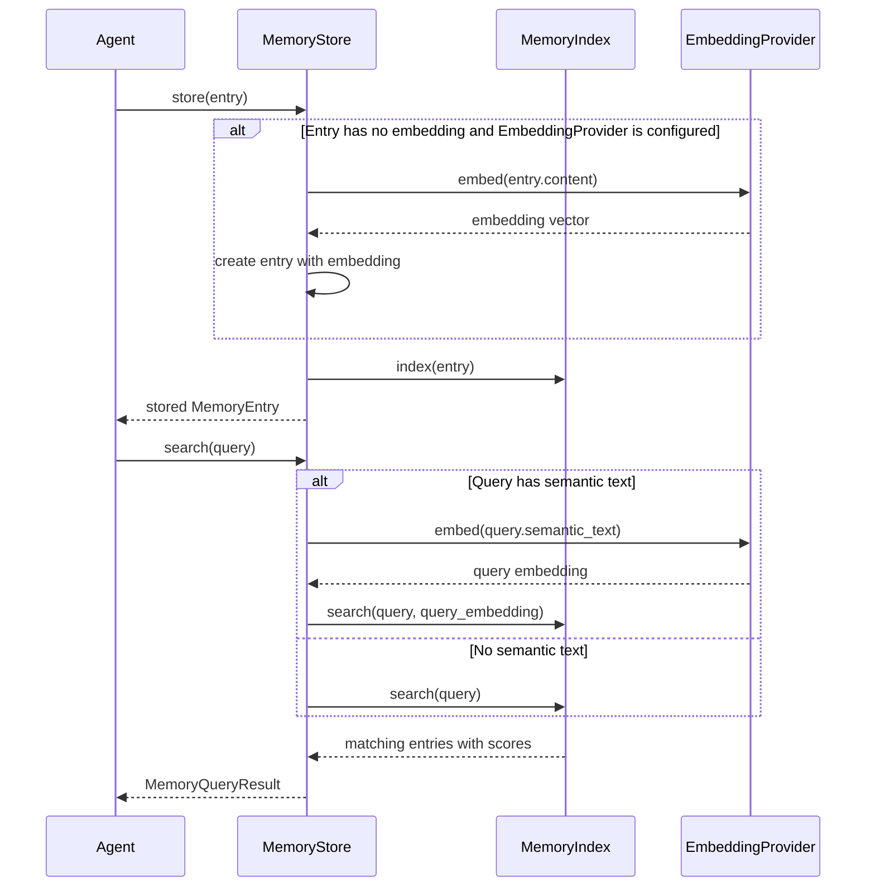
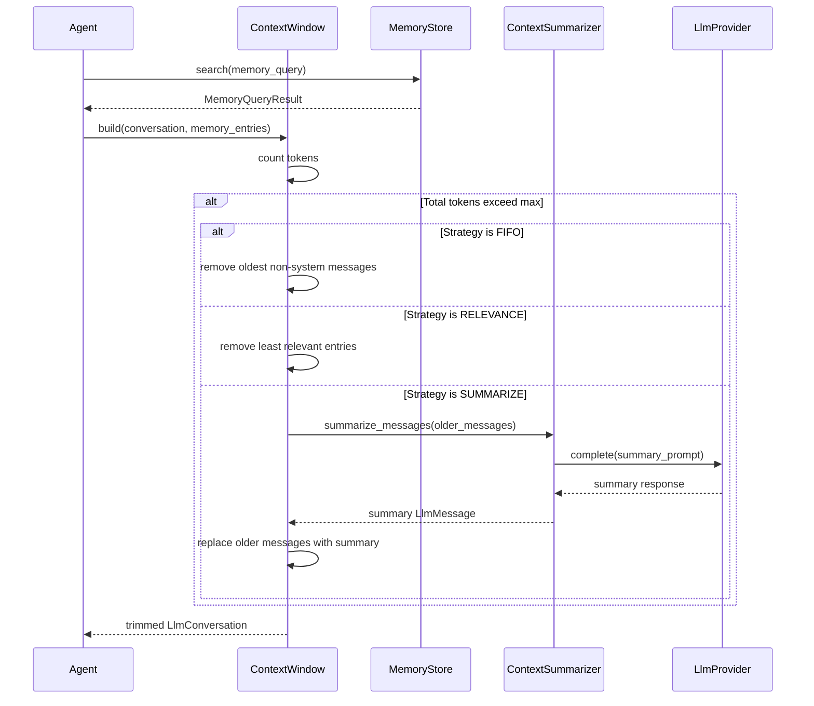
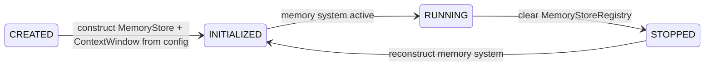

# Design Document — Memory & Context Management

## Overview

The Memory & Context Management feature extends the `automojo-agent-kit` SDK with a unified system for storing, retrieving, and managing agent memory across short-term and long-term horizons. It defines a memory entry abstraction with metadata and tags, pluggable memory backends (in-memory, file-based), memory scoping (per-agent, shared, global), semantic similarity-based retrieval via pluggable embedding providers, context window management for fitting conversation history within LLM token limits, and memory lifecycle management (creation, update, expiration, cleanup).

The system provides:

- `MemoryEntry` — immutable value object representing a single unit of stored memory with content, embedding, metadata, tags, timestamps, and scope
- `MemoryScope` — enumeration defining visibility: AGENT, SHARED, GLOBAL
- `MemoryStore` — abstract base class for pluggable memory backends with store, retrieve, search, update, delete, clear, and cleanup_expired operations
- `MemoryQuery` and `MemoryQueryResult` — immutable query/result objects for tag, metadata, scope, time range, and semantic similarity filtering
- `MemoryIndex` — internal indexing component for efficient tag, metadata, and semantic search within a MemoryStore
- `InMemoryStore` — built-in in-process dictionary-based MemoryStore implementation
- `FileMemoryStore` — built-in JSON file-based MemoryStore implementation with local persistence
- `EmbeddingProvider` — abstract base class for generating embedding vectors from text
- `ContextWindow` — component that selects and arranges memory entries and conversation messages to fit within an LLM token limit
- `ContextWindowStrategy` — enumeration defining trimming strategies: FIFO, RELEVANCE, SUMMARIZE
- `ContextSummarizer` — component that condenses older messages/entries into compact summaries using an LlmProvider
- `MemoryStoreRegistry` — registry for tracking available MemoryStore instances by name
- `MemoryConfiguration` — declarative configuration for memory backend type, connection parameters, scoping defaults, and expiration policies
- `ExpirationPolicy` — configuration for default time-to-live and cleanup interval
- `MemoryStoreError` and `ContextWindowError` — memory-specific exceptions inheriting from AgentKitError

All classes live under `source/packages/automojo/agentkit/` with filenames in all-lowercase (no underscores), following the project naming conventions. The system integrates with:

- Core Agent Framework — `Agent` base class, `AgentIdentity`, `AgentConfiguration`, `AgentStateMachine`, `LifecycleState`, `AgentKitError`, `SemanticError`, `ConfigurationError`
- LLM Integration — `LlmProvider`, `LlmConversation`, `LlmMessage`, `TokenUsage` for context window management and summarization
- `automojo-extension` — `ExtensionPoint` for memory backend plugin discovery
- `automojo-credentials` — `CredentialReference` resolution for backend authentication
- `automojo-this-app` — `AppContext` for settings, environment variables, and directory resolution

The design prioritizes debuggability over performance and readability over conciseness, per the project coding standards.

## Architecture

```mermaid
graph TD
    subgraph automojo.agentkit - Memory System
        MemoryEntry[MemoryEntry]
        MemoryScope[MemoryScope enum]
        MemoryStore[MemoryStore base class]
        MemoryQuery[MemoryQuery]
        MemoryQueryResult[MemoryQueryResult]
        MemoryIndex[MemoryIndex]
        InMemoryStore[InMemoryStore]
        FileMemoryStore[FileMemoryStore]
        EmbeddingProvider[EmbeddingProvider base class]
        ContextWindow[ContextWindow]
        ContextWindowStrategy[ContextWindowStrategy enum]
        ContextSummarizer[ContextSummarizer]
        MemoryStoreRegistry[MemoryStoreRegistry]
        MemoryConfiguration[MemoryConfiguration]
        ExpirationPolicy[ExpirationPolicy]
        MemoryErrors[MemoryStoreError / ContextWindowError]
    end

    subgraph Core Agent Framework
        Agent[Agent base class]
        AgentKitError[AgentKitError]
        LifecycleState[LifecycleState]
    end

    subgraph LLM Integration
        LlmProvider[LlmProvider]
        LlmConversation[LlmConversation]
        LlmMessage[LlmMessage]
        TokenUsage[TokenUsage]
    end

    subgraph External Packages
        Extension[automojo-extension]
        Credentials[automojo-credentials]
        ThisApp[automojo-this-app]
    end

    Agent --> MemoryStoreRegistry
    Agent --> ContextWindow
    Agent --> MemoryConfiguration
    MemoryStore --> MemoryEntry
    MemoryStore --> MemoryQuery
    MemoryStore --> MemoryQueryResult
    MemoryStore --> MemoryIndex
    MemoryStore --> EmbeddingProvider
    MemoryStore --> ExpirationPolicy
    InMemoryStore --> MemoryStore
    FileMemoryStore --> MemoryStore
    MemoryEntry --> MemoryScope
    ContextWindow --> ContextWindowStrategy
    ContextWindow --> ContextSummarizer
    ContextWindow --> LlmConversation
    ContextWindow --> LlmMessage
    ContextSummarizer --> LlmProvider
    ContextSummarizer --> LlmMessage
    MemoryStoreRegistry --> MemoryStore
    MemoryConfiguration --> ExpirationPolicy
    MemoryConfiguration --> ThisApp
    MemoryConfiguration --> Credentials
    MemoryErrors --> AgentKitError
    FileMemoryStore --> ThisApp
    Agent --> Extension
```



### Memory Store and Retrieval Flow



### Context Window Build Flow



### Agent Memory Lifecycle



### Design Decisions

1. `MemoryStore` as abstract base class using `abc.ABC` with abstract `store`, `retrieve`, `search`, `update`, `delete`, and `clear` methods — consistent with the Core Agent Framework pattern for `Agent` and the LLM Integration pattern for `LlmProvider`.
2. `MemoryStoreRegistry` as a per-agent instance (not singleton) — memory stores are scoped to individual agents, consistent with `LlmProviderRegistry` and `ToolRegistry`.
3. `MemoryEntry` as an immutable value object — entries are created once and not mutated in place; updates create new entries via the store's `update` method.
4. `MemoryIndex` as an internal component of `MemoryStore` — encapsulates indexing logic (tag index, metadata index, embedding similarity) so that concrete store implementations can reuse it.
5. `ContextWindow` accepts a token counting callable — decouples tokenization from the context window, allowing provider-specific tokenizers (e.g., tiktoken for OpenAI).
6. `ContextSummarizer` uses an `LlmProvider` for summarization — leverages the existing LLM Integration system rather than implementing a separate summarization engine.
7. `FileMemoryStore` uses one JSON file per entry — simple, debuggable, and avoids file locking issues for single-agent local deployments.
8. `EmbeddingProvider` as abstract base class — allows plugging in different embedding services (OpenAI, local models) without coupling to a specific provider.
9. Cosine similarity for semantic search — standard metric for embedding-based retrieval, computed in `MemoryIndex`.
10. `ExpirationPolicy` as a separate configuration object — cleanly separates lifecycle policy from store implementation.
11. All serializable classes follow the naming convention: `as_dict` for dictionary conversion, `to_json` for JSON serialization, `from_dict`/`from_json` for deserialization.
12. Memory backend plugins discovered via `automojo-extension` ExtensionPoint — consistent with how LLM provider plugins are discovered.

## Components and Interfaces

### File Layout

| File | Class(es) | Purpose |
|---|---|---|
| memoryscope.py | MemoryScope | Enum of memory visibility scopes |
| memoryentry.py | MemoryEntry | Immutable memory entry with content, metadata, tags, embedding |
| memoryquery.py | MemoryQuery | Immutable search query with filter criteria |
| memoryqueryresult.py | MemoryQueryResult | Immutable search result with entries and scores |
| memoryindex.py | MemoryIndex | Internal indexing for tag, metadata, and semantic search |
| embeddingprovider.py | EmbeddingProvider | Abstract base class for embedding generation |
| memorystore.py | MemoryStore | Abstract base class for memory backends |
| inmemorystore.py | InMemoryStore | In-process dictionary-based store |
| filememorystore.py | FileMemoryStore | JSON file-based persistent store |
| memorystoreregistry.py | MemoryStoreRegistry | Registry for tracking available stores |
| contextwindowstrategy.py | ContextWindowStrategy | Enum of context trimming strategies |
| contextsummarizer.py | ContextSummarizer | Summarizes messages/entries via LlmProvider |
| contextwindow.py | ContextWindow | Manages context fitting within token limits |
| expirationpolicy.py | ExpirationPolicy | Expiration and cleanup configuration |
| memoryconfiguration.py | MemoryConfiguration | Declarative memory system configuration |
| memoryerrors.py | MemoryStoreError, ContextWindowError | Memory-specific exceptions |

### MemoryScope

```python
import enum


class MemoryScope(enum.Enum):
    """
        Enumeration defining the visibility scope of a MemoryEntry.
    """

    AGENT = "AGENT"
    SHARED = "SHARED"
    GLOBAL = "GLOBAL"

    @classmethod
    def from_string(cls, value: str) -> "MemoryScope":
        """
            Returns the MemoryScope member matching the given string value.

            :param value: A string value to match against MemoryScope members.

            :returns: The matching MemoryScope member.
            :raises: SemanticError
        """
        upper_value = value.upper().strip()
        for member in cls:
            if member.value == upper_value:
                rtnval = member
                return rtnval

        valid_values = [m.value for m in cls]
        errmsg = "Invalid MemoryScope value {!r}. Valid values are: {}".format(
            value, ", ".join(valid_values)
        )
        raise SemanticError(errmsg)

    def __repr__(self) -> str:
        rtnval = "{}({!r})".format(self.__class__.__name__, self.value)
        return rtnval

    def __str__(self) -> str:
        rtnval = self.value
        return rtnval
```

### MemoryEntry

```python
import json
import uuid
from datetime import datetime, timezone


class MemoryEntry:
    """
        Immutable object representing a single unit of stored memory.
        Contains a unique identifier, content string, optional embedding vector,
        metadata dictionary, tags list, creation timestamp, optional expiration
        timestamp, and a MemoryScope value.
    """

    def __init__(self, content: str, scope: MemoryScope,
                 identifier: str = None, embedding: list = None,
                 metadata: dict = None, tags: list = None,
                 created_at: datetime = None, expires_at: datetime = None):
        """
            Constructs a MemoryEntry.

            :param content: The content string of the memory entry.
            :param scope: The MemoryScope value for this entry.
            :param identifier: Optional unique identifier. Auto-generated UUID if not provided.
            :param embedding: Optional embedding vector as a list of floats.
            :param metadata: Optional metadata dictionary.
            :param tags: Optional list of tag strings.
            :param created_at: Optional creation timestamp. Defaults to current UTC time.
            :param expires_at: Optional expiration timestamp.
        """
        self._identifier = identifier if identifier is not None else str(uuid.uuid4())
        self._content = content
        self._scope = scope
        self._embedding = list(embedding) if embedding is not None else None
        self._metadata = dict(metadata) if metadata is not None else {}
        self._tags = list(tags) if tags is not None else []
        self._created_at = created_at if created_at is not None else datetime.now(timezone.utc)
        self._expires_at = expires_at
        return

    @property
    def identifier(self) -> str:
        return self._identifier

    @property
    def content(self) -> str:
        return self._content

    @property
    def scope(self) -> MemoryScope:
        return self._scope

    @property
    def embedding(self) -> list:
        if self._embedding is not None:
            rtnval = list(self._embedding)
            return rtnval
        return None

    @property
    def metadata(self) -> dict:
        return dict(self._metadata)

    @property
    def tags(self) -> list:
        return list(self._tags)

    @property
    def created_at(self) -> datetime:
        return self._created_at

    @property
    def expires_at(self) -> datetime:
        return self._expires_at

    def is_expired(self, reference_time: datetime = None) -> bool:
        """
            Returns True when the expiration timestamp is set and the
            reference timestamp exceeds the expiration timestamp.

            :param reference_time: Optional reference timestamp. Defaults to current UTC time.

            :returns: True if the entry is expired, False otherwise.
        """
        if self._expires_at is None:
            rtnval = False
            return rtnval

        if reference_time is None:
            reference_time = datetime.now(timezone.utc)

        rtnval = reference_time >= self._expires_at
        return rtnval

    def as_dict(self, brief: bool = False) -> dict:
        """
            Returns a dictionary representation of the entry fields.

            :param brief: If True, excludes the embedding vector.

            :returns: A dictionary with all entry fields.
        """
        rtnval = {
            "identifier": self._identifier,
            "content": self._content,
            "scope": self._scope.value,
            "metadata": dict(self._metadata),
            "tags": list(self._tags),
            "created_at": self._created_at.isoformat(),
            "expires_at": self._expires_at.isoformat() if self._expires_at is not None else None,
        }

        if brief is not True:
            rtnval["embedding"] = list(self._embedding) if self._embedding is not None else None

        return rtnval

    def to_json(self) -> str:
        """
            Returns a JSON string representation of the entry fields.

            :returns: A JSON string.
        """
        rtnval = json.dumps(self.as_dict())
        return rtnval

    @classmethod
    def from_dict(cls, data: dict) -> "MemoryEntry":
        """
            Constructs a MemoryEntry from a dictionary.

            :param data: A dictionary with entry fields.

            :returns: A MemoryEntry instance.
        """
        created_at = None
        if "created_at" in data and data["created_at"] is not None:
            created_at = datetime.fromisoformat(data["created_at"])

        expires_at = None
        if "expires_at" in data and data["expires_at"] is not None:
            expires_at = datetime.fromisoformat(data["expires_at"])

        scope = MemoryScope.from_string(data["scope"])

        rtnval = cls(
            content=data["content"],
            scope=scope,
            identifier=data.get("identifier"),
            embedding=data.get("embedding"),
            metadata=data.get("metadata"),
            tags=data.get("tags"),
            created_at=created_at,
            expires_at=expires_at,
        )
        return rtnval

    @classmethod
    def from_json(cls, json_str: str) -> "MemoryEntry":
        """
            Deserializes a JSON string into a MemoryEntry instance.

            :param json_str: A JSON string.

            :returns: A MemoryEntry instance.
        """
        data = json.loads(json_str)
        rtnval = cls.from_dict(data)
        return rtnval

    def __repr__(self) -> str:
        content_preview = self._content[:50] + "..." if len(self._content) > 50 else self._content
        rtnval = "{}(identifier={!r}, scope={!r}, content={!r})".format(
            self.__class__.__name__, self._identifier, self._scope.value, content_preview
        )
        return rtnval

    def __str__(self) -> str:
        content_preview = self._content[:80] + "..." if len(self._content) > 80 else self._content
        rtnval = "MemoryEntry: {} [{}] tags={} content={!r}".format(
            self._identifier, self._scope.value, len(self._tags), content_preview
        )
        return rtnval

    def __eq__(self, other) -> bool:
        if not isinstance(other, MemoryEntry):
            rtnval = False
            return rtnval
        rtnval = (
            self._identifier == other._identifier
            and self._content == other._content
            and self._scope == other._scope
            and self._embedding == other._embedding
            and self._metadata == other._metadata
            and self._tags == other._tags
            and self._created_at == other._created_at
            and self._expires_at == other._expires_at
        )
        return rtnval
```

### MemoryQuery

```python
import json
from datetime import datetime


class MemoryQuery:
    """
        Immutable object representing a search request against a MemoryStore.
        Supports filtering by tags, metadata, scope, time range, and
        semantic similarity.
    """

    def __init__(self, tags: list = None, metadata: dict = None,
                 scope: MemoryScope = None, start_time: datetime = None,
                 end_time: datetime = None, semantic_text: str = None,
                 max_results: int = None, min_relevance: float = None):
        """
            Constructs a MemoryQuery.

            :param tags: Optional list of required tags.
            :param metadata: Optional metadata key-value pairs to match.
            :param scope: Optional MemoryScope filter.
            :param start_time: Optional start of time range.
            :param end_time: Optional end of time range.
            :param semantic_text: Optional semantic query text for similarity search.
            :param max_results: Optional maximum number of results.
            :param min_relevance: Optional minimum relevance score threshold.
        """
        self._tags = list(tags) if tags is not None else None
        self._metadata = dict(metadata) if metadata is not None else None
        self._scope = scope
        self._start_time = start_time
        self._end_time = end_time
        self._semantic_text = semantic_text
        self._max_results = max_results
        self._min_relevance = min_relevance
        return

    @property
    def tags(self) -> list:
        if self._tags is not None:
            return list(self._tags)
        return None

    @property
    def metadata(self) -> dict:
        if self._metadata is not None:
            return dict(self._metadata)
        return None

    @property
    def scope(self) -> MemoryScope:
        return self._scope

    @property
    def start_time(self) -> datetime:
        return self._start_time

    @property
    def end_time(self) -> datetime:
        return self._end_time

    @property
    def semantic_text(self) -> str:
        return self._semantic_text

    @property
    def max_results(self) -> int:
        return self._max_results

    @property
    def min_relevance(self) -> float:
        return self._min_relevance

    def as_dict(self) -> dict:
        """
            Returns a dictionary representation of the query fields.

            :returns: A dictionary with all query fields.
        """
        rtnval = {
            "tags": list(self._tags) if self._tags is not None else None,
            "metadata": dict(self._metadata) if self._metadata is not None else None,
            "scope": self._scope.value if self._scope is not None else None,
            "start_time": self._start_time.isoformat() if self._start_time is not None else None,
            "end_time": self._end_time.isoformat() if self._end_time is not None else None,
            "semantic_text": self._semantic_text,
            "max_results": self._max_results,
            "min_relevance": self._min_relevance,
        }
        return rtnval

    def to_json(self) -> str:
        """
            Returns a JSON string representation of the query fields.

            :returns: A JSON string.
        """
        rtnval = json.dumps(self.as_dict())
        return rtnval

    @classmethod
    def from_dict(cls, data: dict) -> "MemoryQuery":
        """
            Constructs a MemoryQuery from a dictionary.

            :param data: A dictionary with query fields.

            :returns: A MemoryQuery instance.
        """
        scope = None
        if "scope" in data and data["scope"] is not None:
            scope = MemoryScope.from_string(data["scope"])

        start_time = None
        if "start_time" in data and data["start_time"] is not None:
            start_time = datetime.fromisoformat(data["start_time"])

        end_time = None
        if "end_time" in data and data["end_time"] is not None:
            end_time = datetime.fromisoformat(data["end_time"])

        rtnval = cls(
            tags=data.get("tags"),
            metadata=data.get("metadata"),
            scope=scope,
            start_time=start_time,
            end_time=end_time,
            semantic_text=data.get("semantic_text"),
            max_results=data.get("max_results"),
            min_relevance=data.get("min_relevance"),
        )
        return rtnval

    @classmethod
    def from_json(cls, json_str: str) -> "MemoryQuery":
        """
            Deserializes a JSON string into a MemoryQuery instance.

            :param json_str: A JSON string.

            :returns: A MemoryQuery instance.
        """
        data = json.loads(json_str)
        rtnval = cls.from_dict(data)
        return rtnval

    def __repr__(self) -> str:
        criteria = []
        if self._tags is not None:
            criteria.append("tags={}".format(len(self._tags)))
        if self._metadata is not None:
            criteria.append("metadata={}".format(len(self._metadata)))
        if self._scope is not None:
            criteria.append("scope={}".format(self._scope.value))
        if self._semantic_text is not None:
            criteria.append("semantic=True")
        if self._max_results is not None:
            criteria.append("max={}".format(self._max_results))
        summary = ", ".join(criteria) if len(criteria) > 0 else "no filters"
        rtnval = "{}({})".format(self.__class__.__name__, summary)
        return rtnval

    def __str__(self) -> str:
        criteria = []
        if self._tags is not None:
            criteria.append("tags: {}".format(self._tags))
        if self._metadata is not None:
            criteria.append("metadata: {}".format(list(self._metadata.keys())))
        if self._scope is not None:
            criteria.append("scope: {}".format(self._scope.value))
        if self._start_time is not None or self._end_time is not None:
            criteria.append("time range: {} to {}".format(self._start_time, self._end_time))
        if self._semantic_text is not None:
            preview = self._semantic_text[:50] + "..." if len(self._semantic_text) > 50 else self._semantic_text
            criteria.append("semantic: {!r}".format(preview))
        summary = "; ".join(criteria) if len(criteria) > 0 else "no filters"
        rtnval = "MemoryQuery: {}".format(summary)
        return rtnval

    def __eq__(self, other) -> bool:
        if not isinstance(other, MemoryQuery):
            rtnval = False
            return rtnval
        rtnval = (
            self._tags == other._tags
            and self._metadata == other._metadata
            and self._scope == other._scope
            and self._start_time == other._start_time
            and self._end_time == other._end_time
            and self._semantic_text == other._semantic_text
            and self._max_results == other._max_results
            and self._min_relevance == other._min_relevance
        )
        return rtnval
```

### MemoryQueryResult

```python
class MemoryQueryResult:
    """
        Immutable object encapsulating the result of a MemoryQuery.
        Contains matching MemoryEntry objects, optional relevance scores,
        and the total count of matches.
    """

    def __init__(self, entries: list, scores: list = None, total_count: int = None):
        """
            Constructs a MemoryQueryResult.

            :param entries: List of matching MemoryEntry objects.
            :param scores: Optional list of relevance scores as floats.
            :param total_count: Optional total count of matches. Defaults to len(entries).
        """
        self._entries = list(entries)
        self._scores = list(scores) if scores is not None else None
        self._total_count = total_count if total_count is not None else len(entries)
        return

    @property
    def entries(self) -> list:
        return list(self._entries)

    @property
    def scores(self) -> list:
        if self._scores is not None:
            return list(self._scores)
        return None

    @property
    def total_count(self) -> int:
        return self._total_count

    def as_dict(self) -> dict:
        """
            Returns a dictionary representation of the result fields.

            :returns: A dictionary with entries, scores, and total_count.
        """
        rtnval = {
            "entries": [e.as_dict() for e in self._entries],
            "scores": list(self._scores) if self._scores is not None else None,
            "total_count": self._total_count,
        }
        return rtnval

    def __repr__(self) -> str:
        rtnval = "{}(count={})".format(self.__class__.__name__, self._total_count)
        return rtnval

    def __str__(self) -> str:
        top_ids = [e.identifier for e in self._entries[:5]]
        rtnval = "MemoryQueryResult: {} matches, top: [{}]".format(
            self._total_count, ", ".join(top_ids)
        )
        return rtnval
```

### EmbeddingProvider

```python
import abc


class EmbeddingProvider(abc.ABC):
    """
        Abstract base class for generating embedding vectors from text content.
        Concrete implementations wrap specific embedding services or local models.
    """

    def __init__(self, provider_name: str, embedding_dimension: int,
                 credential_names: list = None):
        """
            Constructs an EmbeddingProvider.

            :param provider_name: The name of the embedding provider.
            :param embedding_dimension: The length of output embedding vectors.
            :param credential_names: Optional list of CredentialReference names.

            :raises: SemanticError if provider_name is empty or embedding_dimension <= 0.
        """
        if provider_name is None or len(str(provider_name).strip()) == 0:
            errmsg = "A provider name is required when constructing an EmbeddingProvider."
            raise SemanticError(errmsg)

        if embedding_dimension is None or embedding_dimension <= 0:
            errmsg = "The embedding_dimension must be a positive integer, got {!r}.".format(
                embedding_dimension
            )
            raise SemanticError(errmsg)

        self._provider_name = provider_name
        self._embedding_dimension = embedding_dimension
        self._credential_names = list(credential_names) if credential_names is not None else []
        return

    @property
    def provider_name(self) -> str:
        return self._provider_name

    @property
    def embedding_dimension(self) -> int:
        return self._embedding_dimension

    @property
    def credential_names(self) -> list:
        return list(self._credential_names)

    @abc.abstractmethod
    def embed(self, text: str) -> list:
        """
            Generates an embedding vector from a text string.

            :param text: The text to embed.

            :returns: An embedding vector as a list of floats.
            :raises: SemanticError if text is empty.
        """
        ...

    @abc.abstractmethod
    def embed_batch(self, texts: list) -> list:
        """
            Generates embedding vectors from a list of text strings.

            :param texts: A list of text strings to embed.

            :returns: A list of embedding vectors, each as a list of floats.
        """
        ...

    def __repr__(self) -> str:
        rtnval = "{}(provider_name={!r}, dimension={})".format(
            self.__class__.__name__, self._provider_name, self._embedding_dimension
        )
        return rtnval

    def __str__(self) -> str:
        rtnval = "EmbeddingProvider: {} (dimension={})".format(
            self._provider_name, self._embedding_dimension
        )
        return rtnval
```

### MemoryIndex

```python
import math


class MemoryIndex:
    """
        Internal indexing component for efficient tag-based, metadata-based,
        and semantic similarity search over MemoryEntry objects.
    """

    def __init__(self):
        self._entries = {}
        self._tag_index = {}
        self._metadata_index = {}
        return

    def add(self, entry: MemoryEntry) -> None:
        """
            Adds a MemoryEntry to the index.

            :param entry: The MemoryEntry to index.
        """
        self._entries[entry.identifier] = entry

        for tag in entry.tags:
            if tag not in self._tag_index:
                self._tag_index[tag] = set()
            self._tag_index[tag].add(entry.identifier)

        for key in entry.metadata:
            compound_key = (key, entry.metadata[key])
            if compound_key not in self._metadata_index:
                self._metadata_index[compound_key] = set()
            self._metadata_index[compound_key].add(entry.identifier)

        return

    def remove(self, identifier: str) -> None:
        """
            Removes a MemoryEntry from the index by identifier.

            :param identifier: The entry identifier to remove.
        """
        if identifier not in self._entries:
            return

        entry = self._entries[identifier]

        for tag in entry.tags:
            if tag in self._tag_index:
                self._tag_index[tag].discard(identifier)

        for key in entry.metadata:
            compound_key = (key, entry.metadata[key])
            if compound_key in self._metadata_index:
                self._metadata_index[compound_key].discard(identifier)

        del self._entries[identifier]
        return

    def clear(self) -> None:
        """
            Removes all entries from the index.
        """
        self._entries = {}
        self._tag_index = {}
        self._metadata_index = {}
        return

    def contains(self, identifier: str) -> bool:
        """
            Returns True if an entry with the given identifier exists.

            :param identifier: The entry identifier to check.

            :returns: True if the entry exists, False otherwise.
        """
        rtnval = identifier in self._entries
        return rtnval

    def get(self, identifier: str) -> MemoryEntry:
        """
            Returns the MemoryEntry with the given identifier, or None.

            :param identifier: The entry identifier.

            :returns: The MemoryEntry or None.
        """
        rtnval = self._entries.get(identifier)
        return rtnval

    @property
    def count(self) -> int:
        return len(self._entries)

    def search(self, query: MemoryQuery, query_embedding: list = None) -> MemoryQueryResult:
        """
            Executes a search against the index using the given query.

            :param query: The MemoryQuery with filter criteria.
            :param query_embedding: Optional embedding vector for semantic search.

            :returns: A MemoryQueryResult with matching entries and scores.
        """
        candidate_ids = set(self._entries.keys())

        if query.tags is not None and len(query.tags) > 0:
            for tag in query.tags:
                if tag in self._tag_index:
                    candidate_ids = candidate_ids.intersection(self._tag_index[tag])
                else:
                    candidate_ids = set()
                    break

        if query.metadata is not None and len(query.metadata) > 0:
            for key, value in query.metadata.items():
                compound_key = (key, value)
                if compound_key in self._metadata_index:
                    candidate_ids = candidate_ids.intersection(self._metadata_index[compound_key])
                else:
                    candidate_ids = set()
                    break

        if query.scope is not None:
            filtered = set()
            for cid in candidate_ids:
                entry = self._entries[cid]
                if entry.scope == query.scope:
                    filtered.add(cid)
            candidate_ids = filtered

        if query.start_time is not None or query.end_time is not None:
            filtered = set()
            for cid in candidate_ids:
                entry = self._entries[cid]
                if query.start_time is not None and entry.created_at < query.start_time:
                    continue
                if query.end_time is not None and entry.created_at > query.end_time:
                    continue
                filtered.add(cid)
            candidate_ids = filtered

        entries = [self._entries[cid] for cid in candidate_ids]
        scores = None

        if query_embedding is not None and len(query_embedding) > 0:
            scored_entries = []
            for entry in entries:
                if entry.embedding is not None:
                    score = self._cosine_similarity(query_embedding, entry.embedding)
                    if query.min_relevance is not None and score < query.min_relevance:
                        continue
                    scored_entries.append((entry, score))

            scored_entries.sort(key=lambda pair: pair[1], reverse=True)
            entries = [pair[0] for pair in scored_entries]
            scores = [pair[1] for pair in scored_entries]

        if query.max_results is not None and len(entries) > query.max_results:
            entries = entries[:query.max_results]
            if scores is not None:
                scores = scores[:query.max_results]

        total_count = len(entries)
        rtnval = MemoryQueryResult(entries=entries, scores=scores, total_count=total_count)
        return rtnval

    @staticmethod
    def _cosine_similarity(vec_a: list, vec_b: list) -> float:
        """
            Computes cosine similarity between two vectors.

            :param vec_a: First vector as a list of floats.
            :param vec_b: Second vector as a list of floats.

            :returns: Cosine similarity as a float between -1 and 1.
        """
        dot_product = sum(a * b for a, b in zip(vec_a, vec_b))
        magnitude_a = math.sqrt(sum(a * a for a in vec_a))
        magnitude_b = math.sqrt(sum(b * b for b in vec_b))

        if magnitude_a == 0.0 or magnitude_b == 0.0:
            rtnval = 0.0
            return rtnval

        rtnval = dot_product / (magnitude_a * magnitude_b)
        return rtnval
```

### MemoryStore

```python
import abc
import logging


logger = logging.getLogger("automojo.agentkit.memory")


class MemoryStore(abc.ABC):
    """
        Abstract base class for memory storage backends.
        Provides a common interface for storing, retrieving, searching,
        updating, and deleting MemoryEntry objects.
    """

    def __init__(self, store_name: str, embedding_provider: EmbeddingProvider = None,
                 expiration_policy: ExpirationPolicy = None,
                 credential_names: list = None):
        """
            Constructs a MemoryStore.

            :param store_name: The name of this memory store.
            :param embedding_provider: Optional EmbeddingProvider for generating embeddings.
            :param expiration_policy: Optional ExpirationPolicy for entry lifecycle.
            :param credential_names: Optional list of CredentialReference names.

            :raises: SemanticError if store_name is empty.
        """
        if store_name is None or len(str(store_name).strip()) == 0:
            errmsg = "A store name is required when constructing a MemoryStore."
            raise SemanticError(errmsg)

        self._store_name = store_name
        self._embedding_provider = embedding_provider
        self._expiration_policy = expiration_policy
        self._credential_names = list(credential_names) if credential_names is not None else []
        return

    @property
    def store_name(self) -> str:
        return self._store_name

    @property
    def embedding_provider(self) -> EmbeddingProvider:
        return self._embedding_provider

    @property
    def expiration_policy(self) -> "ExpirationPolicy":
        return self._expiration_policy

    @property
    @abc.abstractmethod
    def count(self) -> int:
        """
            Returns the count of stored MemoryEntry objects.

            :returns: The entry count as an integer.
        """
        ...

    @abc.abstractmethod
    def store(self, entry: MemoryEntry) -> MemoryEntry:
        """
            Stores a MemoryEntry. If the entry has no embedding and an
            EmbeddingProvider is configured, generates an embedding first.

            :param entry: The MemoryEntry to store.

            :returns: The stored MemoryEntry (potentially with generated embedding).
            :raises: MemoryStoreError, SemanticError
        """
        ...

    @abc.abstractmethod
    def retrieve(self, identifier: str) -> MemoryEntry:
        """
            Retrieves a MemoryEntry by identifier.

            :param identifier: The entry identifier.

            :returns: The MemoryEntry, or None if not found.
            :raises: MemoryStoreError
        """
        ...

    @abc.abstractmethod
    def search(self, query: MemoryQuery) -> MemoryQueryResult:
        """
            Executes a MemoryQuery against the store.

            :param query: The MemoryQuery with filter criteria.

            :returns: A MemoryQueryResult with matching entries.
            :raises: MemoryStoreError
        """
        ...

    @abc.abstractmethod
    def update(self, identifier: str, entry: MemoryEntry) -> MemoryEntry:
        """
            Replaces a MemoryEntry by identifier.

            :param identifier: The identifier of the entry to replace.
            :param entry: The new MemoryEntry.

            :returns: The updated MemoryEntry.
            :raises: MemoryStoreError
        """
        ...

    @abc.abstractmethod
    def delete(self, identifier: str) -> None:
        """
            Removes a MemoryEntry by identifier.

            :param identifier: The entry identifier to remove.
            :raises: MemoryStoreError
        """
        ...

    @abc.abstractmethod
    def clear(self) -> None:
        """
            Removes all entries from the store.
            :raises: MemoryStoreError
        """
        ...

    def contains(self, identifier: str) -> bool:
        """
            Returns True if an entry with the given identifier exists.

            :param identifier: The entry identifier.

            :returns: True if the entry exists, False otherwise.
        """
        entry = self.retrieve(identifier=identifier)
        rtnval = entry is not None
        return rtnval

    def cleanup_expired(self, reference_time: datetime = None) -> int:
        """
            Removes all MemoryEntry objects whose expiration timestamp has passed.

            :param reference_time: Optional reference timestamp. Defaults to current UTC time.

            :returns: The count of removed entries.
        """
        if reference_time is None:
            reference_time = datetime.now(timezone.utc)

        # Default implementation: subclasses may override for efficiency
        removed_count = 0
        all_result = self.search(MemoryQuery())
        for entry in all_result.entries:
            if entry.is_expired(reference_time=reference_time):
                self.delete(identifier=entry.identifier)
                removed_count = removed_count + 1

        if removed_count > 0:
            logger.info(
                "MemoryStore %r cleaned up %d expired entries.",
                self._store_name, removed_count
            )

        rtnval = removed_count
        return rtnval

    def _generate_embedding_if_needed(self, entry: MemoryEntry) -> MemoryEntry:
        """
            If the entry has no embedding and an EmbeddingProvider is configured,
            generates an embedding and returns a new MemoryEntry with the embedding.

            :param entry: The MemoryEntry to check.

            :returns: The original entry or a new entry with embedding.
        """
        if entry.embedding is not None:
            return entry

        if self._embedding_provider is None:
            return entry

        embedding = self._embedding_provider.embed(text=entry.content)
        rtnval = MemoryEntry(
            content=entry.content,
            scope=entry.scope,
            identifier=entry.identifier,
            embedding=embedding,
            metadata=entry.metadata,
            tags=entry.tags,
            created_at=entry.created_at,
            expires_at=entry.expires_at,
        )
        return rtnval

    def _apply_expiration_policy(self, entry: MemoryEntry) -> MemoryEntry:
        """
            If the entry has no expiration and the ExpirationPolicy defines a
            default TTL, returns a new MemoryEntry with the expiration set.

            :param entry: The MemoryEntry to check.

            :returns: The original entry or a new entry with expiration.
        """
        if entry.expires_at is not None:
            return entry

        if self._expiration_policy is None:
            return entry

        if self._expiration_policy.default_ttl is None:
            return entry

        from datetime import timedelta
        expires_at = entry.created_at + timedelta(seconds=self._expiration_policy.default_ttl)
        rtnval = MemoryEntry(
            content=entry.content,
            scope=entry.scope,
            identifier=entry.identifier,
            embedding=entry.embedding,
            metadata=entry.metadata,
            tags=entry.tags,
            created_at=entry.created_at,
            expires_at=expires_at,
        )
        return rtnval

    def __repr__(self) -> str:
        rtnval = "{}(store_name={!r}, count={})".format(
            self.__class__.__name__, self._store_name, self.count
        )
        return rtnval

    def __str__(self) -> str:
        rtnval = "MemoryStore: {} ({} entries)".format(self._store_name, self.count)
        return rtnval
```

### InMemoryStore

```python
class InMemoryStore(MemoryStore):
    """
        Built-in MemoryStore implementation that stores MemoryEntry objects
        in process memory using dictionary-based indexing.
    """

    def __init__(self, store_name: str, embedding_provider: EmbeddingProvider = None,
                 expiration_policy: ExpirationPolicy = None):
        """
            Constructs an InMemoryStore.

            :param store_name: The name of this memory store.
            :param embedding_provider: Optional EmbeddingProvider for generating embeddings.
            :param expiration_policy: Optional ExpirationPolicy for entry lifecycle.
        """
        super().__init__(
            store_name=store_name,
            embedding_provider=embedding_provider,
            expiration_policy=expiration_policy,
        )
        self._index = MemoryIndex()
        return

    @property
    def count(self) -> int:
        return self._index.count

    def store(self, entry: MemoryEntry) -> MemoryEntry:
        """
            Stores a MemoryEntry in the in-memory index.

            :param entry: The MemoryEntry to store.

            :returns: The stored MemoryEntry.
            :raises: SemanticError if a duplicate identifier exists.
        """
        if self._index.contains(identifier=entry.identifier):
            errmsg = "A MemoryEntry with identifier {!r} already exists in store {!r}.".format(
                entry.identifier, self._store_name
            )
            raise SemanticError(errmsg)

        entry = self._apply_expiration_policy(entry=entry)
        entry = self._generate_embedding_if_needed(entry=entry)
        self._index.add(entry=entry)

        logger.info(
            "InMemoryStore %r stored entry %r with scope %s.",
            self._store_name, entry.identifier, entry.scope.value
        )

        rtnval = entry
        return rtnval

    def retrieve(self, identifier: str) -> MemoryEntry:
        """
            Retrieves a MemoryEntry by identifier.

            :param identifier: The entry identifier.

            :returns: The MemoryEntry, or None if not found.
        """
        rtnval = self._index.get(identifier=identifier)
        return rtnval

    def search(self, query: MemoryQuery) -> MemoryQueryResult:
        """
            Executes a MemoryQuery against the in-memory index.

            :param query: The MemoryQuery with filter criteria.

            :returns: A MemoryQueryResult with matching entries.
            :raises: MemoryStoreError if semantic search is requested without an EmbeddingProvider.
        """
        query_embedding = None
        if query.semantic_text is not None:
            if self._embedding_provider is None:
                errmsg = "Semantic search requires an EmbeddingProvider, but none is configured for store {!r}.".format(
                    self._store_name
                )
                raise MemoryStoreError(
                    store_name=self._store_name,
                    operation="search",
                    cause=ValueError(errmsg),
                )
            query_embedding = self._embedding_provider.embed(text=query.semantic_text)

        rtnval = self._index.search(query=query, query_embedding=query_embedding)

        logger.info(
            "InMemoryStore %r search returned %d entries.",
            self._store_name, rtnval.total_count
        )

        return rtnval

    def update(self, identifier: str, entry: MemoryEntry) -> MemoryEntry:
        """
            Replaces a MemoryEntry by identifier.

            :param identifier: The identifier of the entry to replace.
            :param entry: The new MemoryEntry.

            :returns: The updated MemoryEntry.
        """
        self._index.remove(identifier=identifier)
        entry = self._generate_embedding_if_needed(entry=entry)
        self._index.add(entry=entry)
        rtnval = entry
        return rtnval

    def delete(self, identifier: str) -> None:
        """
            Removes a MemoryEntry by identifier.

            :param identifier: The entry identifier to remove.
        """
        self._index.remove(identifier=identifier)

        logger.info(
            "InMemoryStore %r deleted entry %r.",
            self._store_name, identifier
        )

        return

    def clear(self) -> None:
        """
            Removes all entries from the in-memory index.
        """
        self._index.clear()
        return
```

### FileMemoryStore

```python
import json
import os
import logging


logger = logging.getLogger("automojo.agentkit.memory")


class FileMemoryStore(MemoryStore):
    """
        Built-in MemoryStore implementation that persists MemoryEntry objects
        to JSON files on the local file system. Each entry is stored as a
        separate JSON file using the entry identifier as the file name.
    """

    def __init__(self, store_name: str, directory_path: str,
                 embedding_provider: EmbeddingProvider = None,
                 expiration_policy: ExpirationPolicy = None):
        """
            Constructs a FileMemoryStore.

            :param store_name: The name of this memory store.
            :param directory_path: The directory path for storing JSON files.
                Resolved relative to AppContext directory from automojo-this-app.
            :param embedding_provider: Optional EmbeddingProvider for generating embeddings.
            :param expiration_policy: Optional ExpirationPolicy for entry lifecycle.
        """
        super().__init__(
            store_name=store_name,
            embedding_provider=embedding_provider,
            expiration_policy=expiration_policy,
        )
        self._directory_path = directory_path
        self._index = MemoryIndex()

        if not os.path.exists(self._directory_path):
            os.makedirs(self._directory_path, exist_ok=True)

        self._load_existing_entries()
        return

    @property
    def directory_path(self) -> str:
        return self._directory_path

    @property
    def count(self) -> int:
        return self._index.count

    def _load_existing_entries(self) -> None:
        """
            Loads all existing MemoryEntry JSON files from the configured
            directory into the in-memory index.
        """
        if not os.path.isdir(self._directory_path):
            return

        for filename in os.listdir(self._directory_path):
            if not filename.endswith(".json"):
                continue

            filepath = os.path.join(self._directory_path, filename)
            try:
                with open(filepath, "r", encoding="utf-8") as fh:
                    json_str = fh.read()
                entry = MemoryEntry.from_json(json_str=json_str)
                self._index.add(entry=entry)
            except Exception as exc:
                errmsg = "Failed to load MemoryEntry from file {!r}.".format(filepath)
                raise MemoryStoreError(
                    store_name=self._store_name,
                    operation="load",
                    cause=exc,
                ) from exc

        return

    def _entry_filepath(self, identifier: str) -> str:
        """
            Returns the file path for a given entry identifier.

            :param identifier: The entry identifier.

            :returns: The full file path.
        """
        filename = "{}.json".format(identifier)
        rtnval = os.path.join(self._directory_path, filename)
        return rtnval

    def _write_entry_file(self, entry: MemoryEntry) -> None:
        """
            Writes a MemoryEntry to a JSON file.

            :param entry: The MemoryEntry to write.
            :raises: MemoryStoreError on I/O failure.
        """
        filepath = self._entry_filepath(identifier=entry.identifier)
        try:
            json_str = entry.to_json()
            with open(filepath, "w", encoding="utf-8") as fh:
                fh.write(json_str)
        except Exception as exc:
            errmsg = "Failed to write MemoryEntry to file {!r}.".format(filepath)
            raise MemoryStoreError(
                store_name=self._store_name,
                operation="store",
                cause=exc,
            ) from exc
        return

    def _delete_entry_file(self, identifier: str) -> None:
        """
            Deletes the JSON file for a given entry identifier.

            :param identifier: The entry identifier.
            :raises: MemoryStoreError on I/O failure.
        """
        filepath = self._entry_filepath(identifier=identifier)
        try:
            if os.path.exists(filepath):
                os.remove(filepath)
        except Exception as exc:
            errmsg = "Failed to delete MemoryEntry file {!r}.".format(filepath)
            raise MemoryStoreError(
                store_name=self._store_name,
                operation="delete",
                cause=exc,
            ) from exc
        return

    def store(self, entry: MemoryEntry) -> MemoryEntry:
        """
            Stores a MemoryEntry as a JSON file and indexes it.

            :param entry: The MemoryEntry to store.

            :returns: The stored MemoryEntry.
            :raises: SemanticError if a duplicate identifier exists.
            :raises: MemoryStoreError on I/O failure.
        """
        if self._index.contains(identifier=entry.identifier):
            errmsg = "A MemoryEntry with identifier {!r} already exists in store {!r}.".format(
                entry.identifier, self._store_name
            )
            raise SemanticError(errmsg)

        entry = self._apply_expiration_policy(entry=entry)
        entry = self._generate_embedding_if_needed(entry=entry)
        self._write_entry_file(entry=entry)
        self._index.add(entry=entry)

        logger.info(
            "FileMemoryStore %r stored entry %r with scope %s.",
            self._store_name, entry.identifier, entry.scope.value
        )

        rtnval = entry
        return rtnval

    def retrieve(self, identifier: str) -> MemoryEntry:
        rtnval = self._index.get(identifier=identifier)
        return rtnval

    def search(self, query: MemoryQuery) -> MemoryQueryResult:
        query_embedding = None
        if query.semantic_text is not None:
            if self._embedding_provider is None:
                errmsg = "Semantic search requires an EmbeddingProvider, but none is configured for store {!r}.".format(
                    self._store_name
                )
                raise MemoryStoreError(
                    store_name=self._store_name,
                    operation="search",
                    cause=ValueError(errmsg),
                )
            query_embedding = self._embedding_provider.embed(text=query.semantic_text)

        rtnval = self._index.search(query=query, query_embedding=query_embedding)

        logger.info(
            "FileMemoryStore %r search returned %d entries.",
            self._store_name, rtnval.total_count
        )

        return rtnval

    def update(self, identifier: str, entry: MemoryEntry) -> MemoryEntry:
        self._delete_entry_file(identifier=identifier)
        self._index.remove(identifier=identifier)
        entry = self._generate_embedding_if_needed(entry=entry)
        self._write_entry_file(entry=entry)
        self._index.add(entry=entry)
        rtnval = entry
        return rtnval

    def delete(self, identifier: str) -> None:
        self._delete_entry_file(identifier=identifier)
        self._index.remove(identifier=identifier)

        logger.info(
            "FileMemoryStore %r deleted entry %r.",
            self._store_name, identifier
        )

        return

    def clear(self) -> None:
        for identifier in list(self._index._entries.keys()):
            self._delete_entry_file(identifier=identifier)
        self._index.clear()
        return
```

### MemoryStoreRegistry

```python
class MemoryStoreRegistry:
    """
        Registry that tracks all available MemoryStore instances,
        providing lookup by name and enumeration.
    """

    def __init__(self):
        self._stores = {}
        return

    def register(self, store: MemoryStore) -> None:
        """
            Registers a MemoryStore instance using the store name as key.

            :param store: The MemoryStore to register.

            :raises: SemanticError if a store with the same name is already registered.
        """
        name = store.store_name
        if name in self._stores:
            errmsg = "A MemoryStore with name {!r} is already registered.".format(name)
            raise SemanticError(errmsg)

        self._stores[name] = store
        return

    def deregister(self, name: str) -> None:
        """
            Deregisters a MemoryStore by name.

            :param name: The store name to deregister.
        """
        if name in self._stores:
            del self._stores[name]
        return

    def lookup(self, name: str) -> MemoryStore:
        """
            Looks up a registered MemoryStore by name.

            :param name: The store name.

            :returns: The MemoryStore instance, or None if not found.
        """
        rtnval = self._stores.get(name)
        return rtnval

    def list_all(self) -> list:
        """
            Returns a list of all registered MemoryStore instances.

            :returns: A list of MemoryStore instances.
        """
        rtnval = list(self._stores.values())
        return rtnval

    @property
    def count(self) -> int:
        return len(self._stores)

    def has_store(self, name: str) -> bool:
        """
            Returns True if a MemoryStore with the given name is registered.

            :param name: The store name.

            :returns: True if registered, False otherwise.
        """
        rtnval = name in self._stores
        return rtnval

    def clear(self) -> None:
        """
            Removes all registered stores.
        """
        self._stores = {}
        return

    def __repr__(self) -> str:
        rtnval = "{}(count={})".format(self.__class__.__name__, len(self._stores))
        return rtnval

    def __str__(self) -> str:
        names = list(self._stores.keys())
        rtnval = "MemoryStoreRegistry: [{}]".format(", ".join(names))
        return rtnval
```

### ContextWindowStrategy

```python
import enum


class ContextWindowStrategy(enum.Enum):
    """
        Enumeration defining the strategy for trimming context
        to fit within token limits.
    """

    FIFO = "FIFO"
    RELEVANCE = "RELEVANCE"
    SUMMARIZE = "SUMMARIZE"

    @classmethod
    def from_string(cls, value: str) -> "ContextWindowStrategy":
        """
            Returns the ContextWindowStrategy member matching the given string value.

            :param value: A string value to match.

            :returns: The matching ContextWindowStrategy member.
            :raises: SemanticError
        """
        upper_value = value.upper().strip()
        for member in cls:
            if member.value == upper_value:
                rtnval = member
                return rtnval

        valid_values = [m.value for m in cls]
        errmsg = "Invalid ContextWindowStrategy value {!r}. Valid values are: {}".format(
            value, ", ".join(valid_values)
        )
        raise SemanticError(errmsg)

    def __repr__(self) -> str:
        rtnval = "{}({!r})".format(self.__class__.__name__, self.value)
        return rtnval

    def __str__(self) -> str:
        rtnval = self.value
        return rtnval
```

### ContextSummarizer

```python
import logging


logger = logging.getLogger("automojo.agentkit.memory")


class ContextSummarizer:
    """
        Summarizes a list of LlmMessage objects or MemoryEntry objects
        into a condensed summary using an LlmProvider.
    """

    def __init__(self, llm_provider: "LlmProvider", max_summary_tokens: int = None):
        """
            Constructs a ContextSummarizer.

            :param llm_provider: The LlmProvider to use for generating summaries.
            :param max_summary_tokens: Optional maximum token count for summaries.
        """
        self._llm_provider = llm_provider
        self._max_summary_tokens = max_summary_tokens
        return

    @property
    def llm_provider(self) -> "LlmProvider":
        return self._llm_provider

    @property
    def max_summary_tokens(self) -> int:
        return self._max_summary_tokens

    def summarize_messages(self, messages: list) -> "LlmMessage":
        """
            Summarizes a list of LlmMessage objects into a single summary message.

            :param messages: A list of LlmMessage objects to summarize.

            :returns: A single LlmMessage containing the condensed summary.
            :raises: SemanticError if messages is empty.
            :raises: ContextWindowError if the LlmProvider request fails.
        """
        if messages is None or len(messages) == 0:
            errmsg = "Cannot summarize an empty list of messages."
            raise SemanticError(errmsg)

        content_parts = []
        for msg in messages:
            content_parts.append("[{}] {}".format(msg.role, msg.content))
        combined_content = "\n".join(content_parts)

        prompt_content = "Summarize the following conversation concisely, preserving key information:\n\n{}".format(
            combined_content
        )

        summary_conversation = LlmConversation(messages=[
            LlmMessage(role="system", content="You are a concise summarizer."),
            LlmMessage(role="user", content=prompt_content),
        ])

        try:
            response = self._llm_provider.complete(conversation=summary_conversation)
            summary_text = response.message.content
        except Exception as exc:
            errmsg = "Summarization failed using LlmProvider {!r}.".format(
                self._llm_provider.provider_name
            )
            raise ContextWindowError(
                max_tokens=self._max_summary_tokens,
                strategy="SUMMARIZE",
                message=errmsg,
            ) from exc

        rtnval = LlmMessage(role="system", content=summary_text)

        logger.info(
            "ContextSummarizer generated summary from %d messages.",
            len(messages)
        )

        return rtnval

    def summarize_entries(self, entries: list) -> "LlmMessage":
        """
            Summarizes a list of MemoryEntry objects into a single summary message.

            :param entries: A list of MemoryEntry objects to summarize.

            :returns: A single LlmMessage containing the condensed summary.
            :raises: SemanticError if entries is empty.
            :raises: ContextWindowError if the LlmProvider request fails.
        """
        if entries is None or len(entries) == 0:
            errmsg = "Cannot summarize an empty list of memory entries."
            raise SemanticError(errmsg)

        content_parts = []
        for entry in entries:
            content_parts.append("[{}] {}".format(entry.scope.value, entry.content))
        combined_content = "\n".join(content_parts)

        prompt_content = "Summarize the following memory entries concisely, preserving key information:\n\n{}".format(
            combined_content
        )

        summary_conversation = LlmConversation(messages=[
            LlmMessage(role="system", content="You are a concise summarizer."),
            LlmMessage(role="user", content=prompt_content),
        ])

        try:
            response = self._llm_provider.complete(conversation=summary_conversation)
            summary_text = response.message.content
        except Exception as exc:
            errmsg = "Summarization failed using LlmProvider {!r}.".format(
                self._llm_provider.provider_name
            )
            raise ContextWindowError(
                max_tokens=self._max_summary_tokens,
                strategy="SUMMARIZE",
                message=errmsg,
            ) from exc

        rtnval = LlmMessage(role="system", content=summary_text)

        logger.info(
            "ContextSummarizer generated summary from %d memory entries.",
            len(entries)
        )

        return rtnval

    def __repr__(self) -> str:
        rtnval = "{}(llm_provider={!r})".format(
            self.__class__.__name__, self._llm_provider.provider_name
        )
        return rtnval

    def __str__(self) -> str:
        rtnval = "ContextSummarizer: provider={}, max_tokens={}".format(
            self._llm_provider.provider_name, self._max_summary_tokens
        )
        return rtnval
```

### ContextWindow

```python
import logging


logger = logging.getLogger("automojo.agentkit.memory")


class ContextWindow:
    """
        Manages the selection and arrangement of memory entries and
        conversation messages to fit within an LLM provider's token limit.
    """

    def __init__(self, max_tokens: int, strategy: ContextWindowStrategy,
                 token_counter: callable, summarizer: "ContextSummarizer" = None):
        """
            Constructs a ContextWindow.

            :param max_tokens: The maximum token count for the context window.
            :param strategy: The ContextWindowStrategy for trimming content.
            :param token_counter: A callable that accepts a string and returns token count.
            :param summarizer: Optional ContextSummarizer for the SUMMARIZE strategy.

            :raises: SemanticError if max_tokens <= 0 or token_counter is None.
        """
        if max_tokens is None or max_tokens <= 0:
            errmsg = "max_tokens must be a positive integer, got {!r}.".format(max_tokens)
            raise SemanticError(errmsg)

        if token_counter is None:
            errmsg = "A token_counter callable is required when constructing a ContextWindow."
            raise SemanticError(errmsg)

        self._max_tokens = max_tokens
        self._strategy = strategy
        self._token_counter = token_counter
        self._summarizer = summarizer
        return

    @property
    def max_tokens(self) -> int:
        return self._max_tokens

    @property
    def strategy(self) -> ContextWindowStrategy:
        return self._strategy

    def build(self, conversation: "LlmConversation",
              memory_entries: list = None) -> "LlmConversation":
        """
            Builds a trimmed LlmConversation that fits within the configured
            maximum token count.

            :param conversation: The input LlmConversation.
            :param memory_entries: Optional list of MemoryEntry objects to include.

            :returns: A new LlmConversation that fits within the token limit.
            :raises: ContextWindowError if the context cannot fit within the limit.
        """
        all_messages = list(conversation.messages)

        if memory_entries is not None and len(memory_entries) > 0:
            for entry in memory_entries:
                memory_msg = LlmMessage(
                    role="system",
                    content="[Memory] {}".format(entry.content),
                    metadata={"memory_entry_id": entry.identifier},
                )
                all_messages.insert(0, memory_msg)

        total_tokens = self._count_messages_tokens(messages=all_messages)

        if total_tokens <= self._max_tokens:
            rtnval = LlmConversation(messages=all_messages)
            return rtnval

        original_tokens = total_tokens

        if self._strategy == ContextWindowStrategy.FIFO:
            all_messages = self._apply_fifo(messages=all_messages)
        elif self._strategy == ContextWindowStrategy.RELEVANCE:
            all_messages = self._apply_relevance(
                messages=all_messages, memory_entries=memory_entries
            )
        elif self._strategy == ContextWindowStrategy.SUMMARIZE:
            all_messages = self._apply_summarize(messages=all_messages)

        final_tokens = self._count_messages_tokens(messages=all_messages)

        if final_tokens > self._max_tokens:
            errmsg = "Cannot fit context within {} tokens. Minimum required: {}.".format(
                self._max_tokens, final_tokens
            )
            raise ContextWindowError(
                max_tokens=self._max_tokens,
                strategy=self._strategy.value,
                message=errmsg,
            )

        logger.info(
            "ContextWindow trimmed context using %s: %d -> %d tokens.",
            self._strategy.value, original_tokens, final_tokens
        )

        rtnval = LlmConversation(messages=all_messages)
        return rtnval

    def _count_messages_tokens(self, messages: list) -> int:
        """
            Counts the total tokens across all messages.

            :param messages: A list of LlmMessage objects.

            :returns: The total token count.
        """
        total = 0
        for msg in messages:
            total = total + self._token_counter(msg.content)
        rtnval = total
        return rtnval

    def _apply_fifo(self, messages: list) -> list:
        """
            Removes the oldest non-system messages first, preserving
            system messages and the most recent messages.

            :param messages: The list of LlmMessage objects.

            :returns: A trimmed list of messages.
        """
        system_messages = [m for m in messages if m.role == "system"]
        non_system_messages = [m for m in messages if m.role != "system"]

        while len(non_system_messages) > 0:
            candidate = system_messages + non_system_messages
            total = self._count_messages_tokens(messages=candidate)
            if total <= self._max_tokens:
                break
            non_system_messages.pop(0)

        rtnval = system_messages + non_system_messages
        return rtnval

    def _apply_relevance(self, messages: list, memory_entries: list = None) -> list:
        """
            Removes the least relevant memory entry messages first,
            preserving system messages and recent conversation messages.

            :param messages: The list of LlmMessage objects.
            :param memory_entries: Optional list of MemoryEntry objects with relevance info.

            :returns: A trimmed list of messages.
        """
        system_messages = [m for m in messages if m.role == "system"]
        non_system_messages = [m for m in messages if m.role != "system"]

        memory_messages = []
        other_system = []
        for msg in system_messages:
            if msg.metadata.get("memory_entry_id") is not None:
                memory_messages.append(msg)
            else:
                other_system.append(msg)

        while len(memory_messages) > 0:
            candidate = other_system + memory_messages + non_system_messages
            total = self._count_messages_tokens(messages=candidate)
            if total <= self._max_tokens:
                break
            memory_messages.pop(0)

        rtnval = other_system + memory_messages + non_system_messages
        return rtnval

    def _apply_summarize(self, messages: list) -> list:
        """
            Summarizes older non-system messages into a single summary message.

            :param messages: The list of LlmMessage objects.

            :returns: A trimmed list with older messages replaced by a summary.
            :raises: ContextWindowError if summarizer is not configured.
        """
        if self._summarizer is None:
            errmsg = "SUMMARIZE strategy requires a ContextSummarizer, but none is configured."
            raise ContextWindowError(
                max_tokens=self._max_tokens,
                strategy="SUMMARIZE",
                message=errmsg,
            )

        system_messages = [m for m in messages if m.role == "system"]
        non_system_messages = [m for m in messages if m.role != "system"]

        if len(non_system_messages) <= 1:
            rtnval = system_messages + non_system_messages
            return rtnval

        split_point = len(non_system_messages) // 2
        older_messages = non_system_messages[:split_point]
        recent_messages = non_system_messages[split_point:]

        summary_message = self._summarizer.summarize_messages(messages=older_messages)
        rtnval = system_messages + [summary_message] + recent_messages
        return rtnval

    def __repr__(self) -> str:
        rtnval = "{}(max_tokens={}, strategy={!r})".format(
            self.__class__.__name__, self._max_tokens, self._strategy.value
        )
        return rtnval

    def __str__(self) -> str:
        rtnval = "ContextWindow: max_tokens={}, strategy={}".format(
            self._max_tokens, self._strategy.value
        )
        return rtnval
```

### ExpirationPolicy

```python
import json


class ExpirationPolicy:
    """
        Configuration object defining how expired MemoryEntry objects are handled.
        Contains the default time-to-live duration and the cleanup interval.
    """

    def __init__(self, default_ttl: float = None, cleanup_interval: float = 300.0):
        """
            Constructs an ExpirationPolicy.

            :param default_ttl: Optional default time-to-live in seconds.
            :param cleanup_interval: Cleanup interval in seconds. Defaults to 300.
        """
        self._default_ttl = default_ttl
        self._cleanup_interval = cleanup_interval
        return

    @property
    def default_ttl(self) -> float:
        return self._default_ttl

    @property
    def cleanup_interval(self) -> float:
        return self._cleanup_interval

    def as_dict(self) -> dict:
        """
            Returns a dictionary representation of the policy fields.

            :returns: A dictionary with default_ttl and cleanup_interval.
        """
        rtnval = {
            "default_ttl": self._default_ttl,
            "cleanup_interval": self._cleanup_interval,
        }
        return rtnval

    def to_json(self) -> str:
        """
            Returns a JSON string representation of the policy fields.

            :returns: A JSON string.
        """
        rtnval = json.dumps(self.as_dict())
        return rtnval

    @classmethod
    def from_dict(cls, data: dict) -> "ExpirationPolicy":
        """
            Constructs an ExpirationPolicy from a dictionary.

            :param data: A dictionary with policy fields.

            :returns: An ExpirationPolicy instance.
        """
        rtnval = cls(
            default_ttl=data.get("default_ttl"),
            cleanup_interval=data.get("cleanup_interval", 300.0),
        )
        return rtnval

    @classmethod
    def from_json(cls, json_str: str) -> "ExpirationPolicy":
        """
            Deserializes a JSON string into an ExpirationPolicy instance.

            :param json_str: A JSON string.

            :returns: An ExpirationPolicy instance.
        """
        data = json.loads(json_str)
        rtnval = cls.from_dict(data)
        return rtnval

    def __repr__(self) -> str:
        rtnval = "{}(default_ttl={}, cleanup_interval={})".format(
            self.__class__.__name__, self._default_ttl, self._cleanup_interval
        )
        return rtnval

    def __str__(self) -> str:
        ttl_str = "{}s".format(self._default_ttl) if self._default_ttl is not None else "none"
        rtnval = "ExpirationPolicy: ttl={}, cleanup_interval={}s".format(
            ttl_str, self._cleanup_interval
        )
        return rtnval

    def __eq__(self, other) -> bool:
        if not isinstance(other, ExpirationPolicy):
            rtnval = False
            return rtnval
        rtnval = (
            self._default_ttl == other._default_ttl
            and self._cleanup_interval == other._cleanup_interval
        )
        return rtnval
```

### MemoryConfiguration

```python
import json
import os


class MemoryConfiguration:
    """
        Declarative configuration for the memory system. Defines backend type,
        connection parameters, default scope, expiration policy, and
        embedding provider settings.
    """

    def __init__(self, backend_type: str, connection_params: dict = None,
                 default_scope: MemoryScope = None,
                 expiration_policy: ExpirationPolicy = None,
                 embedding_settings: dict = None,
                 credential_names: list = None):
        """
            Constructs a MemoryConfiguration.

            :param backend_type: The memory backend type string (e.g. "inmemory", "file").
            :param connection_params: Optional backend-specific connection parameters.
            :param default_scope: Optional default MemoryScope. Defaults to AGENT.
            :param expiration_policy: Optional ExpirationPolicy.
            :param embedding_settings: Optional embedding provider settings dictionary.
            :param credential_names: Optional list of CredentialReference names.
        """
        self._backend_type = backend_type
        self._connection_params = dict(connection_params) if connection_params is not None else {}
        self._default_scope = default_scope if default_scope is not None else MemoryScope.AGENT
        self._expiration_policy = expiration_policy
        self._embedding_settings = dict(embedding_settings) if embedding_settings is not None else {}
        self._credential_names = list(credential_names) if credential_names is not None else []
        return

    @property
    def backend_type(self) -> str:
        return self._backend_type

    @property
    def connection_params(self) -> dict:
        return dict(self._connection_params)

    @property
    def default_scope(self) -> MemoryScope:
        return self._default_scope

    @property
    def expiration_policy(self) -> ExpirationPolicy:
        return self._expiration_policy

    @property
    def embedding_settings(self) -> dict:
        return dict(self._embedding_settings)

    @property
    def credential_names(self) -> list:
        return list(self._credential_names)

    def as_dict(self) -> dict:
        """
            Returns a dictionary representation of the configuration,
            excluding resolved credential values.

            :returns: A dictionary with configuration fields.
        """
        rtnval = {
            "backend_type": self._backend_type,
            "connection_params": dict(self._connection_params),
            "default_scope": self._default_scope.value,
            "expiration_policy": self._expiration_policy.as_dict() if self._expiration_policy is not None else None,
            "embedding_settings": dict(self._embedding_settings),
            "credential_names": list(self._credential_names),
        }
        return rtnval

    def to_json(self) -> str:
        """
            Returns a JSON string representation of the configuration,
            excluding resolved credential values.

            :returns: A JSON string.
        """
        rtnval = json.dumps(self.as_dict())
        return rtnval

    @classmethod
    def from_dict(cls, data: dict) -> "MemoryConfiguration":
        """
            Constructs a MemoryConfiguration from a dictionary.

            :param data: A dictionary with configuration fields.

            :returns: A MemoryConfiguration instance.
            :raises: ConfigurationError if required fields are missing.
        """
        if "backend_type" not in data or data["backend_type"] is None:
            errmsg = "The 'backend_type' field is required in MemoryConfiguration."
            raise ConfigurationError(errmsg)

        default_scope = MemoryScope.AGENT
        if "default_scope" in data and data["default_scope"] is not None:
            default_scope = MemoryScope.from_string(data["default_scope"])

        expiration_policy = None
        if "expiration_policy" in data and data["expiration_policy"] is not None:
            expiration_policy = ExpirationPolicy.from_dict(data["expiration_policy"])

        rtnval = cls(
            backend_type=data["backend_type"],
            connection_params=data.get("connection_params"),
            default_scope=default_scope,
            expiration_policy=expiration_policy,
            embedding_settings=data.get("embedding_settings"),
            credential_names=data.get("credential_names"),
        )
        return rtnval

    @classmethod
    def from_json(cls, json_str: str) -> "MemoryConfiguration":
        """
            Deserializes a JSON string into a MemoryConfiguration instance.

            :param json_str: A JSON string.

            :returns: A MemoryConfiguration instance.
        """
        data = json.loads(json_str)
        rtnval = cls.from_dict(data)
        return rtnval

    @classmethod
    def from_json_file(cls, file_path: str) -> "MemoryConfiguration":
        """
            Loads a MemoryConfiguration from a JSON file.

            :param file_path: Path to the JSON file. Resolved relative to AppContext.

            :returns: A MemoryConfiguration instance.
            :raises: ConfigurationError if the file cannot be read.
        """
        try:
            with open(file_path, "r", encoding="utf-8") as fh:
                json_str = fh.read()
            rtnval = cls.from_json(json_str=json_str)
            return rtnval
        except Exception as exc:
            errmsg = "Failed to load MemoryConfiguration from file {!r}.".format(file_path)
            raise ConfigurationError(errmsg) from exc

    @classmethod
    def from_yaml_file(cls, file_path: str) -> "MemoryConfiguration":
        """
            Loads a MemoryConfiguration from a YAML file.

            :param file_path: Path to the YAML file. Resolved relative to AppContext.

            :returns: A MemoryConfiguration instance.
            :raises: ConfigurationError if the file cannot be read.
        """
        try:
            import yaml
            with open(file_path, "r", encoding="utf-8") as fh:
                data = yaml.safe_load(fh)
            rtnval = cls.from_dict(data)
            return rtnval
        except Exception as exc:
            errmsg = "Failed to load MemoryConfiguration from YAML file {!r}.".format(file_path)
            raise ConfigurationError(errmsg) from exc

    def __repr__(self) -> str:
        rtnval = "{}(backend_type={!r}, default_scope={!r})".format(
            self.__class__.__name__, self._backend_type, self._default_scope.value
        )
        return rtnval

    def __str__(self) -> str:
        exp_str = str(self._expiration_policy) if self._expiration_policy is not None else "none"
        rtnval = "MemoryConfiguration: backend={}, scope={}, expiration={}".format(
            self._backend_type, self._default_scope.value, exp_str
        )
        return rtnval

    def __eq__(self, other) -> bool:
        if not isinstance(other, MemoryConfiguration):
            rtnval = False
            return rtnval
        rtnval = (
            self._backend_type == other._backend_type
            and self._connection_params == other._connection_params
            and self._default_scope == other._default_scope
            and self._expiration_policy == other._expiration_policy
            and self._embedding_settings == other._embedding_settings
            and self._credential_names == other._credential_names
        )
        return rtnval
```

### Memory Errors

```python
class MemoryStoreError(Exception):
    """
        Raised when a MemoryStore operation fails due to a backend error.
    """

    def __init__(self, store_name: str, operation: str, cause: Exception = None):
        """
            Constructs a MemoryStoreError.

            :param store_name: The name of the store where the error occurred.
            :param operation: The operation that failed (store, retrieve, search, etc.).
            :param cause: The original exception.
        """
        self._store_name = store_name
        self._operation = operation
        self._cause = cause
        message = "MemoryStoreError in store {!r} during operation {!r}: {}".format(
            store_name, operation, str(cause) if cause is not None else "unknown error"
        )
        super().__init__(message)
        return

    @property
    def store_name(self) -> str:
        return self._store_name

    @property
    def operation(self) -> str:
        return self._operation

    @property
    def cause(self) -> Exception:
        return self._cause

    def __repr__(self) -> str:
        rtnval = "{}(store_name={!r}, operation={!r})".format(
            self.__class__.__name__, self._store_name, self._operation
        )
        return rtnval


class ContextWindowError(Exception):
    """
        Raised when the ContextWindow cannot produce a valid context
        within the configured token limit or when summarization fails.
    """

    def __init__(self, max_tokens: int, strategy: str, message: str):
        """
            Constructs a ContextWindowError.

            :param max_tokens: The maximum token count that was configured.
            :param strategy: The strategy name that was in use.
            :param message: A descriptive error message.
        """
        self._max_tokens = max_tokens
        self._strategy = strategy
        self._error_message = message
        super().__init__(message)
        return

    @property
    def max_tokens(self) -> int:
        return self._max_tokens

    @property
    def strategy(self) -> str:
        return self._strategy

    @property
    def error_message(self) -> str:
        return self._error_message

    def __repr__(self) -> str:
        rtnval = "{}(max_tokens={}, strategy={!r}, message={!r})".format(
            self.__class__.__name__, self._max_tokens, self._strategy, self._error_message
        )
        return rtnval
```

## Data Models

### MemoryEntry Fields

| Field | Type | Required | Default | Description |
|---|---|---|---|---|
| identifier | str | No | Auto-generated UUID | Unique identifier for the entry |
| content | str | Yes | — | The content string of the memory |
| scope | MemoryScope | Yes | — | Visibility scope (AGENT, SHARED, GLOBAL) |
| embedding | list[float] | No | None | Optional embedding vector |
| metadata | dict | No | {} | Key-value metadata dictionary |
| tags | list[str] | No | [] | List of tag strings |
| created_at | datetime | No | Current UTC time | Creation timestamp |
| expires_at | datetime | No | None | Optional expiration timestamp |

### MemoryQuery Fields

| Field | Type | Required | Default | Description |
|---|---|---|---|---|
| tags | list[str] | No | None | Required tags filter (AND logic) |
| metadata | dict | No | None | Required metadata key-value pairs (AND logic) |
| scope | MemoryScope | No | None | Scope filter |
| start_time | datetime | No | None | Start of time range filter |
| end_time | datetime | No | None | End of time range filter |
| semantic_text | str | No | None | Semantic query text for similarity search |
| max_results | int | No | None | Maximum number of results |
| min_relevance | float | No | None | Minimum relevance score threshold |

### MemoryQueryResult Fields

| Field | Type | Required | Default | Description |
|---|---|---|---|---|
| entries | list[MemoryEntry] | Yes | — | Matching entries |
| scores | list[float] | No | None | Relevance scores per entry |
| total_count | int | No | len(entries) | Total match count |

### ExpirationPolicy Fields

| Field | Type | Required | Default | Description |
|---|---|---|---|---|
| default_ttl | float | No | None | Default time-to-live in seconds |
| cleanup_interval | float | Yes | 300.0 | Cleanup interval in seconds |

### MemoryConfiguration Fields

| Field | Type | Required | Default | Description |
|---|---|---|---|---|
| backend_type | str | Yes | — | Backend type (e.g. "inmemory", "file") |
| connection_params | dict | No | {} | Backend-specific connection parameters |
| default_scope | MemoryScope | No | AGENT | Default scope for new entries |
| expiration_policy | ExpirationPolicy | No | None | Expiration and cleanup settings |
| embedding_settings | dict | No | {} | Embedding provider configuration |
| credential_names | list[str] | No | [] | CredentialReference names for backend auth |

### MemoryConfiguration JSON Schema

```json
{
    "backend_type": "inmemory",
    "connection_params": {},
    "default_scope": "AGENT",
    "expiration_policy": {
        "default_ttl": 3600.0,
        "cleanup_interval": 300.0
    },
    "embedding_settings": {
        "provider": "openai",
        "model": "text-embedding-3-small",
        "dimension": 1536
    },
    "credential_names": ["openai-api-key"]
}
```

### Agent Memory Integration Points

The Agent base class (from Core Agent Framework) is extended with the following properties and methods for memory management:

| Member | Type | Description |
|---|---|---|
| memory | property → MemoryStore | The agent's primary MemoryStore |
| memory_stores | property → MemoryStoreRegistry | The agent's MemoryStoreRegistry |
| context_window | property → ContextWindow | The agent's ContextWindow |
| register_memory_store(store) | method | Registers a MemoryStore with the registry |
| store_memory(content, metadata, tags, scope) | method → MemoryEntry | Creates and stores a MemoryEntry |
| search_memory(query) | method → MemoryQueryResult | Searches the primary MemoryStore |
| build_context(conversation, memory_query) | method → LlmConversation | Builds a trimmed conversation |

### Extension Point

| Extension Point Name | Purpose |
|---|---|
| automojo.agentkit.memory_backends | Registers MemoryBackendPlugin implementations |
