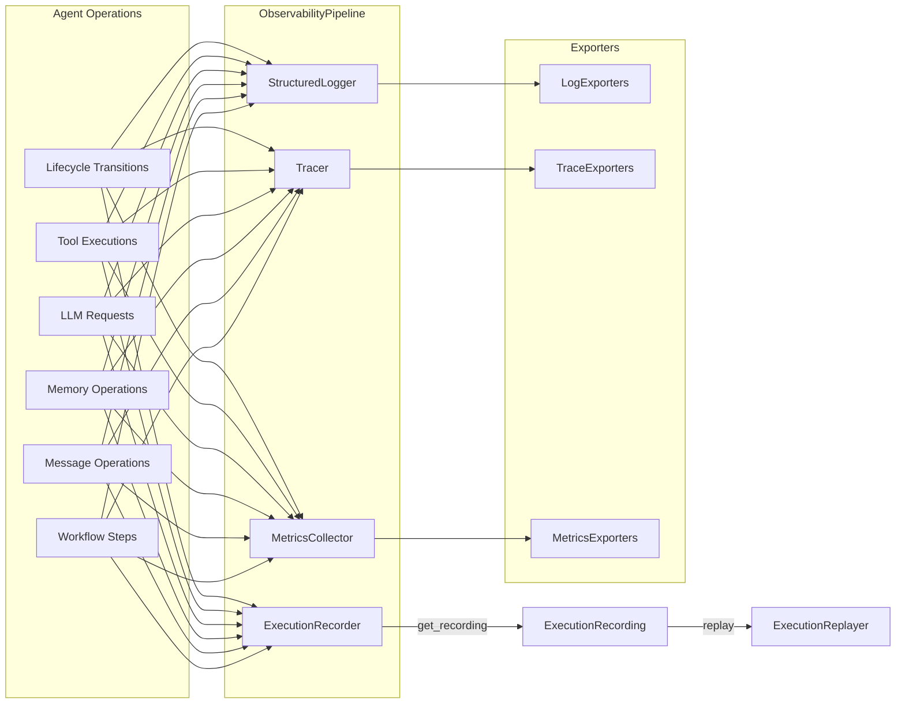

# Design Document — Observability & Debugging

## Overview

The Observability & Debugging feature extends the `codecraftai-agent-kit` SDK with a comprehensive system for monitoring, tracing, measuring, recording, and debugging agent execution. It provides five interconnected subsystems:

1. **Structured Logging** — Correlation-enriched log entries with pluggable formatters and exporters
2. **Distributed Tracing** — W3C Trace Context compatible spans with configurable sampling and pluggable exporters
3. **Metrics Collection** — Counter, gauge, and histogram metrics with a definition registry, snapshots, and pluggable exporters
4. **Execution Recording & Replay** — Ordered event capture with serialization and step-through replay
5. **Debug Mode** — Breakpoint-driven step-through execution with read-only state inspection

All classes live under `source/packages/ccai/agentkit/` with filenames in all-lowercase (no underscores), following the project naming conventions. The framework integrates with four external ccai packages:

- `codecraftai-this-app` — AppContext for settings, environment variables, and directory-based file path resolution
- `codecraftai-credentials` — CredentialReference resolution for exporter authentication
- `codecraftai-dataprofiles` — DataProfileReference resolution
- `codecraftai-extension` — ExtensionPoint registration and plugin discovery for exporter plugins

The design prioritizes debuggability over performance and readability over conciseness, per the project coding standards.

## Architecture

```mermaid
graph TD
    subgraph Observability Pipeline
        ObservabilityPipeline[ObservabilityPipeline]
        ObservabilityConfiguration[ObservabilityConfiguration]
        StructuredLogger[StructuredLogger]
        Tracer[Tracer]
        MetricsCollector[MetricsCollector]
        MetricsRegistry[MetricsRegistry]
        ExecutionRecorder[ExecutionRecorder]
    end

    subgraph Logging Subsystem
        StructuredLogEntry[StructuredLogEntry]
        LogFormatter[LogFormatter base]
        JsonLogFormatter[JsonLogFormatter]
        KeyValueLogFormatter[KeyValueLogFormatter]
        HumanReadableLogFormatter[HumanReadableLogFormatter]
        LogExporter[LogExporter base]
        ConsoleLogExporter[ConsoleLogExporter]
        FileLogExporter[FileLogExporter]
    end

    subgraph Tracing Subsystem
        TraceContext[TraceContext]
        TraceSpan[TraceSpan]
        TraceEvent[TraceEvent]
        TraceExporter[TraceExporter base]
        ConsoleTraceExporter[ConsoleTraceExporter]
        FileTraceExporter[FileTraceExporter]
    end

    subgraph Metrics Subsystem
        MetricDefinition[MetricDefinition]
        MetricType[MetricType enum]
        MetricMeasurement[MetricMeasurement]
        MetricsSnapshot[MetricsSnapshot]
        MetricsExporter[MetricsExporter base]
        ConsoleMetricsExporter[ConsoleMetricsExporter]
        FileMetricsExporter[FileMetricsExporter]
    end

    subgraph Recording & Replay Subsystem
        ExecutionRecord[ExecutionRecord]
        ExecutionRecording[ExecutionRecording]
        ExecutionReplayer[ExecutionReplayer]
    end

    subgraph Debug Subsystem
        DebugSession[DebugSession]
        Breakpoint[Breakpoint]
        DebugInspector[DebugInspector]
    end

    subgraph Shared
        CorrelationContext[CorrelationContext]
        ObservabilityError[ObservabilityError]
    end

    subgraph External Packages
        AppContext[codecraftai-this-app]
        Credentials[codecraftai-credentials]
        Extension[codecraftai-extension]
        Agent[Agent base class]
    end

    ObservabilityPipeline --> ObservabilityConfiguration
    ObservabilityPipeline --> StructuredLogger
    ObservabilityPipeline --> Tracer
    ObservabilityPipeline --> MetricsCollector
    ObservabilityPipeline --> MetricsRegistry
    ObservabilityPipeline --> ExecutionRecorder

    StructuredLogger --> StructuredLogEntry
    StructuredLogger --> CorrelationContext
    StructuredLogger --> LogExporter
    LogExporter --> LogFormatter
    LogFormatter --> JsonLogFormatter
    LogFormatter --> KeyValueLogFormatter
    LogFormatter --> HumanReadableLogFormatter
    LogExporter --> ConsoleLogExporter
    LogExporter --> FileLogExporter

    Tracer --> TraceContext
    Tracer --> TraceSpan
    TraceSpan --> TraceEvent
    Tracer --> TraceExporter
    TraceExporter --> ConsoleTraceExporter
    TraceExporter --> FileTraceExporter

    MetricsCollector --> MetricMeasurement
    MetricsCollector --> MetricsRegistry
    MetricsRegistry --> MetricDefinition
    MetricDefinition --> MetricType
    MetricsCollector --> MetricsSnapshot
    MetricsCollector --> MetricsExporter
    MetricsExporter --> ConsoleMetricsExporter
    MetricsExporter --> FileMetricsExporter

    ExecutionRecorder --> ExecutionRecord
    ExecutionRecorder --> ExecutionRecording
    ExecutionReplayer --> ExecutionRecording

    DebugSession --> Breakpoint
    DebugSession --> DebugInspector

    Agent --> ObservabilityPipeline
    Agent --> DebugSession
    ObservabilityConfiguration --> AppContext
    ObservabilityConfiguration --> Credentials
    Agent --> Extension

    FileLogExporter --> AppContext
    FileTraceExporter --> AppContext
    FileMetricsExporter --> AppContext
    LogExporter --> Credentials
    TraceExporter --> Credentials
    MetricsExporter --> Credentials
```



### Data Flow



### Design Decisions

1. **CorrelationContext as a standalone mutable context** — Propagated through all subsystems to enable end-to-end tracing of logical operations. Mutable to allow updating the active context during agent execution.
2. **Immutable data objects for log entries, trace events, metric measurements, and execution records** — All observability data points are immutable after creation, ensuring thread safety and debuggability.
3. **Abstract base classes for formatters and exporters using abc.ABC** — Enables pluggable backends while enforcing a consistent interface contract.
4. **ObservabilityPipeline as the single coordination point** — All subsystems are owned and coordinated by the pipeline, simplifying agent integration to a single property.
5. **No-op behavior when subsystems are disabled** — When tracing, metrics, or recording are disabled in configuration, the respective components operate as no-ops rather than being absent, avoiding null checks throughout agent code.
6. **Exporter plugin discovery via codecraftai-extension** — External packages contribute exporters through ExtensionPoint registration, following the same pattern as the core agent framework.
7. **Sampling at the root span level** — When a root span is sampled, all child spans within the same trace are also sampled, maintaining trace completeness.
8. **Serialization follows naming conventions** — as_dict for dictionary conversion, to_json/to_yaml for serialization, from_dict/from_json/from_yaml for deserialization.
9. **SemanticError for API misuse, ConfigurationError for configuration problems, ObservabilityError for operational failures** — Consistent with the core agent framework error hierarchy.
10. **DebugSession uses callback-based pause mechanism** — When a breakpoint is hit, a registered pause callback receives a DebugInspector, allowing interactive or programmatic inspection without blocking the event loop.
11. **Built-in agent metrics registered automatically** — Standard metrics for lifecycle, tools, LLM, memory, messaging, and workflow are registered when observability is enabled, providing useful operational data without manual instrumentation.

## Components and Interfaces

### File Layout

| File | Class(es) | Purpose |
|---|---|---|
| correlationcontext.py | CorrelationContext | Correlation identifier propagation |
| structuredlogentry.py | StructuredLogEntry | Immutable structured log record |
| structuredlogger.py | StructuredLogger | Logger with correlation enrichment |
| logformatter.py | LogFormatter, JsonLogFormatter, KeyValueLogFormatter, HumanReadableLogFormatter | Pluggable log formatters |
| logexporter.py | LogExporter, ConsoleLogExporter, FileLogExporter | Pluggable log exporters |
| tracecontext.py | TraceContext | W3C Trace Context compatible tracing context |
| tracespan.py | TraceSpan | Trace span representing a unit of work |
| traceevent.py | TraceEvent | Timestamped annotation within a span |
| tracer.py | Tracer | Span creation and management |
| traceexporter.py | TraceExporter, ConsoleTraceExporter, FileTraceExporter | Pluggable trace exporters |
| metrictype.py | MetricType | Metric type enumeration |
| metricdefinition.py | MetricDefinition | Metric definition with name, description, unit, type |
| metricmeasurement.py | MetricMeasurement | Structured metric data point |
| metricscollector.py | MetricsCollector | Recording counter/gauge/histogram values |
| metricsregistry.py | MetricsRegistry | Metric definition registry |
| metricssnapshot.py | MetricsSnapshot | Point-in-time metric snapshot |
| metricsexporter.py | MetricsExporter, ConsoleMetricsExporter, FileMetricsExporter | Pluggable metrics exporters |
| builtinagentmetrics.py | register_builtin_agent_metrics (function) | Automatic agent metrics registration |
| executionrecord.py | ExecutionRecord | Structured execution event record |
| executionrecorder.py | ExecutionRecorder | Event capture during execution |
| executionrecording.py | ExecutionRecording | Complete recording serialization |
| executionreplayer.py | ExecutionReplayer | Step-through replay of recordings |
| debugsession.py | DebugSession | Step-through execution with breakpoints |
| breakpoint.py | Breakpoint | Breakpoint definition by type and target |
| debuginspector.py | DebugInspector | Read-only agent state inspection |
| observabilityconfiguration.py | ObservabilityConfiguration | Declarative configuration |
| observabilitypipeline.py | ObservabilityPipeline | Coordinating component for all subsystems |
| observabilityerror.py | ObservabilityError | Observability-specific exception |

### CorrelationContext

```python
class CorrelationContext:
    """
        A mutable context object that carries a correlation identifier and optional
        parent correlation identifier across agent operations.
    """

    def __init__(self, correlation_id: str = None, parent_correlation_id: str = None):
        self._correlation_id = correlation_id if correlation_id is not None else str(uuid.uuid4())
        self._parent_correlation_id = parent_correlation_id
        return

    @property
    def correlation_id(self) -> str: ...
    @property
    def parent_correlation_id(self) -> Optional[str]: ...

    def create_child(self) -> "CorrelationContext": ...
    def as_dict(self) -> dict: ...
    def to_json(self) -> str: ...

    @classmethod
    def from_dict(cls, data: dict) -> "CorrelationContext": ...
    @classmethod
    def from_json(cls, json_str: str) -> "CorrelationContext": ...

    def __repr__(self) -> str: ...
    def __str__(self) -> str: ...
```

### StructuredLogEntry

```python
class StructuredLogEntry:
    """
        An immutable object representing a single structured log record.
    """

    def __init__(self, timestamp: datetime, level: str, message: str,
                 logger_name: str, correlation_id: str, agent_id: str,
                 metadata: dict = None):
        self._timestamp = timestamp
        self._level = level
        self._message = message
        self._logger_name = logger_name
        self._correlation_id = correlation_id
        self._agent_id = agent_id
        self._metadata = dict(metadata) if metadata is not None else {}
        return

    @property
    def timestamp(self) -> datetime: ...
    @property
    def level(self) -> str: ...
    @property
    def message(self) -> str: ...
    @property
    def logger_name(self) -> str: ...
    @property
    def correlation_id(self) -> str: ...
    @property
    def agent_id(self) -> str: ...
    @property
    def metadata(self) -> dict: ...

    def as_dict(self) -> dict: ...
    def to_json(self) -> str: ...

    @classmethod
    def from_dict(cls, data: dict) -> "StructuredLogEntry": ...
    @classmethod
    def from_json(cls, json_str: str) -> "StructuredLogEntry": ...

    def __repr__(self) -> str: ...
    def __str__(self) -> str: ...
```

### StructuredLogger

```python
class StructuredLogger:
    """
        A logger wrapper that enriches standard Python log records with correlation
        identifiers, agent identity, and structured metadata fields.
    """

    def __init__(self, agent_id: str, correlation_context: CorrelationContext):
        self._agent_id = agent_id
        self._correlation_context = correlation_context
        self._logger_name = "ccai.agentkit.observability"
        self._logger = logging.getLogger(self._logger_name)
        return

    @property
    def correlation_context(self) -> CorrelationContext: ...

    def set_correlation_context(self, context: CorrelationContext) -> None: ...

    def debug(self, message: str, **metadata) -> StructuredLogEntry: ...
    def info(self, message: str, **metadata) -> StructuredLogEntry: ...
    def warning(self, message: str, **metadata) -> StructuredLogEntry: ...
    def error(self, message: str, **metadata) -> StructuredLogEntry: ...
    def critical(self, message: str, **metadata) -> StructuredLogEntry: ...

    def __repr__(self) -> str: ...
    def __str__(self) -> str: ...
```

### LogFormatter

```python
import abc

class LogFormatter(abc.ABC):
    """
        Abstract base class for formatting StructuredLogEntry objects into output strings.
    """

    def __init__(self, format_name: str):
        self._format_name = format_name
        return

    @property
    def format_name(self) -> str: ...

    @abc.abstractmethod
    def format(self, entry: StructuredLogEntry) -> str: ...

    def __repr__(self) -> str: ...
    def __str__(self) -> str: ...


class JsonLogFormatter(LogFormatter):
    """
        Formats a StructuredLogEntry as a single-line JSON string.
    """

    def __init__(self):
        super().__init__(format_name="json")
        return

    def format(self, entry: StructuredLogEntry) -> str: ...


class KeyValueLogFormatter(LogFormatter):
    """
        Formats a StructuredLogEntry as a key=value pair string with space-separated fields.
    """

    def __init__(self):
        super().__init__(format_name="key_value")
        return

    def format(self, entry: StructuredLogEntry) -> str: ...


class HumanReadableLogFormatter(LogFormatter):
    """
        Formats a StructuredLogEntry as a human-readable string.
    """

    def __init__(self):
        super().__init__(format_name="human_readable")
        return

    def format(self, entry: StructuredLogEntry) -> str: ...
```

### LogExporter

```python
import abc

class LogExporter(abc.ABC):
    """
        Abstract base class for exporting StructuredLogEntry objects to external systems.
    """

    def __init__(self, formatter: LogFormatter, credential_references: list = None):
        self._formatter = formatter
        self._credential_references = list(credential_references) if credential_references is not None else []
        return

    @abc.abstractmethod
    def export(self, entry: StructuredLogEntry) -> None: ...
    @abc.abstractmethod
    def flush(self) -> None: ...
    @abc.abstractmethod
    def shutdown(self) -> None: ...

    def __repr__(self) -> str: ...
    def __str__(self) -> str: ...


class ConsoleLogExporter(LogExporter):
    """
        Writes formatted log entries to standard output.
    """

    def __init__(self, formatter: LogFormatter):
        super().__init__(formatter=formatter)
        return

    def export(self, entry: StructuredLogEntry) -> None: ...
    def flush(self) -> None: ...
    def shutdown(self) -> None: ...


class FileLogExporter(LogExporter):
    """
        Writes formatted log entries to a specified file path, resolved relative
        to the AppContext directory provided by codecraftai-this-app.
    """

    def __init__(self, formatter: LogFormatter, file_path: str, app_context=None):
        super().__init__(formatter=formatter)
        self._file_path = file_path
        self._app_context = app_context
        return

    def export(self, entry: StructuredLogEntry) -> None: ...
    def flush(self) -> None: ...
    def shutdown(self) -> None: ...
```

### TraceContext

```python
class TraceContext:
    """
        An immutable object representing the distributed tracing context for a single
        operation, compatible with the W3C Trace Context specification.
    """

    def __init__(self, trace_id: str = None, span_id: str = None,
                 parent_span_id: str = None, trace_flags: int = 0):
        self._trace_id = trace_id if trace_id is not None else os.urandom(16).hex()
        self._span_id = span_id if span_id is not None else os.urandom(8).hex()
        self._parent_span_id = parent_span_id
        self._trace_flags = trace_flags
        return

    @property
    def trace_id(self) -> str: ...
    @property
    def span_id(self) -> str: ...
    @property
    def parent_span_id(self) -> Optional[str]: ...
    @property
    def trace_flags(self) -> int: ...

    def create_child_span_context(self) -> "TraceContext": ...
    def to_traceparent(self) -> str: ...

    @classmethod
    def from_traceparent(cls, traceparent: str) -> "TraceContext": ...

    def as_dict(self) -> dict: ...
    def to_json(self) -> str: ...

    @classmethod
    def from_dict(cls, data: dict) -> "TraceContext": ...
    @classmethod
    def from_json(cls, json_str: str) -> "TraceContext": ...

    def __repr__(self) -> str: ...
    def __str__(self) -> str: ...
```

### TraceEvent

```python
class TraceEvent:
    """
        An immutable object representing a timestamped annotation within a TraceSpan.
    """

    def __init__(self, name: str, timestamp: datetime = None, attributes: dict = None):
        self._name = name
        self._timestamp = timestamp if timestamp is not None else datetime.utcnow()
        self._attributes = dict(attributes) if attributes is not None else {}
        return

    @property
    def name(self) -> str: ...
    @property
    def timestamp(self) -> datetime: ...
    @property
    def attributes(self) -> dict: ...

    def as_dict(self) -> dict: ...
    def to_json(self) -> str: ...

    @classmethod
    def from_dict(cls, data: dict) -> "TraceEvent": ...
    @classmethod
    def from_json(cls, json_str: str) -> "TraceEvent": ...

    def __repr__(self) -> str: ...
    def __str__(self) -> str: ...
```

### TraceSpan

```python
class TraceSpan:
    """
        A mutable object representing a single unit of work within a distributed trace.
    """

    VALID_STATUSES = ("unset", "ok", "error")

    def __init__(self, name: str, trace_context: TraceContext, start_time: datetime = None,
                 status: str = "unset", attributes: dict = None):
        self._name = name
        self._trace_context = trace_context
        self._start_time = start_time if start_time is not None else datetime.utcnow()
        self._end_time = None
        self._status = status
        self._status_description = None
        self._attributes = dict(attributes) if attributes is not None else {}
        self._events = []
        return

    @property
    def name(self) -> str: ...
    @property
    def trace_context(self) -> TraceContext: ...
    @property
    def start_time(self) -> datetime: ...
    @property
    def end_time(self) -> Optional[datetime]: ...
    @property
    def status(self) -> str: ...
    @property
    def status_description(self) -> Optional[str]: ...
    @property
    def attributes(self) -> dict: ...
    @property
    def events(self) -> list: ...
    @property
    def duration(self) -> Optional[float]: ...

    def set_status(self, status: str, description: str = None) -> None: ...
    def set_attribute(self, key: str, value) -> None: ...
    def add_event(self, name: str, attributes: dict = None) -> None: ...
    def end(self) -> None: ...

    def as_dict(self) -> dict: ...
    def to_json(self) -> str: ...

    @classmethod
    def from_dict(cls, data: dict) -> "TraceSpan": ...
    @classmethod
    def from_json(cls, json_str: str) -> "TraceSpan": ...

    def __repr__(self) -> str: ...
    def __str__(self) -> str: ...
```

### Tracer

```python
class Tracer:
    """
        A component that creates and manages TraceSpan objects for an Agent.
    """

    def __init__(self, agent_id: str, trace_context: TraceContext = None,
                 sampling_rate: float = 1.0):
        self._agent_id = agent_id
        self._root_trace_context = trace_context
        self._sampling_rate = sampling_rate
        self._active_span_stack = []
        self._exporters = []
        return

    @property
    def active_span(self) -> Optional[TraceSpan]: ...
    @property
    def sampling_rate(self) -> float: ...

    def start_span(self, name: str, attributes: dict = None) -> TraceSpan: ...
    def end_span(self) -> None: ...

    def span(self, name: str, attributes: dict = None): ...  # context manager

    def register_exporter(self, exporter: "TraceExporter") -> None: ...

    def __repr__(self) -> str: ...
    def __str__(self) -> str: ...
```

### TraceExporter

```python
import abc

class TraceExporter(abc.ABC):
    """
        Abstract base class for exporting completed TraceSpan objects to external
        tracing backends.
    """

    def __init__(self, credential_references: list = None):
        self._credential_references = list(credential_references) if credential_references is not None else []
        return

    @abc.abstractmethod
    def export(self, spans: list) -> None: ...
    @abc.abstractmethod
    def flush(self) -> None: ...
    @abc.abstractmethod
    def shutdown(self) -> None: ...

    def __repr__(self) -> str: ...
    def __str__(self) -> str: ...


class ConsoleTraceExporter(TraceExporter):
    """
        Writes completed TraceSpan objects as formatted text to standard output.
    """

    def __init__(self):
        super().__init__()
        return

    def export(self, spans: list) -> None: ...
    def flush(self) -> None: ...
    def shutdown(self) -> None: ...


class FileTraceExporter(TraceExporter):
    """
        Writes completed TraceSpan objects as JSON lines to a specified file path,
        resolved relative to the AppContext directory provided by codecraftai-this-app.
    """

    def __init__(self, file_path: str, app_context=None):
        super().__init__()
        self._file_path = file_path
        self._app_context = app_context
        return

    def export(self, spans: list) -> None: ...
    def flush(self) -> None: ...
    def shutdown(self) -> None: ...
```

### MetricType

```python
import enum

class MetricType(enum.Enum):
    """
        Enumeration defining the type of a metric.
    """

    COUNTER = "COUNTER"
    GAUGE = "GAUGE"
    HISTOGRAM = "HISTOGRAM"

    @classmethod
    def from_string(cls, value: str) -> "MetricType": ...
```

### MetricDefinition

```python
class MetricDefinition:
    """
        An immutable object describing a metric with a name, description, unit, and type.
    """

    def __init__(self, name: str, description: str, unit: str, metric_type: MetricType):
        self._name = name
        self._description = description
        self._unit = unit
        self._metric_type = metric_type
        return

    @property
    def name(self) -> str: ...
    @property
    def description(self) -> str: ...
    @property
    def unit(self) -> str: ...
    @property
    def metric_type(self) -> MetricType: ...

    def as_dict(self) -> dict: ...
    def to_json(self) -> str: ...

    @classmethod
    def from_dict(cls, data: dict) -> "MetricDefinition": ...
    @classmethod
    def from_json(cls, json_str: str) -> "MetricDefinition": ...

    def __repr__(self) -> str: ...
    def __str__(self) -> str: ...
```

### MetricMeasurement

```python
class MetricMeasurement:
    """
        An immutable object representing a single metric data point.
    """

    def __init__(self, metric_name: str, value: float, timestamp: datetime = None,
                 labels: dict = None):
        self._metric_name = metric_name
        self._value = value
        self._timestamp = timestamp if timestamp is not None else datetime.utcnow()
        self._labels = dict(labels) if labels is not None else {}
        return

    @property
    def metric_name(self) -> str: ...
    @property
    def value(self) -> float: ...
    @property
    def timestamp(self) -> datetime: ...
    @property
    def labels(self) -> dict: ...

    def as_dict(self) -> dict: ...
    def to_json(self) -> str: ...

    @classmethod
    def from_dict(cls, data: dict) -> "MetricMeasurement": ...
    @classmethod
    def from_json(cls, json_str: str) -> "MetricMeasurement": ...

    def __repr__(self) -> str: ...
    def __str__(self) -> str: ...
```

### MetricsRegistry

```python
class MetricsRegistry:
    """
        A registry that tracks all MetricDefinition instances available to an Agent.
    """

    def __init__(self):
        self._definitions = {}
        return

    @property
    def count(self) -> int: ...

    def register(self, definition: MetricDefinition) -> None: ...
    def deregister(self, name: str) -> None: ...
    def lookup(self, name: str) -> Optional[MetricDefinition]: ...
    def has_metric(self, name: str) -> bool: ...
    def list_all(self) -> list: ...

    def __repr__(self) -> str: ...
    def __str__(self) -> str: ...
```

### MetricsCollector

```python
class MetricsCollector:
    """
        A component that records MetricMeasurement objects for defined metrics.
    """

    def __init__(self, registry: MetricsRegistry):
        self._registry = registry
        self._measurements = []
        self._counter_values = {}
        self._gauge_values = {}
        self._histogram_values = {}
        self._exporters = []
        return

    def increment_counter(self, metric_name: str, value: float = 1.0,
                          labels: dict = None) -> None: ...
    def set_gauge(self, metric_name: str, value: float,
                  labels: dict = None) -> None: ...
    def record_histogram(self, metric_name: str, value: float,
                         labels: dict = None) -> None: ...

    def snapshot(self) -> "MetricsSnapshot": ...
    def reset(self) -> None: ...

    def register_exporter(self, exporter: "MetricsExporter") -> None: ...

    def __repr__(self) -> str: ...
    def __str__(self) -> str: ...
```

### MetricsSnapshot

```python
class MetricsSnapshot:
    """
        An immutable object representing a point-in-time snapshot of all metric values.
    """

    def __init__(self, timestamp: datetime, metrics: dict):
        self._timestamp = timestamp
        self._metrics = dict(metrics)
        return

    @property
    def timestamp(self) -> datetime: ...
    @property
    def metrics(self) -> dict: ...

    def get_metric(self, name: str) -> Optional[dict]: ...

    def as_dict(self) -> dict: ...
    def to_json(self) -> str: ...

    @classmethod
    def from_dict(cls, data: dict) -> "MetricsSnapshot": ...
    @classmethod
    def from_json(cls, json_str: str) -> "MetricsSnapshot": ...

    def __repr__(self) -> str: ...
    def __str__(self) -> str: ...
```

### MetricsExporter

```python
import abc

class MetricsExporter(abc.ABC):
    """
        Abstract base class for exporting MetricMeasurement objects to external
        metrics backends.
    """

    def __init__(self, credential_references: list = None):
        self._credential_references = list(credential_references) if credential_references is not None else []
        return

    @abc.abstractmethod
    def export(self, measurements: list) -> None: ...
    @abc.abstractmethod
    def flush(self) -> None: ...
    @abc.abstractmethod
    def shutdown(self) -> None: ...

    def __repr__(self) -> str: ...
    def __str__(self) -> str: ...


class ConsoleMetricsExporter(MetricsExporter):
    """
        Writes MetricMeasurement objects as formatted text to standard output.
    """

    def __init__(self):
        super().__init__()
        return

    def export(self, measurements: list) -> None: ...
    def flush(self) -> None: ...
    def shutdown(self) -> None: ...


class FileMetricsExporter(MetricsExporter):
    """
        Writes MetricMeasurement objects as JSON lines to a specified file path,
        resolved relative to the AppContext directory provided by codecraftai-this-app.
    """

    def __init__(self, file_path: str, app_context=None):
        super().__init__()
        self._file_path = file_path
        self._app_context = app_context
        return

    def export(self, measurements: list) -> None: ...
    def flush(self) -> None: ...
    def shutdown(self) -> None: ...
```

### Built-in Agent Metrics

```python
def register_builtin_agent_metrics(registry: MetricsRegistry) -> None:
    """
        Registers the standard set of agent metrics in the provided MetricsRegistry.
        Called automatically when an Agent is initialized with observability enabled.
    """
    ...
```

The following metrics are registered:

| Metric Name | Type | Unit | Description |
|---|---|---|---|
| agent.lifecycle.transitions | COUNTER | count | Count of agent lifecycle state transitions |
| agent.tool.execution.duration | HISTOGRAM | seconds | Duration of tool executions |
| agent.tool.execution.errors | COUNTER | count | Count of tool execution errors |
| agent.llm.request.duration | HISTOGRAM | seconds | Duration of LLM completion requests |
| agent.llm.token.usage.prompt | COUNTER | tokens | Count of prompt tokens consumed |
| agent.llm.token.usage.completion | COUNTER | tokens | Count of completion tokens consumed |
| agent.llm.request.errors | COUNTER | count | Count of LLM request errors |
| agent.memory.operations | COUNTER | count | Count of memory store operations |
| agent.message.sent | COUNTER | count | Count of messages sent |
| agent.message.received | COUNTER | count | Count of messages received |
| agent.workflow.step.duration | HISTOGRAM | seconds | Duration of workflow step executions |
| agent.workflow.step.errors | COUNTER | count | Count of workflow step execution errors |
| agent.active.spans | GAUGE | count | Count of currently active trace spans |

### ExecutionRecord

```python
class ExecutionRecord:
    """
        An immutable object representing a recorded event during agent execution.
    """

    def __init__(self, sequence_number: int, timestamp: datetime, event_type: str,
                 agent_id: str, correlation_id: str, payload: dict = None):
        self._sequence_number = sequence_number
        self._timestamp = timestamp
        self._event_type = event_type
        self._agent_id = agent_id
        self._correlation_id = correlation_id
        self._payload = dict(payload) if payload is not None else {}
        return

    @property
    def sequence_number(self) -> int: ...
    @property
    def timestamp(self) -> datetime: ...
    @property
    def event_type(self) -> str: ...
    @property
    def agent_id(self) -> str: ...
    @property
    def correlation_id(self) -> str: ...
    @property
    def payload(self) -> dict: ...

    def as_dict(self) -> dict: ...
    def to_json(self) -> str: ...

    @classmethod
    def from_dict(cls, data: dict) -> "ExecutionRecord": ...
    @classmethod
    def from_json(cls, json_str: str) -> "ExecutionRecord": ...

    def __repr__(self) -> str: ...
    def __str__(self) -> str: ...
```

### ExecutionRecorder

```python
class ExecutionRecorder:
    """
        A component that captures ExecutionRecord objects during agent execution.
    """

    def __init__(self, agent_id: str):
        self._agent_id = agent_id
        self._records = []
        self._sequence_counter = 0
        self._is_recording = False
        return

    @property
    def count(self) -> int: ...
    @property
    def is_recording(self) -> bool: ...

    def start(self) -> None: ...
    def stop(self) -> None: ...
    def record(self, event_type: str, correlation_id: str, payload: dict = None) -> None: ...
    def get_recording(self) -> "ExecutionRecording": ...
    def clear(self) -> None: ...

    def __repr__(self) -> str: ...
    def __str__(self) -> str: ...
```

### ExecutionRecording

```python
class ExecutionRecording:
    """
        An immutable object representing a complete recording of agent execution.
    """

    def __init__(self, agent_id: str, start_time: datetime, end_time: datetime,
                 records: list = None):
        self._agent_id = agent_id
        self._start_time = start_time
        self._end_time = end_time
        self._records = list(records) if records is not None else []
        return

    @property
    def agent_id(self) -> str: ...
    @property
    def start_time(self) -> datetime: ...
    @property
    def end_time(self) -> datetime: ...
    @property
    def records(self) -> list: ...
    @property
    def duration(self) -> float: ...

    def filter_by_event_type(self, event_type: str) -> "ExecutionRecording": ...

    def as_dict(self) -> dict: ...
    def to_json(self) -> str: ...

    @classmethod
    def from_dict(cls, data: dict) -> "ExecutionRecording": ...
    @classmethod
    def from_json(cls, json_str: str) -> "ExecutionRecording": ...

    def __repr__(self) -> str: ...
    def __str__(self) -> str: ...
```

### ExecutionReplayer

```python
class ExecutionReplayer:
    """
        A component that reads an ExecutionRecording and allows step-by-step
        inspection of the recorded events.
    """

    def __init__(self, recording: ExecutionRecording):
        self._recording = recording
        self._position = -1
        return

    @property
    def current(self) -> Optional[ExecutionRecord]: ...
    @property
    def position(self) -> int: ...
    @property
    def total_count(self) -> int: ...

    def next(self) -> Optional[ExecutionRecord]: ...
    def previous(self) -> Optional[ExecutionRecord]: ...
    def reset(self) -> None: ...
    def seek(self, sequence_number: int) -> ExecutionRecord: ...
    def filter(self, event_type: str) -> "ExecutionReplayer": ...

    def __repr__(self) -> str: ...
    def __str__(self) -> str: ...
```

### Breakpoint

```python
class Breakpoint:
    """
        An immutable object representing a condition at which the DebugSession
        pauses execution.
    """

    VALID_TYPES = ("lifecycle", "tool", "llm", "workflow_step", "message", "memory", "custom")

    def __init__(self, breakpoint_type: str, target_name: str = None,
                 condition: str = None):
        self._breakpoint_type = breakpoint_type
        self._target_name = target_name
        self._condition = condition
        return

    @property
    def breakpoint_type(self) -> str: ...
    @property
    def target_name(self) -> Optional[str]: ...
    @property
    def condition(self) -> Optional[str]: ...

    def matches(self, event_type: str, target_name: str = None) -> bool: ...
    def as_dict(self) -> dict: ...

    def __repr__(self) -> str: ...
    def __str__(self) -> str: ...
```

### DebugInspector

```python
class DebugInspector:
    """
        A component that provides read-only access to the current agent state
        during a DebugSession pause.
    """

    def __init__(self, agent: "Agent"):
        self._agent = agent
        return

    @property
    def lifecycle_state(self) -> "LifecycleState": ...
    @property
    def identity(self) -> "AgentIdentity": ...
    @property
    def correlation_context(self) -> Optional[CorrelationContext]: ...

    def get_tool_names(self) -> list: ...
    def get_llm_providers(self) -> list: ...
    def get_memory_store_names(self) -> list: ...
    def get_metrics_snapshot(self) -> Optional[MetricsSnapshot]: ...
    def get_active_span(self) -> Optional[TraceSpan]: ...
    def get_execution_recording(self) -> Optional[ExecutionRecording]: ...

    def __repr__(self) -> str: ...
    def __str__(self) -> str: ...
```

### DebugSession

```python
class DebugSession:
    """
        A component that enables step-through execution of agent operations.
    """

    def __init__(self, agent: "Agent"):
        self._agent = agent
        self._breakpoints = []
        self._is_paused = False
        self._is_active = False
        self._inspector = None
        self._pause_callback = None
        return

    @property
    def is_paused(self) -> bool: ...
    @property
    def is_active(self) -> bool: ...
    @property
    def inspector(self) -> Optional[DebugInspector]: ...

    def add_breakpoint(self, breakpoint: Breakpoint) -> None: ...
    def remove_breakpoint(self, breakpoint: Breakpoint) -> None: ...
    def list_breakpoints(self) -> list: ...
    def clear_breakpoints(self) -> None: ...

    def continue_execution(self) -> None: ...
    def step(self) -> None: ...

    def start(self) -> None: ...
    def stop(self) -> None: ...

    def set_pause_callback(self, callback) -> None: ...

    def __repr__(self) -> str: ...
    def __str__(self) -> str: ...
```

### ObservabilityConfiguration

```python
class ObservabilityConfiguration:
    """
        A configuration object that defines the observability system settings for an Agent.
    """

    VALID_LOG_LEVELS = ("debug", "info", "warning", "error", "critical")
    VALID_LOG_FORMATS = ("json", "key_value", "human_readable")

    def __init__(self, log_level: str = "info", log_format: str = "human_readable",
                 tracing_enabled: bool = False, metrics_enabled: bool = False,
                 recording_enabled: bool = False, debug_mode_enabled: bool = False,
                 sampling_rate: float = 1.0, exporter_settings: dict = None):
        self._log_level = log_level
        self._log_format = log_format
        self._tracing_enabled = tracing_enabled
        self._metrics_enabled = metrics_enabled
        self._recording_enabled = recording_enabled
        self._debug_mode_enabled = debug_mode_enabled
        self._sampling_rate = sampling_rate
        self._exporter_settings = dict(exporter_settings) if exporter_settings is not None else {}
        return

    @property
    def log_level(self) -> str: ...
    @property
    def log_format(self) -> str: ...
    @property
    def tracing_enabled(self) -> bool: ...
    @property
    def metrics_enabled(self) -> bool: ...
    @property
    def recording_enabled(self) -> bool: ...
    @property
    def debug_mode_enabled(self) -> bool: ...
    @property
    def sampling_rate(self) -> float: ...
    @property
    def exporter_settings(self) -> dict: ...

    def as_dict(self) -> dict: ...
    def to_json(self) -> str: ...
    def to_yaml(self) -> str: ...

    @classmethod
    def from_dict(cls, data: dict, app_context=None) -> "ObservabilityConfiguration": ...
    @classmethod
    def from_json(cls, json_str: str, app_context=None) -> "ObservabilityConfiguration": ...
    @classmethod
    def from_yaml(cls, yaml_str: str, app_context=None) -> "ObservabilityConfiguration": ...
    @classmethod
    def from_json_file(cls, file_path: str, app_context=None) -> "ObservabilityConfiguration": ...
    @classmethod
    def from_yaml_file(cls, file_path: str, app_context=None) -> "ObservabilityConfiguration": ...

    def __repr__(self) -> str: ...
    def __str__(self) -> str: ...
```

### ObservabilityPipeline

```python
class ObservabilityPipeline:
    """
        A component that coordinates the StructuredLogger, Tracer, MetricsCollector,
        and ExecutionRecorder for an Agent, routing observability data to configured
        exporters.
    """

    def __init__(self, configuration: ObservabilityConfiguration, agent_id: str,
                 correlation_context: CorrelationContext = None):
        self._configuration = configuration
        self._agent_id = agent_id
        self._logger = None
        self._tracer = None
        self._metrics_collector = None
        self._metrics_registry = None
        self._execution_recorder = None
        self._log_exporters = []
        self._trace_exporters = []
        self._metrics_exporters = []
        return

    @property
    def logger(self) -> StructuredLogger: ...
    @property
    def tracer(self) -> Tracer: ...
    @property
    def metrics_collector(self) -> MetricsCollector: ...
    @property
    def metrics_registry(self) -> MetricsRegistry: ...
    @property
    def execution_recorder(self) -> ExecutionRecorder: ...

    def register_log_exporter(self, exporter: LogExporter) -> None: ...
    def register_trace_exporter(self, exporter: TraceExporter) -> None: ...
    def register_metrics_exporter(self, exporter: MetricsExporter) -> None: ...

    def shutdown(self) -> None: ...

    def __repr__(self) -> str: ...
    def __str__(self) -> str: ...
```

### ObservabilityError

```python
class ObservabilityError(Exception):
    """
        Exception raised when an observability operation fails due to an exporter
        error, recording error, or pipeline configuration error.
    """

    def __init__(self, component_name: str, operation_name: str, message: str,
                 cause: Exception = None):
        self._component_name = component_name
        self._operation_name = operation_name
        super().__init__(message)
        self.__cause__ = cause
        return

    @property
    def component_name(self) -> str: ...
    @property
    def operation_name(self) -> str: ...

    def __repr__(self) -> str: ...
```

## Data Models

### CorrelationContext Fields

| Field | Type | Required | Default | Description |
|---|---|---|---|---|
| correlation_id | str | No | Auto-generated UUID | Unique correlation identifier |
| parent_correlation_id | str | No | None | Parent correlation identifier |

### StructuredLogEntry Fields

| Field | Type | Required | Default | Description |
|---|---|---|---|---|
| timestamp | datetime | Yes | — | UTC timestamp of the log entry |
| level | str | Yes | — | Log level (debug, info, warning, error, critical) |
| message | str | Yes | — | Log message |
| logger_name | str | Yes | — | Name of the logger |
| correlation_id | str | Yes | — | Correlation identifier |
| agent_id | str | Yes | — | Agent identifier |
| metadata | dict | No | {} | Additional key-value fields |

### TraceContext Fields

| Field | Type | Required | Default | Description |
|---|---|---|---|---|
| trace_id | str | No | Random 32-char hex | 32-character lowercase hexadecimal trace identifier |
| span_id | str | No | Random 16-char hex | 16-character lowercase hexadecimal span identifier |
| parent_span_id | str | No | None | Parent span identifier |
| trace_flags | int | No | 0 | Trace flags integer |

### TraceSpan Fields

| Field | Type | Required | Default | Description |
|---|---|---|---|---|
| name | str | Yes | — | Span name |
| trace_context | TraceContext | Yes | — | Associated trace context |
| start_time | datetime | No | Current UTC time | Span start timestamp |
| end_time | datetime | No | None | Span end timestamp (set by end()) |
| status | str | No | "unset" | Span status: "unset", "ok", "error" |
| status_description | str | No | None | Optional status description |
| attributes | dict | No | {} | Key-value span attributes |
| events | list[TraceEvent] | No | [] | List of trace events |

### TraceEvent Fields

| Field | Type | Required | Default | Description |
|---|---|---|---|---|
| name | str | Yes | — | Event name |
| timestamp | datetime | No | Current UTC time | Event timestamp |
| attributes | dict | No | {} | Key-value event attributes |

### MetricDefinition Fields

| Field | Type | Required | Default | Description |
|---|---|---|---|---|
| name | str | Yes | — | Metric name |
| description | str | Yes | — | Metric description |
| unit | str | Yes | — | Unit of measurement |
| metric_type | MetricType | Yes | — | COUNTER, GAUGE, or HISTOGRAM |

### MetricMeasurement Fields

| Field | Type | Required | Default | Description |
|---|---|---|---|---|
| metric_name | str | Yes | — | Name of the metric |
| value | float | Yes | — | Measured value |
| timestamp | datetime | No | Current UTC time | Measurement timestamp |
| labels | dict | No | {} | Dimensional labels |

### MetricsSnapshot Fields

| Field | Type | Required | Default | Description |
|---|---|---|---|---|
| timestamp | datetime | Yes | — | Snapshot timestamp |
| metrics | dict | Yes | — | Metric names to current values and labels |

### ExecutionRecord Fields

| Field | Type | Required | Default | Description |
|---|---|---|---|---|
| sequence_number | int | Yes | — | Monotonically increasing sequence number |
| timestamp | datetime | Yes | — | Event timestamp |
| event_type | str | Yes | — | Type of execution event |
| agent_id | str | Yes | — | Agent identifier |
| correlation_id | str | Yes | — | Correlation identifier |
| payload | dict | No | {} | Event-specific data |

### ExecutionRecording Fields

| Field | Type | Required | Default | Description |
|---|---|---|---|---|
| agent_id | str | Yes | — | Agent identifier |
| start_time | datetime | Yes | — | Recording start timestamp |
| end_time | datetime | Yes | — | Recording end timestamp |
| records | list[ExecutionRecord] | No | [] | Ordered list of execution records |

### Breakpoint Fields

| Field | Type | Required | Default | Description |
|---|---|---|---|---|
| breakpoint_type | str | Yes | — | One of: lifecycle, tool, llm, workflow_step, message, memory, custom |
| target_name | str | No | None | Optional target name to match |
| condition | str | No | None | Optional condition expression |

### ObservabilityConfiguration Schema

```python
{
    "log_level": str,           # "debug", "info", "warning", "error", "critical"
    "log_format": str,          # "json", "key_value", "human_readable"
    "tracing_enabled": bool,
    "metrics_enabled": bool,
    "recording_enabled": bool,
    "debug_mode_enabled": bool,
    "sampling_rate": float,     # 0.0 to 1.0 inclusive
    "exporter_settings": {
        "log_exporters": [...],
        "trace_exporters": [...],
        "metrics_exporters": [...]
    },
    "credentials": {str: {"provider": str, "key": str}}
}
```

## Correctness Properties

*A property is a characteristic or behavior that should hold true across all valid executions of a system — essentially, a formal statement about what the system should do. Properties serve as the bridge between human-readable specifications and machine-verifiable correctness guarantees.*

### Property 1: CorrelationContext JSON round-trip
*For any* valid CorrelationContext instance with any combination of correlation_id and parent_correlation_id, calling to_json() and then from_json() on the resulting string shall produce a CorrelationContext whose correlation_id and parent_correlation_id are equal to the original.
**Validates: Requirements 1.6, 1.8, 1.9**

### Property 2: CorrelationContext auto-generates valid UUID
*For any* CorrelationContext created without an explicit correlation_id, the resulting correlation_id property shall be a valid UUID string parseable by uuid.UUID.
**Validates: Requirements 1.2**

### Property 3: CorrelationContext create_child preserves parent chain
*For any* valid CorrelationContext instance, calling create_child() shall produce a new CorrelationContext whose parent_correlation_id equals the original's correlation_id, and whose correlation_id is a new distinct value.
**Validates: Requirements 1.4**

### Property 4: StructuredLogEntry JSON round-trip
*For any* valid StructuredLogEntry instance with any combination of timestamp, level, message, logger_name, correlation_id, agent_id, and metadata, calling to_json() and then from_json() shall produce a StructuredLogEntry whose fields are equal to the original.
**Validates: Requirements 2.4, 2.6, 2.7**

### Property 5: StructuredLogger produces entries with correct fields
*For any* agent_id, CorrelationContext, log level, message, and metadata keyword arguments, calling the corresponding log method on a StructuredLogger shall produce a StructuredLogEntry containing the correct log level, message, agent_id, correlation_id from the context, and all metadata key-value pairs.
**Validates: Requirements 3.3, 3.4**

### Property 6: JsonLogFormatter produces valid JSON containing all entry fields
*For any* valid StructuredLogEntry, calling JsonLogFormatter.format() shall produce a string that is valid JSON and when parsed contains keys for timestamp, level, message, logger_name, correlation_id, and agent_id with values matching the entry.
**Validates: Requirements 4.3**

### Property 7: TraceContext auto-generates valid identifiers
*For any* TraceContext created without explicit trace_id or span_id, the trace_id shall be a 32-character lowercase hexadecimal string and the span_id shall be a 16-character lowercase hexadecimal string.
**Validates: Requirements 6.1, 6.2, 6.3**

### Property 8: TraceContext JSON round-trip
*For any* valid TraceContext instance, calling to_json() and then from_json() shall produce a TraceContext whose trace_id, span_id, parent_span_id, and trace_flags are equal to the original.
**Validates: Requirements 6.10, 6.12, 6.13**

### Property 9: TraceContext traceparent round-trip
*For any* valid TraceContext instance, calling to_traceparent() and then from_traceparent() shall produce a TraceContext with equivalent trace_id, span_id, and trace_flags.
**Validates: Requirements 6.6, 6.7, 6.14**

### Property 10: TraceContext create_child_span_context preserves trace_id
*For any* valid TraceContext instance, calling create_child_span_context() shall produce a new TraceContext with the same trace_id, a different span_id, and parent_span_id equal to the original's span_id.
**Validates: Requirements 6.5**

### Property 11: TraceEvent JSON round-trip
*For any* valid TraceEvent instance with any name, timestamp, and attributes, calling to_json() and then from_json() shall produce a TraceEvent whose fields are equal to the original.
**Validates: Requirements 8.5, 8.7, 8.8**

### Property 12: TraceSpan JSON round-trip for completed spans
*For any* valid completed TraceSpan instance (with end_time set), calling to_json() and then from_json() shall produce a TraceSpan whose name, trace_context fields, start_time, end_time, status, attributes, and events are equal to the original.
**Validates: Requirements 7.11, 7.13, 7.14**

### Property 13: TraceSpan set_attribute accumulates attributes
*For any* TraceSpan and any sequence of N distinct key-value pairs passed to set_attribute(), the span's attributes dictionary shall contain all N key-value pairs.
**Validates: Requirements 7.5**

### Property 14: TraceSpan add_event accumulates events
*For any* TraceSpan and any sequence of N add_event() calls with distinct names, the span's events list shall contain N TraceEvent objects in order with matching names.
**Validates: Requirements 7.6**

### Property 15: TraceSpan duration equals elapsed time
*For any* completed TraceSpan, the duration property shall equal (end_time - start_time).total_seconds().
**Validates: Requirements 7.9**

### Property 16: Tracer span stack follows LIFO semantics
*For any* sequence of N start_span() calls followed by N end_span() calls on a Tracer, the active_span after each start_span shall be the most recently started span, and after each end_span shall be the previously active span (or None when the stack is empty).
**Validates: Requirements 9.2, 9.3, 9.4, 9.5, 9.6**

### Property 17: Tracer child spans share parent trace_id
*For any* Tracer with nested start_span() calls, all created TraceSpan instances within the same trace shall share the same trace_id, and each child span's parent_span_id shall equal the parent span's span_id.
**Validates: Requirements 9.4**

### Property 18: MetricDefinition JSON round-trip
*For any* valid MetricDefinition instance with any name, description, unit, and MetricType, calling to_json() and then from_json() shall produce a MetricDefinition whose fields are equal to the original.
**Validates: Requirements 11.4, 11.6, 11.7**

### Property 19: MetricMeasurement JSON round-trip
*For any* valid MetricMeasurement instance with any metric_name, value, timestamp, and labels, calling to_json() and then from_json() shall produce a MetricMeasurement whose fields are equal to the original.
**Validates: Requirements 12.5, 12.7, 12.8**

### Property 20: MetricsRegistry registration and lookup correctness
*For any* set of N MetricDefinition instances with unique names: (a) count equals N, (b) lookup returns the correct MetricDefinition for each name, (c) has_metric returns True for each registered name and False for unregistered names, (d) list_all returns all N definitions, (e) duplicate name raises SemanticError.
**Validates: Requirements 14.1, 14.2, 14.4, 14.5, 14.6, 14.7**

### Property 21: MetricsCollector counter accumulation
*For any* registered COUNTER metric and any sequence of N increment_counter() calls with values v1..vN, the snapshot value for that metric shall equal the sum v1+v2+...+vN.
**Validates: Requirements 13.2, 13.10**

### Property 22: MetricsCollector type enforcement
*For any* registered metric, calling the wrong recording method (e.g., increment_counter on a GAUGE metric, set_gauge on a COUNTER metric, record_histogram on a COUNTER metric) shall raise a SemanticError.
**Validates: Requirements 13.4, 13.6, 13.8**

### Property 23: MetricsSnapshot JSON round-trip
*For any* valid MetricsSnapshot instance, calling to_json() and then from_json() shall produce a MetricsSnapshot whose timestamp and metrics dictionary are equal to the original.
**Validates: Requirements 15.5, 15.7, 15.8**

### Property 24: ExecutionRecord JSON round-trip
*For any* valid ExecutionRecord instance with any sequence_number, timestamp, event_type, agent_id, correlation_id, and payload, calling to_json() and then from_json() shall produce an ExecutionRecord whose fields are equal to the original.
**Validates: Requirements 18.4, 18.6, 18.7**

### Property 25: ExecutionRecorder assigns monotonically increasing sequence numbers
*For any* ExecutionRecorder that records N events while in recording state, the resulting ExecutionRecord objects shall have sequence numbers 1 through N in order.
**Validates: Requirements 19.3**

### Property 26: ExecutionRecording JSON round-trip
*For any* valid ExecutionRecording instance, calling to_json() and then from_json() shall produce an ExecutionRecording whose agent_id, start_time, end_time, and records list are equal to the original.
**Validates: Requirements 20.6, 20.8, 20.9**

### Property 27: ExecutionRecording filter_by_event_type correctness
*For any* valid ExecutionRecording and any event_type string, calling filter_by_event_type() shall return a new ExecutionRecording containing exactly the records whose event_type matches the filter, in original order.
**Validates: Requirements 20.4**

### Property 28: ExecutionReplayer traversal visits all records in order
*For any* ExecutionRecording with N records, creating an ExecutionReplayer and calling next() N times shall return each record in sequence order, and calling next() once more shall return None.
**Validates: Requirements 21.2, 21.3**

### Property 29: Breakpoint matches logic
*For any* valid Breakpoint with a given breakpoint_type and optional target_name: (a) matches returns True when event_type equals breakpoint_type and target_name matches (or breakpoint has no target_name), (b) matches returns False when event_type differs from breakpoint_type, (c) matches returns False when breakpoint has a target_name that differs from the provided target_name.
**Validates: Requirements 23.4, 23.5, 23.6**

### Property 30: ObservabilityConfiguration JSON round-trip
*For any* valid ObservabilityConfiguration instance (without credential references), calling to_json() and then from_json() shall produce an ObservabilityConfiguration whose as_dict() output equals the original.
**Validates: Requirements 25.13, 25.16, 25.18**

### Property 31: ObservabilityConfiguration YAML round-trip
*For any* valid ObservabilityConfiguration instance (without credential references), calling to_yaml() and then from_yaml() shall produce an ObservabilityConfiguration whose as_dict() output equals the original.
**Validates: Requirements 25.14, 25.17, 25.19**

### Property 32: ObservabilityConfiguration serialization excludes credentials
*For any* valid ObservabilityConfiguration with CredentialReference entries, the output of as_dict(), to_json(), and to_yaml() shall not contain resolved credential secret values.
**Validates: Requirements 25.12, 25.13, 25.14**

### Property 33: ObservabilityConfiguration validation rejects invalid configs
*For any* configuration dictionary with an invalid log_level, invalid log_format, or sampling_rate outside 0.0–1.0, calling from_dict() shall raise ConfigurationError.
**Validates: Requirements 25.7, 25.8, 25.9**

### Property 34: Tracer sampling rate boundaries
*For any* Tracer with sampling_rate=0.0, no root spans shall be exported. For sampling_rate=1.0, all root spans shall be exported. For any sampling_rate between 0.0 and 1.0, the proportion of exported root spans over many samples shall approximate the sampling rate.
**Validates: Requirements 30.1, 30.2, 30.3, 30.4**

## Error Handling

### ObservabilityError
Raised when an observability operation fails. Used for:
- Exporter export failures (includes exporter class name and underlying error detail)
- Recording errors (includes recorder name and operation)
- Pipeline configuration errors (includes pipeline component and configuration issue)

Error messages use the multi-line formation pattern: build a list of lines, join with os.linesep, assign to a variable for debugger visibility, then raise.

### SemanticError
Raised for API misuse. Per coding standards, must never be caught by library code. Used for:
- Invalid TraceSpan status values (includes the invalid value and lists valid values)
- Ending an already-ended TraceSpan (indicates the span has already been completed)
- Malformed traceparent strings (includes the invalid string and parsing error detail)
- Invalid MetricType string values (includes the invalid value and lists valid types)
- Invalid Breakpoint type values (includes the invalid type and lists valid types)
- Unregistered metric names in MetricsCollector (includes the unregistered metric name)
- Metric type mismatch in MetricsCollector (includes the metric name and expected type)
- Duplicate metric registration in MetricsRegistry (includes the duplicate metric name)
- Invalid sequence number in ExecutionReplayer seek (includes the invalid sequence number)

### ConfigurationError
Raised for configuration problems:
- Missing required ObservabilityConfiguration fields (identifies the missing field)
- Invalid log level (identifies the invalid value and lists valid levels)
- Invalid log format (identifies the invalid value and lists valid formats)
- Sampling rate outside 0.0–1.0 range (indicates the valid range)
- Unresolvable CredentialReference (identifies the credential name)
- Missing AppContext for file path resolution (indicates codecraftai-this-app must be initialized)

### Exporter Error Handling
When a LogExporter, TraceExporter, or MetricsExporter export operation fails:
1. The exporter raises an ObservabilityError that includes the exporter class name and the underlying error detail
2. The ObservabilityPipeline logs the failure and continues operation — a single exporter failure does not halt the pipeline

### Plugin Loading Error Handling
When an ObservabilityExporterPlugin fails to load:
1. Log the failure at WARNING level including the plugin name and error detail
2. Continue loading remaining plugins
3. Do not raise an exception — plugin loading failures are non-fatal

When an ObservabilityExporterPlugin conflicts with an already registered exporter:
1. Log the conflict at WARNING level
2. Skip the conflicting plugin exporter
3. Continue loading remaining plugins

## Testing Strategy

### Testing Framework
Tests use testbase and reside under source/testroots/ccai/tests/singlehost/agentkit/, mirroring the source hierarchy:

| Source File | Test File |
|---|---|
| agentkit/correlationcontext.py | test_correlationcontext.py |
| agentkit/structuredlogentry.py | test_structuredlogentry.py |
| agentkit/structuredlogger.py | test_structuredlogger.py |
| agentkit/logformatter.py | test_logformatter.py |
| agentkit/logexporter.py | test_logexporter.py |
| agentkit/tracecontext.py | test_tracecontext.py |
| agentkit/tracespan.py | test_tracespan.py |
| agentkit/traceevent.py | test_traceevent.py |
| agentkit/tracer.py | test_tracer.py |
| agentkit/traceexporter.py | test_traceexporter.py |
| agentkit/metrictype.py | test_metrictype.py |
| agentkit/metricdefinition.py | test_metricdefinition.py |
| agentkit/metricmeasurement.py | test_metricmeasurement.py |
| agentkit/metricscollector.py | test_metricscollector.py |
| agentkit/metricsregistry.py | test_metricsregistry.py |
| agentkit/metricssnapshot.py | test_metricssnapshot.py |
| agentkit/metricsexporter.py | test_metricsexporter.py |
| agentkit/builtinagentmetrics.py | test_builtinagentmetrics.py |
| agentkit/executionrecord.py | test_executionrecord.py |
| agentkit/executionrecorder.py | test_executionrecorder.py |
| agentkit/executionrecording.py | test_executionrecording.py |
| agentkit/executionreplayer.py | test_executionreplayer.py |
| agentkit/debugsession.py | test_debugsession.py |
| agentkit/breakpoint.py | test_breakpoint.py |
| agentkit/debuginspector.py | test_debuginspector.py |
| agentkit/observabilityconfiguration.py | test_observabilityconfiguration.py |
| agentkit/observabilitypipeline.py | test_observabilitypipeline.py |
| agentkit/observabilityerror.py | test_observabilityerror.py |

### Dual Testing Approach
- Unit tests: specific examples, edge cases, error conditions, integration with external packages (using testbase.mocking.Mock)
- Property-based tests: universal properties across randomly generated inputs

### Property-Based Testing Configuration
- Library: ccai.testbase.properties (built-in testbase property testing engine)
- Minimum 100 iterations per property test
- Each test tagged: Feature: observability-debugging, Property N: title
- Each correctness property implemented by a single property-based test
- testbase property strategies generate random correlation IDs, log entries, trace contexts, traceparent strings, metric definitions, metric measurements, execution records, breakpoint types, and configuration dictionaries

### Unit Test Focus Areas
- Structural checks (abstract method enforcement, read-only properties, immutability)
- External package integration via testbase.mocking.Mock (AppContext, CredentialReference, ExtensionPoint)
- Edge cases: empty metadata, None optional fields, boundary sampling rates (0.0, 1.0), empty recordings
- Error message content verification for SemanticError, ConfigurationError, and ObservabilityError
- Exporter lifecycle (export, flush, shutdown)
- No-op behavior when subsystems are disabled
- Plugin loading failures and conflicts
- DebugSession breakpoint matching with and without target names
- ExecutionReplayer forward/backward traversal and boundary conditions
- Built-in agent metrics registration completeness

### Running Tests
```bash
source .venv/bin/activate
testbase testing run --root source/testroots/ccai --includes=ccai.tests.singlehost.agentkit --output=./.output
```
