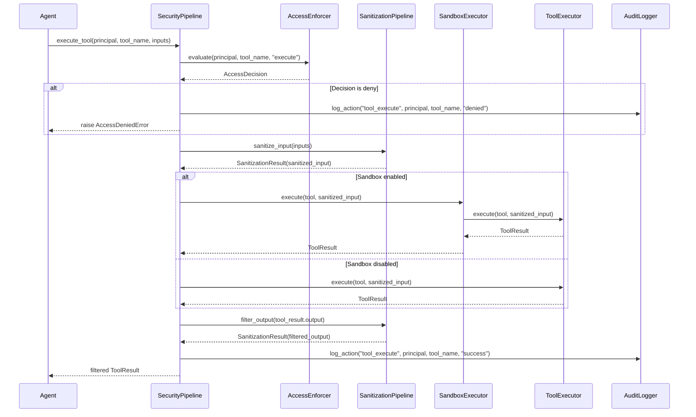
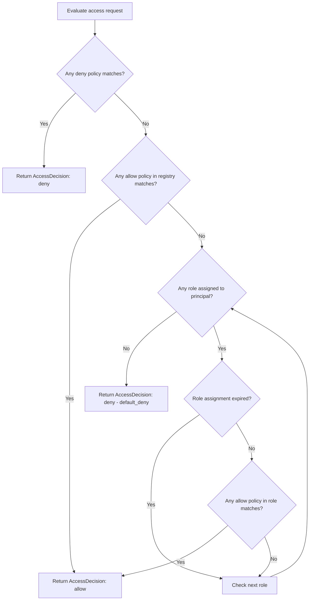
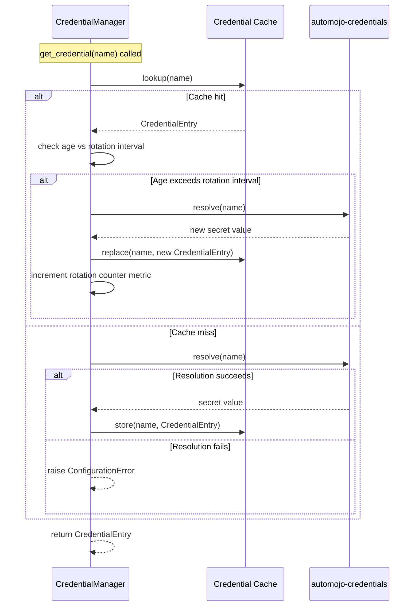

# Design Document — Security & Access Control

## Overview

The Security & Access Control feature extends the `automojo-agent-kit` SDK with a comprehensive system for securing agent operations. It provides six interconnected subsystems:

1. **Credential Management** — Secure retrieval, caching, rotation, and injection of secrets via `CredentialManager`, `CredentialEntry`, and `CredentialRotationPolicy`
2. **Access Control** — Role-based access control with deny-first evaluation via `AccessPolicy`, `AccessPolicyRegistry`, `AccessEnforcer`, `AccessDecision`, `Role`, and `RoleAssignment`
3. **Input Sanitization & Output Filtering** — Pluggable pipeline for preventing injection attacks and data leakage via `InputSanitizer`, `OutputFilter`, `SanitizationPipeline`, `SanitizationRule`, and `SanitizationResult`
4. **Audit Logging** — Tamper-evident, append-only action recording via `AuditLogger`, `AuditEntry`, `AuditStore`, `AuditQuery`, and `AuditQueryResult`
5. **Sandboxed Execution** — Isolated tool execution with resource restrictions via `SandboxExecutor`, `SandboxPolicy`, and `SandboxViolation`
6. **Security Pipeline** — Coordinating component that routes all security operations through the configured subsystems via `SecurityPipeline` and `SecurityConfiguration`

All classes live under `source/packages/automojo/agentkit/` with filenames in all-lowercase (no underscores), following the project naming conventions. The system integrates with:

- Core Agent Framework — `Agent` base class, `AgentConfiguration`, `LifecycleState`, `AgentStateMachine`
- Tool & Capability System — `ToolExecutor`, `ToolResult`, `ToolDescriptor` for sandboxed tool execution and access control
- LLM Integration — LLM requests subject to input sanitization and output filtering
- Memory & Context Management — Memory operations audited and access-controlled
- Communication & Messaging — Message exchanges audited and credential-secured
- Workflow & Orchestration — Workflow steps subject to access control and audit logging
- Observability & Debugging — `StructuredLogger`, `CorrelationContext`, `MetricsCollector`, `MetricDefinition`, `MetricsRegistry` for security metrics and tracing
- Error Handling & Resilience — `AuditLogger` used by resilience components
- `automojo-extension` — `ExtensionPoint` for security plugin discovery and registration
- `automojo-credentials` — `CredentialReference` for underlying credential storage and retrieval
- `automojo-dataprofiles` — `DataProfileReference` for data profile management
- `automojo-this-app` — `AppContext` for settings, environment, and directory resolution

The design prioritizes debuggability over performance and readability over conciseness, per the project coding standards.

## Architecture

```mermaid
graph TD
    subgraph "automojo.agentkit - Security & Access Control"
        SecurityPipeline[SecurityPipeline]
        SecurityConfiguration[SecurityConfiguration]

        CredentialManager[CredentialManager]
        CredentialEntry[CredentialEntry]
        CredentialRotationPolicy[CredentialRotationPolicy]

        AccessPolicy[AccessPolicy]
        AccessPolicyRegistry[AccessPolicyRegistry]
        AccessEnforcer[AccessEnforcer]
        AccessDecision[AccessDecision]
        Role[Role]
        RoleAssignment[RoleAssignment]

        InputSanitizer[InputSanitizer ABC]
        RegexDenySanitizer[RegexDenySanitizer]
        RegexAllowSanitizer[RegexAllowSanitizer]
        LengthLimitSanitizer[LengthLimitSanitizer]
        EncodingNormalizeSanitizer[EncodingNormalizeSanitizer]
        OutputFilter[OutputFilter ABC]
        CredentialRedactFilter[CredentialRedactFilter]
        PiiMaskFilter[PiiMaskFilter]
        RegexRedactFilter[RegexRedactFilter]
        SanitizationPipeline[SanitizationPipeline]
        SanitizationRule[SanitizationRule]
        SanitizationResult[SanitizationResult]

        AuditLogger[AuditLogger]
        AuditEntry[AuditEntry]
        AuditStore[AuditStore ABC]
        InMemoryAuditStore[InMemoryAuditStore]
        FileAuditStore[FileAuditStore]
        AuditQuery[AuditQuery]
        AuditQueryResult[AuditQueryResult]

        SandboxExecutor[SandboxExecutor]
        SandboxPolicy[SandboxPolicy]
        SandboxViolation[SandboxViolation]

        SecurityErrors[AccessDeniedError / SanitizationError / SandboxViolationError / AuditStoreError]
    end

    subgraph "Core Agent Framework"
        Agent[Agent base class]
        AgentConfiguration[AgentConfiguration]
        LifecycleState[LifecycleState]
        Errors[SemanticError / ConfigurationError / AgentKitError]
    end

    subgraph "Tool & Capability System"
        ToolExecutor[ToolExecutor]
        ToolResult[ToolResult]
        ToolDescriptor[ToolDescriptor]
    end

    subgraph "Observability & Debugging"
        StructuredLogger[StructuredLogger]
        CorrelationContext[CorrelationContext]
        MetricsCollector[MetricsCollector]
        MetricsRegistry[MetricsRegistry]
        MetricDefinition[MetricDefinition]
    end

    subgraph "External Packages"
        Extension[automojo-extension]
        Credentials[automojo-credentials]
        AppContext[automojo-this-app]
    end

    Agent --> SecurityPipeline
    SecurityPipeline --> SecurityConfiguration
    SecurityPipeline --> CredentialManager
    SecurityPipeline --> AccessEnforcer
    SecurityPipeline --> AccessPolicyRegistry
    SecurityPipeline --> SanitizationPipeline
    SecurityPipeline --> AuditLogger
    SecurityPipeline --> SandboxExecutor

    CredentialManager --> CredentialEntry
    CredentialManager --> CredentialRotationPolicy
    CredentialManager --> Credentials

    AccessEnforcer --> AccessPolicyRegistry
    AccessEnforcer --> AccessDecision
    AccessEnforcer --> Role
    AccessEnforcer --> RoleAssignment
    AccessPolicyRegistry --> AccessPolicy

    SanitizationPipeline --> InputSanitizer
    SanitizationPipeline --> OutputFilter
    SanitizationPipeline --> SanitizationResult
    InputSanitizer --> RegexDenySanitizer
    InputSanitizer --> RegexAllowSanitizer
    InputSanitizer --> LengthLimitSanitizer
    InputSanitizer --> EncodingNormalizeSanitizer
    OutputFilter --> CredentialRedactFilter
    OutputFilter --> PiiMaskFilter
    OutputFilter --> RegexRedactFilter

    AuditLogger --> AuditEntry
    AuditLogger --> AuditStore
    AuditStore --> InMemoryAuditStore
    AuditStore --> FileAuditStore
    AuditLogger --> StructuredLogger
    AuditLogger --> CorrelationContext

    SandboxExecutor --> SandboxPolicy
    SandboxExecutor --> SandboxViolation
    SandboxExecutor --> ToolExecutor

    SecurityPipeline --> MetricsCollector
    SecurityPipeline --> MetricsRegistry
    SecurityConfiguration --> AppContext
    SecurityConfiguration --> Credentials
    Agent --> Extension
```



### Security Pipeline Execution Flow — Tool Execution



### Access Enforcer Evaluation Flow



### Credential Rotation Flow



### Design Decisions

1. **SecurityPipeline as the single coordination point** — all security subsystems are accessed through the pipeline, providing a unified interface and ensuring consistent component lifecycle management. Consistent with the `ResiliencePipeline` and `ObservabilityPipeline` patterns.
2. **Deny-first access evaluation** — deny policies always take precedence over allow policies, and the default decision when no policy matches is deny. This follows the principle of least privilege.
3. **AccessPolicy wildcard matching with `*`** — uses `fnmatch`-style pattern matching for principal and resource patterns, providing flexible but predictable matching semantics.
4. **InputSanitizer and OutputFilter as abstract base classes using `abc.ABC`** — consistent with `Tool`, `DegradationStrategy`, `HealthCheck`, and other pluggable abstractions in the SDK. Allows external plugins to contribute custom sanitizers and filters.
5. **AuditStore as a pluggable abstraction with append-only semantics** — separates storage concerns from logging logic. Built-in implementations (in-memory, file-based) cover development and single-agent deployments; plugins can provide database-backed stores. Consistent with `DeadLetterStore` pattern.
6. **FileAuditStore uses JSON lines format** — each AuditEntry is serialized as a single JSON line, enabling simple append operations and line-by-line reading without file locking.
7. **AuditEntry integrity hash using SHA-256** — computed over all entry fields (excluding the hash itself) to provide tamper detection. The `verify_integrity` method recomputes and compares.
8. **SandboxExecutor wraps ToolExecutor** — intercepts tool execution to apply resource restrictions before delegating to the standard ToolExecutor. This preserves the existing tool execution interface.
9. **CredentialManager delegates to `automojo-credentials`** — adds caching, rotation lifecycle, and secret-safe serialization on top of the underlying credential storage. Never exposes secret values in `__repr__`, `__str__`, `as_dict`, or `to_json`.
10. **SecurityConfiguration supports JSON and YAML** — consistent with `AgentConfiguration`, `ResilienceConfiguration`, and `ObservabilityConfiguration` loading patterns. File paths resolved relative to `AppContext`.
11. **All serialization follows naming conventions: `as_dict`, `to_json`, `from_json`, `from_dict`** — consistent with all other agentkit classes.
12. **All `__repr__` and `__str__` methods follow the established pattern** — `__repr__` includes class name and key identifying fields, `__str__` returns a human-readable summary.
13. **Security-specific errors inherit from AgentKitError** — `AccessDeniedError`, `SanitizationError`, `SandboxViolationError`, and `AuditStoreError` all inherit from `AgentKitError`, consistent with the error hierarchy used by Core Agent Framework, Tool & Capability System, and Error Handling & Resilience.
14. **Extension points for security plugins** — three extension points (`automojo.agentkit.input_sanitizers`, `automojo.agentkit.output_filters`, `automojo.agentkit.audit_stores`) follow the same pattern as other agentkit extension points.
15. **Structured logging under `automojo.agentkit.security`** — uses Python standard logging module with a dedicated logger hierarchy, consistent with other subsystems using `automojo.agentkit.resilience`, etc.
16. **Built-in security metrics registered via MetricsRegistry** — six counter metrics for access decisions, sanitization, sandbox violations, credential rotations, and audit entries. Consistent with the observability integration pattern.

## Components and Interfaces

### File Layout

| File | Class(es) | Purpose |
|---|---|---|
| credentialentry.py | CredentialEntry | Immutable credential metadata without secret value |
| credentialrotationpolicy.py | CredentialRotationPolicy | Credential rotation configuration |
| credentialmanager.py | CredentialManager | Credential lifecycle management with caching and rotation |
| accesspolicy.py | AccessPolicy | Immutable access control rule with wildcard matching |
| accesspolicyregistry.py | AccessPolicyRegistry | Registry of access policies with file loading |
| accessdecision.py | AccessDecision | Immutable access evaluation result |
| role.py | Role | Named role with embedded access policies |
| roleassignment.py | RoleAssignment | Role-to-agent assignment with optional expiration |
| accessenforcer.py | AccessEnforcer | Deny-first access evaluation engine |
| sanitizationrule.py | SanitizationRule | Immutable sanitization/filtering rule descriptor |
| sanitizationresult.py | SanitizationResult | Immutable sanitization/filtering outcome |
| inputsanitizer.py | InputSanitizer | Abstract base class for input sanitizers |
| regexdenysanitizer.py | RegexDenySanitizer | Removes content matching deny pattern |
| regexallowsanitizer.py | RegexAllowSanitizer | Rejects content not matching allow pattern |
| lengthlimitsanitizer.py | LengthLimitSanitizer | Truncates content exceeding max length |
| encodingnormalizesanitizer.py | EncodingNormalizeSanitizer | Normalizes Unicode encoding form |
| outputfilter.py | OutputFilter | Abstract base class for output filters |
| credentialredactfilter.py | CredentialRedactFilter | Redacts credential-like patterns |
| piimaskfilter.py | PiiMaskFilter | Masks PII patterns (email, phone) |
| regexredactfilter.py | RegexRedactFilter | Redacts content matching regex pattern |
| sanitizationpipeline.py | SanitizationPipeline | Ordered chain of sanitizers and filters |
| auditentry.py | AuditEntry | Immutable audit record with integrity hash |
| auditquery.py | AuditQuery, AuditQueryResult | Query and result for audit search |
| auditstore.py | AuditStore | Abstract base class for audit persistence |
| inmemoryauditstore.py | InMemoryAuditStore | In-process list-based audit store |
| fileauditstore.py | FileAuditStore | JSON lines file-based audit store |
| auditlogger.py | AuditLogger | Audit recording with integrity hashing |
| sandboxpolicy.py | SandboxPolicy | Immutable sandbox restriction configuration |
| sandboxviolation.py | SandboxViolation | Immutable sandbox violation record |
| sandboxexecutor.py | SandboxExecutor | Isolated tool execution with resource limits |
| securityconfiguration.py | SecurityConfiguration | Declarative security settings with JSON/YAML |
| securitypipeline.py | SecurityPipeline | Unified security coordinator |
| securityerrors.py | AccessDeniedError, SanitizationError, SandboxViolationError, AuditStoreError | Security-specific exceptions |

### CredentialEntry

```python
import json
from datetime import datetime

class CredentialEntry:
    """
        Immutable object representing credential metadata without exposing
        the secret value. Contains the credential name, type, creation
        timestamp, optional expiration timestamp, and metadata dictionary.
    """

    VALID_TYPES = ("api_key", "password", "token", "certificate", "secret")

    def __init__(self, name: str, credential_type: str, created_at: datetime,
                 expires_at: datetime = None, metadata: dict = None):
        if credential_type not in self.VALID_TYPES:
            # SemanticError for invalid credential type
            ...
        self._name = name
        self._credential_type = credential_type
        self._created_at = created_at
        self._expires_at = expires_at
        self._metadata = dict(metadata) if metadata is not None else {}
        return

    @property
    def name(self) -> str: ...
    @property
    def credential_type(self) -> str: ...
    @property
    def created_at(self) -> datetime: ...
    @property
    def expires_at(self) -> datetime: ...
    @property
    def metadata(self) -> dict: ...

    def is_expired(self, reference_time: datetime = None) -> bool:
        """
            Returns True when the expiration timestamp is set and the
            reference timestamp exceeds the expiration timestamp.
            Defaults to current UTC time when no reference timestamp
            is provided.

            :param reference_time: Optional reference timestamp.

            :returns: Boolean indicating expiration status.
        """
        ...

    def as_dict(self) -> dict:
        """
            Returns a dictionary representation of the entry fields.
            Does NOT include the credential secret value.

            :returns: A dictionary of entry fields.
        """
        ...

    def to_json(self) -> str:
        """
            Returns a JSON string representation of the entry fields.

            :returns: A JSON string.
        """
        ...

    @classmethod
    def from_dict(cls, data: dict) -> "CredentialEntry":
        """
            Constructs a CredentialEntry from a dictionary.

            :param data: Dictionary containing entry fields.

            :returns: A CredentialEntry instance.
        """
        ...

    @classmethod
    def from_json(cls, json_str: str) -> "CredentialEntry":
        """
            Deserializes a JSON string into a CredentialEntry instance.

            :param json_str: JSON string to deserialize.

            :returns: A CredentialEntry instance.
        """
        ...

    def __repr__(self) -> str: ...
    def __str__(self) -> str: ...
```

### CredentialRotationPolicy

```python
class CredentialRotationPolicy:
    """
        Configuration object defining how and when credentials are rotated.
        Contains the rotation interval in seconds, automatic rotation flag,
        and an optional rotation callback. The callback is excluded from
        serialization.
    """

    def __init__(self, rotation_interval: float, automatic_rotation: bool = False,
                 rotation_callback=None):
        self._rotation_interval = rotation_interval
        self._automatic_rotation = automatic_rotation
        self._rotation_callback = rotation_callback
        return

    @property
    def rotation_interval(self) -> float: ...
    @property
    def automatic_rotation(self) -> bool: ...
    @property
    def rotation_callback(self): ...

    def as_dict(self) -> dict:
        """
            Returns a dictionary representation excluding the rotation callback.

            :returns: A dictionary of policy fields.
        """
        ...

    def to_json(self) -> str:
        """
            Returns a JSON string representation excluding the rotation callback.

            :returns: A JSON string.
        """
        ...

    @classmethod
    def from_dict(cls, data: dict) -> "CredentialRotationPolicy":
        """
            Constructs a CredentialRotationPolicy from a dictionary.
            Automatic rotation defaults to False when not specified.

            :param data: Dictionary containing policy fields.

            :returns: A CredentialRotationPolicy instance.
        """
        ...

    def __repr__(self) -> str: ...
    def __str__(self) -> str: ...
```

### CredentialManager

```python
import logging

class CredentialManager:
    """
        Manages the lifecycle of credentials for an Agent. Provides secure
        retrieval, caching, rotation, and injection of secrets. Delegates
        storage and retrieval to automojo-credentials and adds lifecycle
        management on top. Never exposes secret values in serialization
        or string representations.
    """

    def __init__(self, agent_identifier: str,
                 rotation_policy: "CredentialRotationPolicy" = None):
        self._agent_identifier = agent_identifier
        self._rotation_policy = rotation_policy
        self._cache = {}  # name -> (CredentialEntry, resolved_time)
        self._logger = logging.getLogger("automojo.agentkit.security")
        return

    @property
    def agent_identifier(self) -> str: ...

    @property
    def cached_count(self) -> int:
        """
            Returns the count of currently cached credentials.

            :returns: Integer count.
        """
        ...

    def get_credential(self, name: str) -> "CredentialEntry":
        """
            Returns a CredentialEntry for the given name. Resolves through
            automojo-credentials on first access and caches the result.
            Applies rotation if the rotation policy is configured and the
            credential age exceeds the rotation interval.

            :param name: Credential name string.

            :returns: A CredentialEntry instance.
            :raises: ConfigurationError when the credential cannot be resolved.
        """
        ...

    def get_credential_value(self, name: str) -> str:
        """
            Returns the secret value for the given credential name.
            Resolves through automojo-credentials.

            :param name: Credential name string.

            :returns: The secret value as a string.
            :raises: ConfigurationError when the credential cannot be resolved.
        """
        ...

    def invalidate(self, name: str) -> None:
        """
            Removes the cached CredentialEntry for the given name,
            forcing re-resolution on the next access.

            :param name: Credential name string.
        """
        ...

    def invalidate_all(self) -> None:
        """
            Removes all cached CredentialEntry objects.
        """
        ...

    def list_credential_names(self) -> list:
        """
            Returns the list of cached credential name strings without
            exposing secret values.

            :returns: List of credential name strings.
        """
        ...

    def __repr__(self) -> str: ...
    def __str__(self) -> str: ...
```

### AccessPolicy

```python
import fnmatch

class AccessPolicy:
    """
        Immutable access control rule containing a policy name, principal
        pattern, resource pattern, list of permitted actions, and an effect
        (allow or deny). Supports wildcard matching using fnmatch for
        principal and resource patterns.
    """

    VALID_EFFECTS = ("allow", "deny")

    def __init__(self, name: str, principal_pattern: str, resource_pattern: str,
                 actions: list, effect: str):
        if effect not in self.VALID_EFFECTS:
            # SemanticError for invalid effect
            ...
        if not actions:
            # SemanticError for empty actions list
            ...
        self._name = name
        self._principal_pattern = principal_pattern
        self._resource_pattern = resource_pattern
        self._actions = list(actions)
        self._effect = effect
        return

    @property
    def name(self) -> str: ...
    @property
    def principal_pattern(self) -> str: ...
    @property
    def resource_pattern(self) -> str: ...
    @property
    def actions(self) -> list: ...
    @property
    def effect(self) -> str: ...

    def matches(self, principal: str, resource: str, action: str) -> bool:
        """
            Returns True when the principal matches the principal pattern,
            the resource matches the resource pattern, and the action is
            in the permitted actions list. Uses fnmatch for pattern matching.

            :param principal: Principal string to match.
            :param resource: Resource string to match.
            :param action: Action string to match.

            :returns: Boolean indicating match.
        """
        ...

    def as_dict(self) -> dict: ...
    def to_json(self) -> str: ...

    @classmethod
    def from_dict(cls, data: dict) -> "AccessPolicy": ...

    @classmethod
    def from_json(cls, json_str: str) -> "AccessPolicy": ...

    def __repr__(self) -> str: ...
    def __str__(self) -> str: ...
```

### AccessPolicyRegistry

```python
import json
import yaml

class AccessPolicyRegistry:
    """
        Registry tracking all AccessPolicy instances. Provides registration,
        deregistration, lookup by name, enumeration, and loading from
        JSON or YAML configuration files.
    """

    def __init__(self):
        self._policies = {}  # name -> AccessPolicy
        return

    def register(self, policy: "AccessPolicy") -> None:
        """
            Registers an AccessPolicy using the policy name as the key.

            :param policy: The AccessPolicy to register.

            :raises: SemanticError when a policy with the same name exists.
        """
        ...

    def deregister(self, name: str) -> None: ...

    def lookup(self, name: str) -> "AccessPolicy":
        """
            Returns the AccessPolicy with the given name, or None when
            the name is not found.

            :param name: Policy name string.

            :returns: AccessPolicy instance or None.
        """
        ...

    def list_all(self) -> list:
        """
            Returns a list of all registered AccessPolicy instances.

            :returns: List of AccessPolicy objects.
        """
        ...

    @property
    def count(self) -> int: ...

    def has_policy(self, name: str) -> bool: ...

    def load_from_json_file(self, file_path: str, app_context=None) -> None:
        """
            Loads AccessPolicy definitions from a JSON file. Resolves
            the file path relative to the AppContext directory.

            :param file_path: Path to the JSON file.
            :param app_context: Optional AppContext for path resolution.
        """
        ...

    def load_from_yaml_file(self, file_path: str, app_context=None) -> None:
        """
            Loads AccessPolicy definitions from a YAML file. Resolves
            the file path relative to the AppContext directory.

            :param file_path: Path to the YAML file.
            :param app_context: Optional AppContext for path resolution.
        """
        ...

    def __repr__(self) -> str: ...
    def __str__(self) -> str: ...
```

### AccessDecision

```python
class AccessDecision:
    """
        Immutable object representing the result of an access control
        evaluation. Contains the decision, matching policy name, principal,
        resource, action, and timestamp.
    """

    VALID_DECISIONS = ("allow", "deny")

    def __init__(self, decision: str, policy_name: str, principal: str,
                 resource: str, action: str, timestamp: datetime = None):
        self._decision = decision
        self._policy_name = policy_name
        self._principal = principal
        self._resource = resource
        self._action = action
        self._timestamp = timestamp if timestamp is not None else datetime.utcnow()
        return

    @property
    def decision(self) -> str: ...
    @property
    def policy_name(self) -> str: ...
    @property
    def principal(self) -> str: ...
    @property
    def resource(self) -> str: ...
    @property
    def action(self) -> str: ...
    @property
    def timestamp(self) -> datetime: ...

    @property
    def is_allowed(self) -> bool:
        """
            Returns True when the decision is "allow".

            :returns: Boolean indicating allow status.
        """
        ...

    def as_dict(self) -> dict: ...
    def to_json(self) -> str: ...

    @classmethod
    def from_dict(cls, data: dict) -> "AccessDecision": ...

    @classmethod
    def from_json(cls, json_str: str) -> "AccessDecision": ...

    def __repr__(self) -> str: ...
    def __str__(self) -> str: ...
```

### Role

```python
class Role:
    """
        Immutable object representing a named role with a description and
        a list of AccessPolicy objects that define the permissions granted
        by the role.
    """

    def __init__(self, name: str, description: str, policies: list):
        self._name = name
        self._description = description
        self._policies = list(policies)
        return

    @property
    def name(self) -> str: ...
    @property
    def description(self) -> str: ...
    @property
    def policies(self) -> list: ...

    def as_dict(self) -> dict: ...
    def to_json(self) -> str: ...

    @classmethod
    def from_dict(cls, data: dict) -> "Role": ...

    @classmethod
    def from_json(cls, json_str: str) -> "Role": ...

    def __repr__(self) -> str: ...
    def __str__(self) -> str: ...
```

### RoleAssignment

```python
class RoleAssignment:
    """
        Immutable object representing the assignment of a Role to an agent
        identifier, with an optional expiration timestamp.
    """

    def __init__(self, agent_identifier: str, role_name: str,
                 expires_at: datetime = None):
        self._agent_identifier = agent_identifier
        self._role_name = role_name
        self._expires_at = expires_at
        return

    @property
    def agent_identifier(self) -> str: ...
    @property
    def role_name(self) -> str: ...
    @property
    def expires_at(self) -> datetime: ...

    def is_expired(self, reference_time: datetime = None) -> bool:
        """
            Returns True when the expiration timestamp is set and the
            reference timestamp exceeds the expiration timestamp.
            Defaults to current UTC time when no reference timestamp
            is provided.

            :param reference_time: Optional reference timestamp.

            :returns: Boolean indicating expiration status.
        """
        ...

    def as_dict(self) -> dict: ...
    def to_json(self) -> str: ...

    @classmethod
    def from_dict(cls, data: dict) -> "RoleAssignment": ...

    def __repr__(self) -> str: ...
    def __str__(self) -> str: ...
```

### AccessEnforcer

```python
import logging

class AccessEnforcer:
    """
        Evaluates access requests against the AccessPolicyRegistry and
        registered roles. Applies deny-first evaluation: deny policies
        take precedence over allow policies, and the default decision
        when no policy matches is deny.
    """

    def __init__(self, policy_registry: "AccessPolicyRegistry"):
        self._policy_registry = policy_registry
        self._roles = {}  # role_name -> Role
        self._role_assignments = []  # list of RoleAssignment
        self._logger = logging.getLogger("automojo.agentkit.security")
        return

    @property
    def policy_registry(self) -> "AccessPolicyRegistry": ...

    def register_role(self, role: "Role") -> None:
        """
            Registers a Role for role-based evaluation.

            :param role: The Role to register.
        """
        ...

    def assign_role(self, assignment: "RoleAssignment") -> None:
        """
            Associates a role with the specified agent identifier.

            :param assignment: The RoleAssignment to add.
        """
        ...

    def revoke_role(self, agent_identifier: str, role_name: str) -> None:
        """
            Removes the role assignment for the given agent and role.

            :param agent_identifier: Agent identifier string.
            :param role_name: Role name string.
        """
        ...

    def evaluate(self, principal: str, resource: str, action: str) -> "AccessDecision":
        """
            Evaluates an access request. Checks deny policies first,
            then allow policies from the registry, then allow policies
            from roles assigned to the principal. Returns deny by default
            when no policy matches. Skips expired role assignments.

            :param principal: Principal string (agent identifier or role).
            :param resource: Resource string (tool name, memory store, etc.).
            :param action: Action string (execute, read, write, delete).

            :returns: An AccessDecision instance.
        """
        ...

    def list_roles(self) -> list:
        """
            Returns the list of registered Role objects.

            :returns: List of Role objects.
        """
        ...

    def list_role_assignments(self, agent_identifier: str = None) -> list:
        """
            Returns the list of RoleAssignment objects, optionally filtered
            by agent identifier.

            :param agent_identifier: Optional agent identifier to filter by.

            :returns: List of RoleAssignment objects.
        """
        ...

    def __repr__(self) -> str: ...
    def __str__(self) -> str: ...
```

### InputSanitizer

```python
import abc

class InputSanitizer(abc.ABC):
    """
        Abstract base class for sanitizing input data before it is passed
        to tools, LLM providers, or other components. Concrete implementations
        handle specific sanitization strategies.
    """

    def __init__(self, sanitizer_name: str):
        self._sanitizer_name = sanitizer_name
        return

    @property
    def sanitizer_name(self) -> str: ...

    @abc.abstractmethod
    def sanitize(self, input_value: str) -> "SanitizationResult":
        """
            Sanitizes the input string and returns a SanitizationResult.

            :param input_value: The input string to sanitize.

            :returns: A SanitizationResult instance.
            :raises: SanitizationError when a violation cannot be resolved.
        """
        ...

    def __repr__(self) -> str: ...
    def __str__(self) -> str: ...
```

### RegexDenySanitizer

```python
import re

class RegexDenySanitizer(InputSanitizer):
    """
        Removes input content matching a provided regular expression
        deny pattern.
    """

    def __init__(self, sanitizer_name: str, deny_pattern: str):
        super().__init__(sanitizer_name)
        self._deny_pattern = re.compile(deny_pattern)
        return

    def sanitize(self, input_value: str) -> "SanitizationResult":
        """
            Removes content matching the deny pattern from the input.
            Includes the rule name in the applied rules list when
            content is removed.

            :param input_value: The input string to sanitize.

            :returns: A SanitizationResult instance.
        """
        ...
```

### RegexAllowSanitizer

```python
class RegexAllowSanitizer(InputSanitizer):
    """
        Rejects input content that does not match a provided regular
        expression allowlist pattern.
    """

    def __init__(self, sanitizer_name: str, allow_pattern: str):
        super().__init__(sanitizer_name)
        self._allow_pattern = re.compile(allow_pattern)
        return

    def sanitize(self, input_value: str) -> "SanitizationResult":
        """
            Raises SanitizationError when the input does not match
            the allow pattern.

            :param input_value: The input string to sanitize.

            :returns: A SanitizationResult instance.
            :raises: SanitizationError when input does not match.
        """
        ...
```

### LengthLimitSanitizer

```python
class LengthLimitSanitizer(InputSanitizer):
    """
        Truncates input content exceeding a configured maximum length.
    """

    def __init__(self, sanitizer_name: str, max_length: int):
        super().__init__(sanitizer_name)
        self._max_length = max_length
        return

    def sanitize(self, input_value: str) -> "SanitizationResult": ...
```

### EncodingNormalizeSanitizer

```python
import unicodedata

class EncodingNormalizeSanitizer(InputSanitizer):
    """
        Normalizes input content to a specified Unicode normalization
        form (NFC, NFD, NFKC, NFKD).
    """

    VALID_FORMS = ("NFC", "NFD", "NFKC", "NFKD")

    def __init__(self, sanitizer_name: str, normalization_form: str):
        super().__init__(sanitizer_name)
        if normalization_form not in self.VALID_FORMS:
            # SemanticError for invalid form
            ...
        self._normalization_form = normalization_form
        return

    def sanitize(self, input_value: str) -> "SanitizationResult": ...
```

### OutputFilter

```python
import abc

class OutputFilter(abc.ABC):
    """
        Abstract base class for filtering output data before it is returned
        from tools, LLM providers, or other components. Concrete implementations
        handle specific filtering strategies.
    """

    def __init__(self, filter_name: str):
        self._filter_name = filter_name
        return

    @property
    def filter_name(self) -> str: ...

    @abc.abstractmethod
    def filter(self, output_value: str) -> "SanitizationResult":
        """
            Filters the output string and returns a SanitizationResult.

            :param output_value: The output string to filter.

            :returns: A SanitizationResult instance.
        """
        ...

    def __repr__(self) -> str: ...
    def __str__(self) -> str: ...
```

### CredentialRedactFilter

```python
class CredentialRedactFilter(OutputFilter):
    """
        Detects and replaces credential-like patterns (API keys, tokens,
        passwords) in output with a configurable redaction placeholder.
    """

    DEFAULT_PLACEHOLDER = "[REDACTED]"

    def __init__(self, filter_name: str, placeholder: str = None):
        super().__init__(filter_name)
        self._placeholder = placeholder if placeholder is not None else self.DEFAULT_PLACEHOLDER
        return

    def filter(self, output_value: str) -> "SanitizationResult": ...
```

### PiiMaskFilter

```python
class PiiMaskFilter(OutputFilter):
    """
        Detects and masks personally identifiable information patterns
        (email addresses, phone numbers) in output with a configurable
        mask placeholder.
    """

    DEFAULT_PLACEHOLDER = "[MASKED]"

    def __init__(self, filter_name: str, placeholder: str = None):
        super().__init__(filter_name)
        self._placeholder = placeholder if placeholder is not None else self.DEFAULT_PLACEHOLDER
        return

    def filter(self, output_value: str) -> "SanitizationResult": ...
```

### RegexRedactFilter

```python
class RegexRedactFilter(OutputFilter):
    """
        Redacts output content matching a provided regular expression
        pattern with a configurable replacement string.
    """

    def __init__(self, filter_name: str, redact_pattern: str,
                 replacement: str = "[REDACTED]"):
        super().__init__(filter_name)
        self._redact_pattern = re.compile(redact_pattern)
        self._replacement = replacement
        return

    def filter(self, output_value: str) -> "SanitizationResult": ...
```

### SanitizationRule

```python
class SanitizationRule:
    """
        Immutable object representing a single sanitization or filtering rule.
        Contains a rule name, rule type, pattern or configuration string,
        and a description.
    """

    VALID_TYPES = ("regex_deny", "regex_allow", "encoding_normalize",
                   "length_limit", "credential_redact", "pii_mask")

    def __init__(self, name: str, rule_type: str, pattern: str,
                 description: str):
        if rule_type not in self.VALID_TYPES:
            # SemanticError for invalid rule type
            ...
        self._name = name
        self._rule_type = rule_type
        self._pattern = pattern
        self._description = description
        return

    @property
    def name(self) -> str: ...
    @property
    def rule_type(self) -> str: ...
    @property
    def pattern(self) -> str: ...
    @property
    def description(self) -> str: ...

    def as_dict(self) -> dict: ...
    def to_json(self) -> str: ...

    @classmethod
    def from_dict(cls, data: dict) -> "SanitizationRule": ...

    @classmethod
    def from_json(cls, json_str: str) -> "SanitizationRule": ...

    def __repr__(self) -> str: ...
    def __str__(self) -> str: ...
```

### SanitizationResult

```python
class SanitizationResult:
    """
        Immutable object representing the outcome of a sanitization or
        filtering operation. Contains the original value, sanitized value,
        modified flag, and list of applied rule names.
    """

    def __init__(self, original_value: str, sanitized_value: str,
                 modified: bool, applied_rules: list = None):
        self._original_value = original_value
        self._sanitized_value = sanitized_value
        self._modified = modified
        self._applied_rules = list(applied_rules) if applied_rules is not None else []
        return

    @property
    def original_value(self) -> str: ...
    @property
    def sanitized_value(self) -> str: ...
    @property
    def modified(self) -> bool: ...
    @property
    def applied_rules(self) -> list: ...

    def as_dict(self) -> dict: ...

    def __repr__(self) -> str: ...
    def __str__(self) -> str: ...
```

### SanitizationPipeline

```python
class SanitizationPipeline:
    """
        Chains multiple InputSanitizer and OutputFilter instances into
        an ordered processing pipeline. Applies each sanitizer or filter
        in sequence to input or output data.
    """

    def __init__(self):
        self._input_sanitizers = []
        self._output_filters = []
        return

    def add_input_sanitizer(self, sanitizer: "InputSanitizer") -> None: ...
    def add_output_filter(self, output_filter: "OutputFilter") -> None: ...

    def sanitize_input(self, input_value: str) -> "SanitizationResult":
        """
            Applies all registered InputSanitizer instances in order.
            Returns a SanitizationResult with the final sanitized value
            and the combined list of applied rule names. Propagates
            SanitizationError without invoking subsequent sanitizers.

            :param input_value: The input string to sanitize.

            :returns: A SanitizationResult instance.
            :raises: SanitizationError from any sanitizer in the chain.
        """
        ...

    def filter_output(self, output_value: str) -> "SanitizationResult":
        """
            Applies all registered OutputFilter instances in order.
            Returns a SanitizationResult with the final filtered value
            and the combined list of applied rule names.

            :param output_value: The output string to filter.

            :returns: A SanitizationResult instance.
        """
        ...

    @property
    def input_sanitizer_count(self) -> int: ...

    @property
    def output_filter_count(self) -> int: ...

    def __repr__(self) -> str: ...
    def __str__(self) -> str: ...
```

### AuditEntry

```python
import hashlib
import uuid

class AuditEntry:
    """
        Immutable object representing a single audited action. Contains
        a unique identifier, timestamp, agent identifier, correlation
        identifier, action type, principal, resource, outcome, detail
        dictionary, and an integrity hash for tamper detection.
    """

    VALID_OUTCOMES = ("success", "failure", "denied")

    def __init__(self, identifier: str, timestamp: datetime,
                 agent_identifier: str, correlation_id: str,
                 action_type: str, principal: str, resource: str,
                 outcome: str, detail: dict = None,
                 integrity_hash: str = None):
        if outcome not in self.VALID_OUTCOMES:
            # SemanticError for invalid outcome
            ...
        self._identifier = identifier
        self._timestamp = timestamp
        self._agent_identifier = agent_identifier
        self._correlation_id = correlation_id
        self._action_type = action_type
        self._principal = principal
        self._resource = resource
        self._outcome = outcome
        self._detail = dict(detail) if detail is not None else {}
        self._integrity_hash = integrity_hash if integrity_hash is not None else self._compute_hash()
        return

    @property
    def identifier(self) -> str: ...
    @property
    def timestamp(self) -> datetime: ...
    @property
    def agent_identifier(self) -> str: ...
    @property
    def correlation_id(self) -> str: ...
    @property
    def action_type(self) -> str: ...
    @property
    def principal(self) -> str: ...
    @property
    def resource(self) -> str: ...
    @property
    def outcome(self) -> str: ...
    @property
    def detail(self) -> dict: ...
    @property
    def integrity_hash(self) -> str: ...

    def _compute_hash(self) -> str:
        """
            Computes a SHA-256 hash over the entry fields (excluding the
            integrity hash itself) for tamper detection.

            :returns: Hex-encoded SHA-256 hash string.
        """
        hash_input = json.dumps({
            "identifier": self._identifier,
            "timestamp": self._timestamp.isoformat(),
            "agent_identifier": self._agent_identifier,
            "correlation_id": self._correlation_id,
            "action_type": self._action_type,
            "principal": self._principal,
            "resource": self._resource,
            "outcome": self._outcome,
            "detail": self._detail,
        }, sort_keys=True)
        return hashlib.sha256(hash_input.encode("utf-8")).hexdigest()

    def verify_integrity(self) -> bool:
        """
            Recomputes the integrity hash from the entry fields and returns
            True when the recomputed hash matches the stored integrity hash.

            :returns: Boolean indicating integrity verification result.
        """
        ...

    def as_dict(self) -> dict: ...
    def to_json(self) -> str: ...

    @classmethod
    def from_dict(cls, data: dict) -> "AuditEntry": ...

    @classmethod
    def from_json(cls, json_str: str) -> "AuditEntry": ...

    def __repr__(self) -> str: ...
    def __str__(self) -> str: ...
```

### AuditQuery and AuditQueryResult

```python
class AuditQuery:
    """
        Immutable object representing a search request against an AuditStore.
        Contains optional filter criteria for agent identifier, action type,
        principal, resource, outcome, time range, and max results.
    """

    def __init__(self, agent_identifier: str = None, action_type: str = None,
                 principal: str = None, resource: str = None,
                 outcome: str = None, start_time: datetime = None,
                 end_time: datetime = None, max_results: int = None):
        self._agent_identifier = agent_identifier
        self._action_type = action_type
        self._principal = principal
        self._resource = resource
        self._outcome = outcome
        self._start_time = start_time
        self._end_time = end_time
        self._max_results = max_results
        return

    @property
    def agent_identifier(self) -> str: ...
    @property
    def action_type(self) -> str: ...
    @property
    def principal(self) -> str: ...
    @property
    def resource(self) -> str: ...
    @property
    def outcome(self) -> str: ...
    @property
    def start_time(self) -> datetime: ...
    @property
    def end_time(self) -> datetime: ...
    @property
    def max_results(self) -> int: ...

    def as_dict(self) -> dict: ...

    def __repr__(self) -> str: ...
    def __str__(self) -> str: ...


class AuditQueryResult:
    """
        Immutable object encapsulating the result of an AuditQuery.
        Contains the list of matching AuditEntry objects and the total
        count of matches.
    """

    def __init__(self, entries: list, total_count: int):
        self._entries = list(entries)
        self._total_count = total_count
        return

    @property
    def entries(self) -> list: ...
    @property
    def total_count(self) -> int: ...

    def as_dict(self) -> dict: ...

    def __repr__(self) -> str: ...
    def __str__(self) -> str: ...
```

### AuditStore

```python
import abc

class AuditStore(abc.ABC):
    """
        Abstract base class for persisting AuditEntry objects. Enforces
        append-only semantics — no update or delete methods. Concrete
        implementations handle specific storage backends.
    """

    def __init__(self, store_name: str):
        self._store_name = store_name
        return

    @property
    def store_name(self) -> str: ...

    @abc.abstractmethod
    def append(self, entry: "AuditEntry") -> None:
        """
            Appends an AuditEntry to the store.

            :param entry: The AuditEntry to persist.

            :raises: AuditStoreError on backend failure.
        """
        ...

    @abc.abstractmethod
    def retrieve(self, identifier: str) -> "AuditEntry":
        """
            Retrieves an AuditEntry by identifier. Returns None when
            the identifier is not found.

            :param identifier: The entry identifier string.

            :returns: AuditEntry instance or None.
        """
        ...

    @abc.abstractmethod
    def search(self, query: "AuditQuery") -> "AuditQueryResult":
        """
            Executes an AuditQuery and returns matching entries.

            :param query: The AuditQuery to execute.

            :returns: An AuditQueryResult instance.
        """
        ...

    @abc.abstractmethod
    def count(self) -> int:
        """
            Returns the total number of entries in the store.

            :returns: Integer count.
        """
        ...

    def __repr__(self) -> str: ...
    def __str__(self) -> str: ...
```

### InMemoryAuditStore

```python
class InMemoryAuditStore(AuditStore):
    """
        Stores AuditEntry objects in process memory using list-based storage.
        Suitable for development and testing.
    """

    def __init__(self, store_name: str = "in_memory"):
        super().__init__(store_name)
        self._entries = []
        return

    def append(self, entry: "AuditEntry") -> None: ...
    def retrieve(self, identifier: str) -> "AuditEntry": ...
    def search(self, query: "AuditQuery") -> "AuditQueryResult": ...
    def count(self) -> int: ...
```

### FileAuditStore

```python
class FileAuditStore(AuditStore):
    """
        Persists AuditEntry objects as JSON lines to a specified file path.
        Resolves the file path relative to the AppContext directory.
        Each entry is serialized as a single JSON line for simple append
        operations.
    """

    def __init__(self, store_name: str, file_path: str, app_context=None):
        super().__init__(store_name)
        self._file_path = file_path  # resolved relative to AppContext
        self._app_context = app_context
        return

    def append(self, entry: "AuditEntry") -> None:
        """
            Appends the AuditEntry as a JSON line to the file.

            :param entry: The AuditEntry to persist.

            :raises: AuditStoreError on I/O failure.
        """
        ...

    def retrieve(self, identifier: str) -> "AuditEntry": ...
    def search(self, query: "AuditQuery") -> "AuditQueryResult": ...
    def count(self) -> int: ...
```

### AuditLogger

```python
import logging

class AuditLogger:
    """
        Records all agent actions as AuditEntry objects in an ordered,
        append-only log. Generates unique identifiers, timestamps, and
        integrity hashes for each entry. Integrates with the StructuredLogger
        for structured log output.
    """

    def __init__(self, agent_identifier: str, audit_store: "AuditStore"):
        self._agent_identifier = agent_identifier
        self._audit_store = audit_store
        self._entry_count = 0
        self._logger = logging.getLogger("automojo.agentkit.security")
        return

    @property
    def agent_identifier(self) -> str: ...

    @property
    def entry_count(self) -> int: ...

    def log_action(self, action_type: str, principal: str, resource: str,
                   outcome: str, correlation_id: str,
                   detail: dict = None) -> "AuditEntry":
        """
            Creates and persists an AuditEntry. Generates a unique identifier,
            sets the timestamp to current UTC time, and computes the integrity
            hash using SHA-256. Logs the entry at INFO level via the
            StructuredLogger.

            :param action_type: Action type string.
            :param principal: Principal string.
            :param resource: Resource string.
            :param outcome: Outcome string (success, failure, denied).
            :param correlation_id: Correlation identifier string.
            :param detail: Optional detail dictionary.

            :returns: The created AuditEntry instance.
        """
        ...

    def query(self, audit_query: "AuditQuery") -> "AuditQueryResult":
        """
            Executes an AuditQuery against the AuditStore.

            :param audit_query: The AuditQuery to execute.

            :returns: An AuditQueryResult instance.
        """
        ...

    def __repr__(self) -> str: ...
    def __str__(self) -> str: ...
```

### SandboxPolicy

```python
import os

class SandboxPolicy:
    """
        Immutable configuration object defining the restrictions applied
        by the SandboxExecutor. Contains allowed file system paths, allowed
        network hosts, maximum execution time, maximum memory usage, and
        allowed environment variables.
    """

    def __init__(self, allowed_paths: list = None, allowed_hosts: list = None,
                 max_execution_time: float = 30.0,
                 max_memory_bytes: int = 256 * 1024 * 1024,
                 allowed_env_vars: list = None):
        self._allowed_paths = list(allowed_paths) if allowed_paths is not None else []
        self._allowed_hosts = list(allowed_hosts) if allowed_hosts is not None else []
        self._max_execution_time = max_execution_time
        self._max_memory_bytes = max_memory_bytes
        self._allowed_env_vars = list(allowed_env_vars) if allowed_env_vars is not None else []
        return

    @property
    def allowed_paths(self) -> list: ...
    @property
    def allowed_hosts(self) -> list: ...
    @property
    def max_execution_time(self) -> float: ...
    @property
    def max_memory_bytes(self) -> int: ...
    @property
    def allowed_env_vars(self) -> list: ...

    def is_path_allowed(self, file_path: str) -> bool:
        """
            Returns True when the file path falls within any of the
            allowed file system paths. Uses os.path normalization for
            path comparison.

            :param file_path: File path string to check.

            :returns: Boolean indicating path allowance.
        """
        ...

    def is_host_allowed(self, host: str) -> bool:
        """
            Returns True when the host matches any of the allowed
            network hosts.

            :param host: Host string to check.

            :returns: Boolean indicating host allowance.
        """
        ...

    def is_env_allowed(self, env_var: str) -> bool:
        """
            Returns True when the environment variable name is in
            the allowed environment variables list.

            :param env_var: Environment variable name string.

            :returns: Boolean indicating env var allowance.
        """
        ...

    def as_dict(self) -> dict: ...
    def to_json(self) -> str: ...

    @classmethod
    def from_dict(cls, data: dict) -> "SandboxPolicy": ...

    @classmethod
    def from_json(cls, json_str: str) -> "SandboxPolicy": ...

    def __repr__(self) -> str: ...
    def __str__(self) -> str: ...
```

### SandboxViolation

```python
class SandboxViolation:
    """
        Immutable object representing a security violation detected during
        sandboxed execution. Contains the violation type, violating resource
        identifier, and a description.
    """

    VALID_TYPES = ("file_access", "network_access", "timeout",
                   "memory_limit", "environment_access")

    def __init__(self, violation_type: str, resource: str, description: str):
        if violation_type not in self.VALID_TYPES:
            # SemanticError for invalid violation type
            ...
        self._violation_type = violation_type
        self._resource = resource
        self._description = description
        return

    @property
    def violation_type(self) -> str: ...
    @property
    def resource(self) -> str: ...
    @property
    def description(self) -> str: ...

    def as_dict(self) -> dict: ...
    def to_json(self) -> str: ...

    @classmethod
    def from_dict(cls, data: dict) -> "SandboxViolation": ...

    @classmethod
    def from_json(cls, json_str: str) -> "SandboxViolation": ...

    def __repr__(self) -> str: ...
    def __str__(self) -> str: ...
```

### SandboxExecutor

```python
import logging

class SandboxExecutor:
    """
        Executes tools in an isolated environment with restricted access
        to system resources. Wraps the ToolExecutor and applies resource
        limits, file system restrictions, and network restrictions defined
        by the SandboxPolicy.
    """

    def __init__(self, sandbox_policy: "SandboxPolicy"):
        self._sandbox_policy = sandbox_policy
        self._logger = logging.getLogger("automojo.agentkit.security")
        return

    @property
    def sandbox_policy(self) -> "SandboxPolicy": ...

    def execute(self, tool_executor, tool, inputs: dict) -> "ToolResult":
        """
            Validates the tool's resource access against the SandboxPolicy
            before invoking the ToolExecutor. Enforces file system, network,
            execution time, memory, and environment variable restrictions.
            Creates a SandboxViolation and raises SandboxViolationError
            on any violation.

            :param tool_executor: The ToolExecutor to delegate to.
            :param tool: The Tool to execute.
            :param inputs: Input dictionary for the tool.

            :returns: A ToolResult on successful execution.
            :raises: SandboxViolationError on policy violation.
        """
        ...

    def __repr__(self) -> str: ...
    def __str__(self) -> str: ...
```

### SecurityConfiguration

```python
import json
import yaml

class SecurityConfiguration:
    """
        Configuration object defining the security settings for an Agent.
        Supports loading from dictionaries, JSON files, and YAML files.
        File paths are resolved relative to the AppContext directory.
        Credential values are excluded from serialization output.
    """

    def __init__(self, access_control_enabled: bool = False,
                 audit_logging_enabled: bool = False,
                 input_sanitization_enabled: bool = False,
                 output_filtering_enabled: bool = False,
                 sandbox_enabled: bool = False,
                 default_sandbox_policy: dict = None,
                 credential_rotation_settings: dict = None,
                 security_plugin_settings: dict = None):
        self._access_control_enabled = access_control_enabled
        self._audit_logging_enabled = audit_logging_enabled
        self._input_sanitization_enabled = input_sanitization_enabled
        self._output_filtering_enabled = output_filtering_enabled
        self._sandbox_enabled = sandbox_enabled
        self._default_sandbox_policy = dict(default_sandbox_policy) if default_sandbox_policy is not None else None
        self._credential_rotation_settings = dict(credential_rotation_settings) if credential_rotation_settings is not None else None
        self._security_plugin_settings = dict(security_plugin_settings) if security_plugin_settings is not None else {}
        return

    @property
    def access_control_enabled(self) -> bool: ...
    @property
    def audit_logging_enabled(self) -> bool: ...
    @property
    def input_sanitization_enabled(self) -> bool: ...
    @property
    def output_filtering_enabled(self) -> bool: ...
    @property
    def sandbox_enabled(self) -> bool: ...
    @property
    def default_sandbox_policy(self) -> dict: ...
    @property
    def credential_rotation_settings(self) -> dict: ...
    @property
    def security_plugin_settings(self) -> dict: ...

    def as_dict(self) -> dict:
        """
            Returns a dictionary representation of the configuration,
            excluding resolved credential values.

            :returns: A dictionary of configuration fields.
        """
        ...

    def to_json(self) -> str: ...
    def to_yaml(self) -> str: ...

    @classmethod
    def from_dict(cls, data: dict) -> "SecurityConfiguration":
        """
            Constructs a SecurityConfiguration from a dictionary.
            Validates required fields and raises ConfigurationError
            when required fields are missing.

            :param data: Dictionary containing configuration fields.

            :returns: A SecurityConfiguration instance.
            :raises: ConfigurationError on missing or invalid fields.
        """
        ...

    @classmethod
    def from_json(cls, json_str: str) -> "SecurityConfiguration": ...

    @classmethod
    def from_yaml(cls, yaml_str: str) -> "SecurityConfiguration": ...

    @classmethod
    def from_json_file(cls, file_path: str, app_context=None) -> "SecurityConfiguration":
        """
            Loads a SecurityConfiguration from a JSON file. Resolves
            the file path relative to the AppContext directory.

            :param file_path: Path to the JSON file.
            :param app_context: Optional AppContext for path resolution.

            :returns: A SecurityConfiguration instance.
        """
        ...

    @classmethod
    def from_yaml_file(cls, file_path: str, app_context=None) -> "SecurityConfiguration":
        """
            Loads a SecurityConfiguration from a YAML file. Resolves
            the file path relative to the AppContext directory.

            :param file_path: Path to the YAML file.
            :param app_context: Optional AppContext for path resolution.

            :returns: A SecurityConfiguration instance.
        """
        ...

    def __repr__(self) -> str: ...
    def __str__(self) -> str: ...
```

### SecurityPipeline

```python
import logging

class SecurityPipeline:
    """
        Coordinates the CredentialManager, AccessEnforcer, AccessPolicyRegistry,
        SanitizationPipeline, AuditLogger, and SandboxExecutor for an Agent.
        Routes security operations through the configured components based
        on the SecurityConfiguration.
    """

    def __init__(self, configuration: "SecurityConfiguration",
                 agent_identifier: str):
        self._configuration = configuration
        self._agent_identifier = agent_identifier
        self._credential_manager = None  # constructed based on config
        self._access_enforcer = None
        self._access_policy_registry = None
        self._sanitization_pipeline = None
        self._audit_logger = None
        self._sandbox_executor = None
        self._logger = logging.getLogger("automojo.agentkit.security")
        self._initialize_components()
        return

    def _initialize_components(self) -> None:
        """
            Constructs and configures all security subsystem components
            based on the SecurityConfiguration. Creates pass-through or
            no-op implementations when subsystems are disabled.
        """
        ...

    @property
    def credential_manager(self) -> "CredentialManager": ...
    @property
    def access_enforcer(self) -> "AccessEnforcer": ...
    @property
    def access_policy_registry(self) -> "AccessPolicyRegistry": ...
    @property
    def sanitization_pipeline(self) -> "SanitizationPipeline": ...
    @property
    def audit_logger(self) -> "AuditLogger": ...

    @property
    def sandbox_executor(self) -> "SandboxExecutor":
        """
            Returns the SandboxExecutor instance, or None when sandbox
            is not enabled.

            :returns: SandboxExecutor instance or None.
        """
        ...

    def shutdown(self) -> None:
        """
            Flushes the AuditLogger and releases resources held by
            security components.
        """
        ...

    def __repr__(self) -> str: ...
    def __str__(self) -> str: ...
```

### Security Errors

```python
class AccessDeniedError(AgentKitError):
    """
        Raised when an access control evaluation results in a deny decision.
        Contains the principal, resource, action, and AccessDecision.
    """

    def __init__(self, principal: str, resource: str, action: str,
                 decision: "AccessDecision"):
        self._principal = principal
        self._resource = resource
        self._action = action
        self._decision = decision
        message = f"Access denied: principal={principal}, resource={resource}, action={action}, policy={decision.policy_name}"
        super().__init__(message)
        return

    @property
    def principal(self) -> str: ...
    @property
    def resource(self) -> str: ...
    @property
    def action(self) -> str: ...
    @property
    def decision(self) -> "AccessDecision": ...

    def __repr__(self) -> str: ...


class SanitizationError(AgentKitError):
    """
        Raised when an input sanitization or output filtering operation
        detects a policy violation that cannot be resolved by sanitization.
        Contains the sanitizer/filter name and rule name.
    """

    def __init__(self, component_name: str, rule_name: str, message: str):
        self._component_name = component_name
        self._rule_name = rule_name
        super().__init__(message)
        return

    @property
    def component_name(self) -> str: ...
    @property
    def rule_name(self) -> str: ...

    def __repr__(self) -> str: ...


class SandboxViolationError(AgentKitError):
    """
        Raised when a sandboxed tool execution violates a SandboxPolicy
        restriction. Contains the tool name, SandboxViolation, and
        optional original exception.
    """

    def __init__(self, tool_name: str, violation: "SandboxViolation",
                 cause: Exception = None):
        self._tool_name = tool_name
        self._violation = violation
        self._cause = cause
        message = f"Sandbox violation: tool={tool_name}, type={violation.violation_type}, resource={violation.resource}"
        super().__init__(message)
        return

    @property
    def tool_name(self) -> str: ...
    @property
    def violation(self) -> "SandboxViolation": ...
    @property
    def cause(self) -> Exception: ...

    def __repr__(self) -> str: ...


class AuditStoreError(AgentKitError):
    """
        Raised when an AuditStore operation fails due to a backend error.
        Contains the store name, operation name, and original exception.
    """

    def __init__(self, store_name: str, operation: str,
                 cause: Exception = None):
        self._store_name = store_name
        self._operation = operation
        self._cause = cause
        message = f"Audit store error: store={store_name}, operation={operation}"
        super().__init__(message)
        return

    @property
    def store_name(self) -> str: ...
    @property
    def operation(self) -> str: ...
    @property
    def cause(self) -> Exception: ...

    def __repr__(self) -> str: ...
```

### Built-in Security Metrics

When an Agent is initialized with security enabled, the following `MetricDefinition` instances are registered in the Agent's `MetricsRegistry`:

| Metric Name | Type | Unit | Description |
|---|---|---|---|
| agent.security.access.allowed | COUNTER | count | Count of access requests allowed |
| agent.security.access.denied | COUNTER | count | Count of access requests denied |
| agent.security.sanitization.applied | COUNTER | count | Count of sanitization rules applied |
| agent.security.sandbox.violations | COUNTER | count | Count of sandbox violations detected |
| agent.security.credential.rotations | COUNTER | count | Count of credential rotations performed |
| agent.security.audit.entries | COUNTER | count | Count of audit entries recorded |

Metrics are incremented with labels including the agent identifier and relevant context (principal, resource, rule name, violation type, credential name, action type).

### Security Extension Points

| Extension Point Name | Component Type | Purpose |
|---|---|---|
| automojo.agentkit.input_sanitizers | InputSanitizer | Custom input sanitizer plugins |
| automojo.agentkit.output_filters | OutputFilter | Custom output filter plugins |
| automojo.agentkit.audit_stores | AuditStore | Custom audit store backend plugins |

Plugins are discovered and registered during Agent initialization. Failed plugin loads are logged at WARNING level and skipped. Conflicting component names are logged at WARNING level and skipped.

## Data Models

### CredentialEntry Fields

| Field | Type | Required | Default | Description |
|---|---|---|---|---|
| name | str | Yes | — | Credential name |
| credential_type | str | Yes | — | One of: api_key, password, token, certificate, secret |
| created_at | datetime | Yes | — | Creation timestamp (UTC) |
| expires_at | datetime | No | None | Optional expiration timestamp (UTC) |
| metadata | dict | No | {} | Additional metadata |

### CredentialRotationPolicy Fields

| Field | Type | Required | Default | Description |
|---|---|---|---|---|
| rotation_interval | float | Yes | — | Rotation interval in seconds |
| automatic_rotation | bool | No | False | Whether automatic rotation is enabled |
| rotation_callback | callable | No | None | Callback for obtaining new secret values (excluded from serialization) |

### AccessPolicy Fields

| Field | Type | Required | Default | Description |
|---|---|---|---|---|
| name | str | Yes | — | Policy name |
| principal_pattern | str | Yes | — | Principal pattern with wildcard support |
| resource_pattern | str | Yes | — | Resource pattern with wildcard support |
| actions | list[str] | Yes | — | Permitted action strings (at least one required) |
| effect | str | Yes | — | One of: allow, deny |

### AccessDecision Fields

| Field | Type | Required | Default | Description |
|---|---|---|---|---|
| decision | str | Yes | — | One of: allow, deny |
| policy_name | str | Yes | — | Matching policy name or "default_deny" |
| principal | str | Yes | — | Principal string |
| resource | str | Yes | — | Resource string |
| action | str | Yes | — | Action string |
| timestamp | datetime | No | UTC now | Evaluation timestamp |

### Role Fields

| Field | Type | Required | Default | Description |
|---|---|---|---|---|
| name | str | Yes | — | Role name |
| description | str | Yes | — | Role description |
| policies | list[AccessPolicy] | Yes | — | Embedded access policies |

### RoleAssignment Fields

| Field | Type | Required | Default | Description |
|---|---|---|---|---|
| agent_identifier | str | Yes | — | Agent identifier |
| role_name | str | Yes | — | Role name |
| expires_at | datetime | No | None | Optional expiration timestamp |

### SanitizationRule Fields

| Field | Type | Required | Default | Description |
|---|---|---|---|---|
| name | str | Yes | — | Rule name |
| rule_type | str | Yes | — | One of: regex_deny, regex_allow, encoding_normalize, length_limit, credential_redact, pii_mask |
| pattern | str | Yes | — | Pattern or configuration string |
| description | str | Yes | — | Rule description |

### SanitizationResult Fields

| Field | Type | Required | Default | Description |
|---|---|---|---|---|
| original_value | str | Yes | — | Original input/output value |
| sanitized_value | str | Yes | — | Sanitized/filtered value |
| modified | bool | Yes | — | Whether the value was modified |
| applied_rules | list[str] | No | [] | List of applied rule names |

### AuditEntry Fields

| Field | Type | Required | Default | Description |
|---|---|---|---|---|
| identifier | str | Yes | — | Unique entry identifier (UUID) |
| timestamp | datetime | Yes | — | Entry timestamp (UTC) |
| agent_identifier | str | Yes | — | Agent identifier |
| correlation_id | str | Yes | — | Correlation identifier for tracing |
| action_type | str | Yes | — | Action type string |
| principal | str | Yes | — | Principal string |
| resource | str | Yes | — | Resource string |
| outcome | str | Yes | — | One of: success, failure, denied |
| detail | dict | No | {} | Additional detail |
| integrity_hash | str | Yes | Auto-computed | SHA-256 hash for tamper detection |

### AuditQuery Fields

| Field | Type | Required | Default | Description |
|---|---|---|---|---|
| agent_identifier | str | No | None | Filter by agent identifier |
| action_type | str | No | None | Filter by action type |
| principal | str | No | None | Filter by principal |
| resource | str | No | None | Filter by resource |
| outcome | str | No | None | Filter by outcome |
| start_time | datetime | No | None | Filter by start of time range |
| end_time | datetime | No | None | Filter by end of time range |
| max_results | int | No | None | Maximum number of results |

### SandboxPolicy Fields

| Field | Type | Required | Default | Description |
|---|---|---|---|---|
| allowed_paths | list[str] | No | [] | Allowed file system paths |
| allowed_hosts | list[str] | No | [] | Allowed network hosts |
| max_execution_time | float | No | 30.0 | Maximum execution time in seconds |
| max_memory_bytes | int | No | 268435456 (256 MB) | Maximum memory usage in bytes |
| allowed_env_vars | list[str] | No | [] | Allowed environment variable names |

### SandboxViolation Fields

| Field | Type | Required | Default | Description |
|---|---|---|---|---|
| violation_type | str | Yes | — | One of: file_access, network_access, timeout, memory_limit, environment_access |
| resource | str | Yes | — | Violating resource identifier |
| description | str | Yes | — | Violation description |

### SecurityConfiguration Fields

| Field | Type | Required | Default | Description |
|---|---|---|---|---|
| access_control_enabled | bool | No | False | Enable access control |
| audit_logging_enabled | bool | No | False | Enable audit logging |
| input_sanitization_enabled | bool | No | False | Enable input sanitization |
| output_filtering_enabled | bool | No | False | Enable output filtering |
| sandbox_enabled | bool | No | False | Enable sandbox execution |
| default_sandbox_policy | dict | No | None | Default SandboxPolicy as dictionary |
| credential_rotation_settings | dict | No | None | Credential rotation settings |
| security_plugin_settings | dict | No | {} | Security plugin settings |

### SecurityConfiguration JSON Schema

```json
{
    "access_control_enabled": true,
    "audit_logging_enabled": true,
    "input_sanitization_enabled": true,
    "output_filtering_enabled": true,
    "sandbox_enabled": false,
    "default_sandbox_policy": {
        "allowed_paths": ["/tmp/agent-work"],
        "allowed_hosts": ["api.example.com"],
        "max_execution_time": 60.0,
        "max_memory_bytes": 536870912,
        "allowed_env_vars": ["HOME", "PATH"]
    },
    "credential_rotation_settings": {
        "rotation_interval": 3600.0,
        "automatic_rotation": true
    },
    "security_plugin_settings": {}
}
```

### AccessPolicy Configuration File Schema (JSON)

```json
{
    "policies": [
        {
            "name": "allow-agent-tools",
            "principal_pattern": "agent-*",
            "resource_pattern": "tool:*",
            "actions": ["execute"],
            "effect": "allow"
        },
        {
            "name": "deny-admin-tools",
            "principal_pattern": "*",
            "resource_pattern": "tool:admin-*",
            "actions": ["execute"],
            "effect": "deny"
        }
    ]
}
```

## Error Handling

### SemanticError
Raised for API misuse. Per coding standards, must never be caught by library code. Used for:
- Invalid credential type in CredentialEntry (includes invalid type and valid types)
- Invalid effect in AccessPolicy (includes invalid effect and valid effects)
- Empty actions list in AccessPolicy
- Duplicate policy name in AccessPolicyRegistry (includes the duplicate name)
- Invalid rule type in SanitizationRule (includes invalid type and valid types)
- Invalid outcome in AuditEntry (includes invalid outcome and valid outcomes)
- Invalid violation type in SandboxViolation (includes invalid type and valid types)
- Invalid Unicode normalization form in EncodingNormalizeSanitizer

Error messages use the multi-line formation pattern: build a list of lines, join with `os.linesep`, assign to a variable for debugger visibility, then raise.

### ConfigurationError
Raised for configuration problems:
- Unresolvable credential name in CredentialManager (includes credential name and agent identifier)
- Missing required fields in SecurityConfiguration (identifies the missing field)
- Invalid configuration values in SecurityConfiguration (identifies field and reason)
- Unresolvable CredentialReference in SecurityConfiguration (identifies the credential name)
- Missing AppContext when file path resolution is needed

### AccessDeniedError
Raised when an access control evaluation results in a deny decision:
- Contains principal, resource, action, and the full AccessDecision object
- Provides meaningful `__repr__` with class name, principal, resource, action, and matching policy name

### SanitizationError
Raised when sanitization detects a violation that cannot be resolved:
- RegexAllowSanitizer raises when input does not match the allow pattern
- Contains the sanitizer/filter name, rule name, and descriptive message
- Provides meaningful `__repr__` with class name, component name, and rule name

### SandboxViolationError
Raised when a sandboxed tool execution violates a SandboxPolicy restriction:
- Contains tool name, SandboxViolation object, and optional original exception as cause
- Provides meaningful `__repr__` with class name, tool name, violation type, and violating resource

### AuditStoreError
Raised when an AuditStore operation fails due to a backend error:
- FileAuditStore raises on I/O failures (includes file path and underlying error)
- Contains store name, operation name, and original exception as cause
- Provides meaningful `__repr__` with class name, store name, and operation name

### Structured Logging

All security operations log through the Python standard logging module under the `automojo.agentkit.security` logger hierarchy:

| Event | Level | Fields |
|---|---|---|
| Access decision (allow) | INFO | principal, resource, action, decision |
| Access decision (deny) | WARNING | principal, resource, action, matching policy name |
| Sanitization rule applied | DEBUG | sanitizer name, rule name |
| Sanitization error | WARNING | sanitizer name, rule name, error detail |
| Sandbox violation | WARNING | tool name, violation type, violating resource |
| Credential rotated | INFO | credential name (no secret value) |
| Audit entry recorded | DEBUG | action type, principal, resource, outcome |
| Plugin load failure | WARNING | plugin name, error detail |
| Plugin name conflict | WARNING | component type, component name |

## Testing Strategy

### Testing Framework
Tests use testbase and reside under `source/testroots/automojo/tests/singlehost/agentkit/`, mirroring the source hierarchy:

| Source File | Test File |
|---|---|
| agentkit/credentialentry.py | test_credentialentry.py |
| agentkit/credentialrotationpolicy.py | test_credentialrotationpolicy.py |
| agentkit/credentialmanager.py | test_credentialmanager.py |
| agentkit/accesspolicy.py | test_accesspolicy.py |
| agentkit/accesspolicyregistry.py | test_accesspolicyregistry.py |
| agentkit/accessdecision.py | test_accessdecision.py |
| agentkit/role.py | test_role.py |
| agentkit/roleassignment.py | test_roleassignment.py |
| agentkit/accessenforcer.py | test_accessenforcer.py |
| agentkit/sanitizationrule.py | test_sanitizationrule.py |
| agentkit/sanitizationresult.py | test_sanitizationresult.py |
| agentkit/inputsanitizer.py | test_inputsanitizer.py |
| agentkit/regexdenysanitizer.py | test_regexdenysanitizer.py |
| agentkit/regexallowsanitizer.py | test_regexallowsanitizer.py |
| agentkit/lengthlimitsanitizer.py | test_lengthlimitsanitizer.py |
| agentkit/encodingnormalizesanitizer.py | test_encodingnormalizesanitizer.py |
| agentkit/outputfilter.py | test_outputfilter.py |
| agentkit/credentialredactfilter.py | test_credentialredactfilter.py |
| agentkit/piimaskfilter.py | test_piimaskfilter.py |
| agentkit/regexredactfilter.py | test_regexredactfilter.py |
| agentkit/sanitizationpipeline.py | test_sanitizationpipeline.py |
| agentkit/auditentry.py | test_auditentry.py |
| agentkit/auditquery.py | test_auditquery.py |
| agentkit/auditstore.py | test_auditstore.py |
| agentkit/inmemoryauditstore.py | test_inmemoryauditstore.py |
| agentkit/fileauditstore.py | test_fileauditstore.py |
| agentkit/auditlogger.py | test_auditlogger.py |
| agentkit/sandboxpolicy.py | test_sandboxpolicy.py |
| agentkit/sandboxviolation.py | test_sandboxviolation.py |
| agentkit/sandboxexecutor.py | test_sandboxexecutor.py |
| agentkit/securityconfiguration.py | test_securityconfiguration.py |
| agentkit/securitypipeline.py | test_securitypipeline.py |
| agentkit/securityerrors.py | test_securityerrors.py |

### Dual Testing Approach
- Unit tests: specific examples, edge cases, error conditions, integration with external packages (using `testbase.mocking.Mock`)
- Property-based tests: universal properties across randomly generated inputs

### Property-Based Testing Configuration
- Library: automojo.testbase.properties (built-in testbase property testing engine)
- Minimum 100 iterations per property test
- Each test tagged: `Feature: security-access-control, Property N: title`
- Each correctness property implemented by a single property-based test
- testbase property strategies generate random credential entries, access policies, sanitization rules, audit entries, sandbox policies, and security configurations

### Unit Test Focus Areas
- Structural checks (abstract method enforcement, read-only properties)
- External package integration via `testbase.mocking.Mock` (automojo-credentials, automojo-extension, automojo-this-app)
- Edge cases: expired credentials, expired role assignments, empty policy registries, wildcard-only patterns, empty sanitization pipelines
- Error message content verification for all error types
- Deny-first evaluation ordering in AccessEnforcer
- Integrity hash computation and verification in AuditEntry
- Append-only semantics enforcement in AuditStore
- File I/O error handling in FileAuditStore
- SandboxPolicy path normalization and matching
- SecurityConfiguration defaults when not provided
- Pass-through behavior when subsystems are disabled

### Running Tests
```bash
source .venv/bin/activate
testbase testing run --root source/testroots/automojo --includes=automojo.tests.singlehost.agentkit --output=./.output
```
