# Design Document — Testing & Quality

## Overview

The Testing & Quality feature provides a comprehensive testing infrastructure for the `automojo-agent-kit` SDK. It enables developers to write agent behavior tests with mock dependencies, record and replay agent execution traces for deterministic debugging, verify agent invariants through property-based testing with automojo.testbase.properties, and integration test platform adapters against simulated cloud environments.

All classes live under `source/packages/automojo/agentkit/testing/` with filenames in all-lowercase (no underscores), following the project naming conventions. The testing module is organized into four sub-packages:

- `testing/` — Core test fixtures, context, assertions, configuration, and errors
- `testing/mocks/` — Mock provider implementations (LLM, tool, transport, memory, credential, data profile, embedding)
- `testing/replay/` — Execution trace recording, data objects, replay engine, and replay configuration
- `testing/invariants/` — Agent invariant definitions, strategy generators, test runner, and results
- `testing/platform/` — Platform test harnesses, simulated services, and platform test context

The framework integrates with:

- `automojo.agentkit` — Agent, AgentConfiguration, AgentIdentity, AgentStateMachine, LifecycleState
- `automojo.agentkit.llm` — LlmProvider, LlmConversation, LlmResponse, LlmMessage, TokenUsage
- `automojo.agentkit.tools` — ToolExecutor, ToolResult, ToolDescriptor, ToolSchema
- `automojo.agentkit.communication` — Transport, Message
- `automojo.agentkit.memory` — MemoryStore, MemoryEntry, MemoryQuery, EmbeddingProvider
- `automojo.agentkit.workflow` — WorkflowDefinition, WorkflowResult
- `automojo.agentkit.observability` — ExecutionRecording, ExecutionRecord
- `automojo-this-app` — AppContext for test isolation via temporary directories
- `automojo-credentials` — CredentialReference resolution (mocked in tests)
- `automojo-dataprofiles` — DataProfileReference resolution (mocked in tests)
- `automojo-extension` — ExtensionPoint for plugin-based test harness and invariant discovery
- `testbase` — Test framework for resource factories and assertions
- `automojo.testbase.mocking` — Mock, create_module_patch, create_instance_patch
- `hypothesis` — Property-based testing library for invariant verification

The design prioritizes debuggability over performance and readability over conciseness, per the project coding standards.

## Architecture

```mermaid
graph TD
    subgraph automojo.agentkit.testing
        ATF[AgentTestFixture]
        ATC[AgentTestContext]
        AA[AgentAssertions]
        TCB[TestConfigurationBuilder]
        TC[TestingConfiguration]
        TE[TestingError / ReplayMismatchError / InvariantViolationError]
    end
    subgraph automojo.agentkit.testing.mocks
        MLLM[MockLlmProvider]
        MTE[MockToolExecutor]
        MT[MockTransport]
        MMS[MockMemoryStore]
        MCP[MockCredentialProvider]
        MDP[MockDataProfileProvider]
        MEP[MockEmbeddingProvider]
    end
    subgraph automojo.agentkit.testing.replay
        ETR[ExecutionTraceRecorder]
        ET[ExecutionTrace]
        ETE[ExecutionTraceEvent]
        ETRP[ExecutionTraceReplayer]
        RC[ReplayConfiguration]
    end
    subgraph automojo.agentkit.testing.invariants
        AI[AgentInvariant base]
        SMTI[StateMachineTransitionInvariant]
        CRTI[ConfigurationRoundTripInvariant]
        IRTI[IdentityRoundTripInvariant]
        TSRTI[ToolSchemaRoundTripInvariant]
        MERTI[MemoryEntryRoundTripInvariant]
        MRTI[MessageRoundTripInvariant]
        IS[InvariantStrategy]
        ITR[InvariantTestRunner]
        IR[InvariantResult]
    end
    subgraph automojo.agentkit.testing.platform
        PTH[PlatformTestHarness base]
        AWS[AwsTestHarness]
        AZ[AzureTestHarness]
        GCP[GcpTestHarness]
        LCL[LocalTestHarness]
        SPS[SimulatedPlatformService base]
        PTC[PlatformTestContext]
    end
    subgraph External: automojo.agentkit
        Agent[Agent]
        AgentConfig[AgentConfiguration]
        AgentId[AgentIdentity]
        ASM[AgentStateMachine]
        LS[LifecycleState]
    end
    subgraph External: Subsystem Interfaces
        LlmProv[LlmProvider]
        ToolExec[ToolExecutor]
        TransportIf[Transport]
        MemStoreIf[MemoryStore]
        EmbedIf[EmbeddingProvider]
    end
    subgraph External Packages
        AppCtx[automojo-this-app]
        Creds[automojo-credentials]
        DProf[automojo-dataprofiles]
        Ext[automojo-extension]
    end

    ATF --> ATC
    ATF --> Agent
    ATF --> AppCtx
    ATC --> MLLM
    ATC --> MTE
    ATC --> MT
    ATC --> MMS
    ATC --> MCP
    ATC --> MDP
    AA --> ATC
    TCB --> AgentConfig
    MLLM --> LlmProv
    MTE --> ToolExec
    MT --> TransportIf
    MMS --> MemStoreIf
    MMS --> MEP
    MEP --> EmbedIf
    ETR --> Agent
    ETR --> ET
    ET --> ETE
    ETRP --> ET
    ETRP --> RC
    ETRP --> MLLM
    ETRP --> MTE
    AI --> IS
    ITR --> AI
    ITR --> IR
    ITR -.-> Ext
    PTH --> SPS
    PTH --> PTC
    AWS --> PTH
    AZ --> PTH
    GCP --> PTH
    LCL --> PTH
```



### Design Decisions

1. AgentTestFixture implemented as a `testbase` resource factory function (not a class) that yields an AgentTestContext, following testbase conventions for resource lifecycle management.
2. All mock providers are standalone classes that implement the corresponding subsystem interfaces, rather than using `automojo.testbase.mocking.Mock` directly. This provides type-safe, purpose-built mocks with recording and assertion capabilities.
3. ExecutionTrace and ExecutionTraceEvent are immutable data objects with serialization round-trip support (as_dict, to_json, from_dict, from_json), following the naming conventions for conversion and encoding methods.
4. The invariant system uses automojo.testbase.properties as the property-based testing library, with InvariantStrategy providing reusable testbase property strategies for generating agent-related data.
5. Platform test harnesses use an abstract base class pattern with concrete implementations for AWS, Azure, GCP, and local environments, each providing simulated compute, storage, and messaging services.
6. TestingError hierarchy inherits from AgentKitError, with ReplayMismatchError and InvariantViolationError as specialized subclasses.
7. Structured logging uses the Python standard logging module under the `automojo.agentkit.testing` logger hierarchy.
8. Extension points for test harnesses and invariants integrate with `automojo-extension` for plugin discovery.
9. All classes provide `__repr__` and `__str__` methods for debuggability, per Requirement 27.
10. Serialization follows naming conventions: `as_dict` for type conversion, `to_json`/`from_json` for encoding/decoding.

## Components and Interfaces

### File Layout

| File | Class(es) | Purpose |
|---|---|---|
| testing/__init__.py | — | Package init, exports public API |
| testing/agenttestfixture.py | create_agent_test_fixture (factory function) | testbase resource factory yielding AgentTestContext |
| testing/agenttestcontext.py | AgentTestContext | Mutable test context carrying agent and mock references |
| testing/agentassertions.py | AgentAssertions | Agent-specific assertion utility methods |
| testing/testconfigurationbuilder.py | TestConfigurationBuilder | Fluent builder for AgentConfiguration |
| testing/testingconfiguration.py | TestingConfiguration | Testing infrastructure configuration |
| testing/errors.py | TestingError, ReplayMismatchError, InvariantViolationError | Testing error hierarchy |
| testing/mocks/__init__.py | — | Mocks package init |
| testing/mocks/mockllmprovider.py | MockLlmProvider | Mock LlmProvider with response sequencing |
| testing/mocks/mocktoolexecutor.py | MockToolExecutor | Mock ToolExecutor with result sequencing |
| testing/mocks/mocktransport.py | MockTransport | Mock Transport with message capture |
| testing/mocks/mockmemorystore.py | MockMemoryStore | In-memory MemoryStore mock |
| testing/mocks/mockcredentialprovider.py | MockCredentialProvider | Mock credential resolution |
| testing/mocks/mockdataprofileprovider.py | MockDataProfileProvider | Mock data profile resolution |
| testing/mocks/mockembeddingprovider.py | MockEmbeddingProvider | Deterministic embedding vector generation |
| testing/replay/__init__.py | — | Replay package init |
| testing/replay/executiontraceevent.py | ExecutionTraceEvent | Immutable recorded event data object |
| testing/replay/executiontrace.py | ExecutionTrace | Immutable trace container data object |
| testing/replay/executiontracerecorder.py | ExecutionTraceRecorder | Records agent events into an ExecutionTrace |
| testing/replay/executiontracereplayer.py | ExecutionTraceReplayer | Replays an ExecutionTrace against an Agent |
| testing/replay/replayconfiguration.py | ReplayConfiguration | Replay behavior configuration |
| testing/invariants/__init__.py | — | Invariants package init |
| testing/invariants/agentinvariant.py | AgentInvariant | Abstract base class for invariant definitions |
| testing/invariants/statemachineinvariant.py | StateMachineTransitionInvariant | State machine transition invariant |
| testing/invariants/roundtripinvariants.py | ConfigurationRoundTripInvariant, IdentityRoundTripInvariant, ToolSchemaRoundTripInvariant, MemoryEntryRoundTripInvariant, MessageRoundTripInvariant | Serialization round-trip invariants |
| testing/invariants/invariantstrategy.py | InvariantStrategy | automojo.testbase.properties strategies for agent data generation |
| testing/invariants/invarianttestrunner.py | InvariantTestRunner | Executes invariants via automojo.testbase.properties |
| testing/invariants/invariantresult.py | InvariantResult | Immutable invariant test result |
| testing/platform/__init__.py | — | Platform package init |
| testing/platform/platformtestharness.py | PlatformTestHarness | Abstract base for platform harnesses |
| testing/platform/simulatedplatformservice.py | SimulatedPlatformService | Abstract base for simulated services |
| testing/platform/platformtestcontext.py | PlatformTestContext | Platform test state context |
| testing/platform/awstestharness.py | AwsTestHarness | Simulated AWS environment |
| testing/platform/azuretestharness.py | AzureTestHarness | Simulated Azure environment |
| testing/platform/gcptestharness.py | GcpTestHarness | Simulated GCP environment |
| testing/platform/localtestharness.py | LocalTestHarness | Simulated local environment |

### AgentTestFixture (Resource Factory)

```python
import testbase
from typing import Generator, List, Dict

@testbase.register.resource_factory()
def create_agent_test_fixture(
    constraints: dict = None,
    configuration: dict = None,
    tools: List = None,
    llm_responses: List = None
) -> Generator["AgentTestContext", None, None]:
    """
        Creates an AgentTestContext with a fully configured Agent and mock dependencies.

        The factory creates a temporary directory for AppContext isolation, instantiates
        all mock providers, builds an AgentConfiguration using TestConfigurationBuilder
        with the provided overrides, creates the Agent, and yields the AgentTestContext.
        On cleanup, the Agent is stopped and the temporary directory is removed.

        :param constraints: Optional dictionary of constraints for testbase.
        :param configuration: Optional AgentConfiguration dictionary overrides.
        :param tools: Optional list of Tool instances to register.
        :param llm_responses: Optional list of LlmResponse objects for MockLlmProvider.

        :returns: A generator yielding the AgentTestContext.
    """
    # 1. Create temporary directory for AppContext isolation
    # 2. Create mock providers: MockLlmProvider, MockToolExecutor, MockTransport,
    #    MockMemoryStore, MockCredentialProvider, MockDataProfileProvider
    # 3. Build AgentConfiguration via TestConfigurationBuilder with defaults + overrides
    # 4. Create Agent with configuration and inject mock providers
    # 5. Register tools if provided
    # 6. Configure MockLlmProvider with llm_responses if provided
    # 7. Yield AgentTestContext (Agent is in INITIALIZED state)
    # 8. Cleanup: stop Agent, remove temp directory
    ...
```

### AgentTestContext

```python
class AgentTestContext:
    """
        Mutable context object carrying test-specific state during agent behavior tests.

        Provides access to the Agent under test, all registered mock providers,
        captured events, and assertion state.
    """

    def __init__(self, agent: "Agent", mock_llm: "MockLlmProvider",
                 mock_tool: "MockToolExecutor", mock_transport: "MockTransport",
                 mock_memory: "MockMemoryStore", mock_credential: "MockCredentialProvider",
                 mock_data_profile: "MockDataProfileProvider"):
        self._agent = agent
        self._mock_llm = mock_llm
        self._mock_tool = mock_tool
        self._mock_transport = mock_transport
        self._mock_memory = mock_memory
        self._mock_credential = mock_credential
        self._mock_data_profile = mock_data_profile
        self._captured_events: List[dict] = []
        return

    @property
    def agent(self) -> "Agent": ...

    @property
    def mock_llm_provider(self) -> "MockLlmProvider": ...

    @property
    def mock_tool_executor(self) -> "MockToolExecutor": ...

    @property
    def mock_transport(self) -> "MockTransport": ...

    @property
    def mock_memory_store(self) -> "MockMemoryStore": ...

    @property
    def mock_credential_provider(self) -> "MockCredentialProvider": ...

    @property
    def mock_data_profile_provider(self) -> "MockDataProfileProvider": ...

    def get_captured_events(self) -> List[dict]:
        """
            Returns the list of all events captured during the test.

            :returns: A list of event dictionaries.
        """
        ...

    def reset(self) -> None:
        """
            Clears all captured events and resets all mock providers to initial state.
        """
        ...

    def __repr__(self) -> str: ...
    def __str__(self) -> str: ...
```

### AgentAssertions

```python
class AgentAssertions:
    """
        Utility class providing agent-specific assertion methods for verifying
        lifecycle state, tool execution, LLM responses, memory contents,
        message delivery, and workflow outcomes.
    """

    @staticmethod
    def assert_lifecycle_state(agent: "Agent", expected_state: "LifecycleState") -> None:
        """
            Asserts the agent is in the expected lifecycle state.

            :param agent: The Agent instance to check.
            :param expected_state: The expected LifecycleState.

            :raises: AssertionError
        """
        ...

    @staticmethod
    def assert_tool_called(ctx: "AgentTestContext", tool_name: str) -> None:
        """
            Asserts the named tool was called during the test.

            :param ctx: The AgentTestContext.
            :param tool_name: The name of the tool to check.

            :raises: AssertionError
        """
        ...

    @staticmethod
    def assert_tool_called_with(ctx: "AgentTestContext", tool_name: str,
                                expected_input: dict) -> None: ...

    @staticmethod
    def assert_tool_call_count(ctx: "AgentTestContext", tool_name: str,
                               expected_count: int) -> None: ...

    @staticmethod
    def assert_llm_called(ctx: "AgentTestContext", provider_name: str = None) -> None: ...

    @staticmethod
    def assert_llm_called_with_messages(ctx: "AgentTestContext",
                                        expected_messages: List[dict]) -> None: ...

    @staticmethod
    def assert_message_sent(ctx: "AgentTestContext", recipient: str) -> None: ...

    @staticmethod
    def assert_memory_contains(ctx: "AgentTestContext", content_substring: str) -> None: ...

    @staticmethod
    def assert_workflow_completed(result: "WorkflowResult") -> None: ...

    @staticmethod
    def assert_workflow_step_completed(result: "WorkflowResult", step_id: str) -> None: ...
```

### MockLlmProvider

```python
class MockLlmProvider:
    """
        Mock implementation of the LlmProvider interface that returns preconfigured
        deterministic responses for LLM completion requests.

        Supports response sequencing, conditional responses based on input patterns,
        call recording, latency simulation, and error injection.
    """

    def __init__(self, responses: List["LlmResponse"] = None,
                 provider_name: str = "mock-llm",
                 latency: float = 0.0):
        self._responses: List["LlmResponse"] = list(responses) if responses is not None else []
        self._provider_name: str = provider_name
        self._latency: float = latency
        self._response_index: int = 0
        self._conditional_responses: List[tuple] = []  # (pattern, LlmResponse)
        self._error_indices: set = set()  # request indices that raise LlmRequestError
        self._recorded_requests: List[dict] = []
        return

    def complete(self, conversation: "LlmConversation", **kwargs) -> "LlmResponse":
        """
            Returns the next configured response or a conditional match.

            :param conversation: The LlmConversation to complete.

            :returns: An LlmResponse object.
            :raises: TestingError, LlmRequestError
        """
        ...

    def complete_stream(self, conversation: "LlmConversation", **kwargs):
        """
            Streaming variant that yields the response content in chunks.

            :param conversation: The LlmConversation to complete.

            :returns: A generator yielding response chunks.
            :raises: TestingError, LlmRequestError
        """
        ...

    def add_conditional_response(self, pattern: str, response: "LlmResponse") -> None: ...
    def add_error_at_index(self, index: int) -> None: ...

    @property
    def recorded_requests(self) -> List[dict]: ...

    @property
    def request_count(self) -> int: ...

    def reset(self) -> None: ...
    def __repr__(self) -> str: ...
    def __str__(self) -> str: ...
```

### MockToolExecutor

```python
class MockToolExecutor:
    """
        Mock implementation of the ToolExecutor interface that returns preconfigured
        deterministic results for tool execution requests.

        Supports result sequencing per tool name, conditional results, call recording,
        and error injection.
    """

    def __init__(self, tool_results: Dict[str, List["ToolResult"]] = None):
        self._tool_results: Dict[str, List["ToolResult"]] = {}
        if tool_results is not None:
            for name, results in tool_results.items():
                self._tool_results[name] = list(results)
        self._result_indices: Dict[str, int] = {}
        self._conditional_results: List[tuple] = []  # (tool_name, input_pattern, ToolResult)
        self._error_configs: List[tuple] = []  # (tool_name, index_or_None)
        self._recorded_requests: List[dict] = []
        return

    def execute(self, tool_name: str, input_data: dict) -> "ToolResult":
        """
            Returns the next configured result for the specified tool.

            :param tool_name: The name of the tool to execute.
            :param input_data: The input dictionary for the tool.

            :returns: A ToolResult object.
            :raises: TestingError, ToolExecutionError
        """
        ...

    def add_conditional_result(self, tool_name: str, input_pattern: dict,
                               result: "ToolResult") -> None: ...
    def add_error_for_tool(self, tool_name: str, index: int = None) -> None: ...
    def get_calls_for_tool(self, tool_name: str) -> List[dict]: ...

    @property
    def recorded_requests(self) -> List[dict]: ...

    @property
    def request_count(self) -> int: ...

    def reset(self) -> None: ...
    def __repr__(self) -> str: ...
    def __str__(self) -> str: ...
```

### MockTransport

```python
class MockTransport:
    """
        Mock implementation of the Transport interface that simulates message
        sending and receiving without network dependencies.

        Supports message capture, delivery simulation, connection state tracking,
        and send failure injection.
    """

    def __init__(self, transport_name: str = "mock-transport",
                 incoming_messages: List["Message"] = None):
        self._transport_name: str = transport_name
        self._incoming_messages: List["Message"] = list(incoming_messages) if incoming_messages is not None else []
        self._incoming_index: int = 0
        self._sent_messages: List["Message"] = []
        self._is_connected: bool = False
        self._error_indices: set = set()
        return

    def connect(self) -> None: ...
    def disconnect(self) -> None: ...
    def send(self, message: "Message") -> None: ...
    def receive(self) -> "Message": ...

    @property
    def is_connected(self) -> bool: ...

    @property
    def sent_messages(self) -> List["Message"]: ...

    @property
    def sent_count(self) -> int: ...

    def get_sent_messages_to(self, recipient: str) -> List["Message"]: ...
    def add_send_error_at_index(self, index: int) -> None: ...
    def reset(self) -> None: ...
    def __repr__(self) -> str: ...
    def __str__(self) -> str: ...
```

### MockMemoryStore

```python
class MockMemoryStore:
    """
        Mock implementation of the MemoryStore interface that stores MemoryEntry
        objects in process memory with full query support.

        Supports dictionary-based indexing, tag/metadata/scope/time filtering,
        cosine similarity search with embedding vectors, and operation logging.
    """

    def __init__(self, store_name: str = "mock-memory",
                 embedding_provider: "MockEmbeddingProvider" = None):
        self._store_name: str = store_name
        self._embedding_provider: "MockEmbeddingProvider" = embedding_provider
        self._entries: Dict[str, "MemoryEntry"] = {}
        self._operation_log: List[dict] = []
        return

    def store(self, entry: "MemoryEntry") -> None: ...
    def retrieve(self, entry_id: str) -> "MemoryEntry": ...
    def search(self, query: "MemoryQuery") -> List["MemoryEntry"]: ...
    def update(self, entry_id: str, entry: "MemoryEntry") -> None: ...
    def delete(self, entry_id: str) -> None: ...
    def clear(self) -> None: ...

    @property
    def operation_log(self) -> List[dict]: ...

    @property
    def entry_count(self) -> int: ...

    def reset(self) -> None: ...
    def __repr__(self) -> str: ...
    def __str__(self) -> str: ...
```

### MockCredentialProvider

```python
class MockCredentialProvider:
    """
        Mock credential provider that supplies test credentials without requiring
        automojo-credentials infrastructure.
    """

    def __init__(self, credentials: Dict[str, str] = None):
        self._credentials: Dict[str, str] = dict(credentials) if credentials is not None else {}
        self._resolve_log: List[str] = []
        return

    def resolve(self, credential_name: str) -> str:
        """
            Resolves a credential name to its configured value.

            :param credential_name: The name of the credential to resolve.

            :returns: The credential value string.
            :raises: ConfigurationError
        """
        ...

    def add_credential(self, name: str, value: str) -> None: ...
    def remove_credential(self, name: str) -> None: ...

    @property
    def resolved_names(self) -> List[str]: ...

    def __repr__(self) -> str: ...
    def __str__(self) -> str: ...
```

### MockDataProfileProvider

```python
class MockDataProfileProvider:
    """
        Mock data profile provider that supplies test data profiles without requiring
        automojo-dataprofiles infrastructure.
    """

    def __init__(self, profiles: Dict[str, dict] = None):
        self._profiles: Dict[str, dict] = {}
        if profiles is not None:
            for name, profile in profiles.items():
                self._profiles[name] = dict(profile)
        self._resolve_log: List[str] = []
        return

    def resolve(self, profile_name: str) -> dict:
        """
            Resolves a data profile name to its configured dictionary.

            :param profile_name: The name of the data profile to resolve.

            :returns: The data profile dictionary.
            :raises: ConfigurationError
        """
        ...

    def add_profile(self, name: str, profile: dict) -> None: ...
    def remove_profile(self, name: str) -> None: ...

    @property
    def resolved_names(self) -> List[str]: ...

    def __repr__(self) -> str: ...
    def __str__(self) -> str: ...
```

### MockEmbeddingProvider

```python
class MockEmbeddingProvider:
    """
        Mock implementation of the EmbeddingProvider interface that returns
        deterministic embedding vectors based on input text content.
    """

    def __init__(self, dimension: int = 128,
                 explicit_mappings: Dict[str, List[float]] = None):
        self._dimension: int = dimension
        self._explicit_mappings: Dict[str, List[float]] = dict(explicit_mappings) if explicit_mappings is not None else {}
        self._embed_log: List[str] = []
        return

    def embed(self, text: str) -> List[float]:
        """
            Returns a deterministic embedding vector for the input text.

            Uses explicit mappings first, then generates a deterministic vector
            based on a hash of the input text content.

            :param text: The text to embed.

            :returns: A list of floats as the embedding vector.
        """
        ...

    @property
    def embed_count(self) -> int: ...

    def reset(self) -> None: ...
    def __repr__(self) -> str: ...
    def __str__(self) -> str: ...
```

### ExecutionTraceEvent

```python
class ExecutionTraceEvent:
    """
        Immutable data object representing a single recorded event during agent execution.

        Contains a sequence number, timestamp, event type, agent identifier, and
        a payload dictionary with event-specific data.
    """

    VALID_EVENT_TYPES = (
        "lifecycle", "tool_call", "tool_result", "llm_request", "llm_response",
        "memory_operation", "message_send", "message_receive", "workflow_step",
        "state_change", "error"
    )

    def __init__(self, sequence_number: int, timestamp: str,
                 event_type: str, agent_id: str, payload: dict):
        self._sequence_number = sequence_number
        self._timestamp = timestamp
        self._event_type = event_type
        self._agent_id = agent_id
        self._payload = dict(payload) if payload is not None else {}
        return

    @property
    def sequence_number(self) -> int: ...

    @property
    def timestamp(self) -> str: ...

    @property
    def event_type(self) -> str: ...

    @property
    def agent_id(self) -> str: ...

    @property
    def payload(self) -> dict: ...

    def as_dict(self) -> dict:
        """
            Returns a dictionary representation of the event fields.

            :returns: A dictionary with keys: sequence_number, timestamp, event_type,
                      agent_id, payload.
        """
        ...

    def to_json(self) -> str:
        """
            Returns a JSON string representation of the event fields.

            :returns: A JSON string.
        """
        ...

    @classmethod
    def from_dict(cls, data: dict) -> "ExecutionTraceEvent":
        """
            Constructs an ExecutionTraceEvent from a dictionary.

            :param data: A dictionary containing event fields.

            :returns: An ExecutionTraceEvent instance.
        """
        ...

    @classmethod
    def from_json(cls, json_str: str) -> "ExecutionTraceEvent":
        """
            Deserializes a JSON string into an ExecutionTraceEvent instance.

            :param json_str: A JSON string.

            :returns: An ExecutionTraceEvent instance.
        """
        ...

    def __repr__(self) -> str: ...
    def __str__(self) -> str: ...
```

### ExecutionTrace

```python
class ExecutionTrace:
    """
        Immutable data object representing a complete recording of agent execution events.

        Contains the agent identifier, start/end timestamps, and an ordered list
        of ExecutionTraceEvent objects.
    """

    def __init__(self, agent_id: str, start_timestamp: str,
                 end_timestamp: str, events: List["ExecutionTraceEvent"]):
        self._agent_id = agent_id
        self._start_timestamp = start_timestamp
        self._end_timestamp = end_timestamp
        self._events = list(events)
        return

    @property
    def agent_id(self) -> str: ...

    @property
    def start_timestamp(self) -> str: ...

    @property
    def end_timestamp(self) -> str: ...

    @property
    def events(self) -> List["ExecutionTraceEvent"]: ...

    @property
    def event_count(self) -> int: ...

    def get_events_by_type(self, event_type: str) -> List["ExecutionTraceEvent"]:
        """
            Returns events matching the specified event type.

            :param event_type: The event type string to filter by.

            :returns: A list of matching ExecutionTraceEvent objects.
        """
        ...

    def as_dict(self) -> dict: ...
    def to_json(self) -> str: ...

    @classmethod
    def from_dict(cls, data: dict) -> "ExecutionTrace": ...

    @classmethod
    def from_json(cls, json_str: str) -> "ExecutionTrace": ...

    def __repr__(self) -> str: ...
    def __str__(self) -> str: ...
```

### ExecutionTraceRecorder

```python
class ExecutionTraceRecorder:
    """
        Captures ExecutionTraceEvent objects during agent execution by hooking into
        agent lifecycle, tool execution, LLM completion, memory operations, messaging,
        and workflow step callbacks.
    """

    def __init__(self, agent: "Agent"):
        self._agent = agent
        self._agent_id: str = agent.identity.identifier
        self._events: List["ExecutionTraceEvent"] = []
        self._sequence_counter: int = 0
        self._start_timestamp: str = ""
        self._is_recording: bool = False
        return

    def start(self) -> None:
        """
            Begins recording by registering callbacks on the agent.
        """
        ...

    def stop(self) -> "ExecutionTrace":
        """
            Finalizes the recording and returns an ExecutionTrace.

            :returns: An ExecutionTrace containing all captured events.
        """
        ...

    @property
    def event_count(self) -> int: ...

    def __repr__(self) -> str: ...
    def __str__(self) -> str: ...
```

### ExecutionTraceReplayer

```python
class ExecutionTraceReplayer:
    """
        Replays a recorded ExecutionTrace against an Agent instance, feeding recorded
        LLM responses and tool results back into the agent to reproduce the exact
        execution path.
    """

    def __init__(self, trace: "ExecutionTrace", configuration: "ReplayConfiguration"):
        self._trace = trace
        self._configuration = configuration
        self._current_position: int = 0
        self._is_complete: bool = False
        return

    def replay(self, agent: "Agent") -> None:
        """
            Replays all recorded events against the agent.

            Configures the agent's MockLlmProvider and MockToolExecutor with recorded
            responses and results, then triggers the agent operations.

            :param agent: The Agent instance to replay against.

            :raises: ReplayMismatchError
        """
        ...

    def step(self, agent: "Agent") -> None:
        """
            Replays a single event and pauses for inspection.

            :param agent: The Agent instance to replay against.

            :raises: ReplayMismatchError
        """
        ...

    @property
    def current_position(self) -> int: ...

    @property
    def is_complete(self) -> bool: ...

    def __repr__(self) -> str: ...
    def __str__(self) -> str: ...
```

### ReplayConfiguration

```python
class ReplayConfiguration:
    """
        Configuration object defining replay behavior including strictness
        and timing tolerance.
    """

    def __init__(self, strict_ordering: bool = True,
                 fail_on_unexpected: bool = True,
                 timing_tolerance: float = 0.0):
        self._strict_ordering = strict_ordering
        self._fail_on_unexpected = fail_on_unexpected
        self._timing_tolerance = timing_tolerance
        return

    @property
    def strict_ordering(self) -> bool: ...

    @property
    def fail_on_unexpected(self) -> bool: ...

    @property
    def timing_tolerance(self) -> float: ...

    def as_dict(self) -> dict: ...
    def to_json(self) -> str: ...

    @classmethod
    def from_dict(cls, data: dict) -> "ReplayConfiguration": ...

    @classmethod
    def from_json(cls, json_str: str) -> "ReplayConfiguration": ...

    def __repr__(self) -> str: ...
    def __str__(self) -> str: ...
```

### AgentInvariant (Abstract Base Class)

```python
import abc

class AgentInvariant(abc.ABC):
    """
        Abstract base class representing a property-based invariant that must hold
        for an Agent across random inputs.

        Subclasses define specific invariants such as state machine transition validity,
        configuration round-trip fidelity, and serialization consistency.
    """

    @property
    @abc.abstractmethod
    def name(self) -> str: ...

    @property
    @abc.abstractmethod
    def description(self) -> str: ...

    @abc.abstractmethod
    def strategy(self):
        """
            Returns a Strategy from automojo.testbase.properties.strategies for generating test inputs.

            :returns: A Strategy from automojo.testbase.properties.strategies.
        """
        ...

    @abc.abstractmethod
    def verify(self, generated_input) -> None:
        """
            Verifies the invariant holds for the generated input.

            :param generated_input: The input generated by the strategy.

            :raises: InvariantViolationError
        """
        ...

    def __repr__(self) -> str: ...
    def __str__(self) -> str: ...
```

### Built-in Invariant Implementations

```python
class StateMachineTransitionInvariant(AgentInvariant):
    """
        Verifies all valid state transitions produce the expected target state,
        and all invalid transitions raise SemanticError.
    """
    ...

class ConfigurationRoundTripInvariant(AgentInvariant):
    """
        Verifies for all valid AgentConfiguration dictionaries, converting to JSON
        and parsing back produces an equivalent AgentConfiguration.
    """
    ...

class IdentityRoundTripInvariant(AgentInvariant):
    """
        Verifies for all valid AgentIdentity instances, converting to JSON
        and parsing back produces an equivalent AgentIdentity.
    """
    ...

class ToolSchemaRoundTripInvariant(AgentInvariant):
    """
        Verifies for all valid ToolSchema instances, converting to JSON
        and parsing back produces an equivalent ToolSchema.
    """
    ...

class MemoryEntryRoundTripInvariant(AgentInvariant):
    """
        Verifies for all valid MemoryEntry instances, converting to JSON
        and parsing back produces an equivalent MemoryEntry.
    """
    ...

class MessageRoundTripInvariant(AgentInvariant):
    """
        Verifies for all valid Message instances, converting to JSON
        and parsing back produces an equivalent Message.
    """
    ...
```

### InvariantStrategy

```python
class InvariantStrategy:
    """
        Provides testbase property strategies for generating random agent-related data
        including configurations, identities, lifecycle state sequences, tool schemas,
        LLM messages, memory entries, and messages.

        All strategies constrain generated values to valid ranges and formats as
        defined by the corresponding class constructors.
    """

    @staticmethod
    def agent_configurations() -> "SearchStrategy":
        """
            automojo.testbase.properties strategy for valid AgentConfiguration dictionaries.

            :returns: A SearchStrategy yielding dict objects.
        """
        ...

    @staticmethod
    def agent_identities() -> "SearchStrategy":
        """
            automojo.testbase.properties strategy for valid AgentIdentity instances.

            :returns: A SearchStrategy yielding AgentIdentity objects.
        """
        ...

    @staticmethod
    def lifecycle_state_sequences() -> "SearchStrategy":
        """
            automojo.testbase.properties strategy for valid LifecycleState transition sequences
            that follow AgentStateMachine transition rules.

            :returns: A SearchStrategy yielding lists of LifecycleState.
        """
        ...

    @staticmethod
    def tool_schemas() -> "SearchStrategy":
        """
            automojo.testbase.properties strategy for valid ToolSchema definitions.

            :returns: A SearchStrategy yielding ToolSchema objects.
        """
        ...

    @staticmethod
    def llm_messages() -> "SearchStrategy":
        """
            automojo.testbase.properties strategy for valid LlmMessage instances.

            :returns: A SearchStrategy yielding LlmMessage objects.
        """
        ...

    @staticmethod
    def llm_conversations() -> "SearchStrategy":
        """
            automojo.testbase.properties strategy for valid LlmConversation instances.

            :returns: A SearchStrategy yielding LlmConversation objects.
        """
        ...

    @staticmethod
    def memory_entries() -> "SearchStrategy":
        """
            automojo.testbase.properties strategy for valid MemoryEntry instances.

            :returns: A SearchStrategy yielding MemoryEntry objects.
        """
        ...

    @staticmethod
    def messages() -> "SearchStrategy":
        """
            automojo.testbase.properties strategy for valid Message instances.

            :returns: A SearchStrategy yielding Message objects.
        """
        ...
```

### InvariantTestRunner

```python
class InvariantTestRunner:
    """
        Executes AgentInvariant definitions using the automojo.testbase.properties engine,
        generating random inputs and verifying invariants hold for all cases.
    """

    def __init__(self, invariants: List["AgentInvariant"],
                 max_examples: int = 100):
        self._invariants = list(invariants)
        self._max_examples = max_examples
        self._logger = logging.getLogger("automojo.agentkit.testing")
        return

    def run(self) -> List["InvariantResult"]:
        """
            Executes all configured invariants and returns results.

            Discovers additional invariants from the
            "automojo.agentkit.testing.invariants" ExtensionPoint.

            :returns: A list of InvariantResult objects.
        """
        ...

    def run_single(self, invariant: "AgentInvariant") -> "InvariantResult":
        """
            Executes a single invariant and returns the result.

            :param invariant: The AgentInvariant to execute.

            :returns: An InvariantResult object.
        """
        ...

    def __repr__(self) -> str: ...
    def __str__(self) -> str: ...
```

### InvariantResult

```python
class InvariantResult:
    """
        Immutable data object encapsulating the outcome of an invariant test run.
    """

    def __init__(self, invariant_name: str, passed: bool,
                 test_case_count: int, counterexample: dict = None,
                 duration: float = 0.0):
        self._invariant_name = invariant_name
        self._passed = passed
        self._test_case_count = test_case_count
        self._counterexample = dict(counterexample) if counterexample is not None else None
        self._duration = duration
        return

    @property
    def invariant_name(self) -> str: ...

    @property
    def passed(self) -> bool: ...

    @property
    def test_case_count(self) -> int: ...

    @property
    def counterexample(self) -> dict: ...

    @property
    def duration(self) -> float: ...

    def as_dict(self) -> dict: ...
    def to_json(self) -> str: ...

    @classmethod
    def from_dict(cls, data: dict) -> "InvariantResult": ...

    @classmethod
    def from_json(cls, json_str: str) -> "InvariantResult": ...

    def __repr__(self) -> str: ...
    def __str__(self) -> str: ...
```

### PlatformTestHarness (Abstract Base Class)

```python
import abc

class PlatformTestHarness(abc.ABC):
    """
        Abstract base class representing a simulated platform environment for
        integration testing of platform-specific adapters.
    """

    @property
    @abc.abstractmethod
    def platform_name(self) -> str: ...

    @abc.abstractmethod
    def setup(self) -> None:
        """
            Initializes the simulated environment and all services.
        """
        ...

    @abc.abstractmethod
    def teardown(self) -> None:
        """
            Cleans up the simulated environment and all services.
        """
        ...

    @abc.abstractmethod
    def get_service(self, service_name: str) -> "SimulatedPlatformService":
        """
            Retrieves a simulated service by name.

            :param service_name: The name of the service.

            :returns: A SimulatedPlatformService instance.
        """
        ...

    def __repr__(self) -> str: ...
    def __str__(self) -> str: ...
```

### Concrete Platform Harnesses

```python
class AwsTestHarness(PlatformTestHarness):
    """
        Simulates AWS services: Lambda-like compute, S3-like storage,
        SQS-like messaging.
    """

    @property
    def platform_name(self) -> str:
        rtnval = "aws"
        return rtnval

    def setup(self) -> None: ...
    def teardown(self) -> None: ...
    def get_service(self, service_name: str) -> "SimulatedPlatformService": ...


class AzureTestHarness(PlatformTestHarness):
    """
        Simulates Azure services: Functions-like compute, Blob-like storage,
        Service Bus-like messaging.
    """

    @property
    def platform_name(self) -> str:
        rtnval = "azure"
        return rtnval

    def setup(self) -> None: ...
    def teardown(self) -> None: ...
    def get_service(self, service_name: str) -> "SimulatedPlatformService": ...


class GcpTestHarness(PlatformTestHarness):
    """
        Simulates GCP services: Cloud Functions-like compute, Cloud Storage-like
        storage, Pub/Sub-like messaging.
    """

    @property
    def platform_name(self) -> str:
        rtnval = "gcp"
        return rtnval

    def setup(self) -> None: ...
    def teardown(self) -> None: ...
    def get_service(self, service_name: str) -> "SimulatedPlatformService": ...


class LocalTestHarness(PlatformTestHarness):
    """
        Simulates local platform services: file system storage, process-based
        compute, in-memory message queuing.
    """

    @property
    def platform_name(self) -> str:
        rtnval = "local"
        return rtnval

    def setup(self) -> None: ...
    def teardown(self) -> None: ...
    def get_service(self, service_name: str) -> "SimulatedPlatformService": ...
```

### SimulatedPlatformService (Abstract Base Class)

```python
import abc

class SimulatedPlatformService(abc.ABC):
    """
        Abstract base class representing a simulated cloud service within a
        PlatformTestHarness.
    """

    VALID_SERVICE_TYPES = ("compute", "storage", "messaging")

    @property
    @abc.abstractmethod
    def service_name(self) -> str: ...

    @property
    @abc.abstractmethod
    def service_type(self) -> str: ...

    @abc.abstractmethod
    def start(self) -> None: ...

    @abc.abstractmethod
    def stop(self) -> None: ...

    @property
    def is_running(self) -> bool: ...

    @property
    def interaction_log(self) -> List[dict]:
        """
            Returns the ordered list of service interactions.

            :returns: A list of dictionaries with operation_type, request_params,
                      and response_values keys.
        """
        ...

    def reset(self) -> None: ...
    def configure_error(self, operation: str, error: Exception) -> None: ...
    def __repr__(self) -> str: ...
    def __str__(self) -> str: ...
```

### PlatformTestContext

```python
class PlatformTestContext:
    """
        Mutable context object carrying platform test state, containing the
        PlatformTestHarness, simulated services, and captured interactions.
    """

    def __init__(self, harness: "PlatformTestHarness"):
        self._harness = harness
        return

    @property
    def harness(self) -> "PlatformTestHarness": ...

    @property
    def platform_name(self) -> str: ...

    def get_service(self, service_name: str) -> "SimulatedPlatformService": ...

    def get_interactions(self, service_name: str = None) -> List[dict]:
        """
            Returns interaction logs, optionally filtered by service name.

            :param service_name: Optional service name to filter by.

            :returns: A list of interaction dictionaries.
        """
        ...

    def reset_all(self) -> None:
        """
            Resets all simulated services to their initial state.
        """
        ...

    def __repr__(self) -> str: ...
    def __str__(self) -> str: ...
```

### TestConfigurationBuilder

```python
class TestConfigurationBuilder:
    """
        Fluent builder for constructing AgentConfiguration objects for testing,
        with sensible defaults and easy override of individual fields.
    """

    def __init__(self):
        self._identity_name: str = "test-agent"
        self._identity_version: str = "1.0.0"
        self._identity_identifier: str = None  # Auto-generated UUID
        self._identity_tags: Dict[str, str] = {}
        self._llm_provider_name: str = None
        self._llm_model_name: str = None
        self._tools: List[str] = []
        self._memory_stores: Dict[str, dict] = {}
        self._credentials: Dict[str, str] = {}
        self._data_profiles: Dict[str, dict] = {}
        self._configured_fields: int = 0
        return

    def with_identity(self, name: str, version: str,
                      tags: Dict[str, str] = None) -> "TestConfigurationBuilder":
        """
            Configures the AgentIdentity fields.

            :param name: The agent name.
            :param version: The agent version.
            :param tags: Optional tags dictionary.

            :returns: Self for method chaining.
        """
        ...

    def with_llm_provider(self, provider_name: str,
                          model_name: str) -> "TestConfigurationBuilder": ...

    def with_tool(self, tool_name: str) -> "TestConfigurationBuilder": ...

    def with_memory_store(self, store_name: str,
                          config: dict = None) -> "TestConfigurationBuilder": ...

    def with_credential(self, name: str, value: str) -> "TestConfigurationBuilder": ...

    def with_data_profile(self, name: str,
                          profile: dict) -> "TestConfigurationBuilder": ...

    def build(self) -> "AgentConfiguration":
        """
            Returns a complete AgentConfiguration with sensible defaults
            for all fields not explicitly set.

            :returns: An AgentConfiguration object.
        """
        ...

    def __repr__(self) -> str: ...
    def __str__(self) -> str: ...
```

### TestingConfiguration

```python
class TestingConfiguration:
    """
        Configuration object defining testing infrastructure settings.
    """

    def __init__(self, default_mock_latency: float = 0.0,
                 default_replay_strict_ordering: bool = True,
                 default_invariant_max_examples: int = 100,
                 default_platform_harness_type: str = "local"):
        self._default_mock_latency = default_mock_latency
        self._default_replay_strict_ordering = default_replay_strict_ordering
        self._default_invariant_max_examples = default_invariant_max_examples
        self._default_platform_harness_type = default_platform_harness_type
        return

    @property
    def default_mock_latency(self) -> float: ...

    @property
    def default_replay_strict_ordering(self) -> bool: ...

    @property
    def default_invariant_max_examples(self) -> int: ...

    @property
    def default_platform_harness_type(self) -> str: ...

    def as_dict(self) -> dict: ...
    def to_json(self) -> str: ...

    @classmethod
    def from_dict(cls, data: dict) -> "TestingConfiguration":
        """
            Constructs a TestingConfiguration from a dictionary.

            :param data: A dictionary of configuration fields.

            :returns: A TestingConfiguration instance.
            :raises: ConfigurationError
        """
        ...

    @classmethod
    def from_json(cls, json_str: str) -> "TestingConfiguration": ...

    @classmethod
    def from_json_file(cls, file_path: str) -> "TestingConfiguration":
        """
            Loads configuration from a JSON file.

            :param file_path: Path to the JSON configuration file.

            :returns: A TestingConfiguration instance.
            :raises: ConfigurationError
        """
        ...

    def __repr__(self) -> str: ...
    def __str__(self) -> str: ...
```

### Testing Error Hierarchy

```python
class TestingError(AgentKitError):
    """
        Raised for general testing infrastructure failures including fixture
        setup errors and mock configuration errors.
    """

    def __init__(self, message: str, cause: Exception = None):
        self._message = message
        self._cause = cause
        super().__init__(message)
        if cause is not None:
            self.__cause__ = cause
        return

    def __repr__(self) -> str: ...


class ReplayMismatchError(TestingError):
    """
        Raised when a replay event does not match the expected recorded event.
    """

    def __init__(self, expected_event_type: str, actual_event_type: str,
                 sequence_number: int):
        self._expected_event_type = expected_event_type
        self._actual_event_type = actual_event_type
        self._sequence_number = sequence_number
        message = (
            "Replay mismatch at sequence {}: expected event type '{}', "
            "got '{}'".format(sequence_number, expected_event_type, actual_event_type)
        )
        super().__init__(message=message)
        return

    @property
    def expected_event_type(self) -> str: ...

    @property
    def actual_event_type(self) -> str: ...

    @property
    def sequence_number(self) -> int: ...

    def __repr__(self) -> str: ...


class InvariantViolationError(TestingError):
    """
        Raised when a property-based invariant test discovers a counterexample.
    """

    def __init__(self, invariant_name: str, counterexample: dict):
        self._invariant_name = invariant_name
        self._counterexample = dict(counterexample)
        message = "Invariant '{}' violated with counterexample: {}".format(
            invariant_name, counterexample
        )
        super().__init__(message=message)
        return

    @property
    def invariant_name(self) -> str: ...

    @property
    def counterexample(self) -> dict: ...

    def __repr__(self) -> str: ...
```

## Data Models

### ExecutionTraceEvent Fields

| Field | Type | Required | Description |
|---|---|---|---|
| sequence_number | int | Yes | Monotonically increasing event index |
| timestamp | str | Yes | ISO 8601 UTC timestamp |
| event_type | str | Yes | One of: lifecycle, tool_call, tool_result, llm_request, llm_response, memory_operation, message_send, message_receive, workflow_step, state_change, error |
| agent_id | str | Yes | Identifier of the agent that produced the event |
| payload | dict | Yes | Event-specific data dictionary |

### ExecutionTraceEvent Payload Schemas

| Event Type | Payload Keys |
|---|---|
| lifecycle | previous_state, new_state, timestamp |
| tool_call | tool_name, input_data |
| tool_result | tool_name, status, output, duration |
| llm_request | provider_name, model_name, messages |
| llm_response | provider_name, model_name, content, token_usage |
| memory_operation | operation_type, store_name, entry_id |
| message_send | message_id, sender, recipient, pattern |
| message_receive | message_id, sender, recipient, pattern |
| workflow_step | step_id, step_name, status |
| state_change | previous_state, new_state |
| error | error_type, error_message |

### ExecutionTrace Fields

| Field | Type | Required | Description |
|---|---|---|---|
| agent_id | str | Yes | Identifier of the recorded agent |
| start_timestamp | str | Yes | ISO 8601 UTC timestamp of recording start |
| end_timestamp | str | Yes | ISO 8601 UTC timestamp of recording end |
| events | List[ExecutionTraceEvent] | Yes | Ordered list of recorded events |

### ReplayConfiguration Fields

| Field | Type | Required | Default | Description |
|---|---|---|---|---|
| strict_ordering | bool | No | True | Enforce event order matching |
| fail_on_unexpected | bool | No | True | Fail on events not in the trace |
| timing_tolerance | float | No | 0.0 | Seconds of timing drift allowed |

### InvariantResult Fields

| Field | Type | Required | Default | Description |
|---|---|---|---|---|
| invariant_name | str | Yes | — | Name of the invariant tested |
| passed | bool | Yes | — | Whether the invariant held |
| test_case_count | int | Yes | — | Number of test cases executed |
| counterexample | dict | No | None | Failing input when invariant fails |
| duration | float | No | 0.0 | Execution duration in seconds |

### TestingConfiguration Fields

| Field | Type | Required | Default | Description |
|---|---|---|---|---|
| default_mock_latency | float | No | 0.0 | Default latency for mock providers in seconds |
| default_replay_strict_ordering | bool | No | True | Default strict ordering for replay |
| default_invariant_max_examples | int | No | 100 | Default testbase max_examples per invariant |
| default_platform_harness_type | str | No | "local" | Default platform harness type |

### TestConfigurationBuilder Defaults

| Field | Default Value |
|---|---|
| identity.identifier | Auto-generated UUID |
| identity.name | "test-agent" |
| identity.version | "1.0.0" |
| identity.tags | {} |
| tools | [] |
| credentials | {} |
| data_profiles | {} |

### MockLlmProvider Recorded Request Schema

| Field | Type | Description |
|---|---|---|
| conversation | LlmConversation | The conversation sent to complete |
| kwargs | dict | Additional keyword arguments |
| timestamp | str | ISO 8601 UTC timestamp of the request |

### MockToolExecutor Recorded Request Schema

| Field | Type | Description |
|---|---|---|
| tool_name | str | Name of the tool executed |
| input_data | dict | Input dictionary passed to execute |
| timestamp | str | ISO 8601 UTC timestamp of the request |

### MockMemoryStore Operation Log Schema

| Field | Type | Description |
|---|---|---|
| operation_type | str | One of: store, retrieve, search, update, delete, clear |
| params | dict | Operation-specific parameters |
| timestamp | str | ISO 8601 UTC timestamp of the operation |

### SimulatedPlatformService Interaction Log Schema

| Field | Type | Description |
|---|---|---|
| operation_type | str | The service operation performed |
| request_params | dict | Parameters of the request |
| response_values | dict | Values returned by the service |
| timestamp | str | ISO 8601 UTC timestamp |

## Error Handling

### TestingError
Raised for general testing infrastructure failures. Used for:
- Fixture setup failures (e.g., unable to create temporary directory for AppContext isolation)
- Mock configuration errors (e.g., MockLlmProvider exhausted response sequence)
- Mock tool executor exhausted result sequence for a specific tool name

Error messages use the multi-line formation pattern per coding standards: build a list of lines, join with `os.linesep`, assign to a variable for debugger visibility, then raise.

### ReplayMismatchError
Inherits from TestingError. Raised when replay detects a mismatch between expected and actual events:
- Strict ordering violation: expected event type does not match actual event type at a given sequence number
- Unexpected event: an agent operation produces an event not present in the recorded trace

Contains `expected_event_type`, `actual_event_type`, and `sequence_number` properties for diagnostic inspection.

### InvariantViolationError
Inherits from TestingError. Raised when a property-based invariant test discovers a counterexample:
- State machine transition invariant finds an invalid transition that does not raise SemanticError
- Round-trip invariant finds a value that does not survive serialization/deserialization

Contains `invariant_name` and `counterexample` properties for diagnostic inspection.

### ConfigurationError (from Core Agent Framework)
Reused for configuration-related problems in the testing module:
- MockCredentialProvider cannot resolve a credential name
- MockDataProfileProvider cannot resolve a data profile name
- TestingConfiguration receives an invalid field value
- TestConfigurationBuilder encounters an invalid configuration combination

### SemanticError (from Core Agent Framework)
Never caught by testing infrastructure code. Raised by the Agent and AgentStateMachine when APIs are misused. The testing framework allows these to propagate for test failure reporting.

### Mock Provider Error Injection
Mock providers support configuring error responses at specific indices:
- MockLlmProvider raises LlmRequestError for configured request indices
- MockToolExecutor raises ToolExecutionError for configured tool names or request indices
- MockTransport raises TransportError for configured send message indices
- SimulatedPlatformService raises configured errors for specific operations

### Extension Loading Failures
When a testing plugin fails to load from an ExtensionPoint:
1. Log the failure at WARNING level with plugin name and error detail
2. Continue loading remaining plugins
3. Do not raise or propagate the loading error

### Structured Logging

All testing infrastructure operations produce structured log entries using the Python standard logging module under the `automojo.agentkit.testing` logger hierarchy:

| Event | Level | Content |
|---|---|---|
| AgentTestFixture creates Agent | INFO | Agent identifier, registered mock provider types |
| ExecutionTraceRecorder captures event | DEBUG | Event type, sequence number, agent identifier |
| ExecutionTraceReplayer replays event | INFO | Event type, sequence number, agent identifier |
| Replay mismatch detected | WARNING | Expected event type, actual event type, sequence number |
| InvariantTestRunner completes invariant | INFO | Invariant name, pass/fail, test case count |
| Invariant fails with counterexample | WARNING | Invariant name, counterexample |
| PlatformTestHarness setup/teardown | INFO | Platform name, simulated service names |
| Extension plugin load failure | WARNING | Plugin name, error detail |

## Testing Strategy

### Testing Framework
Tests use `testbase` and reside under `source/testroots/automojo/tests/singlehost/agentkit/testing/`, mirroring the source hierarchy:

| Source File | Test File |
|---|---|
| testing/agenttestfixture.py | testing/test_agenttestfixture.py |
| testing/agenttestcontext.py | testing/test_agenttestcontext.py |
| testing/agentassertions.py | testing/test_agentassertions.py |
| testing/testconfigurationbuilder.py | testing/test_testconfigurationbuilder.py |
| testing/testingconfiguration.py | testing/test_testingconfiguration.py |
| testing/errors.py | testing/test_errors.py |
| testing/mocks/mockllmprovider.py | testing/mocks/test_mockllmprovider.py |
| testing/mocks/mocktoolexecutor.py | testing/mocks/test_mocktoolexecutor.py |
| testing/mocks/mocktransport.py | testing/mocks/test_mocktransport.py |
| testing/mocks/mockmemorystore.py | testing/mocks/test_mockmemorystore.py |
| testing/mocks/mockcredentialprovider.py | testing/mocks/test_mockcredentialprovider.py |
| testing/mocks/mockdataprofileprovider.py | testing/mocks/test_mockdataprofileprovider.py |
| testing/mocks/mockembeddingprovider.py | testing/mocks/test_mockembeddingprovider.py |
| testing/replay/executiontraceevent.py | testing/replay/test_executiontraceevent.py |
| testing/replay/executiontrace.py | testing/replay/test_executiontrace.py |
| testing/replay/executiontracerecorder.py | testing/replay/test_executiontracerecorder.py |
| testing/replay/executiontracereplayer.py | testing/replay/test_executiontracereplayer.py |
| testing/replay/replayconfiguration.py | testing/replay/test_replayconfiguration.py |
| testing/invariants/agentinvariant.py | testing/invariants/test_agentinvariant.py |
| testing/invariants/statemachineinvariant.py | testing/invariants/test_statemachineinvariant.py |
| testing/invariants/roundtripinvariants.py | testing/invariants/test_roundtripinvariants.py |
| testing/invariants/invariantstrategy.py | testing/invariants/test_invariantstrategy.py |
| testing/invariants/invarianttestrunner.py | testing/invariants/test_invarianttestrunner.py |
| testing/invariants/invariantresult.py | testing/invariants/test_invariantresult.py |
| testing/platform/platformtestharness.py | testing/platform/test_platformtestharness.py |
| testing/platform/simulatedplatformservice.py | testing/platform/test_simulatedplatformservice.py |
| testing/platform/platformtestcontext.py | testing/platform/test_platformtestcontext.py |
| testing/platform/awstestharness.py | testing/platform/test_awstestharness.py |
| testing/platform/azuretestharness.py | testing/platform/test_azuretestharness.py |
| testing/platform/gcptestharness.py | testing/platform/test_gcptestharness.py |
| testing/platform/localtestharness.py | testing/platform/test_localtestharness.py |

### Dual Testing Approach
- Unit tests: specific examples, edge cases, error conditions, integration with external packages (using `automojo.testbase.mocking.Mock`)
- Property-based tests: universal properties across randomly generated inputs using automojo.testbase.properties

### Property-Based Testing Configuration
- Library: automojo.testbase.properties (built-in testbase property testing engine)
- Minimum 100 iterations per property test
- Each test tagged: `Feature: testing-quality, Property N: title`
- Each correctness property implemented by a single property-based test
- testbase property strategies from InvariantStrategy generate random agent-related data

### Unit Test Focus Areas
- AgentTestFixture: verify Agent is in INITIALIZED state after yield, verify cleanup stops Agent, verify mock providers are registered, verify AppContext uses temporary directory
- AgentTestContext: verify read-only properties return correct mock instances, verify reset clears events and resets mocks, verify __repr__ and __str__ output
- AgentAssertions: verify each assertion method raises AssertionError with descriptive message on failure, verify each assertion passes on valid state
- Mock providers: verify response/result sequencing, verify conditional matching, verify call recording, verify reset, verify error injection, verify TestingError on exhausted sequences
- MockCredentialProvider/MockDataProfileProvider: verify resolve returns configured values, verify ConfigurationError on missing names, verify add/remove operations
- MockEmbeddingProvider: verify deterministic vectors (same input produces same output), verify explicit mappings override, verify dimension configuration
- MockMemoryStore: verify store/retrieve/search/update/delete/clear operations, verify tag/metadata/scope/time filtering, verify cosine similarity search with embeddings
- ExecutionTrace/ExecutionTraceEvent: verify immutability (read-only properties), verify as_dict/to_json/from_dict/from_json round-trips, verify get_events_by_type filtering
- ReplayConfiguration: verify defaults, verify round-trip serialization
- ExecutionTraceRecorder: verify event capture for each event type, verify monotonic sequence numbers, verify stop returns complete trace
- ExecutionTraceReplayer: verify replay configures mock providers from trace, verify strict ordering raises ReplayMismatchError, verify step-by-step replay
- InvariantTestRunner: verify run executes all invariants, verify run_single returns InvariantResult, verify extension point discovery
- InvariantResult: verify immutability, verify round-trip serialization
- Platform harnesses: verify setup/teardown lifecycle, verify get_service returns correct service, verify interaction logging, verify error injection
- PlatformTestContext: verify delegation to harness, verify get_interactions filtering, verify reset_all
- TestConfigurationBuilder: verify fluent API chaining, verify defaults, verify build produces valid AgentConfiguration
- TestingConfiguration: verify defaults, verify from_dict/from_json/from_json_file, verify ConfigurationError on invalid values
- Error hierarchy: verify inheritance chain, verify error messages contain expected details, verify __repr__ output
- String representations: verify all __repr__ and __str__ methods produce expected format per Requirement 27

### Running Tests
```bash
source .venv/bin/activate
testbase testing run --root source/testroots/automojo --includes=automojo.tests.singlehost.agentkit.testing --output=./.output
```
