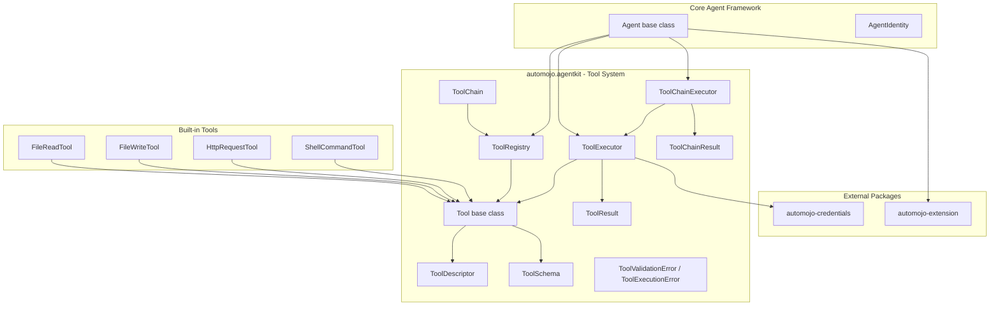
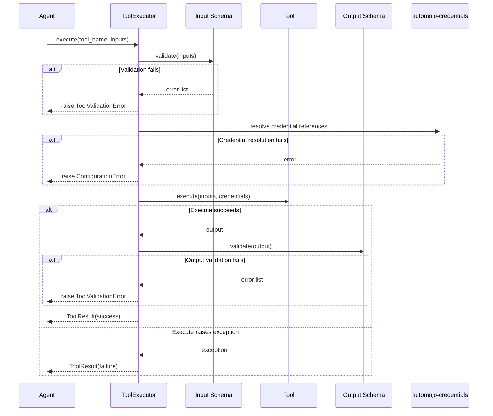
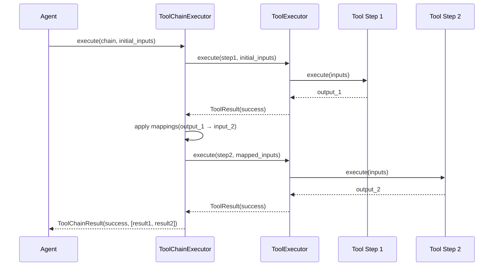

# Design Document — Tool & Capability System

## Overview

The Tool & Capability System extends the Core Agent Framework with a structured mechanism for defining, registering, discovering, validating, executing, chaining, and composing tools that agents use to perform work. A tool is a discrete, reusable unit of functionality with a declared input schema, output schema, and execution logic.

The system provides:

- A `Tool` abstract base class with declared schemas and metadata
- `ToolDescriptor` for immutable tool metadata and discovery
- `ToolSchema` for declarative input/output validation
- `ToolRegistry` for tool registration and lookup
- `ToolExecutor` for validated invocation with credential resolution
- `ToolChain` and `ToolChainExecutor` for composing tool pipelines
- `ToolResult` and `ToolChainResult` for structured execution outcomes
- Built-in tools: `FileReadTool`, `FileWriteTool`, `HttpRequestTool`, `ShellCommandTool`
- A `create_tool` factory function for quick tool creation without subclassing
- Plugin integration via `automojo-extension` ExtensionPoint

All classes live under `source/packages/automojo/agentkit/` with filenames in all-lowercase (no underscores), following the project naming conventions. The system integrates with:

- Core Agent Framework — `Agent` base class, `AgentConfiguration`, `AgentIdentity`, `AgentRegistry`
- `automojo-extension` — `ExtensionPoint` for tool plugin discovery
- `automojo-credentials` — `CredentialReference` resolution for tools requiring secrets

The design prioritizes debuggability over performance and readability over conciseness, per the project coding standards.

## Architecture



### Tool Execution Flow



### Tool Chain Execution Flow



### Design Decisions

1. `Tool` as abstract base class using `abc.ABC` with an abstract `execute` method — consistent with the Core Agent Framework pattern for `Agent`.
2. `ToolSchema` as a standalone validation component — keeps validation logic isolated and testable, supports both input and output validation.
3. `ToolRegistry` as a per-agent instance (not singleton) — tools are scoped to individual agents, unlike `AgentRegistry` which is global.
4. `ToolExecutor` as a separate component from `ToolRegistry` — separates discovery from invocation, each with clear responsibilities.
5. `ToolChain` validates schema compatibility at construction time — fail-fast design catches pipeline mismatches before execution.
6. Built-in tools as concrete `Tool` subclasses — consistent with the custom tool development API.
7. `create_tool` factory function for quick tool creation — reduces boilerplate for simple tools without requiring subclassing.
8. Class-level `INPUT_SCHEMA`, `OUTPUT_SCHEMA`, `TOOL_NAME`, `TOOL_DESCRIPTION`, `TOOL_VERSION` constants — declarative tool definition that is validated at class construction time.
9. `ToolValidationError` and `ToolExecutionError` inherit from `AgentKitError` — consistent with the Core Agent Framework exception hierarchy.
10. Credential resolution happens in `ToolExecutor` before calling `execute` — tools receive resolved credentials, keeping credential logic out of tool implementations.


## Components and Interfaces

### File Layout

| File | Class(es) | Purpose |
|---|---|---|
| toolschema.py | ToolSchema | Declarative schema definition for tool inputs/outputs |
| tooldescriptor.py | ToolDescriptor | Immutable tool metadata for discovery |
| tool.py | Tool | Abstract base class for all tools |
| toolresult.py | ToolResult | Immutable execution result |
| toolregistry.py | ToolRegistry | Per-agent tool registration and lookup |
| toolexecutor.py | ToolExecutor | Validated tool invocation with credential resolution |
| toolchain.py | ToolChain | Ordered tool pipeline definition |
| toolchainexecutor.py | ToolChainExecutor | Sequential chain execution |
| toolchainresult.py | ToolChainResult | Immutable chain execution result |
| toolerrors.py | ToolValidationError, ToolExecutionError | Tool-specific exceptions |
| toolfactory.py | create_tool | Factory function for quick tool creation |
| builtins/filereadtool.py | FileReadTool | Built-in file read tool |
| builtins/filewritetool.py | FileWriteTool | Built-in file write tool |
| builtins/httprequesttool.py | HttpRequestTool | Built-in HTTP request tool |
| builtins/shellcommandtool.py | ShellCommandTool | Built-in shell command tool |

### ToolSchema

```python
class ToolSchema:
    """
        Declarative schema definition for tool input or output parameters.
        Supports type constraints, required/optional marking, defaults, and validation.
    """

    SUPPORTED_TYPES = {"string", "integer", "float", "boolean", "list", "dictionary"}

    TYPE_MAP = {
        "string": str,
        "integer": int,
        "float": float,
        "boolean": bool,
        "list": list,
        "dictionary": dict,
    }

    def __init__(self, parameters: list = None):
        self._parameters = list(parameters) if parameters is not None else []
        return

    @property
    def parameters(self) -> list:
        ...

    @property
    def parameter_count(self) -> int:
        ...

    def validate(self, values: dict) -> list:
        """
            Validates a dictionary of values against this schema.

            :param values: The dictionary of values to validate.

            :returns: A list of validation error strings. Empty list if all values are valid.
        """
        ...

    def as_dict(self) -> dict:
        ...

    def to_json(self) -> str:
        ...

    @classmethod
    def from_dict(cls, schema_data: dict) -> "ToolSchema":
        ...

    @classmethod
    def from_json(cls, json_str: str) -> "ToolSchema":
        ...

    def __repr__(self) -> str:
        ...

    def __str__(self) -> str:
        ...
```

Each parameter in the `parameters` list is a dictionary with keys:
- `name` (str, required): Parameter name
- `type` (str, required): One of SUPPORTED_TYPES
- `required` (bool, optional): Defaults to True
- `default` (any, optional): Default value for optional parameters
- `description` (str, optional): Human-readable description

### ToolDescriptor

```python
class ToolDescriptor:
    """
        Immutable metadata object describing a Tool's capabilities
        without exposing the Tool implementation.
    """

    def __init__(self, name: str, description: str, version: str,
                 input_schema: ToolSchema, output_schema: ToolSchema,
                 tags: dict = None):
        self._name = name
        self._description = description
        self._version = version
        self._input_schema = input_schema
        self._output_schema = output_schema
        self._tags = dict(tags) if tags is not None else {}
        return

    @property
    def name(self) -> str: ...
    @property
    def description(self) -> str: ...
    @property
    def version(self) -> str: ...
    @property
    def input_schema(self) -> ToolSchema: ...
    @property
    def output_schema(self) -> ToolSchema: ...
    @property
    def tags(self) -> dict: ...

    def as_dict(self) -> dict: ...
    def to_json(self) -> str: ...

    @classmethod
    def from_json(cls, json_str: str) -> "ToolDescriptor": ...

    def __repr__(self) -> str: ...
    def __str__(self) -> str: ...
```

### Tool (Abstract Base Class)

```python
import abc

class Tool(abc.ABC):
    """
        Abstract base class for all tools. Subclasses define tool behavior
        by implementing the execute method and declaring schemas.
    """

    TOOL_NAME: str = None
    TOOL_DESCRIPTION: str = ""
    TOOL_VERSION: str = "1.0.0"
    INPUT_SCHEMA: dict = None
    OUTPUT_SCHEMA: dict = None

    def __init__(self, tags: dict = None, credential_names: list = None):
        self._name = self.TOOL_NAME
        self._description = self.TOOL_DESCRIPTION
        self._version = self.TOOL_VERSION
        self._tags = dict(tags) if tags is not None else {}
        self._credential_names = list(credential_names) if credential_names is not None else []
        self._input_schema = None
        self._output_schema = None

        if self._name is None:
            errmsg = "A Tool name is required. Set TOOL_NAME on the class or pass name to constructor."
            raise SemanticError(errmsg)

        if self.INPUT_SCHEMA is not None:
            self._input_schema = ToolSchema.from_dict(self.INPUT_SCHEMA)

        if self.OUTPUT_SCHEMA is not None:
            self._output_schema = ToolSchema.from_dict(self.OUTPUT_SCHEMA)

        return

    @property
    def name(self) -> str: ...
    @property
    def description(self) -> str: ...
    @property
    def version(self) -> str: ...
    @property
    def input_schema(self) -> ToolSchema: ...
    @property
    def output_schema(self) -> ToolSchema: ...
    @property
    def tags(self) -> dict: ...
    @property
    def credential_names(self) -> list: ...

    @property
    def descriptor(self) -> ToolDescriptor:
        """
            Returns a ToolDescriptor containing this Tool's metadata.

            :returns: A ToolDescriptor instance.
        """
        rtnval = ToolDescriptor(
            name=self._name,
            description=self._description,
            version=self._version,
            input_schema=self._input_schema,
            output_schema=self._output_schema,
            tags=self._tags
        )
        return rtnval

    @abc.abstractmethod
    def execute(self, inputs: dict, credentials: dict = None) -> dict:
        """
            Executes the tool with the given validated inputs.

            :param inputs: Validated input dictionary.
            :param credentials: Optional dictionary of resolved credentials.

            :returns: Output dictionary.
        """
        ...

    def __repr__(self) -> str: ...
    def __str__(self) -> str: ...
```

### ToolResult

```python
class ToolResult:
    """
        Immutable result of a single tool execution.
    """

    STATUS_SUCCESS = "success"
    STATUS_FAILURE = "failure"

    def __init__(self, tool_name: str, status: str, output: dict = None,
                 duration: float = 0.0, error: Exception = None):
        self._tool_name = tool_name
        self._status = status
        self._output = output
        self._duration = duration
        self._error = error
        return

    @property
    def tool_name(self) -> str: ...
    @property
    def status(self) -> str: ...
    @property
    def output(self) -> dict: ...
    @property
    def duration(self) -> float: ...
    @property
    def error(self) -> Exception: ...
    @property
    def is_success(self) -> bool: ...

    def as_dict(self) -> dict: ...
    def __repr__(self) -> str: ...
    def __str__(self) -> str: ...
```

### ToolRegistry

```python
class ToolRegistry:
    """
        Registry tracking available Tool instances for an Agent.
        Provides lookup by name, tags, and enumeration.
    """

    def __init__(self):
        self._tools: dict = {}
        return

    def register(self, tool: Tool) -> None:
        """
            Registers a Tool instance using its name as the key.

            :param tool: The Tool instance to register.

            :raises: SemanticError if a tool with the same name is already registered.
        """
        ...

    def deregister(self, tool_name: str) -> None: ...
    def lookup(self, tool_name: str) -> Tool: ...
    def lookup_by_tags(self, **tags: str) -> list: ...
    def list_all(self) -> list: ...
    def list_descriptors(self) -> list: ...
    def has_tool(self, tool_name: str) -> bool: ...
    def clear(self) -> None: ...

    @property
    def count(self) -> int: ...

    def __repr__(self) -> str: ...
    def __str__(self) -> str: ...
```

### ToolExecutor

```python
import logging

class ToolExecutor:
    """
        Validates inputs, resolves credentials, invokes tools, validates outputs,
        and returns structured ToolResult objects.
    """

    def __init__(self, credential_resolver=None):
        self._credential_resolver = credential_resolver
        self._logger = logging.getLogger("automojo.agentkit.tools")
        return

    def execute(self, tool: Tool, inputs: dict, agent_identifier: str = None) -> ToolResult:
        """
            Executes a tool with validated inputs and credential resolution.

            :param tool: The Tool instance to execute.
            :param inputs: The input dictionary.
            :param agent_identifier: Optional agent identifier for logging.

            :returns: A ToolResult with the execution outcome.
            :raises: ToolValidationError, ConfigurationError
        """
        ...
```

### ToolChain

```python
class ToolChain:
    """
        An ordered sequence of tool references with input-output mappings
        defining a pipeline.
    """

    def __init__(self, name: str, steps: list, registry: ToolRegistry):
        """
            Constructs a ToolChain, validating tool existence and schema compatibility.

            :param name: Name of the chain.
            :param steps: List of dicts with 'tool_name' and optional 'mappings' keys.
            :param registry: The ToolRegistry to resolve tool names against.

            :raises: SemanticError if a tool name is not found.
            :raises: ToolValidationError if schema compatibility fails.
        """
        self._name = name
        self._steps = list(steps)
        self._registry = registry
        self._validate_steps()
        return

    @property
    def name(self) -> str: ...
    @property
    def tool_names(self) -> list: ...
    @property
    def step_count(self) -> int: ...

    def _validate_steps(self) -> None: ...
```

### ToolChainExecutor

```python
class ToolChainExecutor:
    """
        Executes a ToolChain by running each step in sequence through the ToolExecutor.
    """

    def __init__(self, tool_executor: ToolExecutor):
        self._tool_executor = tool_executor
        return

    def execute(self, chain: ToolChain, initial_inputs: dict,
                agent_identifier: str = None) -> "ToolChainResult":
        """
            Executes the chain steps in order, applying mappings between steps.

            :param chain: The ToolChain to execute.
            :param initial_inputs: Input dictionary for the first step.
            :param agent_identifier: Optional agent identifier for logging.

            :returns: A ToolChainResult with the overall outcome.
        """
        ...
```

### ToolChainResult

```python
class ToolChainResult:
    """
        Immutable result of a tool chain execution.
    """

    STATUS_SUCCESS = "success"
    STATUS_FAILURE = "failure"

    def __init__(self, chain_name: str, status: str, output: dict = None,
                 step_results: list = None, duration: float = 0.0,
                 error: Exception = None):
        self._chain_name = chain_name
        self._status = status
        self._output = output
        self._step_results = list(step_results) if step_results is not None else []
        self._duration = duration
        self._error = error
        return

    @property
    def chain_name(self) -> str: ...
    @property
    def status(self) -> str: ...
    @property
    def output(self) -> dict: ...
    @property
    def step_results(self) -> list: ...
    @property
    def duration(self) -> float: ...
    @property
    def error(self) -> Exception: ...
    @property
    def is_success(self) -> bool: ...

    def as_dict(self) -> dict: ...
    def __repr__(self) -> str: ...
    def __str__(self) -> str: ...
```

### ToolErrors

```python
class ToolValidationError(AgentKitError):
    """
        Raised when input or output validation against a ToolSchema fails.
    """

    def __init__(self, tool_name: str, direction: str, errors: list):
        self._tool_name = tool_name
        self._direction = direction
        self._errors = list(errors)
        errmsg = self._format_message()
        super().__init__(errmsg)
        return

    @property
    def tool_name(self) -> str: ...
    @property
    def direction(self) -> str: ...
    @property
    def errors(self) -> list: ...

    def __repr__(self) -> str: ...


class ToolExecutionError(AgentKitError):
    """
        Raised when a Tool's execute method encounters a runtime error.
    """

    def __init__(self, tool_name: str, cause: Exception):
        self._tool_name = tool_name
        self._cause = cause
        errmsg = self._format_message()
        super().__init__(errmsg)
        return

    @property
    def tool_name(self) -> str: ...
    @property
    def cause(self) -> Exception: ...

    def __repr__(self) -> str: ...
```

### create_tool Factory Function

```python
def create_tool(name: str, description: str, input_schema: dict,
                output_schema: dict, execute_fn: callable,
                version: str = "1.0.0", tags: dict = None) -> Tool:
    """
        Factory function that creates a Tool instance without requiring subclassing.

        :param name: Tool name.
        :param description: Tool description.
        :param input_schema: Input schema as a dictionary.
        :param output_schema: Output schema as a dictionary.
        :param execute_fn: Callable implementing the tool logic.
        :param version: Tool version string.
        :param tags: Optional tags dictionary.

        :returns: A Tool instance.
    """
    ...
```

### Built-in Tools

#### FileReadTool

```python
class FileReadTool(Tool):
    TOOL_NAME = "file_read"
    TOOL_DESCRIPTION = "Reads the contents of a file at the specified path."
    TOOL_VERSION = "1.0.0"
    INPUT_SCHEMA = {
        "parameters": [
            {"name": "file_path", "type": "string", "required": True, "description": "Path to the file to read."},
            {"name": "encoding", "type": "string", "required": False, "default": "utf-8", "description": "File encoding."},
        ]
    }
    OUTPUT_SCHEMA = {
        "parameters": [
            {"name": "content", "type": "string", "required": True, "description": "File contents."},
        ]
    }

    def execute(self, inputs: dict, credentials: dict = None) -> dict:
        ...
```

#### FileWriteTool

```python
class FileWriteTool(Tool):
    TOOL_NAME = "file_write"
    TOOL_DESCRIPTION = "Writes content to a file at the specified path."
    TOOL_VERSION = "1.0.0"
    INPUT_SCHEMA = {
        "parameters": [
            {"name": "file_path", "type": "string", "required": True, "description": "Path to the file to write."},
            {"name": "content", "type": "string", "required": True, "description": "Content to write."},
            {"name": "encoding", "type": "string", "required": False, "default": "utf-8", "description": "File encoding."},
        ]
    }
    OUTPUT_SCHEMA = {
        "parameters": [
            {"name": "bytes_written", "type": "integer", "required": True, "description": "Number of bytes written."},
        ]
    }

    def execute(self, inputs: dict, credentials: dict = None) -> dict:
        ...
```

#### HttpRequestTool

```python
class HttpRequestTool(Tool):
    TOOL_NAME = "http_request"
    TOOL_DESCRIPTION = "Makes an HTTP request to the specified URL."
    TOOL_VERSION = "1.0.0"
    INPUT_SCHEMA = {
        "parameters": [
            {"name": "url", "type": "string", "required": True, "description": "Request URL."},
            {"name": "method", "type": "string", "required": True, "description": "HTTP method (GET, POST, PUT, DELETE, PATCH)."},
            {"name": "headers", "type": "dictionary", "required": False, "description": "Request headers."},
            {"name": "body", "type": "string", "required": False, "description": "Request body."},
            {"name": "timeout_seconds", "type": "float", "required": False, "default": 30.0, "description": "Request timeout in seconds."},
        ]
    }
    OUTPUT_SCHEMA = {
        "parameters": [
            {"name": "status_code", "type": "integer", "required": True, "description": "HTTP response status code."},
            {"name": "headers", "type": "dictionary", "required": True, "description": "Response headers."},
            {"name": "body", "type": "string", "required": True, "description": "Response body."},
        ]
    }

    def execute(self, inputs: dict, credentials: dict = None) -> dict:
        ...
```

#### ShellCommandTool

```python
class ShellCommandTool(Tool):
    TOOL_NAME = "shell_command"
    TOOL_DESCRIPTION = "Executes a shell command and returns the output."
    TOOL_VERSION = "1.0.0"
    INPUT_SCHEMA = {
        "parameters": [
            {"name": "command", "type": "string", "required": True, "description": "Shell command to execute."},
            {"name": "working_directory", "type": "string", "required": False, "description": "Working directory for command execution."},
            {"name": "timeout_seconds", "type": "float", "required": False, "default": 60.0, "description": "Command timeout in seconds."},
            {"name": "environment", "type": "dictionary", "required": False, "description": "Additional environment variables."},
            {"name": "safe_mode", "type": "boolean", "required": False, "default": True, "description": "Reject commands with shell metacharacters."},
        ]
    }
    OUTPUT_SCHEMA = {
        "parameters": [
            {"name": "exit_code", "type": "integer", "required": True, "description": "Process exit code."},
            {"name": "stdout", "type": "string", "required": True, "description": "Standard output."},
            {"name": "stderr", "type": "string", "required": True, "description": "Standard error."},
        ]
    }

    SHELL_METACHARACTERS = set(";|&$`\\!#~")

    def execute(self, inputs: dict, credentials: dict = None) -> dict:
        ...
```

### Agent Integration (Extensions to Agent Base Class)

The `Agent` base class from the Core Agent Framework is extended with tool-related methods:

```python
# Additional properties and methods on Agent

@property
def tools(self) -> ToolRegistry:
    """
        Returns the Agent's ToolRegistry instance.
    """
    ...

def register_tool(self, tool: Tool) -> None:
    """
        Registers a Tool with this Agent's ToolRegistry.

        :param tool: The Tool instance to register.
    """
    ...

def execute_tool(self, tool_name: str, inputs: dict) -> ToolResult:
    """
        Looks up and executes a tool by name.

        :param tool_name: Name of the tool to execute.
        :param inputs: Input dictionary.

        :returns: A ToolResult.
        :raises: SemanticError if tool not found.
    """
    ...

def execute_chain(self, chain: ToolChain, inputs: dict) -> ToolChainResult:
    """
        Executes a ToolChain through the ToolChainExecutor.

        :param chain: The ToolChain to execute.
        :param inputs: Initial input dictionary.

        :returns: A ToolChainResult.
    """
    ...
```

During `Agent.initialize()`, the agent discovers and registers `ToolPlugin` instances from the `automojo.agentkit.tools` ExtensionPoint. During `Agent.stop()`, the agent's `ToolRegistry` is cleared.

## Data Models

### ToolSchema Parameter Definition

| Field | Type | Required | Default | Description |
|---|---|---|---|---|
| name | str | Yes | — | Parameter name |
| type | str | Yes | — | One of: string, integer, float, boolean, list, dictionary |
| required | bool | No | True | Whether the parameter is required |
| default | any | No | None | Default value for optional parameters |
| description | str | No | "" | Human-readable description |

### ToolDescriptor Fields

| Field | Type | Required | Default | Description |
|---|---|---|---|---|
| name | str | Yes | — | Tool name |
| description | str | Yes | — | Tool description |
| version | str | Yes | — | Version string |
| input_schema | ToolSchema | Yes | — | Input parameter schema |
| output_schema | ToolSchema | Yes | — | Output parameter schema |
| tags | dict | No | {} | Key-value tags for categorization |

### ToolResult Fields

| Field | Type | Required | Default | Description |
|---|---|---|---|---|
| tool_name | str | Yes | — | Name of the executed tool |
| status | str | Yes | — | "success" or "failure" |
| output | dict | No | None | Output dictionary on success |
| duration | float | Yes | 0.0 | Execution duration in seconds |
| error | Exception | No | None | Exception on failure |

### ToolChainResult Fields

| Field | Type | Required | Default | Description |
|---|---|---|---|---|
| chain_name | str | Yes | — | Name of the chain |
| status | str | Yes | — | "success" or "failure" |
| output | dict | No | None | Final step output on success |
| step_results | list[ToolResult] | No | [] | Individual step results |
| duration | float | Yes | 0.0 | Total execution duration in seconds |
| error | Exception | No | None | Error from the failed step |

### ToolChain Step Definition

Each step in a ToolChain is a dictionary:

| Field | Type | Required | Description |
|---|---|---|---|
| tool_name | str | Yes | Name of the tool to execute |
| mappings | dict | No | Maps output field names from previous step to input field names for this step |

### ToolValidationError Fields

| Field | Type | Description |
|---|---|---|
| tool_name | str | Name of the tool that failed validation |
| direction | str | "input" or "output" |
| errors | list[str] | List of validation error strings |

### ToolExecutionError Fields

| Field | Type | Description |
|---|---|---|
| tool_name | str | Name of the tool that failed execution |
| cause | Exception | The original exception |

### Tool Class-Level Schema Declaration Format

```python
{
    "parameters": [
        {
            "name": "param_name",
            "type": "string",       # string, integer, float, boolean, list, dictionary
            "required": True,        # optional, defaults to True
            "default": "value",      # optional, for optional parameters
            "description": "desc"    # optional
        }
    ]
}
```

## Correctness Properties

*A property is a characteristic or behavior that should hold true across all valid executions of a system — essentially, a formal statement about what the system should do. Properties serve as the bridge between human-readable specifications and machine-verifiable correctness guarantees.*

### Property 1: ToolSchema JSON round-trip

*For any* valid ToolSchema instance, calling `to_json()` and then `from_json()` on the resulting string shall produce a ToolSchema whose `as_dict()` output equals the original's `as_dict()` output.

**Validates: Requirements 3.8, 3.9, 3.10, 3.11, 3.12, 16.3, 16.4, 16.6**

### Property 2: ToolSchema validates correct inputs as valid

*For any* valid ToolSchema and any input dictionary that includes all required parameters with values matching their declared type constraints, `validate()` shall return an empty list.

**Validates: Requirements 3.1, 3.2, 3.5**

### Property 3: ToolSchema reports missing required parameters

*For any* valid ToolSchema with at least one required parameter, and any input dictionary missing that required parameter, `validate()` shall return a non-empty list containing an error string that includes the missing parameter's name.

**Validates: Requirements 3.6**

### Property 4: ToolSchema reports type mismatches

*For any* valid ToolSchema parameter with a declared type constraint, and any input value whose type does not match the constraint, `validate()` shall return a non-empty list containing an error string that includes the parameter name, the expected type, and the actual type.

**Validates: Requirements 3.7**

### Property 5: ToolDescriptor JSON round-trip

*For any* valid ToolDescriptor instance, calling `to_json()` and then `from_json()` on the resulting string shall produce a ToolDescriptor whose name, description, version, input_schema, output_schema, and tags are equal to the original.

**Validates: Requirements 2.3, 2.4, 2.5, 2.6, 16.1, 16.2, 16.5**

### Property 6: Tool descriptor property reflects tool metadata

*For any* Tool instance, the `descriptor` property shall return a ToolDescriptor whose name, description, version, input_schema, output_schema, and tags match the Tool's own corresponding properties.

**Validates: Requirements 1.3, 12.2, 12.3**

### Property 7: Tool construction preserves tags and credential names

*For any* Tool instance constructed with a tags dictionary and a credential_names list, the `tags` property shall return a dictionary equal to the provided tags, and the `credential_names` property shall return a list equal to the provided credential names.

**Validates: Requirements 1.4, 1.5**

### Property 8: Tool class-level schema declarations are validated and converted

*For any* Tool subclass with valid class-level `INPUT_SCHEMA` and `OUTPUT_SCHEMA` dictionaries, construction shall produce a Tool whose `input_schema` and `output_schema` are ToolSchema instances equivalent to `ToolSchema.from_dict()` of the declared dictionaries. For any subclass with an invalid schema dictionary, construction shall raise SemanticError.

**Validates: Requirements 12.1, 12.5**

### Property 9: ToolRegistry registration, lookup, and enumeration correctness

*For any* set of N Tools with unique names: (a) after registration, `count` equals N, (b) `lookup(name)` returns the correct Tool or None for unregistered names, (c) `has_tool(name)` returns True for registered names and False otherwise, (d) `list_all()` returns all N Tools, (e) `list_descriptors()` returns N ToolDescriptors, (f) registering a duplicate name raises SemanticError.

**Validates: Requirements 4.1, 4.2, 4.4, 4.6, 4.7, 4.8, 4.9**

### Property 10: ToolRegistry deregistration removes tool

*For any* registered Tool, calling `deregister(name)` shall remove it so that `lookup(name)` returns None, `has_tool(name)` returns False, and `count` decreases by one.

**Validates: Requirements 4.3**

### Property 11: ToolRegistry lookup by tags returns matching tools

*For any* set of registered Tools with various tag dictionaries, `lookup_by_tags(**criteria)` shall return exactly those Tools whose tags contain all the specified key-value pairs.

**Validates: Requirements 4.5**

### Property 12: ToolExecutor validates input and rejects invalid inputs

*For any* Tool and any input dictionary that fails the Tool's input ToolSchema validation, the ToolExecutor shall raise ToolValidationError containing the validation error strings, without invoking the Tool's execute method.

**Validates: Requirements 5.1, 5.2**

### Property 13: ToolExecutor validates output and rejects invalid outputs

*For any* Tool whose execute method returns output that fails the Tool's output ToolSchema validation, the ToolExecutor shall raise ToolValidationError containing the output validation error strings.

**Validates: Requirements 5.4, 5.5**

### Property 14: ToolExecutor returns correct ToolResult based on execution outcome

*For any* Tool and valid input: (a) when execute succeeds with valid output, the ToolExecutor returns a ToolResult with success status, the output value, and a non-negative duration; (b) when execute raises an exception, the ToolExecutor returns a ToolResult with failure status, the exception information, and a non-negative duration.

**Validates: Requirements 5.6, 5.7**

### Property 15: ToolResult is_success reflects status

*For any* ToolResult instance, `is_success` shall return True when status is "success" and False when status is "failure".

**Validates: Requirements 6.3**

### Property 16: ToolResult fields and as_dict correctness

*For any* ToolResult instance, all fields (tool_name, status, output, duration, error) shall be accessible as read-only properties, and `as_dict()` shall return a dictionary containing these fields with matching values.

**Validates: Requirements 6.1, 6.2, 6.4**

### Property 17: ToolChain validates tool existence at construction

*For any* list of step definitions referencing a tool name not present in the provided ToolRegistry, ToolChain construction shall raise SemanticError identifying the missing tool name.

**Validates: Requirements 7.2, 7.3**

### Property 18: ToolChain validates schema compatibility at construction

*For any* ToolChain where the output schema of step N is incompatible with the input schema of step N+1 according to the provided mappings, construction shall raise ToolValidationError identifying the incompatible step pair and the specific field mismatch.

**Validates: Requirements 7.4, 7.5**

### Property 19: ToolChainExecutor executes steps in sequence with mappings

*For any* valid ToolChain with N steps and input-output mappings, the ToolChainExecutor shall execute each step in order, applying the mappings to pass output fields from the previous step as input fields to the next step.

**Validates: Requirements 7.6, 7.7**

### Property 20: ToolChainExecutor returns correct result based on outcome

*For any* valid ToolChain: (a) when all steps succeed, the ToolChainResult has success status, the final step output, N ToolResult objects, and a non-negative total duration; (b) when step K fails, execution stops and the ToolChainResult has failure status with results for steps 0..K.

**Validates: Requirements 7.8, 7.9**

### Property 21: ToolChain exposes correct tool names and step count

*For any* valid ToolChain with N steps, `tool_names` shall return the ordered list of tool names and `step_count` shall equal N.

**Validates: Requirements 7.10, 7.11**

### Property 22: ToolChainResult is_success reflects status

*For any* ToolChainResult instance, `is_success` shall return True when status is "success" and False when status is "failure".

**Validates: Requirements 8.3**

### Property 23: ToolChainResult fields and as_dict correctness

*For any* ToolChainResult instance, all fields (chain_name, status, output, step_results, duration, error) shall be accessible as read-only properties, and `as_dict()` shall return a dictionary containing these fields with matching values.

**Validates: Requirements 8.1, 8.2, 8.4, 8.5**

### Property 24: File I/O round-trip

*For any* string content and valid file path, executing FileWriteTool to write the content and then FileReadTool to read it back shall produce the original content string.

**Validates: Requirements 9.2, 9.6**

### Property 25: ShellCommandTool rejects metacharacters in safe mode

*For any* command string containing at least one shell metacharacter (`;|&$\`\\!#~`) when `safe_mode` is True, the ShellCommandTool shall raise ToolExecutionError.

**Validates: Requirements 11.5**

### Property 26: create_tool factory produces working Tool

*For any* valid name, description, input schema dictionary, output schema dictionary, and execute callable, `create_tool()` shall return a Tool instance whose name, description, input_schema, and output_schema match the provided arguments, and whose execute method delegates to the provided callable.

**Validates: Requirements 12.6**

### Property 27: Agent tool registration and execution

*For any* Agent and any Tool, calling `register_tool(tool)` shall make the tool discoverable via `agent.tools.lookup(tool.name)`, and calling `execute_tool(tool.name, valid_inputs)` shall return a ToolResult.

**Validates: Requirements 13.2, 13.3**

### Property 28: Agent execute_tool raises SemanticError for unknown tool

*For any* Agent and any tool name not registered in the Agent's ToolRegistry, calling `execute_tool(name, inputs)` shall raise SemanticError that includes the tool name and agent identity.

**Validates: Requirements 13.4**

### Property 29: Agent ToolRegistry cleared on stop

*For any* Agent with registered tools, after the Agent transitions to STOPPED state, the Agent's ToolRegistry count shall be zero.

**Validates: Requirements 13.7**

### Property 30: Tool exception fields are accessible

*For any* ToolValidationError, the tool_name, direction, and errors properties shall be accessible and match the constructor arguments. *For any* ToolExecutionError, the tool_name and cause properties shall be accessible and match the constructor arguments.

**Validates: Requirements 15.2, 15.4**

### Property 31: Tool string representations contain required information

*For any* Tool instance, `repr()` shall contain the class name, tool name, and version, and `str()` shall contain the tool name and description. *For any* ToolDescriptor, `repr()` shall contain the class name, tool name, and version, and `str()` shall contain the tool name and description. *For any* ToolSchema, `repr()` shall contain the class name and parameter count, and `str()` shall list parameter names and types. *For any* ToolResult, `repr()` shall contain the class name, tool name, and status, and `str()` shall contain the tool name, status, and duration. *For any* ToolChainResult, `repr()` shall contain the class name, chain name, and status, and `str()` shall contain the chain name, status, step count, and duration. *For any* ToolRegistry, `repr()` shall contain the class name and count, and `str()` shall list registered tool names. *For any* tool exception, `repr()` shall include the exception class name, tool name, and descriptive message.

**Validates: Requirements 1.7, 1.8, 18.1, 18.2, 18.3, 18.4, 18.5, 18.6, 18.7, 18.8, 18.9, 18.10, 18.11, 18.12, 15.5**

## Error Handling

### ToolValidationError

Raised when input or output validation against a ToolSchema fails. Inherits from `AgentKitError`. Contains:
- `tool_name`: The tool that failed validation
- `direction`: "input" or "output" indicating which validation failed
- `errors`: List of validation error strings from ToolSchema.validate()

Error message uses the multi-line formation pattern: build a list of lines including the tool name, direction, and each validation error, join with `os.linesep`, assign to a variable for debugger visibility, then raise.

### ToolExecutionError

Raised when a Tool's execute method encounters a runtime error. Inherits from `AgentKitError`. Contains:
- `tool_name`: The tool that failed execution
- `cause`: The original exception

Error message includes the tool name and the original exception's message. The original exception is chained using `raise ToolExecutionError(...) from cause`.

### SemanticError (existing)

Used for API misuse in the tool system. Per coding standards, must never be caught by library code. Used for:
- Tool constructed without a name (includes guidance to set TOOL_NAME)
- Duplicate tool registration (includes the duplicate tool name)
- ToolChain referencing a tool name not in the registry (includes the missing name)
- Agent execute_tool with unknown tool name (includes tool name and agent identity)
- Invalid class-level schema dictionary format (includes the validation details)

### ConfigurationError (existing)

Used for configuration problems in the tool system:
- Unresolvable CredentialReference during tool execution (includes credential name and tool name)

### Built-in Tool Error Handling

Each built-in tool raises `ToolExecutionError` for runtime failures:

- **FileReadTool**: File not found (includes file path), permission denied (includes file path and permission detail)
- **FileWriteTool**: Permission denied (includes file path and permission detail)
- **HttpRequestTool**: Timeout (includes URL, method, timeout duration), connection error (includes URL and error detail)
- **ShellCommandTool**: Timeout (includes command and timeout duration), missing working directory (includes directory path), shell metacharacter rejection in safe mode (includes the command)

### ToolPlugin Error Handling

When a ToolPlugin fails to load during Agent initialization:
1. Log at WARNING level including the plugin name and error detail
2. Continue loading remaining plugins — do not raise

When a ToolPlugin provides a Tool with a conflicting name:
1. Log at WARNING level including both tool names
2. Skip the conflicting plugin tool — do not raise

### Logging

The ToolExecutor uses the Python standard logging module with a logger hierarchy under `automojo.agentkit.tools`:
- INFO: Tool execution begin (tool name, agent identifier)
- INFO: Tool execution success (tool name, duration, status)
- WARNING: Tool execution failure (tool name, duration, error detail)
- WARNING: Input validation failure (tool name, validation errors)

## Testing Strategy

### Testing Framework

Tests use testbase and reside under `source/testroots/automojo/tests/singlehost/agentkit/`, mirroring the source hierarchy:

| Source File | Test File |
|---|---|
| agentkit/toolschema.py | test_toolschema.py |
| agentkit/tooldescriptor.py | test_tooldescriptor.py |
| agentkit/tool.py | test_tool.py |
| agentkit/toolresult.py | test_toolresult.py |
| agentkit/toolregistry.py | test_toolregistry.py |
| agentkit/toolexecutor.py | test_toolexecutor.py |
| agentkit/toolchain.py | test_toolchain.py |
| agentkit/toolchainexecutor.py | test_toolchainexecutor.py |
| agentkit/toolchainresult.py | test_toolchainresult.py |
| agentkit/toolerrors.py | test_toolerrors.py |
| agentkit/toolfactory.py | test_toolfactory.py |
| agentkit/builtins/filereadtool.py | builtins/test_filereadtool.py |
| agentkit/builtins/filewritetool.py | builtins/test_filewritetool.py |
| agentkit/builtins/httprequesttool.py | builtins/test_httprequesttool.py |
| agentkit/builtins/shellcommandtool.py | builtins/test_shellcommandtool.py |

### Dual Testing Approach

- **Unit tests**: Verify specific examples, edge cases, error conditions, and integration with external packages (using `automojo.testbase.mocking.Mock`)
- **Property-based tests**: Verify universal properties across randomly generated inputs

Both are complementary and necessary for comprehensive coverage. Unit tests catch concrete bugs and verify specific behaviors; property tests verify general correctness across the input space.

### Property-Based Testing Configuration

- **Library**: Hypothesis for Python property-based testing
- **Minimum 100 iterations** per property test (due to randomization)
- Each test tagged with a comment: **Feature: tool-capability-system, Property N: title**
- Each correctness property implemented by a **single** property-based test
- Hypothesis strategies generate random:
  - Schema parameter definitions (names, types, required/optional, defaults)
  - ToolSchema instances with varying parameter counts and types
  - ToolDescriptor instances with random names, descriptions, versions, schemas, tags
  - Tool subclasses with random schemas and execute implementations
  - ToolResult instances with random statuses, outputs, durations
  - ToolChainResult instances with random step results
  - ToolRegistry populations with random tool sets
  - Tag dictionaries for lookup testing
  - Input dictionaries with valid/invalid values for schema validation
  - ToolChain step definitions with random mappings

### Unit Test Focus Areas

- **Structural checks**: Abstract method enforcement on Tool, read-only properties on ToolDescriptor/ToolResult/ToolChainResult
- **Error conditions**: Tool without name raises SemanticError, duplicate registration, invalid schema dictionaries
- **Built-in tools**: FileReadTool/FileWriteTool with real temp files, HttpRequestTool with mocked HTTP (using `automojo.testbase.mocking.Mock`), ShellCommandTool with simple commands
- **Edge cases**: Empty ToolSchema validates any input, ToolChain with single step, ToolResult with None output
- **Integration**: Agent tool registration/execution with mocked ToolExecutor, ToolPlugin discovery with mocked ExtensionPoint, credential resolution with mocked automojo-credentials
- **Logging**: Verify log output at correct levels using log capture
- **Error messages**: Verify error messages follow multi-line formation pattern and include required context

### Running Tests

```bash
source .venv/bin/activate
testbase testing run --root source/testroots/automojo --includes=automojo.tests.singlehost.agentkit --output=./.output
```
