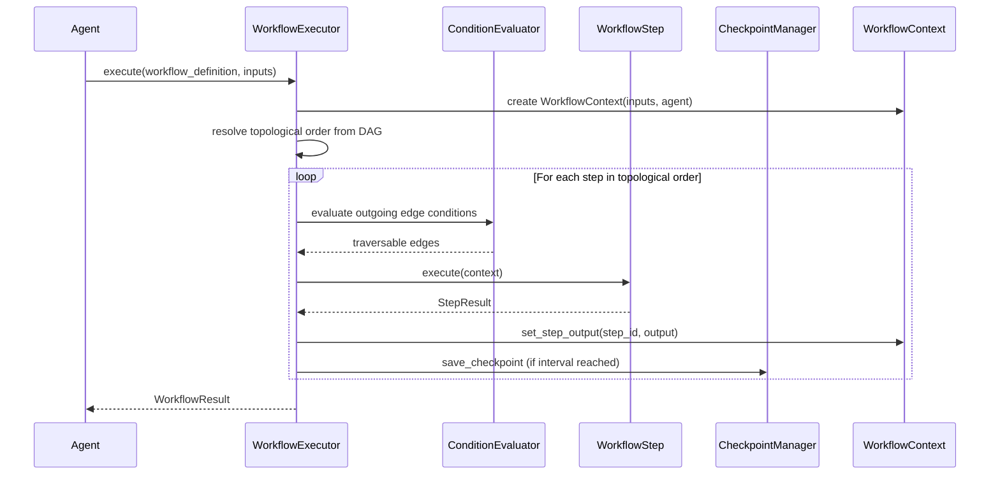
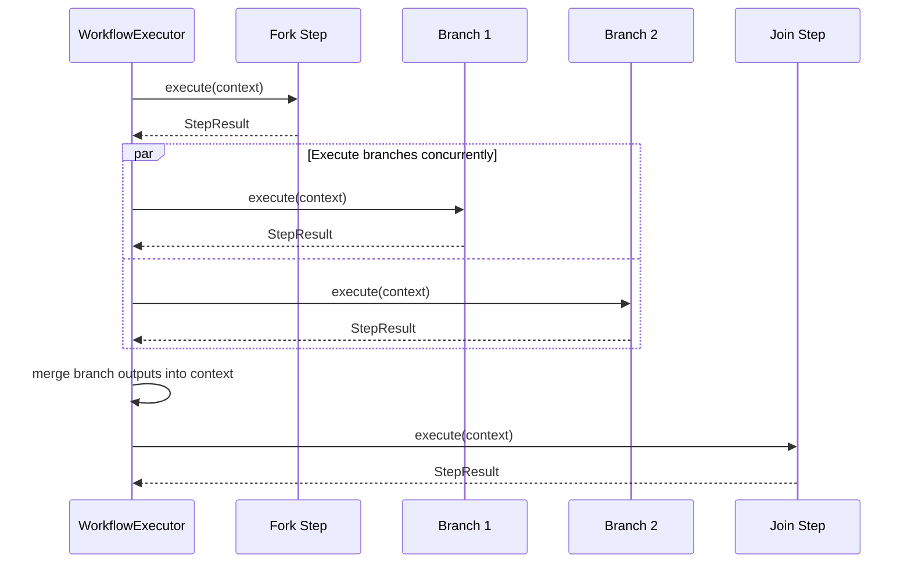
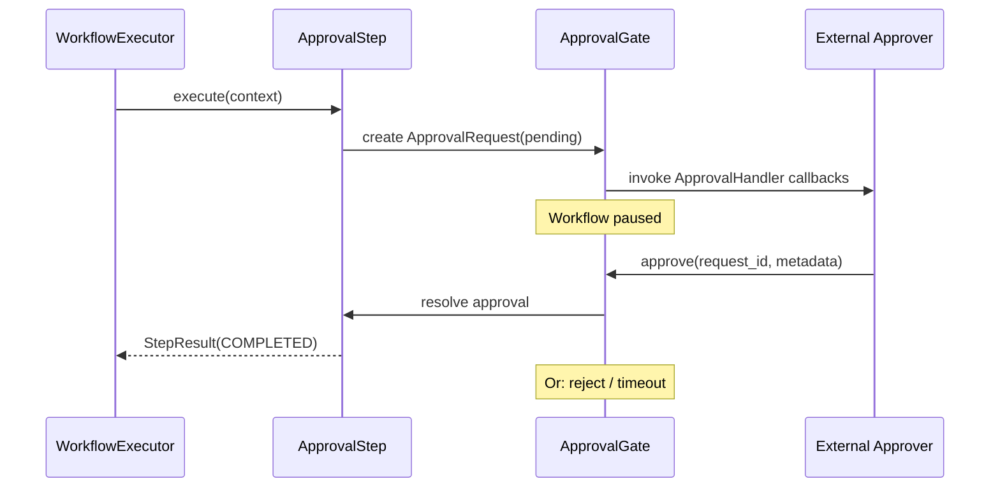
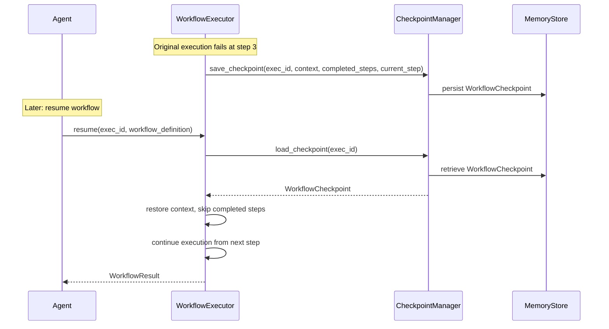

# Design Document — Workflow & Orchestration

## Overview

The Workflow & Orchestration feature extends the `codecraftai-agent-kit` SDK with a system for defining, executing, checkpointing, and resuming multi-step workflows composed as directed acyclic graphs (DAGs). It provides a workflow definition abstraction with typed steps and edges, conditional branching, parallel task execution, workflow checkpointing and resumption for fault tolerance, and human-in-the-loop approval gates for supervised automation.

The system provides:

- `WorkflowDefinition` as an immutable DAG of `WorkflowStep` nodes connected by `WorkflowEdge` edges
- `WorkflowStep` abstract base class with built-in implementations: `ToolStep`, `LlmStep`, `AgentStep`, `ApprovalStep`, `SubWorkflowStep`
- `WorkflowEdge` with optional `ConditionExpression` for conditional branching
- `ConditionEvaluator` for safe expression evaluation against `WorkflowContext`
- `WorkflowExecutor` for DAG traversal, step execution, and parallel branch management
- `WorkflowResult` and `StepResult` for structured execution outcomes
- `WorkflowContext` for shared state across workflow steps
- `ParallelBranch` for declaring concurrent execution boundaries
- `CheckpointManager` and `WorkflowCheckpoint` for fault-tolerant execution with resumption
- `ApprovalGate`, `ApprovalRequest`, and `ApprovalStep` for human-in-the-loop approval
- `WorkflowRegistry` for workflow definition registration and lookup
- `WorkflowConfiguration` for declarative execution settings
- `WorkflowExecutionStatus` and `StepExecutionStatus` enumerations
- Error types: `WorkflowDefinitionError`, `WorkflowExecutionError`, `WorkflowCheckpointError`, `ApprovalTimeoutError`

All classes live under `source/packages/ccai/agentkit/` with filenames in all-lowercase (no underscores), following the project naming conventions. The system integrates with:

- Core Agent Framework — `Agent` base class, `AgentConfiguration`, `AgentIdentity`, `AgentRegistry`
- Tool & Capability System — `ToolRegistry`, `ToolExecutor`, `ToolResult`
- LLM Integration — `LlmProviderRegistry`, `LlmConversation`, `LlmResponse`, `PromptTemplate`, `OutputParser`
- Memory & Context Management — `MemoryStore` for checkpoint persistence
- Communication & Messaging — `Transport`, `Message` for cross-agent coordination
- `codecraftai-extension` — `ExtensionPoint` for workflow step plugin discovery
- `codecraftai-credentials` — `CredentialReference` resolution within workflow steps
- `codecraftai-this-app` — `AppContext` for settings and file path resolution

The design prioritizes debuggability over performance and readability over conciseness, per the project coding standards.

## Architecture

```mermaid
graph TD
    subgraph ccai.agentkit - Workflow System
        WorkflowDefinition[WorkflowDefinition]
        WorkflowStep[WorkflowStep base class]
        WorkflowEdge[WorkflowEdge]
        ConditionEvaluator[ConditionEvaluator]
        WorkflowExecutor[WorkflowExecutor]
        WorkflowResult[WorkflowResult]
        StepResult[StepResult]
        WorkflowContext[WorkflowContext]
        ParallelBranch[ParallelBranch]
        CheckpointManager[CheckpointManager]
        WorkflowCheckpoint[WorkflowCheckpoint]
        ApprovalGate[ApprovalGate]
        ApprovalRequest[ApprovalRequest]
        WorkflowRegistry[WorkflowRegistry]
        WorkflowConfiguration[WorkflowConfiguration]
        WorkflowExecutionStatus[WorkflowExecutionStatus enum]
        StepExecutionStatus[StepExecutionStatus enum]
        WorkflowErrors[WorkflowDefinitionError / WorkflowExecutionError / WorkflowCheckpointError / ApprovalTimeoutError]
    end

    subgraph Built-in Steps
        ToolStep[ToolStep]
        LlmStep[LlmStep]
        AgentStep[AgentStep]
        ApprovalStep[ApprovalStep]
        SubWorkflowStep[SubWorkflowStep]
    end

    subgraph Core Agent Framework
        Agent[Agent base class]
        AgentIdentity[AgentIdentity]
        AgentRegistry[AgentRegistry singleton]
    end

    subgraph External Systems
        ToolRegistry[ToolRegistry]
        LlmProviderRegistry[LlmProviderRegistry]
        MemoryStore[MemoryStore]
        Transport[Transport]
        Extension[codecraftai-extension]
        AppContext[codecraftai-this-app]
    end

    Agent --> WorkflowRegistry
    Agent --> WorkflowExecutor
    Agent --> CheckpointManager
    Agent --> ApprovalGate
    Agent --> WorkflowConfiguration

    WorkflowDefinition --> WorkflowStep
    WorkflowDefinition --> WorkflowEdge
    WorkflowDefinition --> ParallelBranch
    WorkflowExecutor --> WorkflowDefinition
    WorkflowExecutor --> WorkflowContext
    WorkflowExecutor --> ConditionEvaluator
    WorkflowExecutor --> CheckpointManager
    WorkflowExecutor --> WorkflowResult
    WorkflowContext --> StepResult

    ToolStep --> WorkflowStep
    LlmStep --> WorkflowStep
    AgentStep --> WorkflowStep
    ApprovalStep --> WorkflowStep
    SubWorkflowStep --> WorkflowStep

    ToolStep --> ToolRegistry
    LlmStep --> LlmProviderRegistry
    AgentStep --> Transport
    ApprovalStep --> ApprovalGate
    SubWorkflowStep --> WorkflowExecutor
    CheckpointManager --> MemoryStore
    WorkflowConfiguration --> AppContext
    Agent --> Extension
```



### Workflow Execution Flow



### Parallel Execution Flow



### Approval Gate Flow



### Checkpoint and Resumption Flow



### Design Decisions

1. `WorkflowDefinition` as an immutable DAG validated at construction time — catches structural errors (cycles, disconnected nodes, invalid references) early rather than at execution time.
2. `WorkflowStep` as abstract base class using `abc.ABC` — consistent with `Transport`, `Tool`, and `Agent` patterns in the SDK.
3. `WorkflowExecutor` as a per-execution component — each execution gets its own executor instance with isolated state, preventing cross-execution interference.
4. `ConditionEvaluator` restricts to a safe expression subset — prevents arbitrary code execution in condition expressions while supporting common comparison and logical operators.
5. `ParallelBranch` as an explicit declaration — makes parallel execution boundaries visible in the workflow definition rather than inferred, improving debuggability.
6. `CheckpointManager` delegates to `MemoryStore` — reuses the existing memory abstraction for persistence, consistent with the Memory & Context Management feature.
7. `ApprovalGate` as a per-agent component — approval state is scoped to individual agents, consistent with `ToolRegistry` and `TransportRegistry` patterns.
8. `WorkflowRegistry` uses composite key (name + version) — supports multiple versions of the same workflow, with latest-version lookup as a convenience.
9. `WorkflowContext` is mutable — steps need to write outputs during execution, but the context is scoped to a single execution and not shared across executions.
10. All workflow errors inherit from `AgentKitError` — consistent with the exception hierarchy established in the Core Agent Framework.
11. Built-in steps as concrete `WorkflowStep` subclasses — consistent with built-in tools and built-in transports patterns.
12. Structured logging under `ccai.agentkit.workflow` logger hierarchy — consistent with messaging and configuration logging patterns.

## Components and Interfaces

### File Layout

| File | Class(es) | Purpose |
|---|---|---|
| workflowexecutionstatus.py | WorkflowExecutionStatus | Enum of workflow execution states |
| stepexecutionstatus.py | StepExecutionStatus | Enum of step execution states |
| workflowerrors.py | WorkflowDefinitionError, WorkflowExecutionError, WorkflowCheckpointError, ApprovalTimeoutError | Workflow exceptions |
| workflowedge.py | WorkflowEdge | Directed edge between steps |
| parallelbranch.py | ParallelBranch | Parallel execution boundary declaration |
| stepresult.py | StepResult | Immutable step execution outcome |
| workflowresult.py | WorkflowResult | Immutable workflow execution outcome |
| workflowcontext.py | WorkflowContext | Mutable shared state for execution |
| workflowstep.py | WorkflowStep | Abstract base class for steps |
| workflowdefinition.py | WorkflowDefinition | Immutable DAG of steps and edges |
| conditionevaluator.py | ConditionEvaluator | Safe expression evaluation |
| workflowcheckpoint.py | WorkflowCheckpoint | Immutable checkpoint snapshot |
| checkpointmanager.py | CheckpointManager | Checkpoint persistence and restoration |
| approvalrequest.py | ApprovalRequest | Immutable approval request |
| approvalgate.py | ApprovalGate | Approval lifecycle management |
| workflowconfiguration.py | WorkflowConfiguration | Declarative execution settings |
| workflowregistry.py | WorkflowRegistry | Workflow definition registration and lookup |
| workflowexecutor.py | WorkflowExecutor | DAG traversal and step execution |
| steps/toolstep.py | ToolStep | Built-in tool execution step |
| steps/llmstep.py | LlmStep | Built-in LLM completion step |
| steps/agentstep.py | AgentStep | Built-in cross-agent delegation step |
| steps/approvalstep.py | ApprovalStep | Built-in approval gate step |
| steps/subworkflowstep.py | SubWorkflowStep | Built-in sub-workflow execution step |

### WorkflowExecutionStatus

```python
import enum

class WorkflowExecutionStatus(enum.Enum):
    """
        Enumeration of workflow execution states.
    """

    RUNNING = "RUNNING"
    COMPLETED = "COMPLETED"
    FAILED = "FAILED"
    PAUSED = "PAUSED"
    CANCELLED = "CANCELLED"

    @classmethod
    def from_string(cls, value: str) -> "WorkflowExecutionStatus":
        """
            Returns the WorkflowExecutionStatus member matching the given string.

            :param value: The string value to match.

            :returns: The matching WorkflowExecutionStatus member.
            :raises: SemanticError
        """
        ...
```

### StepExecutionStatus

```python
import enum

class StepExecutionStatus(enum.Enum):
    """
        Enumeration of step execution states.
    """

    PENDING = "PENDING"
    RUNNING = "RUNNING"
    COMPLETED = "COMPLETED"
    FAILED = "FAILED"
    SKIPPED = "SKIPPED"
    PENDING_APPROVAL = "PENDING_APPROVAL"
    CANCELLED = "CANCELLED"

    @classmethod
    def from_string(cls, value: str) -> "StepExecutionStatus":
        """
            Returns the StepExecutionStatus member matching the given string.

            :param value: The string value to match.

            :returns: The matching StepExecutionStatus member.
            :raises: SemanticError
        """
        ...
```

### WorkflowEdge

```python
class WorkflowEdge:
    """
        Immutable directed connection between two WorkflowStep nodes.
    """

    def __init__(self, source_step_id: str, target_step_id: str,
                 condition: str = None, priority: int = 0):
        self._source_step_id = source_step_id
        self._target_step_id = target_step_id
        self._condition = condition
        self._priority = priority
        return

    @property
    def source_step_id(self) -> str: ...
    @property
    def target_step_id(self) -> str: ...
    @property
    def condition(self) -> str: ...
    @property
    def priority(self) -> int: ...

    def as_dict(self) -> dict: ...

    def __repr__(self) -> str: ...
    def __str__(self) -> str: ...
```

### ParallelBranch

```python
class ParallelBranch:
    """
        Grouping construct identifying a set of steps that can execute concurrently,
        bounded by a fork step and a join step.
    """

    def __init__(self, fork_step_id: str, join_step_id: str):
        self._fork_step_id = fork_step_id
        self._join_step_id = join_step_id
        return

    @property
    def fork_step_id(self) -> str: ...
    @property
    def join_step_id(self) -> str: ...

    def as_dict(self) -> dict: ...

    def __repr__(self) -> str: ...
    def __str__(self) -> str: ...
```

### StepResult

```python
class StepResult:
    """
        Immutable object encapsulating the outcome of a single WorkflowStep execution.
    """

    def __init__(self, step_id: str, step_name: str, status: StepExecutionStatus,
                 output: dict = None, duration: float = 0.0, error: str = None):
        self._step_id = step_id
        self._step_name = step_name
        self._status = status
        self._output = dict(output) if output is not None else {}
        self._duration = duration
        self._error = error
        return

    @property
    def step_id(self) -> str: ...
    @property
    def step_name(self) -> str: ...
    @property
    def status(self) -> StepExecutionStatus: ...
    @property
    def output(self) -> dict: ...
    @property
    def duration(self) -> float: ...
    @property
    def error(self) -> str: ...
    @property
    def is_success(self) -> bool: ...

    def as_dict(self) -> dict: ...
    def to_json(self) -> str: ...

    @classmethod
    def from_json(cls, json_str: str) -> "StepResult": ...

    def __repr__(self) -> str: ...
    def __str__(self) -> str: ...
```

### WorkflowResult

```python
class WorkflowResult:
    """
        Immutable object encapsulating the outcome of a workflow execution.
    """

    def __init__(self, workflow_name: str, status: WorkflowExecutionStatus,
                 step_results: list = None, final_output: dict = None,
                 duration: float = 0.0, error: str = None):
        self._workflow_name = workflow_name
        self._status = status
        self._step_results = list(step_results) if step_results is not None else []
        self._final_output = dict(final_output) if final_output is not None else {}
        self._duration = duration
        self._error = error
        return

    @property
    def workflow_name(self) -> str: ...
    @property
    def status(self) -> WorkflowExecutionStatus: ...
    @property
    def step_results(self) -> list: ...
    @property
    def final_output(self) -> dict: ...
    @property
    def duration(self) -> float: ...
    @property
    def error(self) -> str: ...
    @property
    def is_success(self) -> bool: ...

    def get_step_result(self, step_id: str) -> StepResult: ...

    def as_dict(self) -> dict: ...
    def to_json(self) -> str: ...

    @classmethod
    def from_json(cls, json_str: str) -> "WorkflowResult": ...

    def __repr__(self) -> str: ...
    def __str__(self) -> str: ...
```

### WorkflowContext

```python
class WorkflowContext:
    """
        Mutable object carrying shared state across workflow steps during execution.
    """

    def __init__(self, inputs: dict, agent=None, metadata: dict = None):
        self._inputs = dict(inputs) if inputs is not None else {}
        self._agent = agent
        self._metadata = dict(metadata) if metadata is not None else {}
        self._step_outputs = {}
        return

    @property
    def inputs(self) -> dict: ...
    @property
    def agent(self): ...
    @property
    def step_outputs(self) -> dict: ...
    @property
    def metadata(self) -> dict: ...

    def get_input(self, field_name: str, default=None): ...
    def get_step_output(self, step_id: str) -> dict: ...
    def set_step_output(self, step_id: str, output: dict) -> None: ...
    def get_metadata(self, key: str, default=None): ...
    def set_metadata(self, key: str, value) -> None: ...

    def as_dict(self) -> dict: ...
    def to_json(self) -> str: ...

    @classmethod
    def from_dict(cls, data: dict, agent=None) -> "WorkflowContext": ...

    def __repr__(self) -> str: ...
    def __str__(self) -> str: ...
```

### WorkflowStep (Abstract Base Class)

```python
import abc

class WorkflowStep(abc.ABC):
    """
        Abstract base class representing a single unit of work within a workflow.
    """

    def __init__(self, step_id: str, name: str, step_type: str,
                 input_schema: dict = None, output_schema: dict = None,
                 tags: dict = None, retry_policy=None):
        self._step_id = step_id
        self._name = name
        self._step_type = step_type
        self._input_schema = dict(input_schema) if input_schema is not None else {}
        self._output_schema = dict(output_schema) if output_schema is not None else {}
        self._tags = dict(tags) if tags is not None else {}
        self._retry_policy = retry_policy

        if self._step_id is None or len(self._step_id.strip()) == 0:
            errmsg = "A step identifier is required."
            raise SemanticError(errmsg)

        if self._name is None or len(self._name.strip()) == 0:
            errmsg = "A step name is required."
            raise SemanticError(errmsg)

        return

    @property
    def step_id(self) -> str: ...
    @property
    def name(self) -> str: ...
    @property
    def step_type(self) -> str: ...
    @property
    def input_schema(self) -> dict: ...
    @property
    def output_schema(self) -> dict: ...
    @property
    def tags(self) -> dict: ...
    @property
    def retry_policy(self): ...

    @abc.abstractmethod
    def execute(self, context: WorkflowContext) -> StepResult:
        """
            Executes this step using the provided workflow context.

            :param context: The WorkflowContext with inputs and prior step outputs.

            :returns: A StepResult with the execution outcome.
        """
        ...

    def __repr__(self) -> str: ...
    def __str__(self) -> str: ...
```

### WorkflowDefinition

```python
class WorkflowDefinition:
    """
        Immutable DAG of WorkflowStep nodes connected by WorkflowEdge edges.
        Validates structural integrity at construction time.
    """

    def __init__(self, name: str, version: str, steps: dict,
                 edges: list, start_step_id: str,
                 parallel_branches: list = None, description: str = None):
        self._name = name
        self._version = version
        self._description = description
        self._steps = dict(steps)
        self._edges = list(edges)
        self._start_step_id = start_step_id
        self._parallel_branches = list(parallel_branches) if parallel_branches is not None else []

        self._validate()
        return

    def _validate(self) -> None:
        """
            Validates the workflow DAG:
            1. Start step exists in steps dictionary
            2. All edge source/target step IDs reference valid steps
            3. No cycles in the graph
            4. All steps are reachable from the start step
            5. ParallelBranch fork/join steps are valid and paths converge

            :raises: WorkflowDefinitionError
        """
        ...

    @property
    def name(self) -> str: ...
    @property
    def version(self) -> str: ...
    @property
    def description(self) -> str: ...
    @property
    def steps(self) -> dict: ...
    @property
    def edges(self) -> list: ...
    @property
    def start_step_id(self) -> str: ...
    @property
    def parallel_branches(self) -> list: ...

    def get_step(self, step_id: str) -> WorkflowStep: ...
    def get_outgoing_edges(self, step_id: str) -> list: ...
    def get_incoming_edges(self, step_id: str) -> list: ...
    def get_terminal_steps(self) -> list: ...

    def as_dict(self) -> dict: ...
    def to_json(self) -> str: ...
    def to_yaml(self) -> str: ...

    @classmethod
    def from_dict(cls, data: dict, step_type_registry: dict = None) -> "WorkflowDefinition": ...
    @classmethod
    def from_json(cls, json_str: str, step_type_registry: dict = None) -> "WorkflowDefinition": ...
    @classmethod
    def from_yaml(cls, yaml_str: str, step_type_registry: dict = None) -> "WorkflowDefinition": ...

    def __repr__(self) -> str: ...
    def __str__(self) -> str: ...
```

### ConditionEvaluator

```python
class ConditionEvaluator:
    """
        Evaluates ConditionExpression strings against a WorkflowContext.
        Restricts evaluation to a safe subset of Python expressions.
    """

    ALLOWED_OPERATORS = {"==", "!=", "<", ">", "<=", ">=", "and", "or", "not", "in"}

    def evaluate(self, expression: str, context: WorkflowContext) -> bool:
        """
            Evaluates a condition expression against the workflow context.
            Supports:
            - steps.<step_id>.<output_field> for step output references
            - inputs.<field_name> for workflow input references
            - Comparison operators: ==, !=, <, >, <=, >=
            - Logical operators: and, or, not
            - Membership operator: in

            :param expression: The condition expression string.
            :param context: The WorkflowContext to evaluate against.

            :returns: True if the condition is satisfied.
            :raises: WorkflowExecutionError for unresolved step references.
            :raises: WorkflowDefinitionError for invalid expression syntax.
        """
        ...

    def __repr__(self) -> str: ...
    def __str__(self) -> str: ...
```

### WorkflowCheckpoint

```python
class WorkflowCheckpoint:
    """
        Immutable snapshot of workflow execution state at a specific point.
    """

    def __init__(self, workflow_name: str, execution_id: str,
                 completed_step_ids: set, context_state: dict,
                 current_step_id: str, timestamp: datetime = None):
        self._workflow_name = workflow_name
        self._execution_id = execution_id
        self._completed_step_ids = set(completed_step_ids)
        self._context_state = dict(context_state)
        self._current_step_id = current_step_id
        self._timestamp = timestamp if timestamp is not None else datetime.now(timezone.utc)
        return

    @property
    def workflow_name(self) -> str: ...
    @property
    def execution_id(self) -> str: ...
    @property
    def completed_step_ids(self) -> set: ...
    @property
    def context_state(self) -> dict: ...
    @property
    def current_step_id(self) -> str: ...
    @property
    def timestamp(self) -> datetime: ...

    def as_dict(self) -> dict: ...
    def to_json(self) -> str: ...

    @classmethod
    def from_json(cls, json_str: str) -> "WorkflowCheckpoint": ...

    def __repr__(self) -> str: ...
    def __str__(self) -> str: ...
```

### CheckpointManager

```python
import logging

class CheckpointManager:
    """
        Persists and restores WorkflowExecution state at configurable
        checkpoint boundaries using a MemoryStore backend.
    """

    def __init__(self, memory_store):
        self._memory_store = memory_store
        self._logger = logging.getLogger("ccai.agentkit.workflow.checkpoint")
        return

    def save_checkpoint(self, execution_id: str, context: WorkflowContext,
                        completed_step_ids: set, current_step_id: str) -> None:
        """
            Persists a WorkflowCheckpoint to the MemoryStore.

            :raises: WorkflowCheckpointError
        """
        ...

    def load_checkpoint(self, execution_id: str) -> WorkflowCheckpoint:
        """
            Returns the most recent WorkflowCheckpoint for the execution, or None.

            :raises: WorkflowCheckpointError
        """
        ...

    def list_checkpoints(self, workflow_name: str) -> list:
        """
            Returns checkpoints for the workflow, ordered by timestamp descending.
        """
        ...

    def delete_checkpoint(self, execution_id: str) -> None:
        """
            Removes all checkpoints for the execution.
        """
        ...

    def __repr__(self) -> str: ...
    def __str__(self) -> str: ...
```

### ApprovalRequest

```python
class ApprovalRequest:
    """
        Immutable object representing a pending approval within a workflow.
    """

    VALID_STATUSES = {"pending", "approved", "rejected", "expired"}

    def __init__(self, identifier: str, execution_id: str, step_id: str,
                 description: str, requesting_agent_id: str,
                 status: str = "pending", metadata: dict = None,
                 rejection_reason: str = None, timestamp: datetime = None):
        self._identifier = identifier if identifier is not None else str(uuid.uuid4())
        self._execution_id = execution_id
        self._step_id = step_id
        self._description = description
        self._requesting_agent_id = requesting_agent_id
        self._status = status
        self._metadata = dict(metadata) if metadata is not None else {}
        self._rejection_reason = rejection_reason
        self._timestamp = timestamp if timestamp is not None else datetime.now(timezone.utc)
        return

    @property
    def identifier(self) -> str: ...
    @property
    def execution_id(self) -> str: ...
    @property
    def step_id(self) -> str: ...
    @property
    def description(self) -> str: ...
    @property
    def requesting_agent_id(self) -> str: ...
    @property
    def status(self) -> str: ...
    @property
    def metadata(self) -> dict: ...
    @property
    def rejection_reason(self) -> str: ...
    @property
    def timestamp(self) -> datetime: ...

    def as_dict(self) -> dict: ...
    def to_json(self) -> str: ...

    @classmethod
    def from_json(cls, json_str: str) -> "ApprovalRequest": ...

    def __repr__(self) -> str: ...
    def __str__(self) -> str: ...
```

### ApprovalGate

```python
import logging

class ApprovalGate:
    """
        Manages the lifecycle of approval requests within workflow execution.
    """

    def __init__(self):
        self._pending_requests = {}
        self._handlers = []
        self._logger = logging.getLogger("ccai.agentkit.workflow.approval")
        return

    def create_request(self, execution_id: str, step_id: str,
                       description: str, requesting_agent_id: str) -> ApprovalRequest:
        """
            Creates a pending ApprovalRequest and invokes all registered handlers.
        """
        ...

    def approve(self, request_id: str, metadata: dict = None) -> None:
        """
            Resolves a pending approval as approved.
        """
        ...

    def reject(self, request_id: str, reason: str) -> None:
        """
            Resolves a pending approval as rejected.
        """
        ...

    def list_pending(self) -> list:
        """
            Returns all ApprovalRequest objects with status "pending".
        """
        ...

    def register_handler(self, handler: callable) -> None: ...
    def deregister_handler(self, handler: callable) -> None: ...

    @property
    def pending_count(self) -> int: ...

    def __repr__(self) -> str: ...
    def __str__(self) -> str: ...
```

### WorkflowConfiguration

```python
class WorkflowConfiguration:
    """
        Configuration object defining default workflow execution settings.
    """

    def __init__(self, max_parallel_workers: int = 4,
                 checkpoint_interval: int = 1,
                 default_approval_timeout: float = 3600.0,
                 default_retry_policy=None):
        self._max_parallel_workers = max_parallel_workers
        self._checkpoint_interval = checkpoint_interval
        self._default_approval_timeout = default_approval_timeout
        self._default_retry_policy = default_retry_policy
        return

    @property
    def max_parallel_workers(self) -> int: ...
    @property
    def checkpoint_interval(self) -> int: ...
    @property
    def default_approval_timeout(self) -> float: ...
    @property
    def default_retry_policy(self): ...

    def as_dict(self) -> dict: ...
    def to_json(self) -> str: ...
    def to_yaml(self) -> str: ...

    @classmethod
    def from_dict(cls, data: dict) -> "WorkflowConfiguration": ...
    @classmethod
    def from_json(cls, json_str: str) -> "WorkflowConfiguration": ...
    @classmethod
    def from_yaml(cls, yaml_str: str) -> "WorkflowConfiguration": ...
    @classmethod
    def from_json_file(cls, file_path: str, app_context=None) -> "WorkflowConfiguration": ...
    @classmethod
    def from_yaml_file(cls, file_path: str, app_context=None) -> "WorkflowConfiguration": ...

    def __repr__(self) -> str: ...
    def __str__(self) -> str: ...
```

### WorkflowRegistry

```python
class WorkflowRegistry:
    """
        Registry tracking WorkflowDefinition instances for an Agent.
        Uses composite key of workflow name and version.
    """

    def __init__(self):
        self._workflows = {}
        return

    def register(self, workflow: WorkflowDefinition) -> None:
        """
            Registers a WorkflowDefinition using name+version as the key.

            :raises: SemanticError for duplicate name+version.
        """
        ...

    def deregister(self, name: str, version: str) -> None: ...

    def lookup(self, name: str, version: str = None) -> WorkflowDefinition:
        """
            Returns the WorkflowDefinition matching name and version.
            When version is None, returns the latest version.
        """
        ...

    def list_all(self) -> list: ...
    def has_workflow(self, name: str, version: str = None) -> bool: ...

    @property
    def count(self) -> int: ...

    def __repr__(self) -> str: ...
    def __str__(self) -> str: ...
```

### WorkflowExecutor

```python
import logging

class WorkflowExecutor:
    """
        Executes a WorkflowDefinition by traversing the DAG, evaluating
        edge conditions, executing steps, managing parallel branches,
        and producing a WorkflowResult.
    """

    def __init__(self, configuration: WorkflowConfiguration = None,
                 checkpoint_manager: CheckpointManager = None):
        self._configuration = configuration or WorkflowConfiguration()
        self._checkpoint_manager = checkpoint_manager
        self._condition_evaluator = ConditionEvaluator()
        self._logger = logging.getLogger("ccai.agentkit.workflow.executor")
        return

    def execute(self, workflow: WorkflowDefinition, inputs: dict,
                agent=None) -> WorkflowResult:
        """
            Executes a workflow from the start step.

            :param workflow: The WorkflowDefinition to execute.
            :param inputs: The initial input dictionary.
            :param agent: The executing Agent instance.

            :returns: A WorkflowResult with the execution outcome.
        """
        ...

    def resume(self, execution_id: str, workflow: WorkflowDefinition,
               agent=None) -> WorkflowResult:
        """
            Resumes a workflow from the last checkpoint.

            :param execution_id: The workflow execution identifier.
            :param workflow: The WorkflowDefinition to resume.
            :param agent: The executing Agent instance.

            :returns: A WorkflowResult with the execution outcome.
            :raises: WorkflowCheckpointError if no checkpoint found.
        """
        ...

    def __repr__(self) -> str: ...
    def __str__(self) -> str: ...
```

### Workflow Errors

```python
class WorkflowDefinitionError(AgentKitError):
    """
        Raised when a WorkflowDefinition is structurally invalid.
    """

    def __init__(self, workflow_name: str, detail: str):
        self._workflow_name = workflow_name
        self._detail = detail
        errmsg = self._format_message()
        super().__init__(errmsg)
        return

    @property
    def workflow_name(self) -> str: ...
    @property
    def detail(self) -> str: ...

    def _format_message(self) -> str: ...
    def __repr__(self) -> str: ...


class WorkflowExecutionError(AgentKitError):
    """
        Raised when a workflow execution fails during step execution.
    """

    def __init__(self, workflow_name: str, step_id: str, cause: Exception = None):
        self._workflow_name = workflow_name
        self._step_id = step_id
        self._cause = cause
        errmsg = self._format_message()
        super().__init__(errmsg)
        return

    @property
    def workflow_name(self) -> str: ...
    @property
    def step_id(self) -> str: ...
    @property
    def cause(self) -> Exception: ...

    def _format_message(self) -> str: ...
    def __repr__(self) -> str: ...


class WorkflowCheckpointError(AgentKitError):
    """
        Raised when a checkpoint save or restore operation fails.
    """

    def __init__(self, execution_id: str, operation: str, cause: Exception = None):
        self._execution_id = execution_id
        self._operation = operation
        self._cause = cause
        errmsg = self._format_message()
        super().__init__(errmsg)
        return

    @property
    def execution_id(self) -> str: ...
    @property
    def operation(self) -> str: ...
    @property
    def cause(self) -> Exception: ...

    def _format_message(self) -> str: ...
    def __repr__(self) -> str: ...


class ApprovalTimeoutError(AgentKitError):
    """
        Raised when an ApprovalRequest exceeds the configured timeout.
    """

    def __init__(self, request_id: str, step_id: str, timeout: float):
        self._request_id = request_id
        self._step_id = step_id
        self._timeout = timeout
        errmsg = self._format_message()
        super().__init__(errmsg)
        return

    @property
    def request_id(self) -> str: ...
    @property
    def step_id(self) -> str: ...
    @property
    def timeout(self) -> float: ...

    def _format_message(self) -> str: ...
    def __repr__(self) -> str: ...
```

### Built-in Steps

#### ToolStep

```python
class ToolStep(WorkflowStep):
    """
        Executes a named Tool from the Agent's ToolRegistry.
    """

    def __init__(self, step_id: str, name: str, tool_name: str,
                 input_mapping: dict = None, **kwargs):
        super().__init__(step_id=step_id, name=name, step_type="tool", **kwargs)
        self._tool_name = tool_name
        self._input_mapping = dict(input_mapping) if input_mapping is not None else {}
        return

    @property
    def tool_name(self) -> str: ...
    @property
    def input_mapping(self) -> dict: ...

    def execute(self, context: WorkflowContext) -> StepResult: ...
```

#### LlmStep

```python
class LlmStep(WorkflowStep):
    """
        Executes an LLM completion request through the Agent's LlmProviderRegistry.
    """

    def __init__(self, step_id: str, name: str, provider_name: str,
                 model_name: str, prompt_template=None, prompt_string: str = None,
                 output_parser=None, **kwargs):
        super().__init__(step_id=step_id, name=name, step_type="llm", **kwargs)
        self._provider_name = provider_name
        self._model_name = model_name
        self._prompt_template = prompt_template
        self._prompt_string = prompt_string
        self._output_parser = output_parser
        return

    @property
    def provider_name(self) -> str: ...
    @property
    def model_name(self) -> str: ...

    def execute(self, context: WorkflowContext) -> StepResult: ...
```

#### AgentStep

```python
class AgentStep(WorkflowStep):
    """
        Delegates execution to another Agent via the Communication & Messaging system.
    """

    def __init__(self, step_id: str, name: str, target_agent_id: str,
                 transport_name: str = None, timeout: float = None, **kwargs):
        super().__init__(step_id=step_id, name=name, step_type="agent", **kwargs)
        self._target_agent_id = target_agent_id
        self._transport_name = transport_name
        self._timeout = timeout
        return

    @property
    def target_agent_id(self) -> str: ...
    @property
    def transport_name(self) -> str: ...
    @property
    def timeout(self) -> float: ...

    def execute(self, context: WorkflowContext) -> StepResult: ...
```

#### ApprovalStep

```python
class ApprovalStep(WorkflowStep):
    """
        Creates an ApprovalRequest and pauses workflow execution
        until the approval is resolved.
    """

    def __init__(self, step_id: str, name: str, description: str,
                 timeout: float = None, **kwargs):
        super().__init__(step_id=step_id, name=name, step_type="approval", **kwargs)
        self._description = description
        self._timeout = timeout
        return

    @property
    def description(self) -> str: ...
    @property
    def timeout(self) -> float: ...

    def execute(self, context: WorkflowContext) -> StepResult: ...
```

#### SubWorkflowStep

```python
class SubWorkflowStep(WorkflowStep):
    """
        Executes a nested WorkflowDefinition as a sub-workflow.
    """

    def __init__(self, step_id: str, name: str,
                 sub_workflow: WorkflowDefinition,
                 input_mapping: dict = None, **kwargs):
        super().__init__(step_id=step_id, name=name, step_type="sub_workflow", **kwargs)
        self._sub_workflow = sub_workflow
        self._input_mapping = dict(input_mapping) if input_mapping is not None else {}
        return

    @property
    def sub_workflow(self) -> WorkflowDefinition: ...
    @property
    def input_mapping(self) -> dict: ...

    def execute(self, context: WorkflowContext) -> StepResult: ...
```

### Agent Integration (Extensions to Agent Base Class)

```python
# Additional properties and methods on Agent

@property
def workflows(self) -> WorkflowRegistry:
    """
        Returns the Agent's WorkflowRegistry instance.
    """
    ...

@property
def approval_gate(self) -> ApprovalGate:
    """
        Returns the Agent's ApprovalGate instance.
    """
    ...

def register_workflow(self, workflow: WorkflowDefinition) -> None:
    """
        Registers a WorkflowDefinition with this Agent's WorkflowRegistry.
    """
    ...

def execute_workflow(self, name: str, inputs: dict,
                     version: str = None) -> WorkflowResult:
    """
        Looks up and executes a workflow by name and optional version.

        :raises: SemanticError if workflow not found.
    """
    ...

def resume_workflow(self, execution_id: str,
                    workflow_name: str = None) -> WorkflowResult:
    """
        Resumes a workflow from the last checkpoint.
    """
    ...
```

During `Agent.initialize()` (transition to INITIALIZED):
1. Construct `WorkflowRegistry`, `WorkflowExecutor`, `CheckpointManager`, and `ApprovalGate` from the `WorkflowConfiguration`
2. Query the `"ccai.agentkit.workflow_steps"` ExtensionPoint and register all discovered `WorkflowStep` types
3. If no `WorkflowConfiguration` is provided, default to a `WorkflowConfiguration` with default values

During `Agent.stop()` (transition to STOPPED):
1. Clear all registered workflows from the `WorkflowRegistry`
2. Cancel all pending `ApprovalRequest` objects in the `ApprovalGate`

### Extension Points

| ExtensionPoint Name | Plugin Type | Description |
|---|---|---|
| `ccai.agentkit.workflow_steps` | WorkflowStep | Registers custom WorkflowStep implementations with an Agent |

### Structured Logging

| Operation | Log Level | Logged Fields |
|---|---|---|
| Workflow execution begins | INFO | workflow name, execution identifier, agent identifier |
| Workflow execution completes | INFO | workflow name, execution identifier, status, total duration |
| Workflow execution fails | WARNING | workflow name, execution identifier, failed step identifier, error detail |
| Step execution begins | INFO | workflow name, step identifier, step name |
| Step execution completes | INFO | workflow name, step identifier, status, duration |
| Step execution fails | WARNING | workflow name, step identifier, error detail |
| Checkpoint saved | INFO | workflow name, execution identifier, completed step count |
| Workflow resumed from checkpoint | INFO | workflow name, execution identifier, previously completed step count |
| ApprovalRequest created | INFO | request identifier, workflow name, step identifier, description |
| ApprovalRequest approved | INFO | request identifier, approver metadata |
| ApprovalRequest rejected | WARNING | request identifier, rejection reason |
| ApprovalRequest timed out | WARNING | request identifier, timeout duration |
| Parallel branches forked | INFO | workflow name, fork step identifier, branch count |
| Parallel branches joined | INFO | workflow name, join step identifier, completed branch count |
| Step plugin load failure | WARNING | plugin name, error detail |
| Step plugin type conflict | WARNING | conflicting step type name |

## Data Models

### WorkflowEdge Fields

| Field | Type | Required | Default | Description |
|---|---|---|---|---|
| source_step_id | str | Yes | — | Source step identifier |
| target_step_id | str | Yes | — | Target step identifier |
| condition | str | No | None | ConditionExpression string |
| priority | int | No | 0 | Edge evaluation priority (ascending) |

### ParallelBranch Fields

| Field | Type | Required | Default | Description |
|---|---|---|---|---|
| fork_step_id | str | Yes | — | Step where parallel execution begins |
| join_step_id | str | Yes | — | Step where parallel branches converge |

### StepResult Fields

| Field | Type | Required | Default | Description |
|---|---|---|---|---|
| step_id | str | Yes | — | Step identifier |
| step_name | str | Yes | — | Step name |
| status | StepExecutionStatus | Yes | — | Execution status |
| output | dict | No | {} | Step output dictionary |
| duration | float | No | 0.0 | Execution duration in seconds |
| error | str | No | None | Error information |

### WorkflowResult Fields

| Field | Type | Required | Default | Description |
|---|---|---|---|---|
| workflow_name | str | Yes | — | Workflow name |
| status | WorkflowExecutionStatus | Yes | — | Overall execution status |
| step_results | list[StepResult] | No | [] | Individual step results |
| final_output | dict | No | {} | Final output from terminal steps |
| duration | float | No | 0.0 | Total execution duration in seconds |
| error | str | No | None | Error information |

### WorkflowContext Fields

| Field | Type | Required | Default | Description |
|---|---|---|---|---|
| inputs | dict | Yes | — | Workflow input dictionary |
| agent | Agent | No | None | Executing Agent reference |
| metadata | dict | No | {} | Workflow-level metadata |
| step_outputs | dict | No | {} | Step outputs keyed by step identifier |

### WorkflowCheckpoint Fields

| Field | Type | Required | Default | Description |
|---|---|---|---|---|
| workflow_name | str | Yes | — | Workflow name |
| execution_id | str | Yes | — | Execution identifier |
| completed_step_ids | set[str] | Yes | — | Set of completed step identifiers |
| context_state | dict | Yes | — | Serialized WorkflowContext state |
| current_step_id | str | Yes | — | Current step identifier |
| timestamp | datetime | No | Current UTC time | Checkpoint timestamp |

### ApprovalRequest Fields

| Field | Type | Required | Default | Description |
|---|---|---|---|---|
| identifier | str | No | Auto-generated UUID | Unique request identifier |
| execution_id | str | Yes | — | Workflow execution identifier |
| step_id | str | Yes | — | Step identifier |
| description | str | Yes | — | Description of what is being approved |
| requesting_agent_id | str | Yes | — | Requesting agent identifier |
| status | str | No | "pending" | One of: "pending", "approved", "rejected", "expired" |
| metadata | dict | No | {} | Optional approval metadata |
| rejection_reason | str | No | None | Rejection reason string |
| timestamp | datetime | No | Current UTC time | Request creation timestamp |

### WorkflowConfiguration Fields

| Field | Type | Required | Default | Description |
|---|---|---|---|---|
| max_parallel_workers | int | No | 4 | Maximum concurrent parallel branches |
| checkpoint_interval | int | No | 1 | Steps between automatic checkpoints |
| default_approval_timeout | float | No | 3600.0 | Default approval timeout in seconds |
| default_retry_policy | RetryPolicy | No | None | Default retry policy for steps |

### Error Type Fields

| Error Type | Fields |
|---|---|
| WorkflowDefinitionError | workflow_name (str), detail (str) |
| WorkflowExecutionError | workflow_name (str), step_id (str), cause (Exception) |
| WorkflowCheckpointError | execution_id (str), operation (str), cause (Exception) |
| ApprovalTimeoutError | request_id (str), step_id (str), timeout (float) |

## Correctness Properties

The following properties must hold for the Workflow & Orchestration system. These are universal invariants suitable for property-based testing.

### Property 1: WorkflowContext JSON Round-Trip

For all valid `WorkflowContext` instances with JSON-serializable inputs, step outputs, and metadata, calling `to_json` and then parsing the JSON and calling `from_dict` shall produce a `WorkflowContext` with equivalent inputs, step outputs, and metadata.

- Validates: Requirement 5 AC 13

### Property 2: WorkflowResult JSON Round-Trip

For all valid `WorkflowResult` instances, calling `to_json` and then `from_json` shall produce an equivalent `WorkflowResult` object with the same workflow name, status, step results, final output, duration, and error.

- Validates: Requirement 6 AC 8, Requirement 21 AC 11

### Property 3: StepResult JSON Round-Trip

For all valid `StepResult` instances, calling `to_json` and then `from_json` shall produce an equivalent `StepResult` object with the same step identifier, step name, status, output, duration, and error.

- Validates: Requirement 6 AC 15

### Property 4: WorkflowCheckpoint JSON Round-Trip

For all valid `WorkflowCheckpoint` instances, calling `to_json` and then `from_json` shall produce an equivalent `WorkflowCheckpoint` object with the same workflow name, execution identifier, completed step identifiers, context state, current step identifier, and timestamp.

- Validates: Requirement 9 AC 15, Requirement 21 AC 14

### Property 5: ApprovalRequest JSON Round-Trip

For all valid `ApprovalRequest` instances, calling `to_json` and then `from_json` shall produce an equivalent `ApprovalRequest` object with the same identifier, execution identifier, step identifier, description, requesting agent identifier, status, metadata, rejection reason, and timestamp.

- Validates: Requirement 11 AC 18, Requirement 21 AC 17

### Property 6: WorkflowDefinition JSON Round-Trip

For all valid `WorkflowDefinition` instances, calling `to_json` and then `from_json` shall produce an equivalent `WorkflowDefinition` object with the same name, version, description, steps, edges, start step identifier, and parallel branches.

- Validates: Requirement 21 AC 7

### Property 7: WorkflowDefinition YAML Round-Trip

For all valid `WorkflowDefinition` instances, calling `to_yaml` and then `from_yaml` shall produce an equivalent `WorkflowDefinition` object.

- Validates: Requirement 21 AC 8

### Property 8: WorkflowConfiguration JSON Round-Trip

For all valid `WorkflowConfiguration` instances, calling `to_json` and then `from_json` shall produce an equivalent `WorkflowConfiguration` object with the same max parallel workers, checkpoint interval, default approval timeout, and default retry policy.

- Validates: Requirement 17 AC 15

### Property 9: WorkflowConfiguration YAML Round-Trip

For all valid `WorkflowConfiguration` instances, calling `to_yaml` and then `from_yaml` shall produce an equivalent `WorkflowConfiguration` object.

- Validates: Requirement 17 AC 16

### Property 10: DAG Acyclicity Validation

For all sets of steps and edges that form a cycle, the `WorkflowDefinition` constructor shall raise a `WorkflowDefinitionError`. Conversely, for all valid DAGs (no cycles), the constructor shall succeed without raising.

- Validates: Requirement 1 AC 6, Requirement 1 AC 7

### Property 11: DAG Reachability Validation

For all `WorkflowDefinition` instances, every step in the steps dictionary shall be reachable from the start step via the edges. If any step is unreachable, the constructor shall raise a `WorkflowDefinitionError`.

- Validates: Requirement 1 AC 8, Requirement 1 AC 9

### Property 12: Topological Execution Order

For all valid `WorkflowDefinition` instances, the `WorkflowExecutor` shall execute steps in an order such that for every edge (A → B), step A completes before step B begins. No step shall execute before all its incoming edge sources have completed.

- Validates: Requirement 4 AC 2

### Property 13: ConditionEvaluator Safety

For all `ConditionExpression` strings, the `ConditionEvaluator` shall never execute arbitrary function calls, attribute access beyond the allowed `steps.<id>.<field>` and `inputs.<field>` patterns, or import statements. Any expression containing disallowed constructs shall raise a `WorkflowDefinitionError`.

- Validates: Requirement 3 AC 10
